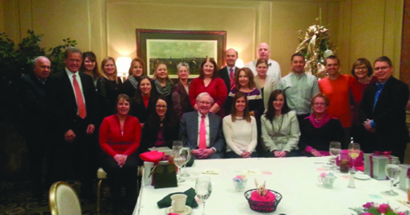

# 巴菲特2013年度致股东信 完整中文译稿

## 伯克希尔公司表现与标普500比较

| 年度 | 伯克希尔每股账面价值年度变动（1） | 标普500含股息年度变动（2） | 相对结果（1－2，百分点） |
| --- | --- | --- | --- |
| 1965 | 23.8% | 10.0% | 13.8 |
| 1966 | 20.3% | (11.7%) | 32.0 |
| 1967 | 11.0% | 30.9% | (19.9) |
| 1968 | 19.0% | 11.0% | 8.0 |
| 1969 | 16.2% | (8.4%) | 24.6 |
| 1970 | 12.0% | 3.9% | 8.1 |
| 1971 | 16.4% | 14.6% | 1.8 |
| 1972 | 21.7% | 18.9% | 2.8 |
| 1973 | 4.7% | (14.8%) | 19.5 |
| 1974 | 5.5% | (26.4%) | 31.9 |
| 1975 | 21.9% | 37.2% | (15.3) |
| 1976 | 59.3% | 23.6% | 35.7 |
| 1977 | 31.9% | (7.4%) | 39.3 |
| 1978 | 24.0% | 6.4% | 17.6 |
| 1979 | 35.7% | 18.2% | 17.5 |
| 1980 | 19.3% | 32.3% | (13.0) |
| 1981 | 31.4% | (5.0%) | 36.4 |
| 1982 | 40.0% | 21.4% | 18.6 |
| 1983 | 32.3% | 22.4% | 9.9 |
| 1984 | 13.6% | 6.1% | 7.5 |
| 1985 | 48.2% | 31.6% | 16.6 |
| 1986 | 26.1% | 18.6% | 7.5 |
| 1987 | 19.5% | 5.1% | 14.4 |
| 1988 | 20.1% | 16.6% | 3.5 |
| 1989 | 44.4% | 31.7% | 12.7 |
| 1990 | 7.4% | (3.1%) | 10.5 |
| 1991 | 39.6% | 30.5% | 9.1 |
| 1992 | 20.3% | 7.6% | 12.7 |
| 1993 | 14.3% | 10.1% | 4.2 |
| 1994 | 13.9% | 1.3% | 12.6 |
| 1995 | 43.1% | 37.6% | 5.5 |
| 1996 | 31.8% | 23.0% | 8.8 |
| 1997 | 34.1% | 33.4% | 0.7 |
| 1998 | 48.3% | 28.6% | 19.7 |
| 1999 | 0.5% | 21.0% | (20.5) |
| 2000 | 6.5% | (9.1%) | 15.6 |
| 2001 | (6.2%) | (11.9%) | 5.7 |
| 2002 | 10.0% | (22.1%) | 32.1 |
| 2003 | 21.0% | 28.7% | (7.7) |
| 2004 | 10.5% | 10.9% | (0.4) |
| 2005 | 6.4% | 4.9% | 1.5 |
| 2006 | 18.4% | 15.8% | 2.6 |
| 2007 | 11.0% | 5.5% | 5.5 |
| 2008 | (9.6%) | (37.0%) | 27.4 |
| 2009 | 19.8% | 26.5% | (6.7) |
| 2010 | 13.0% | 15.1% | (2.1) |
| 2011 | 4.6% | 2.1% | 2.5 |
| 2012 | 14.4% | 16.0% | (1.6) |
| 2013 | 18.2% | 32.4% | (14.2) |
| 1965—2013年年复合增长 | 19.7% | 9.8% | 9.9 |
| 1964—2013年累计增长 | 693,518% | 9,841% | — |

注：除以下情况，数据均按日历年：1965与1966年为截至9月30日的一年；1967年为截至12月31日的十五个月。

自1979年起，会计规则要求，保险公司持有的股票按市价计量，而非此前的成本与市价孰低。本表伯克希尔截至1978年的结果，已按新规则重列；其余方面，都使用原来报告的数字。

标普500为税前数字，伯克希尔为税后。若像伯克希尔这样的公司，只持有标普500并计提相应税款，指数正回报年份，会落后；指数负回报年份，则会领先。长久而言，税收成本会使累计落后相当显著。

伯克希尔·哈撒韦公司

致伯克希尔·哈撒韦公司的股东：

2013年，伯克希尔净资产增加342亿美元。这已扣除购买马蒙与伊斯卡少数股权所产生的18亿美元费用，后面会解释，它在经济上毫无意义。扣除后，A类股与B类股每股账面价值均增长18.2%。过去49年，也就是现任管理层接手以来，每股账面价值从19美元增至134,973美元，年复合增长率19.7%。*

对页列着长期使用的业绩尺度：伯克希尔每股账面价值年度变动，与标普500市场表现比较。当然，真正重要的是每股内在价值。但它是主观数字，账面价值可作粗略追踪指标。第103—108页《与所有者有关的经营原则》，详细讨论内在价值。原则列入年报已有30年，我们敦促新股东与潜在股东阅读。

长期以来，我一直告诉你们，内在价值远超账面价值，而且近年差距明显扩大。因此，2012年授权以账面价值120%回购，很有道理。每股内在价值显著超过这个比例，按此购买，会让继续持有的股东获益。不过，2013年没有回购，因为价格没跌到120%。真到了，我们会积极出手。

伯克希尔副董事长、我的搭档查理·芒格和我相信，市场下跌或温和上涨时，账面价值与内在价值都会超过标普；市场强劲时，则预期落后，2013年就是如此。49年中，十年落后，除一年外，都发生在标普上涨超过15%时。

2007年底到2013年底的整个股市周期，我们胜过标普。未来完整周期，预期仍能做到。如果不行，就没挣到工资。毕竟，你们随时可以买指数基金，确保得到标普结果。

## 伯克希尔这一年

经营方面，去年几乎事事顺利，有些极其顺利。容我逐一道来：

- 我们完成两项大型收购，花近180亿美元，全资买下NV Energy，并取得亨氏重大权益。两家都很适合我们，一个世纪后仍会兴旺。

收购亨氏，还创造了一种未来大型收购可用的合作模式。伙伴是3G Capital的投资者，由朋友若热·保罗·雷曼领导。能干的同事，亨氏新首席执行官贝尔纳多·希斯，以及董事长亚历克斯·贝林，负责经营。

*本报告所有每股数字均适用于伯克希尔A类股，B类股相应数字为A类股的1/1500。

伯克希尔是出资伙伴。我们购买80亿美元亨氏优先股，票面股息率9%，还有其他特点，应使年度回报达到约12%。另外，伯克希尔与3G各花42.5亿美元，买下亨氏普通股一半。

虽有些像“私募股权”交易，却有关键不同：伯克希尔从不打算卖一股，反而想多买，而且可能实现。3G某些投资者未来可能卖部分或全部，届时我们可以增持。未来某时，双方也可能认为，以适当的当时股权估值，把部分优先股换普通股，互相有利。

合作企业6月取得亨氏控制权，迄今经营结果令人鼓舞。但本年报告利润里，亨氏贡献很少，因为购买及随后重组，一次性费用合计13亿美元。2014年利润会很可观。

算上亨氏，我们如今拥有八家半若独立存在就能进《财富》500强的公司。只剩491家半了。

公用事业子公司中美能源，以56亿美元买下NV Energy，向内华达州约88%人口供电。这项收购很适合现有电力业务，也带来许多可再生能源大规模投资机会。它不会是中美能源最后一项大型收购。

- 中美能源是“五台强力发动机”之一，这批大型非保险企业，2013年合计税前利润创纪录，达108亿美元，比2012年多7.58亿美元。其余四家是BNSF、伊斯卡、路博润和马蒙。

九年前，五家之中我们只拥有中美能源，当时税前赚3.93亿美元。此后另外三家全用现金买下；第五家BNSF，约70%成本用现金，其余发行股票，使流通股数增6.1%。换句话说，九年间，五家每年给伯克希尔增加104亿美元利润，只伴随少量稀释。符合我们的目标：不仅增长，更要增加每股结果。

如果2014年美国经济继续改善，可以预期五家利润也提高，也许税前增加约10亿美元。

- 数十家较小非保险企业，去年税前赚47亿美元，2012年39亿美元，2014年也预期再进步。

- 庞大的保险业务，2013年又承保盈利，连续11年，还增加了浮存金。11年间，这些不属于我们、却能供伯克希尔投资获利的资金，从410亿美元增至770亿美元；同时，累计税前承保利润220亿美元，包括2013年的30亿美元。一切，始于1967年以860万美元购买国民赔偿。

如今，我们拥有多种非凡保险业务。最知名的GEICO，1995年底全资收购，更早多年已持有部分。1996年，全美汽车保险商排第七，如今刚超过好事达，名列第二。惊人增长，理由简单：低价与可靠服务。拨打1-800-847-7536或访问Geico.com，看看能否降低保险成本，帮自己一个忙。省下的钱，买点伯克希尔其他产品。

- 查理和我找大象时，众多子公司经常作补充收购。去年签约25项，预计总成本31亿美元，单笔从190万美元到11亿美元。

我们鼓励这些交易，把资本投入与现有业务相配、由专家经理经营的活动。结果是我们不用多干活，你们多赚利润。未来还会有许多，合计将十分重要。

- 去年，35亿美元投在最有把握的补充收购：增持两家已经控制的优秀企业。马蒙的购买，让持股达到2008年约定的100%；伊斯卡方面，韦特海默家族行使出售选择权，把2006年控制权收购时留下的20%，卖给我们。

购买使当前税前盈利能力增加约3亿美元，还带来8亿美元现金。同时，去年信中所说同一条荒唐会计规则，要求按比实付款低18亿美元入账，从而减少账面价值。费用记入“超过面值的资本”，你们琢磨一下吧。这项古怪会计，立即使伯克希尔内在价值超过账面价值的差额，也增加同样18亿美元。

- 子公司厂房设备支出创纪录，达110亿美元，约为折旧两倍，约89%花在美国。虽也海外投资，机会的主矿脉仍在美国。

- 多数股票经理都觉得无法胜过标普500的一年，托德·康布斯和特德·韦施勒却轻松做到。如今，每人管理超过70亿美元，他们配得上。

我又得承认，他们投资表现超过我，查理说应该加“多得多”。这种羞辱性比较再继续，我只好不再谈他们。

除了组合活动，托德和特德还在几件事上，为你们创造重大价值。贡献才刚开始，两人血管里都流着伯克希尔的血。

- 年底含亨氏，员工总数创纪录，达330,745人，比上年多42,283人。必须承认，奥马哈总部也增加一人。别慌，大家仍能舒舒服服待在一层楼。

- “四大”投资，美国运通、可口可乐、IBM与富国银行，持股比例全部提高。增持使富国银行从2012年底8.7%升至9.2%，IBM从6.0%升至6.3%；回购让可口可乐从8.9%升至9.1%，美国运通从13.7%升至14.2%。如果觉得零点几个百分点不重要，想想：合计而言，四家权益每增加0.1个百分点，就使伯克希尔应占年度利润多5,000万美元。

四家公司业务优秀，经理既有才干，又为股东着想。相比全资拥有平平企业，我们更喜欢不控股、但大量持有优秀企业。拥有希望钻石的一部分，比整颗水钻强。

按年底持仓，应占四家公司2013年利润为44亿美元，但报告利润只包括收到的股息，去年约14亿美元。请别误会，没报告的30亿美元，和入账的一样有价值。

四家留存利润，常用于回购自身股票，扩大我们对未来利润的份额，也为通常有利的经营机会融资。因此，我们预期，每股利润会随时间显著增长。若如此，伯克希尔收到股息会增加；更重要的，未实现资本利得也增加，年底四家已合计390亿美元。

资本配置灵活，愿把大笔资金被动投在不控制的企业，让我们比那些只愿收购自己能经营企业的公司有显著优势。伍迪·艾伦概括过：“双性恋的优势，是让星期六晚上约会的机会翻倍。”类似地，经营企业和被动投资，我们都吃得下，就让源源喷出的现金，找到合理用途的机会翻倍。

* * *

2009年底，大衰退阴霾中，我们同意收购BNSF，是伯克希尔史上最大购买。我当时称之为“对美国经济未来的全押”。

这种承诺，不是新事。自1965年巴菲特合伙企业取得控制权，就一直作类似下注，理由充分。查理和我始终认为，押美国繁荣持续增长，几乎是稳操胜券。

过去237年，谁曾靠看空美国获益？把今天与1776年比较，你简直要揉眼睛惊叹。市场经济内在活力，会继续创造魔力。美国最好的日子仍在前头。

顺风相助，查理和我希望，通过五种方式增加每股内在价值：（1）不断改善子公司基本盈利能力；（2）补充收购，进一步增加利润；（3）受益于被投资公司成长；（4）股价显著低于内在价值时回购；（5）偶尔作大型收购。也会尽可能少发行伯克希尔股票，最好不发行，来最大化你们的结果。

这些积木，立在坚如磐石的基础上。一世纪后，BNSF和中美能源仍是经济重要角色。企业与个人始终需要保险，没有公司能带来比伯克希尔更多的人才与财力。

另外，始终维持最强财务实力，至少持有200亿美元现金等价物，绝不承担重大短期义务。看到这些及其他优势，查理和我喜欢你们公司的前景，觉得受托管理，非常幸运。

## 企业内在价值

虽然查理和我经常谈企业内在价值，却不能精确告诉你们，伯克希尔股票，乃至任何股票，这个数字究竟多少。不过，2010年年报提出三项关键因素，其中一项定性，帮助合理估值，全文转载在第109—110页。

更新两项数量指标：2013年，每股投资额增13.6%，至129,253美元；保险与投资以外业务的每股税前利润，增12.8%，至9,116美元。

1970年以来，每股投资额年复合增19.3%，利润增20.6%。43年间，股价以与两项价值尺度非常相近的速度上升，并非巧合。查理和我喜欢两端都进步，但最侧重的，仍是增加经营利润。

* * *

现在，看看四个主要板块。资产负债表与利润特点彼此迥异，因此会当成四门独立生意介绍，查理和我也是这样看的，虽然放在同一屋檐下，有重要而持久的优势。目标是提供这样的信息：如果位置对调，你们报告经营，我们当不管事的股东，自己希望知道什么。不过，别动什么念头！

## 保险

“我们对保险公司的投资，是努力建立更多样盈利基础的第一个重大步骤。”

——1967年年报

先看保险。它是核心业务，自1967年报告以来，一直是推动扩张的发动机。

财产及意外伤害保险公司先收保费，后付赔款。极端情形，例如特定工伤事故，付款可能延续几十年。这种“现在收钱、以后付款”的模式，让财险公司握着大量最终须付给别人的资金，称为“浮存金”。期间，保险商可以拿去投资，为自身获利。虽然单张保单与索赔来来去去，相对于保费规模，浮存金通常相当稳定。所以，业务增长，浮存金也增长。看下表，我们增长可真不少：

| 年度 | 浮存金，百万美元 |
| :--- | ---: |
| 1970 | 39 |
| 1980 | 237 |
| 1990 | 1,632 |
| 2000 | 27,871 |
| 2010 | 65,832 |
| 2013 | 77,240 |

进一步增长不容易。好的一面，GEICO几乎肯定增加；但国民赔偿再保险部门，有一些逐步退出的合约，浮存金缓缓减少。如果未来某时下降，会非常渐进，一年最多不超过3%。合约性质决定，我们绝不可能被立即要求支付相对于现金资源而言很大的金额。这方面，财险与某些寿险有重要区别。

保费超过全部费用与最终赔款，就有承保利润，再加上浮存金投资收益。如此，我们不仅免费用钱，更好的是，还拿钱替人保管。

不幸的是，保险商全想这样，竞争激烈到多数年份，整个财险行业都大额承保亏损。这实际上是行业持有浮存金的成本。例如，全美遥遥领先的最大保险商、而且经营良好的州立农场保险，截至2012年的12年，九年承保亏损，写信时最新财务数据只到2012年。竞争态势几乎保证，即使都享有浮存金收益，保险业相对于其他行业，仍会延续低于正常水平的惨淡回报。

前面说过，我们连续11年承保盈利，累计税前220亿美元。我相信，未来多数年份继续如此。所有保险经理每天都专注于此，知道浮存金虽宝贵，糟糕承保却能把它淹没。

浮存金怎样影响内在价值？计算账面价值时，全额当负债扣除，仿佛明天就得付出，而且无法补充。但完全只当负债，是错误的，应该看作循环资金。每天赔付旧索赔，2013年向超过500万索赔人付约170亿美元，使浮存金减少；每天又承接新业务，产生新赔偿责任，增加浮存金。如果循环资金无成本、又长存，我相信会如此，其真实负债价值就大幅低于会计负债。

与这个高估负债相对应的，是账面作为资产列示、属于保险企业的155亿美元“商誉”。很大程度上，代表我们为产生浮存金的能力支付的价格。但商誉成本与真实价值无关。例如，长期大额承保亏损的企业，账面商誉不论成本多少，都应视为毫无价值。

幸好，伯克希尔不是如此。查理和我相信，真实经济商誉，也就是我们愿为拥有同样质量浮存金的保险企业支付的价格，远高于历史账面值。浮存金价值，是内在价值显著超过账面价值的一个原因，而且是极大的原因。

* * *

诱人的保险经济特性，只因为有出色经理，经营着有纪律、商业模式强大而难以复制的企业。下面介绍主要单位。

按浮存金规模居首，是阿吉特·贾恩管理的伯克希尔·哈撒韦再保险集团。他承保别人不愿、或没有资本承接的风险，把承保能力、速度、决断，尤其头脑，独一无二地结合。但绝不让伯克希尔承担相对于资源不适当的风险。事实上，回避风险这方面，比多数大型保险商保守得多。例如，某次超级巨灾若使行业损失2,500亿美元，约为以往任何一次三倍，凭众多利润来源，伯克希尔整体很可能当年仍取得可观利润，现金也充盈。若灾难震动市场，我们还能寻找大机会。同时，其他大型保险商、再保险商都会严重亏损，有些无力偿付。

1985年从零起步，阿吉特创造出一家370亿美元浮存金、累计承保利润巨大的企业，没有其他保险首席执行官接近。他的脑子是点子工厂，总在寻找能加入现有组合的新业务。

去年6月，一个新项目成真：成立伯克希尔·哈撒韦特种保险，简称BHSI，进入商业保险。美国大型保险经纪商和企业风险经理，立即接纳。他们知道，其他保险商没有谁能匹敌伯克希尔财务实力，确保多年以后出现的有效索赔，及时、足额支付。

BHSI由彼得·伊斯特伍德领导。他承保经验丰富，广受尊重，组建了一支出色团队，已经与许多《财富》500强及较小公司，承接大量业务。几年内将有数十亿美元业务量，会是重要资产。年会遇见彼得，请给他一个伯克希尔式欢迎。

* * *

另一家再保险劲旅，是塔德·蒙特罗斯管理的通用再保险。

归根结底，健全保险经营，需要四项纪律：（1）理解可能造成保单损失的全部风险暴露；（2）保守评估每项风险造成损失的概率及可能成本；（3）确定的保费，覆盖预期赔款与经营费用后，平均而言仍盈利；（4）得不到适当保费时，愿意转身离开。

许多保险商前三项过关，第四项却不及格，就是不能拒绝竞争者抢着承接的业务。“别人干，所以我们也得干”，在任何行业都意味着麻烦，保险业尤其如此。

塔德遵守全部四条戒律，结果说明一切。他领导下，巨额浮存金不仅无成本，还带来承保利润，预期平均而言会持续。我们尤其喜欢国际寿险再保险，自1998年收购以来，持续而有利润地成长。

还记得刚收购不久，问题接踵而来，评论家，连我也短暂认为，犯了巨大错误。那时已远去，如今通用再保险是一块宝石。

* * *

最后是GEICO，63年前我从它开始摸索保险。托尼·奈斯利管理，18岁加入，2013年服务满52年。1993年出任首席执行官，此后公司一路高飞。

1951年1月初识GEICO，巨大的成本优势让我震撼，费用远低于行业巨头。效率保持至今，是最重要的资产。没人喜欢买车险，却几乎人人喜欢开车；必要保险，是多数家庭重大支出。省钱重要，只有低成本经营才能提供。

成本优势，让它年复一年吞食市场份额。低成本构成持久护城河，竞争者过不来。同时，小壁虎继续告诉美国人，GEICO能省可观的钱。最新经营成本下降，让故事更有说服力。

1995年，我们买下尚未持有的另一半GEICO，支付价比所取得有形净资产多14亿美元。这就是“商誉”，会永远原样留在账上。但业务成长，真实经济商誉也增长，我认为已接近200亿美元。

* * *

三大保险业务以外，还有一批小公司，多数在保险世界特殊角落做生意。合起来不断增长，持续承保盈利，而且如下表，也提供可观浮存金。查理和我珍视这些公司及其经理。

| 保险业务 | 2013年承保利润 | 2012年承保利润 | 2013年底浮存金 | 2012年底浮存金 |
| :--- | ---: | ---: | ---: | ---: |
| 伯克希尔再保险 | 1,294 | 304 | 37,231 | 34,821 |
| 通用再保险 | 283 | 355 | 20,013 | 20,128 |
| GEICO | 1,127 | 680 | 12,566 | 11,578 |
| 其他直接保险 | 385 | 286 | 7,430 | 6,598 |
| 合计 | 3,089 | 1,625 | 77,240 | 73,125 |

单位：百万美元。

* * *

简单说，保险是卖承诺。客户现在付款，保险商答应，如果特定事件发生，将来付钱。

有时，承诺几十年才受检验，比如20多岁买的寿险。所以，即使付款时经济混乱，保险商的支付能力和意愿，都至关重要。

伯克希尔的承诺无可匹敌。近年，全球最大、最精明保险商的行动，证实这一点。有些想摆脱巨额、期限极长的负债，尤其石棉索赔，也就是向再保险商“分出”责任。但选错人，未来财务吃紧或不守信用，责任就可能回到原保险商怀里。

寻求帮助的大型保险商，几乎无一例外都来伯克希尔。最大一项交易，是2007年劳合社，把1993年以前保单产生的数以万计已知索赔，加上同一时期以后肯定出现、数量未知却极大的索赔，一并交给我们。没错，几十年后，仍会收到针对1993年前事件的索赔。

最终要付多少，今天不知道。但确定的是，150亿美元保单上限内，全部有效索赔都会支付。没有其他保险商的承诺，能给劳合社同等安心。当时处理其索赔的实体首席执行官，说得最好：“Names，也就是劳合社原承保人，想晚上睡得安稳，我想我们刚替他们买下了全世界最好的床垫。”

* * *

出色经理、顶级财务实力，以及多种拥有宽护城河的商业模式，组合成保险世界独一无二的东西。这是股东巨大资产，而且只会越来越有价值。

## 受监管、资本密集型企业

“公用事业虽有许多监管限制，我们仍可能增加投入。若如此，金额可能很大。”

——1999年年报

BNSF与中美能源两大业务，有重要共同特征，与其他企业不同。所以，本信单列一节，也在GAAP资产负债表、利润表中，分别列示合计数据。

关键之一，是在寿命很长的受监管资产上投入巨资，部分资金来自不由伯克希尔担保的大额长期债务。实际不需要我们的信用，因为即使经济极差，盈利能力也远超利息需求。例如，去年BNSF利息保障倍数为9倍。我们定义为税前利润除以利息，不是普遍使用、却认为缺陷严重的EBITDA除以利息。

中美能源有两项因素，确保任何情况下都能偿债。第一，所有公用事业都有：独家提供必要服务，带来抗衰退利润。第二，其他很少有：利润来源高度多样，不会被单一监管机构严重伤害。NV Energy又拓宽盈利基础。这份实力，加上伯克希尔持有，使中美能源及其公用事业子公司，能明显降低债务成本，我们和客户都受益。

每天，两家子公司大力推动经济：

- BNSF按吨英里承担约15%的全部城际货物，不论货物走卡车、铁路、水路、航空或管线。货运吨英里超过任何其他承运者，是经济循环系统最重要的动脉，2013年第一地位进一步加强。

像所有铁路一样，BNSF极其节能环保，一加仑柴油把一吨货送约500英里。同样任务，卡车吞掉的燃油约四倍。

- 中美能源在11州服务受监管零售客户，没有公用事业公司覆盖更广。另外，也是可再生能源龙头，九年前从零起步，如今占全美风电装机7%，还会增加。太阳能份额更大，其中大部分仍在建设。

能这样投资，是因为保留全部利润。少有人知：去年留存利润金额，远超美国任何其他电力公用事业。我们与监管者都视为重要优势，五年、十年、二十年后，几乎肯定依然存在。

现有项目完成时，可再生能源组合成本150亿美元。只要预期合理回报，我们乐于承诺，而这方面，对未来监管抱有很大信任。

信心来自经验，也来自认识：社会永远需要在交通和能源上巨额投资。确保资金持续流向必要项目，善待资本提供者，符合政府自身利益；以赢得监管者及其代表公众认可的方式经营，也符合我们自身利益。

去年，客户满意度调查覆盖52家控股公司及101家电力经营企业，我们以行动证明尽责。中美能源集团排第一，95.3%受访者给“非常满意”，没有一个给“不满意”。顺便说，垫底成绩只有惨淡的34.5%。

三家公司被收购前，排名都远低得多。扩张时，这种非凡满意度极重要。希望进入州的监管者，知道我们负责任，很乐意迎来我们。

铁路同样勤于预见客户需求。关于美国基础设施破败，无论听到什么，都不适用于BNSF或整个铁路业。巨额投资，使系统从未更好。但我们不停歇，2013年BNSF投40亿美元，是折旧两倍，也创铁路单年纪录，2014年还会多得多。就像诺亚早早预见需要可靠交通，我们知道，提前规划是职责。

两家资本密集企业，由中美能源格雷格·阿贝尔，以及BNSF马特·罗斯、卡尔·艾斯团队领导。三位非凡经理，值得我和你们感谢。主要数字如下：

### 中美能源（持股89.8%）

| 项目 | 2013年 | 2012年 | 2011年 |
| :--- | ---: | ---: | ---: |
| 英国公用事业利润 | 362 | 429 | 469 |
| 爱荷华州公用事业利润 | 230 | 236 | 279 |
| 西部公用事业利润 | 982 | 737 | 771 |
| 管线利润 | 385 | 383 | 388 |
| HomeServices利润 | 139 | 82 | 39 |
| 其他净额 | 4 | 91 | 36 |
| 公司层面利息及税前营业利润 | 2,102 | 1,958 | 1,982 |
| 利息 | 296 | 314 | 336 |
| 所得税 | 170 | 172 | 315 |
| 净利润 | 1,636 | 1,472 | 1,331 |
| 伯克希尔应占收益 | 1,470 | 1,323 | 1,204 |

单位：百万美元。利息与税按原表列为正数费用。

### BNSF

| 项目 | 2013年 | 2012年 | 2011年 |
| :--- | ---: | ---: | ---: |
| 收入 | 22,014 | 20,835 | 19,548 |
| 营业费用 | 15,357 | 14,835 | 14,247 |
| 利息及税前营业利润 | 6,657 | 6,000 | 5,301 |
| 净利息 | 729 | 623 | 560 |
| 所得税 | 2,135 | 2,005 | 1,769 |
| 净利润 | 3,793 | 3,372 | 2,972 |

单位：百万美元。

罗恩·佩尔蒂埃继续建设中美能源的地产经纪子公司HomeServices。去年四项收购，最重要的是费城Fox & Roach，全美最大的单一市场房地产经纪商。

如今经纪人22,114名，比2012年多38%，第112页按地区列出。另持Prudential与Real Living特许业务67%，正逐步将加盟商改名Berkshire Hathaway HomeServices。如果还没见到，许多人很快会在“出售”牌上看见我们的名字。

## 制造、服务与零售业务

“看那家店，”沃伦指着内布拉斯加家具卖场说，“真是门好生意。”

“为什么不买？”我问。

“私人持有。”沃伦说。

“哦。”我说。

“也许还是会买，”沃伦说，“总有一天。”

——亚当·斯密《超级金钱》（1972年）

本板块五花八门、无所不包。不过，先看合计简要资产负债表和利润表。

### 2013年12月31日资产负债表

| 资产 | 金额 | 负债与权益 | 金额 |
| :--- | ---: | :--- | ---: |
| 现金及现金等价物 | 6,625 | 应付票据 | 1,615 |
| 应收账款及票据 | 7,749 | 其他流动负债 | 8,965 |
| 存货 | 9,945 | 流动负债合计 | 10,580 |
| 其他流动资产 | 716 | 递延税款 | 5,184 |
| 流动资产合计 | 25,035 | — | — |
| 商誉及其他无形资产 | 25,617 | 长期债务及其他负债 | 4,405 |
| 固定资产 | 19,389 | 非控制性权益 | 456 |
| 其他资产 | 4,274 | 伯克希尔权益 | 53,690 |
| 资产合计 | 74,315 | 负债与权益合计 | 74,315 |

单位：百万美元。左右项目分别排列，“—”为空白占位，不代表零。

### 利润表

| 项目 | 2013年 | 2012年 | 2011年 |
| :--- | ---: | ---: | ---: |
| 收入 | 95,291 | 83,255 | 72,406 |
| 营业费用 | 88,414 | 76,978 | 67,239 |
| 利息费用 | 135 | 146 | 130 |
| 税前利润 | 6,742 | 6,131 | 5,037 |
| 所得税及非控制性权益 | 2,512 | 2,432 | 1,998 |
| 净利润 | 4,230 | 3,699 | 3,039 |

单位：百万美元。

GAAP收入与费用见第29页。上表营业费用则为非GAAP，剔除部分购买会计项目，主要是某些无形资产摊销。因为查理和我认为，调整数字比GAAP，更准确反映这些企业真实经济费用与利润。

所有调整不一一解释，有些微小晦涩。但认真投资者应理解，无形资产性质迥异：有些确实逐渐耗尽，有些完全不减值。例如，软件摊销是真实费用；客户关系等其他无形资产摊销，却由购买会计规则产生，显然不是真实成本。GAAP不作区分，都计作费用，但投资者眼中，两者差别不能再大。

第29页GAAP数字，把本节公司6.48亿美元摊销当费用扣除。我们认为约20%真实，其余不是。许多收购使差异重大，今后买更多，几乎肯定还会增加。

当然，相关资产摊完，不真实费用最终消失。但通常要15年，唉，到时受惠的报告利润，属于继任者。

不过，我们报告的每一分钱折旧，都是真实成本，几乎所有其他公司也如此。华尔街鼓吹EBITDA估值时，请扣紧钱包。

公开利润当然继续符合GAAP。但要把握现实，记得把多数摊销加回。

* * *

本板块产品，从棒棒糖到喷气式飞机都有。有些以无杠杆有形净资产利润衡量，经济特性极佳，税后回报25%至远超100%；另一些有12%—20%良好回报。少数很差，是我资本配置严重错误。不是被误导，是自己判断企业或行业经济动态时错了。

幸好，失误通常是相对小的收购。大买卖总体成功，有几项不只成功而已。但购买企业或股票，我还没犯完最后一个错，事情不会全按计划。

合起来，是门优秀生意。2013年平均使用250亿美元有形净资产，现金过剩很多、杠杆很少，却在这个资本基础上取得16.7%税后回报。

当然，价格过高，优秀企业也会是糟糕投资。多数业务，我们支付远超有形净资产，成本体现在大笔商誉中。不过总体资本回报不错，内在价值也明显超过账面。即便如此，保险和受监管板块差距更大，真正大赢家在那里。

* * *

企业太多，没法逐一评论。还有，现有与潜在竞争者都读年报，有几项业务，如果知道数字，会使我们不利。所以，对评估伯克希尔不算重大的一些单位，只披露必要信息。不过，第80—84页仍有许多详细资料。

不过，我忍不住要更新内布拉斯加家具卖场进军得克萨斯的情况。不是因为经济上对伯克希尔多重要，一家新店，撼不动2,250亿美元权益基础。但与出色的布卢姆金家族合作30年，如今看它在达拉斯都会区北部The Colony，建一座真正得克萨斯尺度的非凡商店，我很兴奋。

明年完成时，433英亩地块上，同一屋顶下，零售与配套仓库合计180万平方英尺，可在www.nfm.com/texas看进度。卖场已拥有全国销量最高的两家家居店，奥马哈与堪萨斯州堪萨斯城，每家年销约4.5亿美元。我预言，得克萨斯店会把纪录远远甩开。住达拉斯附近，来看看。

想起1983年8月30日，我生日，带着自己拟的一页又四分之一收购提议，去见B太太，也就是罗斯·布卢姆金。提议转载在第114—115页。她一字不改接受，交易没有投行或律师参与，简直天堂般。报表虽未审计，我不担心；B太太告诉我情况，她的话就够。

当时89岁，干到103岁，绝对是我喜欢的女士。看看第116—117页1946年报表。如今一切，来自当年72,264美元净资产和50美元现金，没少写零，以及B太太、儿子路易、孙子罗恩与欧文不可思议的才干。

点睛之处，是B太太一天学也没上过，从俄罗斯移民时，英语一字不会。但热爱新祖国，应她要求，家族聚会总唱《上帝保佑美国》。

有志经营的人，该仔细学习，造就成功的朴素而罕见品质。每年40所大学学生来访，我让他们先去卖场；学会B太太那一课，就不需要我的课了。

## 金融与金融产品

“克莱顿贷款组合，不用太多年，很可能至少达到50亿美元；只要信用标准合理，应该贡献可观利润。”

——2003年年报

这个最小板块，包括挂车租赁XTRA、家具租赁CORT，以及全美领先的工厂预制住宅生产与融资商克莱顿住宅。全资子公司以外，还有一批金融资产，及Berkadia Commercial Mortgage的50%权益。

克莱顿列在此，因为拥有并服务326,569笔按揭，合计136亿美元。近年工厂预制住宅销量暴跌，利润很大比例来自按揭。

但2013年，新房销售开始回升，制造与零售利润，又逐渐重要。克莱顿仍是美国第一大住宅建造商，29,547套，占全国独栋新住宅约4.7%。凯文·克莱顿带领公司熬过严重住宅萧条，干得漂亮。如今工作肯定有趣多了，也可展望2014年利润再增长。

CORT和XTRA也各为行业龙头，杰夫·佩德森与比尔·弗兰茨会保持领先。我们购买设备、扩大出租能力，支持他们的计划。

税前利润汇总如下：

| 项目 | 2013年 | 2012年 | 2011年 |
| :--- | ---: | ---: | ---: |
| Berkadia | 80 | 35 | 25 |
| 克莱顿 | 416 | 255 | 154 |
| CORT | 40 | 42 | 29 |
| XTRA | 125 | 106 | 126 |
| 金融净收益* | 324 | 410 | 440 |
| 合计 | 985 | 848 | 774 |

单位：百万美元。

*不包括资本利得或损失。

## 投资

“股票组合……市值比账面价值，即成本，约低1,700万美元……我们相信，经过若干年，整体组合将证明价值高于成本。”

——1974年年报

下表列出年底市值最大的十五项普通股投资：

| 股数** | 公司 | 持有公司比例（%） | 成本* | 2013年12月31日市值 |
| ---: | :--- | ---: | ---: | ---: |
| 151,610,700 | 美国运通 | 14.2 | 1,287 | 13,756 |
| 400,000,000 | 可口可乐 | 9.1 | 1,299 | 16,524 |
| 22,238,900 | DIRECTV | 4.2 | 1,017 | 1,536 |
| 41,129,643 | 埃克森美孚 | 0.9 | 3,737 | 4,162 |
| 13,062,594 | 高盛集团 | 2.8 | 750 | 2,315 |
| 68,121,984 | 国际商业机器公司（IBM） | 6.3 | 11,681 | 12,778 |
| 24,669,778 | 穆迪 | 11.5 | 248 | 1,936 |
| 20,060,390 | 慕尼黑再保险 | 11.2 | 2,990 | 4,415 |
| 20,668,118 | Phillips 66 | 3.4 | 660 | 1,594 |
| 52,477,678 | 宝洁 | 1.9 | 336 | 4,272 |
| 22,169,930 | 赛诺菲 | 1.7 | 1,747 | 2,354 |
| 301,046,076 | 乐购（Tesco） | 3.7 | 1,699 | 1,666 |
| 96,117,069 | 合众银行（U.S. Bancorp） | 5.3 | 3,002 | 3,883 |
| 56,805,984 | 沃尔玛 | 1.8 | 2,976 | 4,470 |
| 483,470,853 | 富国银行 | 9.2 | 11,871 | 21,950 |
| — | 其他 | — | 11,281 | 19,894 |
| — | 按市值列示的普通股合计 | — | 56,581 | 117,505 |

成本与市值单位：百万美元。“—”为空白占位。

*为实际购买价，也是计税基础；少数情况下，按GAAP规定调增或调减，“成本”有所不同。

**不包括伯克希尔子公司养老金持股。

一项重大股权头寸不在表中：2021年9月以前，可随时以50亿美元，购买美国银行7亿股，年底市值109亿美元。很可能到选择权临近到期才买。目前，要认识到，它实际上是第五大股票投资，我们很看重。

股票以外，还投大量债券，通常不错，但不总是。

多数人没听过Energy Future Holdings，算你们幸运，我真希望自己也没听过。2007年成立，目的是杠杆收购得克萨斯电力资产。权益所有者投入80亿美元，另借巨资。伯克希尔买了约20亿美元债，我决定，没问查理。大错。

除非天然气价暴涨，EFH几乎肯定2014年申请破产。去年以2.59亿美元卖出，持有期间收8.37亿美元现金利息，合计税前损失8.73亿美元。下次我会给查理打电话。

少数子公司，主要电力与天然气，经营中用衍生品。除此，已有几年没订新合约，现有头寸继续到期退出。到期合约带来巨大利润，以及数十亿美元中期浮存金。没有保证，但预期剩余也有类似结果。

## 关于投资的一些想法

“投资越像经营企业，就越明智。”

——本杰明·格雷厄姆《聪明的投资者》

以本的引语开场很合适，投资知识许多拜他所赐。后面多谈本，更早会谈普通股。不过，先讲很久前两项小型非股票投资。虽未大幅改变净资产，却有启发。

故事始于内布拉斯加。1973—1981年，中西部农地价格暴涨，大家相信恶性通胀将来，乡村小银行放贷又推波助澜。然后泡沫破，价格跌至少50%，重创借钱的农民与贷款银行。事后爱荷华、内布拉斯加倒闭银行数，是最近大衰退的五倍。

1986年，我从联邦存款保险公司，买下奥马哈以北50英里一座400英亩农场，28万美元，远低于几年前一家倒闭银行以此抵押所贷金额。我不懂种地，但有个爱种地的儿子，从他那儿知道玉米、大豆能产多少蒲式耳，经营费多少，估算当时正常回报约10%。还认为生产率与农价会逐渐提高，两项预期后来都实现。

不用特殊知识或智慧，就能得出：投资没什么下行损失，潜在上行却可观。当然，偶尔歉收，价格有时失望，那又怎样？也会有特别好年份，而且从不用被迫卖地。28年后，利润为原来三倍，价值至少是买价五倍。我仍不懂种地，最近才第二次到农场。

1993年，又作一项小投资。拉里·西尔弗斯坦，是我当所罗门首席执行官时公司的房东，告诉我，重组信托公司RTC正出售一处纽约大学旁的零售物业。又是泡沫破，这次商业地产；RTC就是为处置倒闭储蓄机构资产而设，它们乐观放贷，助长荒唐。

分析仍简单。像农场，当前无杠杆收益率约10%。但RTC管理不足，几间空店租出，收入就增加。更重要的，最大租户占约20%面积，每平方英尺租金约5美元，其他租户平均70美元。九年后廉价租约到期，肯定大增利润。地段也极好，纽约大学不会搬走。

我加入拉里及朋友弗雷德·罗斯等小群体，买下物业。弗雷德是经验丰富、品格一流的地产投资者，与家人负责管理，果然管得漂亮。旧约到期，利润增至三倍。如今年度分配超过最初权益投资35%。此外，1996与1999年两次再融资，带来合计超过原投入150%的几次特别分配。我至今还没去看过。

未来几十年，农场与大学旁地产的收入，大概还会增加。虽不会惊人，却会是我一生，以及随后子孙们扎实、令人满意的资产。

讲这些，为说明几项投资基本原则：

- 不必是专家，也能取得满意回报。但不是专家，就必须认识局限，采取肯定能相当有效的方法。保持简单，别每球都冲着全垒打。谁许诺快速赚钱，就迅速回答“不”。

- 关注所考察资产未来的生产力。如果不能有把握粗估未来利润，就忘掉，去看别的。没人能评估所有可能，但不需要无所不知，只需理解自己做的事。

- 如果关注的是未来价格变化，你就在投机，并无不当。但我知道自己不能成功投机，也怀疑那些声称能持续成功的人。抛硬币，一半人第一轮获胜，继续玩却没有盈利期望。某资产最近涨过，绝不是买入理由。

- 两项小投资，我只想会产出什么，完全不在意每日估价。比赛由关注赛场的球员赢得，不是死盯记分牌的人。若周六周日不看股价也过得开心，工作日也试试。

- 形成宏观观点，或听别人宏观、市场预测，浪费时间，甚至危险，会模糊真正重要事实。听电视评论员流利预测下一步，总让我想起米奇·曼托的讽刺：“坐进转播间以后，你才知道这比赛有多容易。”

- 两项购买在1986年与1993年。紧接的1987年、1994年，经济、利率或股市怎样，作决定时完全不重要。我不记得当时头条和评论家说什么。无论闲谈如何，内布拉斯加玉米照长，学生照样涌向纽约大学。

小投资与股票，有个重大不同：股票每分钟给估价，农场和纽约地产，我还从没见报价。

持仓被赋予剧烈波动的估值，对股票投资者本该是巨大优势，有些人确实如此。想想，一个喜怒无常的邻居，每天喊个价，愿买我的农场或卖自己的，随精神状态短期大幅变化，我怎么可能不从中获益？低得荒唐、有闲钱，就买他的；高得荒唐，可以卖，也可以继续种地。

但股票所有者，太常让其他所有者反复无常、不理性的行为，使自己也不理性。市场、经济、利率、股价，议论如此多，有些人认为必须听专家，更坏的是，还得考虑照他们的话行动。

拥有农场或公寓楼，能安静坐几十年的人，看到连续股价，加上评论员暗示“别干坐着，做点什么”，就变得狂躁。流动性本应是纯粹好处，对他们却成诅咒。

“闪崩”或其他极端波动，对投资者的伤害，不会超过古怪多嘴邻居对农场投资的伤害。事实上，价格远离价值、手头有现金时，跌市能帮助真正投资者。恐惧气氛是朋友，兴奋狂热是敌人。

2008年底非凡恐慌中，严重衰退明显酝酿，我却从没想卖农场或纽约地产。如果全资拥有长期前景良好的扎实企业，连考虑抛弃都愚蠢。那为何要卖那些代表优秀企业一小份权益的股票？某一家最终可能失望，但整体肯定做得好。真有人相信，美国不可思议的生产资产和无限人类创造力，会被大地吞掉？

* * *

查理和我买股票，把它看成企业小部分，分析与买整家相似。先判断，能否合理估计五年或更久以后的盈利范围。能，就在相对于估计下限合理的价，买股票或企业。不能估计，而通常如此，就看别的。合作54年，从未因宏观、政治环境或别人观点，放弃有吸引力的购买。事实上，决定时根本不提这些。

不过，认识“能力圈”边界，远远留在里面，至关重要。即便如此，股票和企业也会犯错；但不会像长期上涨引诱人按预计价格走势、为凑热闹买入那样，造成灾难。

当然，多数人一生并没优先研究企业前景。明智的话，会承认对具体企业了解不够，无法预测未来盈利能力。

给非专业人士一个好消息：普通投资者不需要这种能力。美国企业整体，长期极出色，还会继续，当然过程必然是不可预测的走走停停。20世纪，道指66升至11,497，还付日增股息；21世纪会有进一步增长，几乎肯定相当可观。目标不该是挑赢家，自己和“帮手”都做不到，而是拥有一批横跨企业的权益，整体必定会好。低成本标普500指数基金，能实现。

这是投资“什么”，“什么时候”也重要。主要危险，是胆小或新手在极度狂热时入市，纸面亏损后幻灭。记住已故巴顿·比格斯：“牛市像性爱，快结束前感觉最好。”解药，是长期逐步积累股份，坏消息、股价远低于高点时，绝不卖。遵守这些，“什么也不懂”却分散持有、成本极低的人，几乎肯定取得满意结果。事实上，诚实面对不足的普通投资者，长期很可能优于知识丰富、却连一个弱点也不愿看见的专业人士。

如果“投资者”狂躁地互相买卖农地，作物产量和价格都不会增加，唯一后果，是寻求建议、转换资产的巨额成本，降低全体农场所有者利润。

然而，靠建议或交易赚钱的人，会不断敦促个人和机构活跃。摩擦成本可能巨大，对投资者整体却无益。所以，忽略喧嚣，成本降至最低，像买农场一样买股票。

还要说，我的钱也站在嘴巴这边。这里建议，与遗嘱某些指示基本相同。一项遗赠规定，把现金交给受托人，为妻子利益管理。个人遗赠必须用现金，因为遗产清理结束后的十年内，全部伯克希尔股票，将全数分给若干慈善组织。给受托人的建议，再简单不过：10%现金投短期国债，90%投极低成本标普500指数基金，我建议先锋。我相信，长期会胜过多数聘高收费经理的投资者，不论养老基金、机构还是个人。

* * *

现在回到本·格雷厄姆。这里谈的大部分想法，来自1949年买的《聪明的投资者》，买下时，我的财务人生改变了。

此前，我在投资领域四处游荡，凡相关文字都吞读。许多很迷人，试画图、用市场指标预测走势，坐券商办公室看行情纸带，听评论。很好玩，却摆不脱毫无进展的感觉。

本却用优雅、易懂的文字，逻辑清楚地解释，没有希腊字母或复杂公式。关键在后版标为第8章和第20章，1949初版编号不同。今天，仍指导我的决定。

关于书，还有两件趣事。后版附言，描述一项未具名、让本大赚的投资。1948年写初版时买下，准备好了吗，神秘公司正是GEICO！如果他没在幼年认出独特品质，我和伯克希尔未来会大不相同。

1949年版还推荐一只铁路股，售价17美元，每股赚约10美元。我钦佩本，原因之一是敢用当下例子，失手就可能被嘲笑。低估的部分原因，是当时会计规则要求，报告利润不得包含关联企业的大量留存利润。

推荐的是北太平洋，最重要关联企业是芝加哥、伯灵顿与昆西。这些铁路，如今是BNSF重要部分，伯克希尔全资拥有。读书时，北太平洋市值约4,000万美元，如今后继者，当然增加了许多资产，每四天就赚这个数。

第一本书多少钱，我不记得。无论多少，都印证本那句：价格是付出的，价值是得到的。所有投资里，买这本书最好，除了两次购买结婚证。

* * *

州及地方财务问题加速恶化，很大程度因为公共机构承诺了负担不起的养老金。公民和官员通常低估：承诺与筹资意愿不配时，生出的巨大财务绦虫。不幸，养老金数学，今天对多数美国人仍是谜。

投资政策也重要。1975年，我给当时华盛顿邮报董事长凯瑟琳·格雷厄姆写备忘录，谈承诺陷阱与投资政策重要性，转载在第118—136页。

未来十年，你会读到许多公共养老金坏消息，希望备忘录能帮助理解，问题存在时，及时补救有多必要。

## 股东大会

大会定于5月3日星期六，CenturyLink中心，能干的总调度卡丽·索瓦负责，总部全员协助。比专业策划干得更好，而且，没错，还省钱。

早上7点开门，7点30分第三届国际投报挑战，克莱顿住宅门廊为目标，距线精确35英尺。少年扔约50万份，所以自认不差。来挑战，谁比我更靠门槛，就请一支Dilly Bar。报纸36—42页，自己折，不准橡皮筋。

8点30分新电影，一小时后问答，中间在中心餐饮摊位买午餐、休息，到下午3点30分结束。短暂休息后，查理和我3点45分召开正式股东大会。要在问答期间离开，请选查理说话时。

当然，离场最好的理由是购物。我们会在会场旁194,300平方英尺的展厅里，摆满几十家子公司的产品，助你一臂之力。去年，你们尽了力，多数展位都创下销售纪录。九个小时，卖出1,062双Justin靴子，平均每32秒一双；12,792磅喜诗糖果；11,162把Quikut刀具，每分钟21把；以及6,344双始终抢手的Wells Lamont手套。今年，查理和我还会出售相互竞争的番茄酱瓶。当然，印有查理照片的那一款，会大打折扣。不过，有你们帮忙，我的瓶子销量一定能超过他的。这事很重要，别让我失望。

跑鞋企业Brooks还将在大会推出特别纪念鞋。买一双，第二天穿着参加第二届“伯克希尔5公里跑”吧。比赛早上8点从CenturyLink中心出发，门票附带的访客指南，会列出全部参加细节。跑在你身旁的，将有许多伯克希尔经理、董事和同事。

GEICO在购物区设展位，由全国各地赶来的多位资深顾问坐镇。去询个价。多数情况下，能给股东通常8%的折扣；51个经营司法辖区中，有44个允许这项特别优惠。补充一点，如果已符合其他折扣，例如某些团体优惠，就不能叠加。带上现有保单的详细资料，看看能否省钱。我相信，至少一半人可以。

一定去逛Bookworm。约35种书籍和DVD，其中有几本新作。一本是马克斯·奥尔森编的伯克希尔股东信，追溯至1965年。索引列出人物、公司及主题所在页码，我觉得特别有用。还推荐儿子霍华德的《Forty Chances》，你们会喜欢。

如果你出手阔绰，或者志在成为那种人，星期六中午至下午5点，请去奥马哈机场东侧的Signature Flight Support。我们会展示一支NetJets机队，保证让你心跳加速。坐巴士来，坐私人飞机走。潇洒一点。

随报告附上的委托投票材料里，有附件说明如何取得大会及其他活动的入场证。航空公司有时为伯克希尔周末抬高票价。如果从远方来，不妨比较飞堪萨斯城和奥马哈的费用。两城车程约两个半小时，飞前者可能省不少钱，尤其本来就在奥马哈租车的人。省下的钱，花给我们。

内布拉斯加家具卖场，在第72街Dodge街与Pacific街之间，占地77英亩，今年仍有“伯克希尔周末”优惠。去年，大会前后一周，店里做了4,020万美元生意，比原纪录高12%；星期六还创下820万美元单日纪录，光床垫就卖了近100万美元。

要享折扣，须在4月29日星期二至5月5日星期一购物，首尾两天都包括，并出示大会入场证。优惠甚至适用于几家知名厂商的产品，它们平时严禁折扣，这次为股东周末专门破例。感谢它们配合。卖场周一至周六上午10点至晚上9点营业，星期日上午10点至下午6点。星期六下午5点30分至晚上8点，还将举行野餐会，欢迎大家参加。

波仙珠宝仍有两场股东专享活动。第一场是5月2日星期五晚上6点至9点的鸡尾酒会；第二场主要庆典，定于5月4日星期日上午9点至下午4点。星期六营业到下午6点。近年，三天销量远超整个12月，而12月通常是珠宝商最好的月份。

星期日下午1点15分左右，我会在波仙珠宝开始当店员。喜欢哪件商品，就向我要“疯狂沃伦”报价。年纪越大，我的定价越离谱。来占我的便宜吧。

整个周末，波仙珠宝都会人潮汹涌。为方便大家，股东优惠价从4月28日星期一持续至5月10日星期六。请出示大会入场证，或能证明持有伯克希尔股票的券商对账单，以表明股东身份。

星期日，在珠宝店外商场，两届美国国际象棋冠军帕特里克·沃尔夫会蒙上双眼，每组六人，接受所有挑战者对弈，挑战者倒能把眼睛睁得大大的。附近，达拉斯的出色魔术师诺曼·贝克，会让观众摸不着头脑。两位世界顶尖桥牌专家鲍勃·哈曼和莎伦·奥斯伯格，也将在星期日下午与股东打牌。别跟他们赌钱。

朋友邢延华星期日也会在商场，接受乒乓球挑战。去年，她的奥运表现，让美国人，尤其是我，感到自豪。

认识延华时，她才九岁，那时我就从她手上拿不到一分。如今，她是普林斯顿大一学生、美国女子冠军。如果不怕丢脸，下午1点起，试试自己的本事吧。比尔·盖茨和我会先上，试着先消磨她一下。

5月4日星期日，Gorat’s与Piccolo’s再次只招待伯克希尔股东。两家都营业至晚上10点，前者下午1点开门，后者下午4点。这是我最爱的两家餐厅，星期日晚餐，我两家都吃。记住：预订Gorat’s，请4月1日致电402-551-3733，别提前；预订Piccolo’s，请致电402-342-9038。在后者，甜点要巨型沙士冰淇淋漂浮饮料，只有胆小鬼才点小号。

我们将再次邀请同样三位财经记者参与问答，向查理和我提出股东邮件提交的问题。他们及其邮箱是：《财富》的卡萝尔·卢米斯，cloomis@fortunemail.com；CNBC的贝姬·奎克，BerkshireQuestions@cnbc.com；《纽约时报》的安德鲁·罗斯·索尔金，arsorkin@nytimes.com。

每位记者会选择自己认为最有趣、最重要的六个问题。他们告诉我，写得简洁、别拖到最后一刻、与伯克希尔有关，而且每封邮件最多两问，入选机会最大。邮件里请说明，如果问题入选，是否希望提及你的名字。

另外，还有三位研究伯克希尔的分析师。今年保险专家是巴克莱的杰伊·盖尔布；Ruane, Cunniff & Goldfarb的乔纳森·布兰特，将提出非保险业务的问题。

我们还会再次邀请一位有资历的伯克希尔空头。欢迎实际做空股票的人报名，请附上头寸证据。三位分析师会带来各自的伯克希尔问题，与记者和观众交替提问。

查理和我认为，所有股东都应同时得到新信息，也有充分时间分析。所以，我们力求星期五晚些时候或星期六一早披露财务信息，并把大会放在星期六。我们不与大型机构投资者或分析师一对一交谈，而对所有股东一视同仁。希望记者和分析师的问题，帮助所有者进一步理解自己的投资。

查理和我事先连一丁点问题线索都不会得到。我们知道，记者和分析师会出难题，而我们就喜欢这样。总计预期至少54问，每位分析师和记者各六问，观众18问。如有余时，再多接现场问题。观众提问者，由早上8点15分，在主会场及主要分流会场15个麦克风前举行的抽签确定。

* * *

我经常赞扬经营经理的成就，这完全有道理。他们是真正的全明星，把企业当作家族唯一资产来经营。我相信，在大型上市公司中，他们的股东立场已是最鲜明的一类。多数人没有为钱工作的需要，打出商业“全垒打”的喜悦，与工资同样重要。

同样重要的，还有总部与我共事的24位男女同事。他们高效处理大量证券交易委员会及其他监管要求，申报23,000页联邦所得税表，以及州和外国税表，回复无数股东及媒体询问，出版年报，筹备全国最大的年度股东大会，协调董事会活动，清单还可以继续列下去。

他们愉快地完成全部事务，效率高得不可思议，让我的生活轻松愉悦。而且，工作远不止伯克希尔事务：去年，200所申请大学中选出的40所，派学生来奥马哈，与我共度问答一天，他们负责接洽。他们还处理各种请求、安排旅行，甚至替我买午餐汉堡和薯条，当然，淋满番茄酱。没有哪个首席执行官比我更享福，我真的每天都想跳着踢踏舞去上班。

最后，我觉得，该打破“不拍照片”的政策，让你们看看非凡的总部团队了。下面是圣诞午餐合照，两人没能来，除此以外，所有总部工作人员都在。他们真是创造奇迹的人。

明年的信，将回顾伯克希尔50年，并稍稍畅想未来50年。在此之前，5月3日来奥马哈，享受我们的“资本家的伍德斯托克音乐节”吧。

2014年2月28日

沃伦·E.巴菲特
董事会主席

伯克希尔式的实力派午餐
