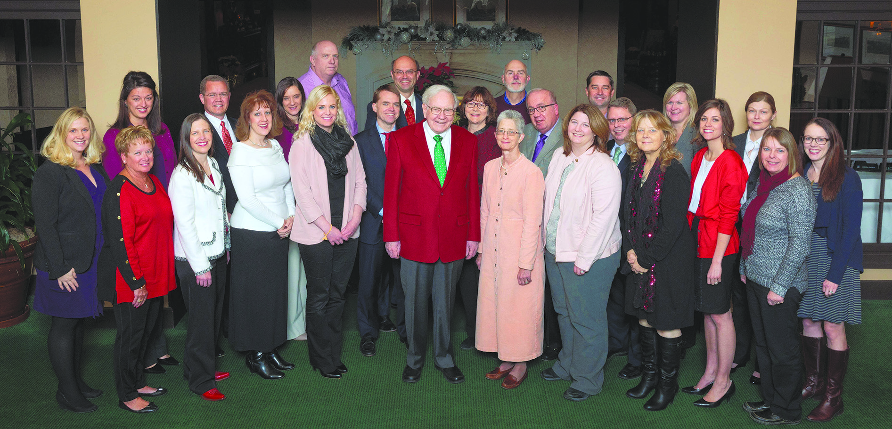
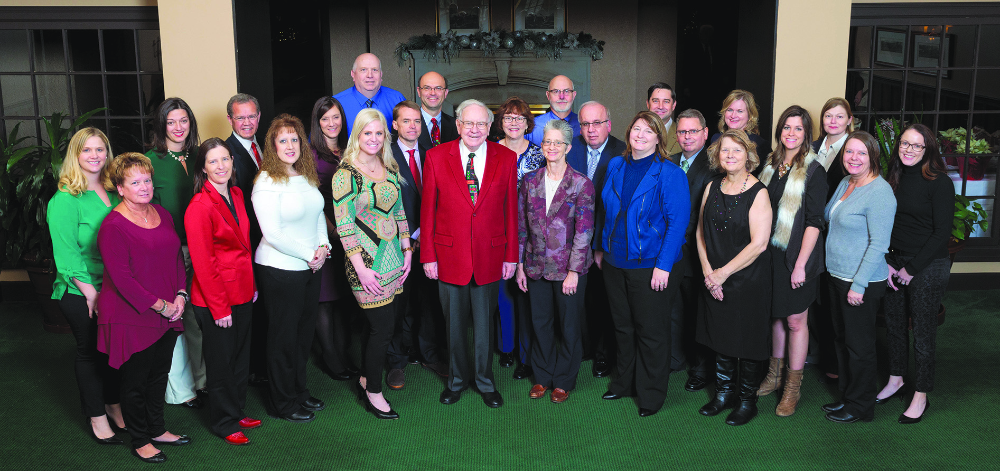

# 巴菲特2015年度致股东信 完整中文译稿

## 伯克希尔公司表现与标普500比较

| 年度 | 伯克希尔每股账面价值年度变动 | 伯克希尔每股市值年度变动 | 标普500含股息年度变动 |
| --- | --- | --- | --- |
| 1965 | 23.8% | 49.5% | 10.0% |
| 1966 | 20.3% | (3.4%) | (11.7%) |
| 1967 | 11.0% | 13.3% | 30.9% |
| 1968 | 19.0% | 77.8% | 11.0% |
| 1969 | 16.2% | 19.4% | (8.4%) |
| 1970 | 12.0% | (4.6%) | 3.9% |
| 1971 | 16.4% | 80.5% | 14.6% |
| 1972 | 21.7% | 8.1% | 18.9% |
| 1973 | 4.7% | (2.5%) | (14.8%) |
| 1974 | 5.5% | (48.7%) | (26.4%) |
| 1975 | 21.9% | 2.5% | 37.2% |
| 1976 | 59.3% | 129.3% | 23.6% |
| 1977 | 31.9% | 46.8% | (7.4%) |
| 1978 | 24.0% | 14.5% | 6.4% |
| 1979 | 35.7% | 102.5% | 18.2% |
| 1980 | 19.3% | 32.8% | 32.3% |
| 1981 | 31.4% | 31.8% | (5.0%) |
| 1982 | 40.0% | 38.4% | 21.4% |
| 1983 | 32.3% | 69.0% | 22.4% |
| 1984 | 13.6% | (2.7%) | 6.1% |
| 1985 | 48.2% | 93.7% | 31.6% |
| 1986 | 26.1% | 14.2% | 18.6% |
| 1987 | 19.5% | 4.6% | 5.1% |
| 1988 | 20.1% | 59.3% | 16.6% |
| 1989 | 44.4% | 84.6% | 31.7% |
| 1990 | 7.4% | (23.1%) | (3.1%) |
| 1991 | 39.6% | 35.6% | 30.5% |
| 1992 | 20.3% | 29.8% | 7.6% |
| 1993 | 14.3% | 38.9% | 10.1% |
| 1994 | 13.9% | 25.0% | 1.3% |
| 1995 | 43.1% | 57.4% | 37.6% |
| 1996 | 31.8% | 6.2% | 23.0% |
| 1997 | 34.1% | 34.9% | 33.4% |
| 1998 | 48.3% | 52.2% | 28.6% |
| 1999 | 0.5% | (19.9%) | 21.0% |
| 2000 | 6.5% | 26.6% | (9.1%) |
| 2001 | (6.2%) | 6.5% | (11.9%) |
| 2002 | 10.0% | (3.8%) | (22.1%) |
| 2003 | 21.0% | 15.8% | 28.7% |
| 2004 | 10.5% | 4.3% | 10.9% |
| 2005 | 6.4% | 0.8% | 4.9% |
| 2006 | 18.4% | 24.1% | 15.8% |
| 2007 | 11.0% | 28.7% | 5.5% |
| 2008 | (9.6%) | (31.8%) | (37.0%) |
| 2009 | 19.8% | 2.7% | 26.5% |
| 2010 | 13.0% | 21.4% | 15.1% |
| 2011 | 4.6% | (4.7%) | 2.1% |
| 2012 | 14.4% | 16.8% | 16.0% |
| 2013 | 18.2% | 32.7% | 32.4% |
| 2014 | 8.3% | 27.0% | 13.7% |
| 2015 | 6.4% | (12.5%) | 1.4% |
| 1965—2015年年复合增长 | 19.2% | 20.8% | 9.7% |
| 1964—2015年累计增长 | 798,981% | 1,598,284% | 11,355% |

注：除以下情况外，数据均按日历年列示：1965 年和 1966 年，为截至 9 月 30 日的一年；1967 年，为截至 12 月 31 日的十五个月。

自 1979 年起，会计规则要求保险公司持有的股票按市价计量，而不是像以前那样按成本与市价孰低计量。本表中，伯克希尔截至 1978 年的业绩，已经重列，以符合变更后的规则。其他所有方面，均使用最初报告的数字计算。

标普 500 的数字是税前的，伯克希尔的数字则是税后的。如果像伯克希尔这样的公司，只持有标普 500，并计提相应税款，那么，在指数回报为正的年份，它的业绩会落后于指数；在指数回报为负的年份，则会优于指数。经过多年，税收成本会使累计落后幅度相当可观。

## 伯克希尔·哈撒韦公司

致伯克希尔·哈撒韦公司的股东：

2015 年，伯克希尔的净资产增加了 154 亿美元，A 类股和 B 类股的每股账面价值均增长 6.4%。过去 51 年，也就是现任管理层接手以来，每股账面价值从 19 美元增至 155,501 美元，年复合增长率为 19.2%。*

在这 51 年的前半段，伯克希尔的净资产，大致相当于那个真正重要的数字：企业的内在价值。当时两者之所以接近，是因为我们的大部分资源都投在有价证券中，而这些证券会定期按市场报价重新估值，再扣除假如出售时需要缴纳的税款。用华尔街的话来说，当时我们的资产负债表，在很大程度上是“按市价计量”的。

然而，到了 20 世纪 90 年代初，我们的重心转向了直接拥有企业，这个转变削弱了资产负债表数字的参考意义。两者之所以脱节，是因为适用于受控公司的会计规则，与用于给有价证券估值的规则，有着重大差别。我们持有的“输家”，账面价值会被减记；“赢家”却永远不会向上重估。

这两种结果，我们都经历过：我做过一些愚蠢的收购，为那些公司的经济商誉支付的金额，后来被核销，使伯克希尔的账面价值下降。我们也有一些赢家，其中几家还是大赢家，但却没有把它们的账面价值上调过一分钱。

随着时间推移，这种不对称的会计处理——我们赞同这种处理——必然会扩大内在价值与账面价值的差距。如今，“赢家”身上那些未入账、而且不断增加的巨额增值，清楚表明，伯克希尔的内在价值远远超过账面价值。因此，如果我们的股票售价低至账面价值的 120%，我们会非常乐于回购。在这个价位买入，将立即而且显著地提高继续持有股份的伯克希尔股东所享有的每股内在价值。

我们拥有的企业，那些未入账的价值增长，解释了为什么对页表中伯克希尔累计市值的增幅，显著超过账面价值的增幅。短期内，这两个指标的变化会很不规则。例如，去年账面价值的表现更好。不过，随着时间推移，市值增长应当会继续延续历史上的趋势，超过账面价值增长。

*本报告所有每股数字均适用于伯克希尔 A 类股。B 类股的相应数字，为所列 A 类股数字的 1/1500。

## 伯克希尔这一年

伯克希尔副董事长、我的合伙人查理·芒格和我，预期伯克希尔的正常盈利能力每年都会增强。（当然，实际年度利润有时会下降，原因可能是美国经济疲弱，也可能是保险业遭遇特大灾难。）有些年份，正常盈利能力的增幅会较小；另一些年份，则会相当可观。去年是个好年，亮点如下：

- 2015 年，伯克希尔最重要的进展，不在财务方面，虽然它确实带来了更好的利润。继 2014 年表现不佳之后，我们的 BNSF 铁路，去年大幅改善了客户服务。为了取得这个结果，我们全年投入了约 58 亿美元资本支出，远远刷新了美国任何铁路公司的纪录，也接近我们年度折旧费用的三倍。这钱花得值。

  按有收入的吨英里衡量，美国城际货运中约有 17% 由 BNSF 承运；这里的全部运输方式，包括铁路、卡车、航空、水路和管线。在这方面，我们在美国七家大型铁路公司中稳居第一，其中两家总部在加拿大；我们承运的货物吨英里数，比最接近的竞争对手高出 45%。因此，保持一流服务，不仅对货主的利益至关重要，对美国经济顺畅运转也很重要。

  对大多数美国铁路公司来说，2015 年令人失望：总吨英里数下降，利润也走弱。不过，BNSF 保住了运量，税前利润上升至创纪录的 68 亿美元*，比 2014 年增加 6.06 亿美元。BNSF 的管理者马特·罗斯和卡尔·艾斯，得到了我的感谢，也值得你们感谢。

- BNSF 是我们“五台强力发动机”中最大的一家，其他四家是伯克希尔·哈撒韦能源、马蒙、路博润和 IMC。这五家盈利最多的非保险企业，2015 年合计赚取了 131 亿美元，比 2014 年增加 6.5 亿美元。

  2003 年，这五家公司中，我们只拥有当时利润为 3.93 亿美元的伯克希尔·哈撒韦能源。后来，其他四家中有三家，我们用全现金买入。不过，收购 BNSF 时，我们支付的成本约 70% 是现金，其余部分则发行伯克希尔股票，使流通股数增加 6.1%。换句话说，这十二年间，五家公司为伯克希尔带来的年度利润增加了 127 亿美元，而伴随的股权稀释却很小。这符合我们的目标：不只增加利润，还要确保每股业绩也随之增加。

- 明年，我将讨论“六台强力发动机”。新成员将是精密铸件公司，简称 PCC；一个月前，我们以超过 320 亿美元的现金，买下了这家企业。PCC 完全符合伯克希尔的模式，将大幅增强我们正常情况下的每股盈利能力。

  在首席执行官马克·多尼根的领导下，PCC 已成为全球首屈一指的航空航天零部件供应商；其产品大多用于原始设备，不过备件对公司也很重要。马克的成就，让我想起我们出色的以色列切削工具制造商 IMC 的雅各布·哈帕兹，经常施展的魔法。这两个人，都把极普通的原材料，变成世界各地大型制造商使用的非凡产品。他们各自都是本行的达·芬奇。

  PCC 的产品，是大多数大型飞机的关键零部件，往往通过多年期合同交付。公司也服务于其他行业，其 30,466 名员工，在 13 个国家的 162 家工厂工作。发展企业的过程中，马克已经完成许多收购，以后还会继续。我们期待他运用伯克希尔的资本。

*本信中，除另有说明外，利润均为税前。

这里要特别感谢一个人：若没有我们自己的托德·库姆斯提供意见和帮助，PCC 这笔收购就不会发生。几年前，是他让我注意到这家公司，此后又让我了解这门生意，以及马克这个人。托德和特德·韦施勒的主要工作虽然是投资管理——他们各自为我们管理约 90 亿美元——但他们也乐于以其他方式，为伯克希尔创造重大价值，而且干得十分出色。聘用这两个人，是我最明智的决定之一。

- 收购 PCC 后，伯克希尔将拥有十又四分之一家这样的公司：假如独立经营，就能进入《财富》500 强。（我们持有卡夫亨氏 27% 的股份，算那四分之一家。）如此一来，美国商界巨头中，还有将近 98% 没给我们打过电话。接线员正等着呢。

- 我们数十家规模较小的非保险企业，去年赚了 57 亿美元，高于 2014 年的 51 亿美元。其中，一家去年利润超过 7 亿美元，两家在 4 亿至 7 亿美元之间，七家在 2.5 亿至 4 亿美元之间，六家在 1 亿至 2.5 亿美元之间，十一家在 5,000 万至 1 亿美元之间。我们每一家都爱：随着岁月推移，这些企业的数量和利润都会增长。

- 听到有人谈论美国基础设施破败时，你们尽可放心，他们说的不是伯克希尔。去年，我们在房产、厂房和设备上投资 160 亿美元，其中整整 86% 投在美国。

  前面，我已介绍了 BNSF 在 2015 年创纪录的资本支出。每年年底，我们铁路的实物设施，都会比十二个月前更好。

  伯克希尔·哈撒韦能源（BHE）的情况也一样。公司已在可再生能源上投资 160 亿美元，如今拥有全国风力发电能力的 7%、太阳能发电能力的 6%。事实上，我们受监管公用事业拥有并运营的风电容量为 4,423 兆瓦，是排名第二的公用事业公司的六倍。

  我们还没有做完。去年，为支持巴黎气候变化大会，BHE 对今后的可再生能源开发作出了重大承诺。兑现这些承诺，无论对环境，还是对伯克希尔的经济效益，都很有意义。

- 伯克希尔庞大且不断增长的保险业务，2015 年再次实现承保盈利——已连续 13 年如此——浮存金也有所增加。这些年，我们的浮存金，也就是不属于我们、却可以由我们投资并为伯克希尔谋利的资金，从 410 亿美元增至 880 亿美元。浮存金的增加及其规模本身，都不体现在伯克希尔的利润中；但它让我们得以持有资产，从而产生可观的投资收益。

  与此同时，这 13 年的承保利润累计为 260 亿美元，其中包括 2015 年的 18 亿美元。毫无疑问，伯克希尔最大的一笔未入账财富，就藏在保险业务里。我们花了 48 年建立这项多层面的业务，它无法被复制。

- 查理和我寻找新的收购企业时，我们的众多子公司也在经常进行补强式收购。去年，我们签约了 29 项，预计总成本为 6.34 亿美元，单笔金额从 30 万美元至 1.43 亿美元不等。

  只要价格合理，查理和我就鼓励这类收购。（送到我们面前的大多数交易，价格绝对不合理。）这些收购，把资本投入与现有企业相契合的业务，并由我们那些经验丰富的经理人负责经营。这意味着我们不必多干活，伯克希尔却能多赚利润；这样的组合，我们十分喜欢。今后几年，我们还会完成许多、许多这样的补强式收购。

- 我们与若热·保罗·雷曼、亚历克斯·贝林及贝尔纳多·希斯合作的亨氏，去年通过与卡夫合并，规模扩大了一倍以上。交易前，我们持有亨氏约 53% 的股份，成本为 42.5 亿美元。如今，我们持有卡夫亨氏 3.254 亿股，约占 27%，成本为 98 亿美元。新公司的年销售额为 270 亿美元，能给你供应亨氏番茄酱或芥末酱，搭配来自卡夫一方的奥斯卡·迈耶热狗。再来一杯可口可乐，你就能享受到我最喜欢的一餐。（我们会把奥斯卡·迈耶热狗车开到股东大会——带上孩子们吧。）

  虽然我们一股卡夫亨氏股票也没卖，但“GAAP”，也就是一般公认会计原则，要求我们在合并完成时，把这项投资的账面价值上调 68 亿美元。结果，我们资产负债表上卡夫亨氏的账面价值，比实际成本高出数十亿美元，却又比市值低了数十亿美元。这样的结果，只有会计师才会喜欢。

  伯克希尔还持有卡夫亨氏优先股，每年收取 7.2 亿美元，资产负债表上的账面金额为 77 亿美元。这项持仓几乎肯定会在 6 月，以 83.2 亿美元赎回；按优先股条款，那是允许赎回的最早时间。这对卡夫亨氏是好消息，对伯克希尔却是坏消息。

  若热·保罗及其伙伴，再没有比他们更好的合伙人了。我们有着共同的热情：购买、建设并长期持有满足人们基本需要与愿望的大型企业。不过，为实现这个目标，我们走的路有所不同。

  他们的方法，是购买那些有机会削减许多不必要成本的公司，然后迅速采取行动，把事情办成。在这方面，他们极其成功。他们的行动显著提高了生产率，而生产率正是过去 240 年美国经济增长中至关重要的因素。如果每个工时不能产出更多人们想要的商品和服务——这就是生产率提高的衡量标准——经济就必然停滞。美国许多企业都有可能真正大幅提高生产率，这一事实，为若热·保罗及其伙伴提供了机会。

  在伯克希尔，我们同样渴求效率、厌恶官僚主义。不过，我们实现目标的办法，更着重于从一开始就避免臃肿：购买像 PCC 这样的企业，它们长期以来就是由注重成本、讲求效率的经理人经营的。收购之后，我们的角色只是创造一种环境，让这些首席执行官，以及日后接替他们、通常也志趣相同的继任者，能够充分发挥管理效能，并尽情享受工作带来的乐趣。（采用这种放手的方式，我遵循的是一句著名的芒格箴言：“如果你想确保自己一辈子痛苦，就一定要抱着改变对方行为的打算，与那个人结婚。”）

  伯克希尔将继续实行极端分权，程度之高，确实几乎闻所未闻。不过，我们也会寻找与若热·保罗合作的机会：可以是融资伙伴，就像他的集团收购 Tim Hortons 时那样；也可以同时提供股权资本和融资，就像在亨氏那样。偶尔，我们也可能与其他人合作，如同此前在 Berkadia 成功做过的那样。

  然而，伯克希尔只会与进行友好收购的伙伴联手。诚然，某些敌意收购有其道理：有些首席执行官忘了，自己应当为股东工作；另一些经理人则无能得令人遗憾。在这两种情况下，董事可能看不见问题，或者只是不愿作出必要的改变。这时，就需要新面孔。不过，这些“机会”，我们会留给别人。在伯克希尔，我们只去欢迎我们的地方。

- 去年，伯克希尔在“四大”投资——美国运通、可口可乐、IBM 和富国银行——中的持股比例，全部提高了。我们增持了 IBM，使持股比例从 2014 年底的 7.8% 升至 8.4%；也增持了富国银行，使比例从 9.4% 升至 9.8%。在另外两家公司，可口可乐和美国运通，股份回购提高了我们的持股比例。可口可乐从 9.2% 升至 9.3%，美国运通则从 14.8% 升至 15.6%。如果你觉得这些看起来微小的变化不重要，请算一算：对这四家公司合计而言，我们的持股比例每提高一个百分点，伯克希尔应占的年度利润，就增加约 5 亿美元。

  这四家被投资企业的业务都很优秀，管理者既有才干，又把股东放在心上。它们的有形净资产回报率，从优秀到惊人不等。在伯克希尔，我们更愿意不掌握控制权、却持有一家优秀公司的相当大部分，而不是百分之百拥有一家平平的企业。拥有希望钻石的一部分，总比拥有整颗水钻好。

  以伯克希尔年底持股为基准，我们应占“四大”2015 年的利润为 47 亿美元。不过，在向你们报告的利润中，我们只计入它们支付给我们的股息，去年约为 18 亿美元。但千万别误会：这些公司中我们没有报告的近 30 亿美元利润，对我们的价值，与伯克希尔已经入账的那部分丝毫不差。

  被投资企业留存的利润，常被用来回购自家股票；这样，我们不必掏出一分钱，就能提高伯克希尔在未来利润中所占的份额。这些公司的留存利润，也为经营机会提供资金，而这些机会通常会带来好结果。因此，我们预计，从整体看，这四家被投资企业的每股利润，将随时间推移而显著增长。如果增长确实实现，伯克希尔收到的股息就会增加，我们的未实现资本利得也会增加。

  我们在资本配置上的灵活性——愿意把大笔资金被动地投到不受我们控制的企业——使我们相对于那些把选择局限于收购自己能够经营的企业的公司，拥有显著优势。伍迪·艾伦曾解释，双性恋的好处，是星期六晚上找到约会对象的机会增加了一倍。类似地——好吧，也不完全类似——经营企业和被动投资，我们都乐于接受，这就使我们为伯克希尔源源不绝涌出的现金寻找合理用途时，机会增加了一倍。此外，持有庞大的有价证券组合，也使我们储备了一大笔可以随时调用的资金；一旦有人送来大象级的收购机会，就能派上用场。

* * *

今年是大选年，候选人没完没了地谈论国家的问题，而这些问题，当然只有他们自己能解决。由于这阵不断敲响的负面鼓点，如今许多美国人相信，孩子将来的生活不会像自己这样好。

这种看法完全错误：今天在美国出生的婴儿，是历史上最幸运的一代。

美国目前的人均 GDP 约为 56,000 美元。正如我去年提到的，按实际购买力衡量，这个数字是我出生的 1930 年的六倍，增幅惊人，远远超过我父母及其同代人最狂放的想象。今天的美国人，并不天生比以前更聪明，也不比 1930 年的美国人工作更辛苦。真正的差别，是工作效率高得多，因而产出也多得多。这股强大的趋势必将继续：美国经济的魔力，仍然生机勃勃。

有些评论家哀叹，目前实际 GDP 每年只增长 2%。没错，我们都希望增长率更高。不过，就用这个备受抱怨的 2%，来算一道简单的题吧。你会看到，这样的增长率，也能带来惊人的进步。

美国人口每年约增长 0.8%，其中出生减去死亡贡献 0.5%，净移民贡献 0.3%。因此，整体经济增长 2%，就带来约 1.2% 的人均增长。听上去也许不怎么惊人。不过，只需一代人的时间，比如 25 年，这个增长率就会使实际人均 GDP 增加 34.4%。（之所以超过直接用 25 乘以 1.2% 算出的结果，是因为复利的作用。）这 34.4% 的增幅，又意味着下一代的实际人均 GDP，将增加惊人的 19,000 美元。假如平均分配，一个四口之家的年度增量就是 76,000 美元。今天的政客，不必为明天的孩子流泪。

事实上，今天的大多数孩子，也过得很好。我所在的中上收入社区里，所有家庭日常享受的生活水平，都超过我出生时老约翰·D·洛克菲勒所能达到的水平。无论交通、娱乐、通信，还是医疗服务——这里只列几项——我们如今习以为常的东西，他那举世无双的财富也买不到。洛克菲勒当然拥有权力和名声，但他的生活，仍无法像今天我的邻居们这样好。

下一代能够分享的蛋糕，虽然会比今天大得多，但如何分配，仍会引发激烈争论。正如现在一样，新增商品和服务的产出，会引来各种争夺：在工作年龄的人与退休者之间，健康者与体弱者之间，继承财富的人与白手起家者之间，投资者与劳动者之间；尤其是那些才干受到市场高度重视的人，与同样正派、同样勤劳，却缺少市场所珍视技能的美国人之间。这样的冲突从来就有，也将永远存在。国会将是战场，金钱和选票将是武器。游说，还会继续成为一个增长行业。

不过，好消息是：即使身处“输家”一方的人，未来几乎肯定也会——而且理应——享有远比过去更多的商品和服务。他们所享受的这些更丰富的东西，质量也会大幅改善。要生产人们想要的东西，没有什么能与市场制度匹敌；而在提供那些人们尚不知道自己想要的东西方面，市场更是无人能及。我父母年轻时，无法想象电视机；我在五十多岁时，也不觉得自己需要一台个人电脑。然而，一旦人们看到它们能做什么，这两种产品很快就彻底改变了他们的生活。我如今每周花十个小时在网上打桥牌。写这封信时，“搜索”对我更是价值非凡。（不过，Tinder 我还没准备好。）

240 年来，看空美国一直是个大错，现在也不是开始这么做的时候。美国商业与创新这只下金蛋的鹅，会继续下出更多、更大的蛋。美国的社会保障承诺会得到履行，而且也许会变得更加慷慨。没错，美国孩子的生活，将远远好于父母。

* * *

有这样有利的顺风，伯克希尔——当然，还有许许多多其他企业——几乎肯定会繁荣发展。接替查理和我的经理人，将遵循我们简单的蓝图，提高伯克希尔每股内在价值：（1）不断增强众多子公司的基础盈利能力；（2）通过补强式收购，进一步增加它们的利润；（3）受益于被投资企业的成长；（4）在伯克希尔股价显著低于内在价值时回购股份；（5）偶尔完成一笔大型收购。管理层还会尽量少发行伯克希尔股票，最好根本不发行，以求为你们取得最佳结果。

## 企业内在价值

虽然查理和我经常谈论企业内在价值，但我们无法精确告诉你，伯克希尔股票的这个数字是多少；事实上，其他任何股票，我们也说不准。不过，作出合理估计是可能的。在 2010 年年报中，我们列出了我们认为估算伯克希尔内在价值的三个关键要素，其中一个是定性的。这段讨论完整转载于本年报第 113—114 页。

以下是两个定量要素的更新：2015 年，我们的每股现金和投资增加 8.3%，达到 159,794 美元，其中卡夫亨氏股票按市值计量；众多企业的利润——*包括保险承保收益*——增加 2.1%，达到每股 12,304 美元。在第二个要素中，我们剔除了所持投资带来的股息和利息，否则就会重复计算价值。计算这一利润数字时，我们扣除了全部公司总部费用、利息、折旧、摊销，以及少数股东权益。不过，没有扣除所得税。也就是说，这里的利润是税前利润。

上段之所以使用斜体，是因为我们首次把保险承保收益计入企业利润。最初介绍伯克希尔这两个定量估值支柱时，我们没有这样做，因为当时保险业绩很大程度上受巨灾保险影响。如果风不刮、地不摇，我们就赚大钱；但一场超级巨灾，就会带来赤字。因此，为了保守地列示企业利润，我们一直假设承保业务长期收支相抵，每年计算第二项价值要素时，既不计入承保收益，也不计入承保亏损。

如今，我们的保险业绩很可能比一二十年前更加稳定，因为我们降低了对巨灾保险的侧重，大幅扩张了日常基础业务。去年，在本节第二段所说的每股 12,304 美元利润中，承保收益贡献了 1,118 美元。过去十年，年度承保收益平均为每股 1,434 美元；我们预计，大多数年份都会盈利。不过，你们应当认识到，任何特定年份的承保业务，都完全可能亏损，甚至出现重大亏损。

自 1970 年以来，我们的每股投资以 18.9% 的年复合增长率增加，利润则以 23.7% 的速度增长；利润计算在起始年和终止年都包括了承保业绩。在随后的 45 年里，伯克希尔股价的增长率，与这两个价值指标的增长率十分接近，这并非巧合。查理和我希望这两方面都有进步，但我们的主要目标，是增加经营利润。

* * *

现在，让我们看看四大业务板块。各板块的资产负债表和收益特征，都与其他板块大不相同。因此，我们会把它们作为四项独立业务介绍；查理和我就是这样看待它们的，虽然把它们放在同一屋檐下，确实有重要而持久的经济优势。我们的目的，是提供这样的信息：假如你我换个位置，你们是报告经营情况的经理人，而我们是不参与经营的股东，我们希望得到什么信息，就提供什么信息。（别激动，我们并没有考虑这样换位子。）

## 保险

先看保险。自 1967 年我们以 860 万美元收购国民赔偿及其姊妹公司 National Fire & Marine 以来，保险业中的财产与意外险，一直是推动我们扩张的发动机。如今，按净资产衡量，国民赔偿已是全球最大的财产与意外险公司。而且，它的内在价值，远远超过我们账上的金额。

财产与意外险吸引我们的原因之一，是它的财务特征：保险公司先收保费，后付赔款。在极端情况下，例如某些工伤事故，赔付可能延续几十年。这种先收钱、后付款的模式，使财产与意外险公司手里持有大笔最终要付给别人的钱，我们称之为“浮存金”。在此期间，保险公司可以投资这笔钱，为自己谋利。虽然单份保单和单项索赔来来去去，但一家保险公司持有的浮存金，相对于保费规模，通常比较稳定。因此，随着业务增长，我们的浮存金也随之增长。看看下表，就知道我们长了多少：

| 年份 | 浮存金（百万美元） |
| :--- | ---: |
| 1970 | 39 |
| 1980 | 237 |
| 1990 | 1,632 |
| 2000 | 27,871 |
| 2010 | 65,832 |
| 2015 | 87,722 |

进一步增加浮存金，将很困难。有利的一面是，GEICO 和我们几项专业保险业务，几乎肯定会以不错的速度增长。不过，国民赔偿的再保险部门承接了若干处于逐步结清阶段的合同，这些合同的浮存金正在缓慢下降。如果将来浮存金确实下降，过程也会非常缓慢，任何一年的最大降幅都不会超过 3%。我们的保险合同具有这样的性质：绝不会出现立即或短期内就要求我们支付大笔资金、对现金资源构成重大影响的情况。这种结构是有意设计的，也是伯克希尔经济堡垒实力的关键组成部分。我们绝不会在这一点上让步。

如果保费超过各项费用与最终赔款之和，我们就会取得承保利润，进一步增加浮存金产生的投资收益。赚到这样的利润，就意味着我们不仅免费使用资金，而且更妙的是，别人还付钱让我们持有它。

不幸的是，所有保险公司都想得到这个美好结果，因此竞争异常激烈，有时甚至使整个财产与意外险行业出现重大的承保亏损。这笔亏损，实际上就是整个行业为持有浮存金付出的代价。竞争格局几乎保证了，即使所有保险公司都享有浮存金收益，与美国其他企业相比，保险业仍会延续其有形净资产回报低于正常水平的糟糕纪录。全球目前正经历的长期低利率，也几乎保证了今后许多年，浮存金收益将持续下降，从而加重保险公司的盈利难题。可以相当有把握地说，未来十年的行业业绩，会不如过去十年，尤其是专业再保险公司。

正如本报告前面提到的，伯克希尔已经连续 13 年实现承保盈利，这段时期税前利润累计为 262 亿美元。这并非偶然：我们所有保险经理人，每天都把严守纪律的风险评估放在中心位置。他们知道，浮存金虽然有价值，但糟糕的承保业绩足以把它的好处淹没。所有保险公司嘴上都会这样说。在伯克希尔，这是一种信仰，而且是《旧约》式的信仰。

那么，浮存金如何影响内在价值？计算伯克希尔账面价值时，浮存金全额作为负债扣除，仿佛我们明天就得全部付出去，而且无法补充。但把浮存金纯粹看作负债，是不对的。它更应被视作一笔循环资金。每天，我们支付旧索赔和相关费用——2015 年，向六百多万名索赔人支付的金额高达 245 亿美元——这会减少浮存金。同样确定的是，我们每天也承接新业务，增加浮存金；这些业务，不久之后又会产生自己的索赔。

如果我们的循环浮存金既不需要成本，又能够长期存在——我相信会如此——那么，这项负债的真实价值，就远低于会计账面上的负债。欠一美元，但这笔钱实际上永远不会离开公司，因为新业务几乎肯定会补进替代资金；与欠一美元、明天就得付出去，而且此后不会得到补充，是天差地别的两回事。不过，在 GAAP 下，这两类负债被同等对待。

部分抵消这笔高估负债的，是我们收购保险公司时形成的 155 亿美元“商誉”资产，它会增加账面价值。这笔商誉在很大程度上，代表我们为保险业务产生浮存金的能力而支付的价格。不过，商誉的成本，与它的真实价值毫无关系。例如，如果一家保险公司长期遭受巨额承保亏损，那么，无论最初成本是多少，账上的任何商誉资产都应被视为毫无价值。

幸运的是，伯克希尔不是这样。查理和我相信，我们保险商誉的真实经济价值——也就是假如要收购一家拥有同等优质浮存金的保险企业，我们愿意欣然支付的金额——远远超过它历史上的账面价值。事实上，我们保险业务账上这 155 亿美元商誉，几乎全部在 2000 年就已存在。然而，此后我们的浮存金却增长到原来的三倍。如今浮存金的价值，是我们认为伯克希尔企业内在价值显著高于账面价值的一个原因，而且是一个极大的原因。

* * *

伯克希尔保险业务之所以具有诱人的经济特性，完全是因为我们有一些出色的经理人，经营着纪律严明、商业模式难以复制的企业。让我介绍一下主要业务。

按浮存金规模，排第一的是阿吉特·贾因管理的伯克希尔·哈撒韦再保险集团。阿吉特承保的风险，是别人不愿意或没有资本去承担的。他把承保实力、速度、果断，以及最重要的智慧，结合成保险业独一无二的方式。不过，他绝不会让伯克希尔承担与我们资源不相称的风险。

事实上，在规避风险方面，伯克希尔比大多数大型保险公司保守得多。例如，假如一场超级巨灾给保险业造成 2,500 亿美元损失，约为以往任何一次损失的三倍，凭借众多利润来源，伯克希尔整体很可能仍会在当年取得可观利润。我们的现金也仍将十分充沛，并会在可能陷入混乱的保险市场中，寻找大规模承接业务的机会。与此同时，其他大型保险公司和再保险公司，即使没有面临破产，也会深陷赤字。

1986 年的一个星期六，阿吉特走进伯克希尔办公室时，在保险业连一天的工作经验也没有。然而，我们当时的保险负责人迈克·戈德堡，却把再保险业务的钥匙交给了他。这一举动，足以让迈克位列圣贤：此后，阿吉特为伯克希尔股东创造了数百亿美元价值。

* * *

我们还有另一家强大的再保险企业，由塔德·蒙特罗斯管理的通用再保险。

说到底，一项稳健的保险业务，需要恪守四条纪律：（1）了解一张保单可能产生损失的所有风险敞口；（2）保守评估每项风险真正造成损失的可能性，以及一旦发生时可能付出的代价；（3）确定这样的保费水平，使平均而言，扣除预计赔款和经营费用后，仍能获利；（4）如果收不到适当的保费，就愿意转身离开。

许多保险公司通过了前三项考验，却在第四项不及格。看到竞争对手热火朝天地承接业务，它们就是无法转身离开。“别人都在做，我们也得做”这句老话，在任何行业都会惹祸，而在保险业，尤其如此。

塔德遵守了全部四条保险戒律，结果也体现在业绩中。在他的领导下，通用再保险那笔庞大的浮存金，远不只是免费而已；我们预计，从平均情况看，这种状况还会继续。尤其令我们兴奋的是通用再保险的国际寿险再保险业务，自 1998 年我们收购公司以来，它一直持续而有利可图地增长。

大家也许还记得，我们买下通用再保险后不久，它就被种种问题困扰，使评论家们——甚至短时间内的我自己——都认为，我犯了一个大错。那样的日子，早已过去。如今，通用再保险是一块宝石。

* * *

最后，是 GEICO，我在 65 年前开始了解保险业，就是从它入门的。GEICO 由托尼·奈斯利管理。他 18 岁加入公司，到 2015 年，已服务满 54 年。托尼 1993 年成为首席执行官，自那以后，公司就一路腾飞。没有比托尼更好的经理人。我认识他 40 年，他的每个行动都极有道理。

1951 年 1 月，我初次接触 GEICO 时，发现与行业巨头承受的费用相比，这家公司有着巨大的成本优势，令我震惊。我很清楚，GEICO 会成功，因为它理应成功。

没有人喜欢买汽车保险。不过，几乎每个人都喜欢开车。随之必需的保险，对大多数家庭都是一笔大开支。能省钱，对他们很重要，而只有低成本经营才能带来这样的节省。事实上，读这封信的人中，至少有 40% 可以通过向 GEICO 投保省钱。所以，先别读了——就是现在！——去 geico.com，或者拨打 800-368-2734 吧。

GEICO 的成本优势，使它能够年复一年地大口吞下市场份额。（2015 年底，我们占市场的 11.4%；1995 年伯克希尔取得 GEICO 控制权时，只有 2.5%。）公司的低成本，筑起了一条持久的护城河，竞争对手无法跨越。

与此同时，我们的小壁虎不厌其烦地告诉美国人，GEICO 能为他们省下一大笔钱。我喜欢听这小家伙传递它的信息：“花 15 分钟，汽车保险就可能省下 15% 或更多。”（当然，人群里总有个爱抱怨的家伙。我的一个朋友说，他很庆幸，只有少数动物会说话，因为那些会说话的动物，似乎除了保险，就聊不出别的话题。）

* * *

除了三大保险业务，我们还拥有一批规模较小的公司，主要承保商业保险。作为整体，这些公司已构成一项规模可观、不断成长且价值很高的业务，持续取得承保利润，通常远优于竞争对手报告的成绩。事实上，过去 13 年，这组业务从承保中赚取了 40 亿美元，约占其保费收入的 13%；与此同时，浮存金从 9.43 亿美元增至 99 亿美元。

不到三年前，我们成立了伯克希尔·哈撒韦专业保险公司，简称 BHSI，也归在这一组。我们的第一个决定，就是请彼得·伊斯特伍德负责。这一招打出了全垒打：BHSI 的年度保费规模，已达到 10 亿美元；在彼得的带领下，它注定会成为全球领先的财产与意外险公司之一。

以下按业务部门汇总承保利润和浮存金：

| 保险业务 | 2015年承保利润 | 2014年承保利润 | 2015年底浮存金 | 2014年底浮存金 |
| :--- | ---: | ---: | ---: | ---: |
| 伯克希尔再保险 | 421 | 606 | 44,108 | 42,454 |
| 通用再保险 | 132 | 277 | 18,560 | 19,280 |
| GEICO | 460 | 1,159 | 15,148 | 13,569 |
| 其他直接保险 | 824 | 626 | 9,906 | 8,618 |
| 合计 | 1,837 | 2,668 | 87,722 | 83,921 |

单位：百万美元。

伯克希尔出色的经理人、顶尖的财务实力，以及受宽阔护城河保护的多种商业模式，汇成了保险世界独一无二的优势。这些实力的组合，是伯克希尔股东的一项巨大资产，而且只会随着时间推移变得更加宝贵。

## 受监管、资本密集型企业

我们有两项主要业务，BNSF 和 BHE，具有一些共同的重要特征，使它们区别于其他业务。因此，我们在信中为它们单设一节，并在按 GAAP 编制的资产负债表和利润表中，单独列出两者合计的财务数据。去年，它们合计贡献了伯克希尔税后经营利润的 37%。

这两家公司的一个关键特征，是在寿命极长的受监管资产上投入巨额资金，其中部分由大笔长期债务提供融资，而这些债务不由伯克希尔担保。事实上，它们并不需要我们的信用支持，因为即使经济状况非常糟糕，两家公司的盈利能力也会远远超过利息支付需求。例如，去年虽然是铁路业令人失望的一年，BNSF 的利息保障倍数仍超过 8∶1。（我们对保障倍数的定义，是息税前利润与利息的比率，而不是一种常见、但在我们看来有严重缺陷的指标：EBITDA 除以利息。）

与此同时，BHE 有两个因素，确保它在任何情况下都能偿付债务。第一个是所有公用事业共有的特点：由于以独家方式提供必需服务，它们的盈利能够抵御经济衰退。第二个则是其他公用事业公司很少拥有的特点：利润来源高度多样化，而且范围还在扩大，使 BHE 不至于因任何一个监管机构而受到严重损害。这些众多的利润来源，再加上拥有强大母公司的固有优势，使 BHE 及其公用事业子公司能够显著降低债务成本。这一经济事实，让我们与客户都受益。

去年，BHE 和 BNSF 合计向厂房和设备投资了 116 亿美元，为美国基础设施的关键组成部分作出了巨额投入。只要预期能带来合理回报，我们就乐于进行这样的投资；而在这方面，我们对未来的监管政策抱有很大信任。

我们的信心既有过往经验作依据，也来自这样一种认识：社会永远需要对交通运输和能源进行巨额投资。以能够确保资金持续流入必要项目的方式，对待资本提供者，符合政府自身的利益。同样，以能够赢得监管机构及其所代表公众认可的方式经营，也符合我们自身的利益。

低廉的价格，是让这些相关群体满意的有力办法。在爱荷华州，BHE 的平均零售电价为每千瓦时 6.8 美分；州内另一家大型电力公司 Alliant，平均为 9.5 美分。邻近各州相应的行业数字是：内布拉斯加州 9.0 美分，密苏里州 9.3 美分，伊利诺伊州 9.3 美分，明尼苏达州 9.7 美分。全国平均为 10.4 美分。我们极低的价格，对那些靠工资过日子、手头紧张的客户，累积起来就是真金白银。

至于 BNSF，要比较大型铁路公司的价格，困难得多，因为各家的货物组合和平均运输距离，差别很大。不过，作为一个非常粗略的尺度，我们去年每吨英里的收入略低于 3 美分；而其他四家总部位于美国的大型铁路，其客户的运输费用至少高出 40%，在每吨英里 4.2 至 5.3 美分之间。

BHE 和 BNSF 在采用有利于地球环境的技术方面，都走在前列。在风力发电上，没有哪个州能接近爱荷华。去年，我们在该州的风力发电量，按兆瓦时计算，相当于售给零售客户全部电量的 47%。（我们已承诺建设的其他风电项目，将在 2017 年把这个数字提高到 58%。）

BNSF 与其他一级铁路公司一样，只用一加仑柴油，就能把一吨货物运送将近 500 英里。这使铁路的燃油效率达到卡车的四倍！此外，铁路还大幅减轻了公路拥堵，也减少了因交通繁忙而由纳税人承担的道路维护费用。

以下是 BHE 和 BNSF 的主要数字：

### 伯克希尔·哈撒韦能源（持股89.9%）

| 项目 | 2015年 | 2014年 | 2013年 |
| :--- | ---: | ---: | ---: |
| 英国公用事业利润 | 460 | 527 | 362 |
| 爱荷华州公用事业利润 | 314 | 298 | 230 |
| 内华达州公用事业利润 | 586 | 549 | (58) |
| PacifiCorp（主要位于俄勒冈与犹他州） | 1,026 | 1,010 | 982 |
| 天然气管线（北方天然气、克恩河） | 401 | 379 | 385 |
| 加拿大输电公用事业 | 170 | 16 | — |
| 可再生能源项目 | 175 | 194 | 50 |
| HomeServices | 191 | 139 | 139 |
| 其他净额 | 27 | 26 | 12 |
| 公司层面利息及税前营业利润 | 3,350 | 3,138 | 2,102 |
| 利息 | 499 | 427 | 296 |
| 所得税 | 481 | 616 | 170 |
| 净利润 | 2,370 | 2,095 | 1,636 |
| 伯克希尔应占收益 | 2,132 | 1,882 | 1,470 |

单位：百万美元。括号表示负数，“—”为原表横线。

### BNSF

| 项目 | 2015年 | 2014年 | 2013年 |
| :--- | ---: | ---: | ---: |
| 收入 | 21,967 | 23,239 | 22,014 |
| 营业费用 | 14,264 | 16,237 | 15,357 |
| 利息及税前营业利润 | 7,703 | 7,002 | 6,657 |
| 净利息 | 928 | 833 | 729 |
| 所得税 | 2,527 | 2,300 | 2,135 |
| 净利润 | 4,248 | 3,869 | 3,793 |

单位：百万美元。

我目前预计，BHE 在 2016 年的税后利润会增加，而 BNSF 的利润会下降。

## 制造、服务与零售业务

伯克希尔这一部分的业务，真是五花八门、无所不包。不过，还是先看看整个组别的简要合并资产负债表和利润表。

### 2015年12月31日资产负债表

| 资产 | 金额 | 负债与权益 | 金额 |
| :--- | ---: | :--- | ---: |
| 现金及现金等价物 | 6,807 | 应付票据 | 2,135 |
| 应收账款及票据 | 8,886 | 其他流动负债 | 10,565 |
| 存货 | 11,916 | 流动负债合计 | 12,700 |
| 其他流动资产 | 970 | 递延税款 | 3,649 |
| 流动资产合计 | 28,579 | — | — |
| 商誉及其他无形资产 | 30,289 | 长期债务及其他负债 | 4,767 |
| 固定资产 | 15,161 | 非控制性权益 | 521 |
| 其他资产 | 4,445 | 伯克希尔权益 | 56,837 |
| 资产合计 | 78,474 | 负债与权益合计 | 78,474 |

单位：百万美元。左右项目分别排列，“—”为空白占位，不代表零。

### 利润表

| 项目 | 2015年 | 2014年 | 2013年* |
| :--- | ---: | ---: | ---: |
| 收入 | 107,825 | 97,689 | 93,472 |
| 营业费用 | 100,607 | 90,788 | 87,208 |
| 利息费用 | 103 | 109 | 104 |
| 税前利润 | 7,115 | 6,792 | 6,160 |
| 所得税及非控制性权益 | 2,432 | 2,324 | 2,283 |
| 净利润 | 4,683 | 4,468 | 3,877 |

单位：百万美元。

*2013 年的利润已经重列，剔除了马蒙的租赁业务；这些业务如今列入“金融与金融产品”业绩。

符合 GAAP 的收入和费用数据，见年报第 38 页。相比之下，上面的营业费用数字采用非 GAAP 口径，因为它们剔除了某些购买会计项目，主要是某些无形资产的摊销。我们这样列示数据，是因为查理和我认为，与 GAAP 数字相比，调整后的数字能够更准确地反映表中这些企业真实的经济费用和利润。

我不会逐一解释所有调整，有些项目既微小又晦涩。不过，认真的投资者应当理解，无形资产的性质各不相同。有些确实会随着时间推移而损耗价值，另一些却丝毫不减价值。软件就是一个重要例子：软件摊销是真实的费用。反过来，对客户关系等其他无形资产计提费用的概念，源自购买会计规则，显然并不反映经济现实。GAAP 会计并不区分这两类费用。也就是说，计算利润时，两者都记作费用，尽管从投资者的角度来看，它们实在是天差地别。

在年报第 38 页符合 GAAP 的数字中，已作为费用扣除了 11 亿美元摊销。我们认为，其中约 20% 是“真实”的，其余则不是。这些“不真实”的费用，原来在伯克希尔并不存在；随着我们进行了大量收购，它们的金额已变得相当可观。今后继续收购公司时，这类不真实的摊销费用，很可能还会增加。

年报第 55 页的表格，列出了按 GAAP 计算的无形资产现状。目前，尚可摊销的无形资产余额为 68 亿美元，其中 41 亿美元将在未来五年计入费用。当然，最终这些“资产”的每一美元，都会被全部摊销。到那时，即使真实利润毫无增长，报告出来的利润也会上升。（这是我送给继任者的礼物。）

我建议你们忽略部分 GAAP 摊销成本。不过，提出这个建议时，我也有些忐忑，因为我知道，经理人要求股东忽略某些实实在在的费用，已经成了常见做法。“以股票支付的报酬”就是最恶劣的例子。名字本身已经说得很清楚：“报酬”。如果报酬不算费用，那它算什么？而如果真实、经常发生的费用，不该列入利润计算，到底又该放在哪里？

华尔街分析师也常在这出闹剧中扮演角色，鹦鹉学舌般重复管理层喂给他们的、无视薪酬费用的虚假“利润”数字。也许，这些分析师根本不懂。也许，他们害怕失去接触管理层的机会。也许，他们抱着犬儒态度，告诉自己，既然别人都在玩这游戏，自己为什么不跟着玩。不管理由是什么，这些分析师都在传播误导性的数字，可能欺骗投资者，他们对此负有责任。

折旧费用是个更复杂的话题，不过，几乎总是真实成本。在伯克希尔，肯定如此。我也希望，我们能够一面保持企业竞争力，一面把支出控制在折旧费用以下，但 51 年来，我还没想出该怎么做。事实上，我们铁路业务记载的折旧，远远低于仅仅维持铁路正常运行所需的资本支出。这种不匹配，使 GAAP 利润高于真实经济利润。（所有铁路都存在这样的利润高估。）如果首席执行官或投资银行家，把 EBITDA 这类扣除折旧前的数字吹捧为估值指南，就看看他们说话时，鼻子是不是越长越长。

当然，我们公开报告的利润，仍会继续符合 GAAP。不过，要把握实际情况，你们应当记得，把我们报告的大部分摊销费用加回去。你们也应当扣除一些金额，以反映 BNSF 折旧计提不足的情况。

* * *

再回到我们众多的制造、服务和零售企业，它们销售的产品，从棒棒糖到喷气式飞机，无所不包。按不使用杠杆的有形净资产回报来衡量，这个板块的某些企业具有极佳的经济特性，税后回报率从 25% 到远超 100% 不等。另一些则创造了 12% 至 20% 左右的良好回报。

不过，也有少数企业的回报很差；它们代表了我在资本配置工作中犯下的严重错误。在多数情况下，我对公司或其所在行业的经济运行情况，评估错了，如今我们正在为我的误判付出代价。另一些时候，是我在评估原有经理人、或后来由我任命的经理人的忠诚或能力时，栽了跟头。我以后还会犯错，你们尽可相信这一点。如果运气好，错误会发生在规模较小的业务中。

把这个组别的企业看成一个整体，它们是一门优秀的生意。2015 年，它们平均使用 256 亿美元的有形净资产；虽然持有大量多余现金，而且几乎不使用杠杆，仍在这笔资本上取得了 18.4% 的税后回报。

当然，一家经济特性极佳的企业，如果买价太高，也可能成为一项糟糕的投资。我们购买的大多数企业，支付的价格都显著高于其有形净资产；这一成本，体现在账上大额的商誉及其他无形资产中。不过，总体而言，我们投到这个板块的资本，取得了不错的回报。随着金霸王和精密铸件公司加入，这组企业在 2016 年的利润，应当会显著增长。

* * *

这个组别里的公司实在太多，我们无法逐一评论。而且，它们现有和潜在的竞争对手，也会阅读这份报告。对于其中少数业务，别人如果知道我们的数字，可能会使我们处于不利地位。因此，对某些规模尚不足以对评估伯克希尔构成重大影响的业务，我们只披露规定要求的信息。不过，在年报第 88—91 页，你们仍能找到许多业务相当详细的资料。

## 金融与金融产品

我们的三项出租和租赁业务，由 CORT（家具）、XTRA（半挂车）和马蒙经营；马蒙主要出租罐车，也出租普通货车、联运罐式集装箱和起重机。这三家公司都是行业领先者，随着美国经济增强，它们的利润也显著增长。每家公司投向新设备的资金，都超过许多竞争对手，而且已经获得回报。凭实力行事，是伯克希尔一项持久的优势。

凯文·克莱顿再次带领美国第二大住宅建筑商克莱顿住宅，交出了行业领先的成绩。去年，公司售出 34,397 套住宅，约占美国人购买的工厂预制住宅的 45%。相比之下，2003 年伯克希尔收购它时，公司在这一领域排名第三，份额为 14%。

工厂预制住宅，使收入较低的公民也能实现拥有住房的美国梦：售价不超过 15 万美元的新房，约有 70% 来自我们这个行业。克莱顿约 46% 的住宅，通过我们自己拥有和经营的 331 家门店销售。其余销售，大部分面向 1,395 家独立零售商。

克莱顿经营的关键，是其 128 亿美元的住房抵押贷款组合。全部工厂预制住宅按揭中，约有 35% 由我们发放。我们的按揭组合中，约 37% 来自自营零售业务，其余主要由独立零售商促成；这些零售商中，有些销售我们的住宅，另一些则只销售竞争对手的住宅。

克莱顿以外的贷款机构，来了又走。不过，凭借伯克希尔的支持，克莱顿在 2008—2009 年金融恐慌的日子里，始终坚定地为购房者融资。事实上，那段时间，克莱顿还动用宝贵资本，为那些不销售我们住宅的经销商提供融资。当时，我们提供给高盛和通用电气的资金，上了报纸头条；伯克希尔静静地交给克莱顿的资金，却使数千个家庭有机会拥有住房，也让许多不属于克莱顿体系的经销商活了下来。

我们的零售网点，始终用简单语言和大号字体，向购房者说明其他融资来源，大部分来自当地银行；并且总会取得客户确认，证明他们已经收到、阅读了这些资料。（我们使用的表格，按实际尺寸转载于年报第 119 页。）

按揭贷款的发放方式，对借款人和整个社会都极其重要。毫无疑问，住房贷款中的鲁莽做法，是引发 2008 年金融恐慌的重要因素，而金融恐慌又导致了大衰退。崩溃之前的几年，一种破坏性、而且往往腐败的按揭制造模式盛行起来：（1）某个比如在加利福尼亚的贷款发放者放贷；（2）随即卖给一家比如在纽约的投资银行或商业银行，由后者把许多按揭打包，作为一系列复杂得令人眼花缭乱的抵押贷款支持证券的担保；再（3）卖给世界各地不明就里的机构。

仿佛这些罪过还不足以酿成一团大乱，富于想象力的投资银行家，有时还会设计出第二层切片融资，其价值取决于第一层发行品中更垃圾的部分。（华尔街一旦开始“创新”，你就得小心！）这件事进行时，我曾这样形容这种“再加一层”的做法：投资者要评估所出售的单一证券，就得阅读数万页让人脑袋发木的文字。

在这类融资中，无论贷款发放者还是打包者，都不必自己承担相应风险，驱动他们的是业务量和加价。许多住房借款人也加入了狂欢，在贷款申请上公然撒谎，而贷款发放者睁一只眼闭一只眼。自然，越是可疑的贷款，带来的利润越多。能说会道的华尔街推销员，靠制造客户无法理解的产品，每年赚取数百万美元。（几家主要评级机构，是否有能力评估那些更复杂的结构，也很值得怀疑。但不管怎样，它们还是给了评级。）

巴尼·弗兰克，也许是金融恐慌期间最懂金融的国会议员，最近评价 2010 年《多德—弗兰克法案》时说：“我在执行中看到的一个主要弱点，是监管机构作出决定，没有要求所有住宅按揭贷款都实行风险留存。”如今，仍有一些立法者和评论者主张，贷款发放者应保留 1% 至 5% 的风险，使其利益与最终贷款人或按揭担保人的利益保持一致。

在克莱顿，我们过去的风险留存是 100%，现在也是。我们发放一笔按揭，就把它留在自己手里，少数符合政府担保条件的贷款除外。因此，放贷判断出错时，我们就得付出代价；这个代价很大，远远超过最初卖房时实现的利润。去年，我们不得不对 8,444 笔工厂预制住宅按揭执行抵押权止赎，为此付出了 1.57 亿美元。

2015 年，我们发放的贷款，平均每笔只有 59,942 美元；对传统按揭机构来说，这是小钱，但对我们许多低收入借款人而言，却是一项令人望而生畏的承诺。购房者得到一套像样的房子——看看我们在股东大会上展示的住宅吧——每月平均需要偿还本息 522 美元。

当然，一些借款人会失业，也会有人离婚或去世。另一些人，会在信用卡上过度透支，或者把财务弄得一团糟。到那时，我们会赔钱，借款人也会失去首付款，虽然他们居住期间支付的按揭月供，可能远低于同类住房的租金。尽管如此，虽然我们借款人的 FICO 评分和收入都低，但大衰退期间，他们的还款表现，却远好于许多其他按揭池；后者的借款人，收入是我们典型借款人的好几倍。

借款人强烈希望拥有自己的家，是我们按揭组合表现良好的一个原因。同样重要的是，我们用浮动利率债务或短期固定利率债务，为这个组合的大部分融资。因此，近几年低得难以置信的短期利率，使我们的利息成本，与固定利率按揭组合产生的收入之间，利差不断扩大。（顺便说一句，假如只是买入长期债券，再用某种短期融资持有，我们也会享有类似的利差。）

通常，像我们在克莱顿这样，以固定利率长期放贷、借入短期资金，是一件风险很大的事。多年来，一些重要金融机构就曾因此倒闭。不过，在伯克希尔，我们有一种天然的抵消因素：各项业务始终持有至少 200 亿美元、赚取短期利率的现金等价物。更多时候，我们的短期投资在 400 亿至 600 亿美元之间。假设我们有 600 亿美元，收益率仅为 0.25% 或更低；那么，短期利率大幅上升带来的好处，将远远超过为克莱顿 130 亿美元按揭组合融资所增加的成本。用银行业术语说，伯克希尔是，而且永远会是，高度资产敏感型的，因此会从利率上升中受益。

让我谈一个自己特别自豪的话题，那就是监管。大衰退使按揭贷款发放者、服务商和打包者，都受到严厉审查，并被处以数十亿美元的罚款和处罚。

这样的审查，当然也包括克莱顿。我们的按揭做法，在贷款发放、服务、催收、广告、合规及内部控制等方面，一直受到持续审查和检查。在联邦层面，我们接受联邦贸易委员会、住房与城市发展部，以及消费者金融保护局的监管。还有几十个州也监管我们。事实上，过去两年，各联邦机构及来自 25 个州的有关部门，对克莱顿及其按揭贷款，共进行了 65 次检查和审查。结果呢？这段期间，我们的罚款总计为 38,200 美元，向客户退款 704,678 美元。此外，虽然去年我们不得不对工厂预制住宅按揭中的 2.64% 执行止赎，但到年底，95.4% 的借款人都按时还款，继续朝着拥有一套无债住房迈进。

* * *

到年底，马蒙的铁路车队扩大到 133,220 辆。9 月 30 日，公司从通用电气购买了 25,085 辆货车，使这个数字大幅增加。假如把我们的车队连接成一列火车，车头会在奥马哈，而车尾则在缅因州波特兰。

年底，我们 97% 的货车已经出租，每年约有 15% 至 17% 的车队租约到期待续。虽然“罐车”听上去像是运输原油的容器，但我们的车队只有约 7% 运输原油；主要承运的，是化学品和精炼石油产品。火车驶过时，看看有没有 UTLX 或 Procor 标记，它们标明了我们的罐车。看到这些品牌，就挺起胸膛吧：那辆车有你的一份。

以下是这个板块的利润汇总：

| 项目 | 2015年 | 2014年 | 2013年 |
| :--- | ---: | ---: | ---: |
| Berkadia（我们应占50%） | 74 | 122 | 80 |
| 克莱顿 | 706 | 558 | 416 |
| CORT | 55 | 49 | 42 |
| 马蒙——集装箱与起重机 | 192 | 238 | 226 |
| 马蒙——铁路货车 | 546 | 442 | 353 |
| XTRA | 172 | 147 | 125 |
| 金融净收益* | 341 | 283 | 322 |
| 合计 | 2,086 | 1,839 | 1,564 |

单位：百万美元。

*不包括资本利得或损失。

## 投资

下表列出了截至年底，按市值排名最大的十五项普通股投资。我们没有列入卡夫亨氏持股，因为我们是其控制集团的一部分，对它采用“权益法”核算。

| 股数** | 公司 | 持有公司比例（%） | 成本* | 2015年12月31日市值 |
| ---: | :--- | ---: | ---: | ---: |
| 151,610,700 | 美国运通 | 15.6 | 1,287 | 10,545 |
| 46,577,138 | AT&T | 0.8 | 1,283 | 1,603 |
| 7,463,157 | Charter Communications | 6.6 | 1,202 | 1,367 |
| 400,000,000 | 可口可乐 | 9.3 | 1,299 | 17,184 |
| 18,513,482 | DaVita HealthCare Partners | 8.8 | 843 | 1,291 |
| 22,164,450 | 迪尔公司 | 7.0 | 1,773 | 1,690 |
| 11,390,582 | 高盛集团 | 2.7 | 654 | 2,053 |
| 81,033,450 | 国际商业机器公司（IBM） | 8.4 | 13,791 | 11,152 |
| 24,669,778 | 穆迪 | 12.6 | 248 | 2,475 |
| 55,384,926 | Phillips 66 | 10.5 | 4,357 | 4,530 |
| 52,477,678 | 宝洁 | 1.9 | 336 | 4,683*** |
| 22,169,930 | 赛诺菲 | 1.7 | 1,701 | 1,896 |
| 101,859,335 | 合众银行（U.S. Bancorp） | 5.8 | 3,239 | 4,346 |
| 63,507,544 | 沃尔玛 | 2.0 | 3,593 | 3,893 |
| 500,000,000 | 富国银行 | 9.8 | 12,730 | 27,180 |
| — | 其他 | — | 10,276 | 16,450 |
| — | 按市值列示的普通股合计 | — | 58,612 | 112,338 |

成本与市值单位：百万美元。“—”为空白占位。

*这里列的是我们的实际买入价格，也是计税基础；在少数情况下，由于 GAAP 规则要求向上或向下调整，GAAP“成本”与此不同。

**不包括伯克希尔子公司养老基金持有的股份。

***已按此金额订立出售合同。

伯克希尔还有一项重要的股权头寸，未列入上表：在 2021 年 9 月之前，我们随时可以用 50 亿美元购买美国银行 7 亿股股票。截至年底，这些股票价值 118 亿美元。我们很可能会在期权即将到期前才购买；如果愿意，还可以用我们持有的 50 亿美元、股息率为 6% 的美国银行优先股，为这次购买提供资金。不过，在此期间，你们应当认识到，美国银行实际上是我们的第四大股权投资，而且是一项我们十分看重的投资。

## 生产率与繁荣

前面，我介绍了卡夫亨氏的伙伴们如何清除低效率，从而提高每个工时的产出。自 1776 年建国以来，美国生活水平之所以大幅提高，秘诀就在这种进步。不幸的是，“秘诀”这个词用得还真合适：充分理解生产率与繁荣之间联系的美国人，实在太少。要看清这种联系，让我们先看看全国最鲜明的例子——农业——然后再考察三个与伯克希尔直接有关的领域。

1900 年，美国非军职劳动力共有 2,800 万人。其中，1,100 万人从事农业，占总数的比例高达 40%。当时最主要的作物，与今天一样，是玉米。种植面积约为 9,000 万英亩，每英亩产量为 30 蒲式耳，全年总产量为 27 亿蒲式耳。

接着，拖拉机出现了，随后一个又一个创新，彻底改变了播种、收割、灌溉、施肥和种子质量等决定农业生产率的关键环节。如今，我们种植玉米的面积约为 8,500 万英亩。不过，生产率提高，使每英亩产量增至 150 蒲式耳以上，全年总产量为 130 亿至 140 亿蒲式耳。其他农产品，也取得了类似进步。

不过，单产提高，只是故事的一半：实物产出巨增的同时，农业劳动者的数量，也就是“人力投入”，却大幅减少。如今，农场工作者约有 300 万人，只占我们 1.58 亿劳动力的区区 2%。因此，农业方法的改善，使今天数以千万计的劳动者，能够把时间和才干用在其他事业上。这种人力资源的重新配置，让当今美国人得以享有大量非农业商品和服务；否则，这些东西就不会存在。

回看这 115 年，很容易看出，农业创新带来了多么非凡的好处；不仅农民如此，更广泛地说，全社会都受益。如果我们压制了那些生产率进步，今天的美国，就远不会是我们现在所熟悉的样子。（幸好马没有投票权。）不过，在日常生活中，对于被机器取代而失业的农场工人，所谓“更大利益”，想必听起来空洞无物；那些机器执行常规任务的效率，人永远无法企及。本节稍后，我们会考察生产率提高的这一面。

现在，还是先看三个效率提升的故事，它们给伯克希尔子公司带来了重大影响。类似的转变，在美国企业界十分常见。

- 1947 年，第二次世界大战结束不久，美国劳动力总数为 4,400 万人，其中铁路业约有 135 万名员工。当年，一级铁路公司的有收入货运量，合计为 6,550 亿吨英里。

  到 2014 年，一级铁路公司的运输量达到 1.85 万亿吨英里，增加 182%；员工却只有 187,000 人，比 1947 年减少 86%。（其中部分变化涉及客运相关员工，但劳动力缩减主要来自货运。）如此惊人的生产率进步，使按通胀调整后的每吨英里货运价格，自 1947 年以来下降 55%；按如今的美元计价，每年为货主节省约 900 亿美元。

  还有一个惊人的统计数字：假如今天运送货物所需的人手，仍与 1947 年的效率相同，那么，要处理目前的运量，我们就得雇用远远超过 300 万名铁路员工。（当然，这样的雇员规模，会使运费大幅上升；因此，实际运量也根本不可能接近今天的水平。）

我们自己的 BNSF，是 1995 年伯灵顿北方与圣达菲合并成立的。1996 年，也就是合并后的第一个完整经营年度，45,000 名员工运输了 4.11 亿吨英里的货物。去年，相应数字为 7.02 亿吨英里，增长 71%；员工为 47,000 人，仅增加 4%。这种巨大的生产率进步，既让股东受益，也让货主受益。BNSF 的安全状况也改善了：1996 年，每 200,000 工时的须报告工伤数为 2.04，此后下降超过 50%，降到 0.95。〔译注：本段两项吨英里数字，原PDF均写作 million，译文按原件保留；未据行业规模自行改为 billion。〕

- 一个多世纪前，汽车被发明出来，围绕它，又形成了一个为汽车及驾驶者提供保险的行业。最初，这类业务通过传统保险代理机构承保，也就是经营火险的那类机构。以代理为中心的方式，带来高佣金和其他承保费用，合计吃掉每一美元保费中的约 40 美分。实力强大的本地代理机构，当时掌握着方向盘，因为它们代理多家保险公司，谈佣金时可以让各家公司相互竞争。类似卡特尔的定价盛行，参与其中的人都过得不错——消费者除外。

  随后，美国人的聪明才智开始发挥作用：伊利诺伊州默纳的一位农民 G. J. 梅彻尔，想出了专属销售队伍的办法，只销售一家公司的保险产品。他的这个孩子，被命名为州农互助保险公司。公司削减佣金和费用，从而能够降低价格，很快就成为强者。几十年来，州农在车险和住宅保险的业务量上，一直遥遥领先。同样采取直接销售模式的 Allstate，长期位居第二。州农和 Allstate 的承保费用率，均约为 25%。

  20 世纪 30 年代初，另一个竞争者美国军人汽车协会（USAA），一家类似互助制的公司，正以直接面向客户的方式，为军官承保汽车保险。这项营销创新，源于军人需要一种能够随他们从一个基地迁往另一个基地的保险。本地代理机构对这种业务兴趣不大，它们更想要永久居民带来的稳定续保。

  事实证明，USAA 直接销售的成本，比州农和 Allstate 还低，因此能给客户更大的实惠。这使 USAA 的员工利奥和莉莲·古德温产生了一个梦想：把这种直销模式的目标市场，从军官扩大到其他群体。1936 年，他们以 10 万美元资本，成立了政府雇员保险公司，后来把这个拗口的长名字压缩为 GEICO。

  1937 年，也就是第一个完整年度，这只雏鸟做了 238,000 美元的车险业务。去年，GEICO 的业务量达到 226 亿美元，是 USAA 的两倍多。（早起的鸟儿有虫吃，不过，第二只老鼠才吃得到奶酪。）2015 年，GEICO 的承保费用占保费的 14.7%；大型公司中，只有 USAA 的比例更低。（GEICO 的效率完全不亚于 USAA，只不过，为了推动增长，广告支出多得多。）

  GEICO 的低成本，使它能够提供价格优势；因此，几年前它从 Allstate 手中夺走车险第二名，也就不足为奇。GEICO 与州农的差距也在缩小，虽然州农的业务量仍遥遥领先。2030 年 8 月 30 日，也就是我一百岁生日那天，我打算宣布，GEICO 已经登上第一名。请在日历上记下来。

  GEICO 雇用约 34,000 人，为 1,400 万名投保人服务。要在代理制度下服务同样多的投保人，需要多少人，我只能猜测。不过，我认为至少要 60,000 人，包括保险公司直接雇用的员工，以及配套代理机构所需的人员。

- 在电力公用事业中，我们的伯克希尔·哈撒韦能源（BHE），正处于一种不断变化的经济模式之中。过去，一家本地电力公司的生存，并不取决于效率。事实上，即使经营得“马马虎虎”，财务表现也可以很好。

  原因是，公用事业通常是某种必需产品的唯一供应者，并获准以能够就所用资本取得规定回报的水平定价。行业里有个笑话：公用事业是唯一一种只要重新装修老板办公室，就能自动多赚钱的生意。有些首席执行官，也确实照这个思路经营。

  这一切正在改变。如今，社会已经认定，由联邦政府补贴风电和太阳能发电，符合国家的长期利益。联邦税收抵免被用来落实这项政策；这样的支持，使可再生能源在某些地区具有价格竞争力。这些税收抵免，或其他政府强制要求的可再生能源扶持措施，最终可能侵蚀原有公用事业的经济效益，尤其是高成本经营者。BHE 长期重视效率，即使公司不需要靠效率也能取得获准的收益时，仍然如此；这使我们在今天的市场中格外有竞争力，而更重要的是，在明天的市场中也一样。

  BHE 在 1999 年收购了爱荷华州的公用事业。此前一年，这家企业雇用 3,700 人，发电量为 1,900 万兆瓦时。如今，我们雇用 3,500 人，发电量达到 2,900 万兆瓦时。效率大幅提高，使我们连续 16 年没有提高电价；同一时期，行业电价上涨了 44%。

  爱荷华业务的安全纪录也十分出色。2015 年，每 100 名员工发生工伤 0.79 次；而前任所有者在我们收购前一年，相应数字为 7.0 次。

  2006 年，BHE 收购了主要在俄勒冈州和犹他州经营的 PacifiCorp。收购前一年，公司雇用 6,750 人，发电量为 5,260 万兆瓦时。去年，相应数字为 5,700 人和 5,630 万兆瓦时。这里的安全状况同样大幅改善，每 100 名员工的事故率，从 2005 年的 3.4 次，降至 2015 年的 0.85 次。就安全而言，BHE 如今跻身行业前 10%。

  这些出色表现，解释了为什么 BHE 提议收购某个辖区的公用事业时，会受到当地监管机构欢迎。监管者知道，公司会高效、安全、可靠地经营，而且会带来不受限的资本，为任何合理的项目提供资金。（自我们拥有 BHE 以来，它从未向伯克希尔支付过股息。在美国，没有哪家投资者所有的公用事业公司，其再投资热情能接近 BHE。）

* * *

我刚刚列出的生产率进步，以及美国取得的其他无数进步，为社会带来了惊人的好处。这就是为什么，整体而言，我们的公民已经——而且将继续——在所享有的商品和服务方面，取得巨大进步。

不过，这个想法也有另一面。首先，近几年生产率进步的好处，大部分归了富人。其次，生产率提高常常带来剧变：创新或新效率颠覆原有世界时，资本和劳动者，都可能付出惨痛代价。

我们不必为资本家流泪，无论他们是私人老板，还是一大群公众股东。照顾好自己，是他们的职责。既然好的决策能给投资者带来丰厚回报，那么，错误选择造成的损失，也不应该替他们免除。此外，广泛分散投资、然后安坐不动的投资者，必然会繁荣：在美国，成功投资的收益，始终远远抵消了糟糕投资的损失。（20 世纪，道琼斯工业平均指数——某种意义上的指数基金——从 66 点飙升至 11,497 点；与此同时，成分公司还一直支付着不断增加的股息。）

长期从事同一工作的劳动者，面对的却是另一道题。创新与市场制度相互作用、提高效率时，许多员工可能变得不再被需要，他们的技能也过时了。有些人能够在别处找到体面的工作；另一些人，却没有这样的选择。

低成本竞争把制鞋业推向亚洲时，我们曾经兴隆的 Dexter 业务倒闭了，缅因州一个小镇的 1,600 名员工因此失业。许多人在人生的那个阶段，已经难以再学一门手艺。我们失去了全部投资，这个损失我们承受得起；但许多工人失去了生计，却无法找到替代。同样的情形，以慢动作发生在我们最初的新英格兰纺织业务中；它挣扎了 20 年，才最终走到尽头。新贝德福德工厂的许多年长员工，就是一个令人心酸的例子：他们说葡萄牙语，英语几乎不会，甚至完全不会。他们没有第二条路。

面对这样的剧变，答案并不是限制或禁止提高生产率的行动。如果我们曾经强制要求，永远必须有 1,100 万人从事农业，那么美国人的生活，就远远不会像今天这样好。

相反，解决办法，是建立各种安全网，为那些愿意工作，却因市场力量而使自身技能被认为价值不高的人，提供体面的生活。（我个人赞成改革并扩大劳动所得税收抵免，力求确保美国对那些愿意工作的人，也能运转良好。）让绝大多数美国人越来越繁荣，不应以不幸者陷入赤贫为代价。

## 重要风险

与所有上市公司一样，证券交易委员会要求我们，每年在 10-K 报告中列出“风险因素”。不过，我想不起有哪一次，阅读 10-K 的“风险”部分，曾帮助我评估一家企业。这并不是说，其中列出的风险不真实。然而，真正重要的风险，通常早已广为人知。此外，10-K 的风险清单，很少有助于评估：（1）威胁事件真正发生的概率；（2）一旦发生，成本可能落在哪个范围；（3）损失可能出现的时间。某个 50 年后才会浮现的威胁，可能是社会的问题，却不是今天投资者的财务问题。

据我所知，伯克希尔涉足的行业，比任何公司都多。每项业务，都有自己可能面对的问题与机会。这些很容易列举，却很难评估：对于这些可能性发生的概率、时间，以及可能带来的成本或收益，查理、我和各位首席执行官，经常有极大的分歧。

只举几个例子。先说一个明显的威胁：未来十年，BNSF 与其他铁路，肯定会失去相当数量的煤炭运量。将来某个时候——不过，在我看来，还要很久——由于无人驾驶汽车，GEICO 的保费规模可能缩小；这种发展也可能伤害我们的汽车经销业务。纸质报纸的发行量会继续下降，这是我们购买它们时就已考虑到的确定事实。到目前为止，可再生能源帮助了我们的公用事业业务，但这可能改变，尤其是电力储存能力如果大幅改善。网络零售，威胁着我们零售企业及某些消费品牌的商业模式。这些，只是我们面对的部分不利可能性；不过，即使只是偶尔看看商业新闻的人，也早就知道它们了。

然而，这些问题，没有哪一个会决定伯克希尔长期是否安好。1965 年我们接管公司时，它的风险可以浓缩为一句话：“我们全部资本所在的北方纺织业，注定会反复亏损，最终消失。”不过，这样的发展，并没有敲响我们的丧钟。我们只是作出了适应。今后，也会继续如此。

每天，伯克希尔的经理人都在思考，如何在不断变化的世界里，更好地参与竞争。查理和我，也同样认真地关注，源源不断的资金应当投到哪里。在这方面，我们比单一行业的公司拥有重大优势，因为它们的选择有限得多。我坚信，伯克希尔拥有资金、人才和文化，能够穿过上面列出的种种逆境，以及更多其他逆境，并以更强的盈利能力走出来。

不过，有一项清楚、现实而持久的危险，查理和我都无能为力。对伯克希尔的这项威胁，也是全体美国公民面对的主要威胁：一场针对美国的、按攻击者定义取得“成功”的网络、生物、核或化学攻击。这是伯克希尔与美国所有企业共同承担的风险。

这种大规模毁灭，在任何特定一年发生的概率，可能都很小。我当年投递过一份《华盛顿邮报》，头版报道美国投下第一颗原子弹；距今，已有 70 多年。此后，我们有过几次惊险擦边，但避免了灾难性的毁灭。为这个结果，我们可以感谢政府，也得感谢运气！

然而，短期内的小概率，放到长期，就会接近必然。（如果一件事每年发生的概率只有三十分之一，那么，一百年内至少发生一次的概率，就是 96.6%。）更坏的消息是，永远都会有人、组织，甚至可能有国家，希望给美国造成最大程度的伤害。在我的一生中，他们实现这种目的的手段，已经呈指数增长。“创新”也有阴暗面。

美国公司及其投资者，无法摆脱这个风险。如果美国发生导致大规模毁灭的事件，所有股票投资的价值，几乎肯定都会遭到重创。

没人知道，“第二天”会是什么样子。不过，我认为，爱因斯坦在 1949 年的那句评语，仍然贴切：“我不知道第三次世界大战会用什么武器，但第四次世界大战，打仗用的会是木棍和石头。”

* * *

我写这一部分，是因为今年股东大会，需要审议一项有关气候变化的股东提案。提案人希望我们提交报告，说明这种变化可能给保险业务带来的危险，并解释我们如何应对这些威胁。

在我看来，气候变化极有可能给地球带来重大问题。我说“极有可能”，而非“确定”，是因为我没有科学方面的天分，也清楚记得，当年大多数“专家”对千年虫作过多么可怕的预测。不过，只要世界遭受巨大损害的结果存在可能，而且及时行动哪怕只有很小的机会能够阻止危险，那么，我或任何人若坚持要求百分之百的证据才行动，就是愚蠢的。

这个问题，与帕斯卡关于上帝存在的赌注，有相似之处。大家也许记得，帕斯卡认为，即使上帝真实存在的概率极小，按上帝存在的方式行事，也有道理；因为回报可能无限，而不信的风险却是永恒的痛苦。同样，如果地球走向真正重大灾难的可能性只有 1%，而拖延就意味着跨过不可逆的临界点，那么，现在不行动，就是鲁莽。把这叫作“诺亚法则”吧：如果方舟可能是活命所必需的，那么，无论天空看起来多么晴朗，今天就开始造。

提案人认为，伯克希尔作为承保各种风险的巨型保险商，尤其容易受到气候变化威胁，这是可以理解的。提案人也许担心，天气变化将使财产损失激增。如果我们签的是固定价格、十年或二十年的保单，这种担忧事实上可能很有道理。不过，保险合同通常只签一年，每年会根据变化的风险重新定价。损失可能性增加，很快就会转化为保费上涨。

回想 1951 年，我第一次对 GEICO 充满热情时，公司每张保单的平均年度赔款，约为 30 美元。假如我当时预测，到了 2015 年，每张保单的损失成本将升至约 1,000 美元，想想你会有什么反应。你也许会问，如此飞涨的赔款，难道不会带来灾难吗？答案是，不会。

多年来，通货膨胀使事故中修车和治疗伤者的成本大幅上升。不过，保费也及时提高，与这些新增成本相匹配。因此，反直觉的是，赔付成本不断攀升，反而使保险公司的价值大幅增加。如果成本一直不变，伯克希尔今天拥有的汽车保险公司，年度业务量就会是 6 亿美元，而非 230 亿美元。

到目前为止，气候变化并未使保险承保的飓风或其他天气相关事件，变得更加频繁或代价更高。因此，近几年，美国超级巨灾保险费率持续下降，这也是我们减少参与这项业务的原因。如果超级巨灾变得代价更高、发生更频繁，对伯克希尔保险业务的影响，很可能——但远非确定——是使其规模更大、利润更多。

作为公民，气候变化让你夜不能寐，是可以理解的。作为低洼地区的房主，你也许应该考虑搬迁。不过，如果只从一家大型保险公司的股东身份考虑，气候变化就不应列在你的担忧清单上。

## 股东大会

查理和我，终于决定迈进 21 世纪了。今年的年度股东大会，将首次向全球全程网络直播。要观看大会，只需在 4 月 30 日星期六，美国中部夏令时间早上 9 点，进入 https://finance.yahoo.com/brklivestream 。雅虎直播会先用半小时采访经理人、董事和股东。随后，9 点 30 分，查理和我开始回答问题。

这个新安排，有两个目的。首先，它也许会使到会人数不再增长，或略微减少。去年，超过 40,000 人的纪录，已经让我们的接待能力吃紧。CenturyLink 中心主会场很快坐满，备用会场也挤满了人，最后还得借用隔壁奥马哈希尔顿酒店的两个大型会议室。尽管 Airbnb 加大了服务力度，所有主要酒店仍然客满。对预算有限的访客，Airbnb 尤其有帮助。

我们开始网络直播的第二个原因，更重要。查理 92 岁，我 85 岁。假如我们与你们合伙经营一家小企业，并负责管理，你们一定希望偶尔来看看，确认我们还没飘进神游天地。相比之下，股东不应该非得到奥马哈，才能看看我们的模样、听听我们说话。（作评估时，请仁慈一点：别忘了，即使在最好的年纪，我们看起来也没那么出色。）

观众还可以观察我们延年益寿的饮食。大会期间，查理和我各自消耗的可口可乐、喜诗软糖和花生脆糖，其热量足够一名 NFL 前线大汉吃一星期。很久以前，我们就发现了一个根本道理：饿得厉害时，没有什么比吃胡萝卜和西兰花更合适——如果你还想继续饿着的话。

准备到场的股东，请在 CenturyLink 中心早上 7 点开门时就来，开始购物。凯莉·索瓦将再次负责组织庆祝活动。上个月月底，她刚生下第二个孩子，不过，这可没让她放慢脚步。凯莉处变不惊、足智多谋，而且善于激发同事的最佳表现。全国各地数百名伯克希尔员工，以及总部全体同事，都会协助她，大家一起出力，让股东度过一个有趣、又有收获的周末。

去年，我们延长了 CenturyLink 的购物时间，销售额随即大涨；所以，自然会保留这个新日程。4 月 29 日星期五，中午到下午 5 点可以购物；星期六，展区和商店从早上 7 点开放到下午 4 点 30 分。

星期六早上，我们将举办第五届国际掷报挑战赛。靶子仍是一栋克莱顿住宅的门廊，与投掷线的距离精确为 35 英尺。我十几岁时——那是我这辈子短暂尝试诚实劳动的一段时光——大约投递过 50 万份报纸。因此，我觉得这游戏自己玩得相当不错。来挑战我吧！让我出丑吧！杀杀我的威风吧！报纸有 36 至 42 页，必须自己折叠，不准用橡皮筋。

比赛 7 点 15 分开始，选手先进行预投。被评为最准的八次投掷，将选出八位选手，在 7 点 45 分与我较量：四位年龄在 12 岁及以下，另外四位年龄更大。小挑战者人人有奖，不过，大挑战者得赢过我，才能带东西回家。

也一定要看看那套克莱顿住宅。售价 78,900 美元，在你提供的土地上，全部安装到位。过去几年，我们在大会当天卖出了不少。凯文·克莱顿会带着订单簿在现场等候。

早上 8 点 30 分，会放映一部新的伯克希尔电影。一小时后开始问答，中间留出时间供大家到 CenturyLink 的摊位买午餐，持续到下午 3 点 30 分。短暂休息后，查理和我将在 3 点 45 分召开正式股东大会。这一处理公司事务的环节，通常只需半小时左右；如果你急着抓紧最后一点时间购物，放心跳过也无妨。

你们购物的地方，是紧邻会场、面积为 194,300 平方英尺的展厅，数十家伯克希尔子公司的产品将在那里出售。许多伯克希尔经理人，会亲自坐镇自家的展台，请和他们打个招呼。也一定要看看 BNSF 那套精妙的铁路模型，它向我们所有子公司致意。你的孩子，还有你自己，都会为它着迷。

今年，展厅会有一个全新、而且特别的展品：世界最大飞机发动机的全尺寸模型，精密铸件公司为这种发动机制造许多关键零部件。真正的发动机，重约 20,000 磅，直径 10 英尺，长 22 英尺。大会上的剖开模型，会让你清楚看到许多 PCC 零部件，正是它们为你的飞行提供动力。

我们的跑鞋公司 Brooks，将再次在会上推出特别纪念鞋。买上一双，星期日就穿着它参加第四届“伯克希尔 5 公里跑”吧。比赛早上 8 点从 CenturyLink 中心出发。参加活动的全部细节，将收录在与你们的大会入场凭证一同寄出的《访客指南》中。参赛者会发现，伯克希尔的许多经理人、董事和同事，就在身边一起跑。（不过，查理和我会睡懒觉，软糖和花生脆糖总得付出点代价。）5 公里跑的参加人数每年都在增加，请帮我们再创纪录。

购物区的 GEICO 展位，将有来自全国各地的多位顶尖顾问值守。过去问个报价吧。在多数情况下，GEICO 能给你股东折扣，通常为 8%。我们开展业务的 51 个司法辖区中，有 44 个允许这项特别优惠。（补充一点：如果你已经享有其他折扣，例如某些群体可以获得的优惠，这项折扣不能叠加。）带上你现有保险的详细资料，来比较我们的价格。我们能替许多人省下实实在在的钱。省下的钱，请花在我们的其他产品上。

一定要到 Bookworm 书店看看。那里将销售约 35 种图书和 DVD，包括几种新作品。安迪·基尔帕特里克会介绍他那部全面讲述伯克希尔的著作的最新版本，也很乐意签名。这书有 1,304 页，重 9.8 磅。（我给书写的推荐语是：“简略得不像话。”）也看看彼得·贝弗林的新书吧。彼得长期以来，一直敏锐地观察伯克希尔。

我们还会推出新版伯克希尔 50 周年纪念册，比以前多 20 页；去年大会，这本书卖出了 12,000 册。此后，凯莉和我又发现了一些令人着迷的资料，例如格罗弗·克利夫兰写给朋友爱德华·巴特勒的一些十分私人的信，当时巴特勒是《布法罗新闻报》的发行人。初版的内容，没有任何更改或删减，售价仍是 20 美元。查理和我会共同签名 100 册，随机混放在大会可供出售的 5,000 册之中。

我的朋友菲尔·博伊思写了一本自传《Limping on Water》，记述他在大都会通信公司的生涯，也介绍了许多有关公司领导人汤姆·墨菲和丹·伯克的故事。无论成就本身，还是取得成就的方式，这两位都是查理和我见过的最佳管理搭档。人生会成为什么样的人，很大程度取决于你选择敬仰和效仿谁。从汤姆·墨菲开始吧，你就再也不需要第二个榜样。

最后，杰里米·米勒写了一本《沃伦·巴菲特的基本规则》（Warren Buffett’s Ground Rules），将在股东大会首发。米勒先生出色地研究、剖析了巴菲特合伙有限公司的运作，并解释伯克希尔文化如何从 BPL 的源头演变而来。如果你着迷于投资理论与实践，会喜欢这本书。

随这份年报附上的委托投票材料中，有一份附件，说明怎样取得参加大会及其他活动所需的入场凭证。航空公司有时会在伯克希尔周末抬高票价。如果你从远方而来，请比较一下飞往堪萨斯城与飞往奥马哈的费用。两座城市之间开车约需两个半小时；飞堪萨斯城可能替你省下不少钱，尤其是你本来就打算在奥马哈租车的话。两个人省下的金额，可能达到 1,000 美元甚至更多。把省下的钱花在我们这里吧。

内布拉斯加家具卖场位于第七十二街、道奇街与太平洋街之间，占地 77 英亩，今年仍会提供“伯克希尔周末”优惠价。去年，大会所在的一周，该店创下了 44,239,493 美元的销售纪录。你把这个数字告诉零售商，他是不会相信的。（奥马哈店平常一周的销售额，约为 900 万美元；除我们新开的达拉斯店外，它是全美销售额最高的家居用品商店。）

要享受卖场的伯克希尔折扣，请在 4 月 26 日星期二至 5 月 2 日星期一之间购物，首尾两天均包括在内，并出示大会入场凭证。这段时间的特别价格，甚至适用于几家知名制造商的产品；它们通常有绝不打折的铁规矩，但为了我们的股东周末，特地为你们破了例。我们感谢它们的合作。“伯克希尔周末”期间，卖场星期一至星期五营业时间为上午 10 点到晚上 9 点，星期六为上午 10 点到晚上 9 点 30 分，星期日为上午 10 点到晚上 8 点。星期六下午 5 点 30 分到晚上 8 点，卖场会举办野餐，欢迎大家参加。

波仙珠宝也将再次举行两场股东专属活动。第一场，是 4 月 29 日星期五晚上 6 点至 9 点的鸡尾酒招待会；第二场，也就是主要庆祝活动，将在 5 月 1 日星期日上午 9 点至下午 4 点举行。星期六，我们会营业到下午 6 点。去年从星期五到星期日，商店营业期间，每 15 秒就开出一张销售单。

整个周末，波仙珠宝都会人潮汹涌。因此，为了方便大家，从 4 月 25 日星期一到 5 月 7 日星期六，都可以享受股东价。在此期间，请出示大会入场凭证，或者能够证明你持有伯克希尔股票的券商对账单，以表明股东身份。

星期日，来自达拉斯的出色魔术师诺曼·贝克，会在波仙珠宝外的购物中心，把围观者看得目瞪口呆。楼上，世界顶尖桥牌专家中的两位——鲍勃·哈曼和莎伦·奥斯伯格——星期日下午也会到场，与股东打桥牌。我会加入他们，也希望阿吉特和查理能来。

星期日，我的朋友邢延华也会在购物中心，接受乒乓球挑战。我认识她时，她才九岁；即便那时，我也没法从她手里赢下一分。如今，她是普林斯顿大学三年级学生，而且已经代表美国参加过 2012 年奥运会。如果你不介意出丑，下午 1 点起就来试试身手吧。比尔·盖茨和我会先上场，争取先把她磨弱一点。

5 月 1 日星期日，Gorat’s 将再次只接待伯克希尔股东，从下午 1 点供应餐饮到晚上 10 点。预订请在 4 月 1 日拨打 402-551-3733，不要提前。至于我另一家最喜欢的餐厅 Piccolo’s，很遗憾，它已经关门了。

大会的问答环节，仍将由同样三位财经记者参与主持，把股东通过电子邮件提交的问题，问给查理和我。他们及其邮箱是：卡萝尔·卢米斯，她是其时代最杰出的商业记者，邮箱为 loomisbrk@gmail.com；CNBC 的贝姬·奎克，邮箱为 BerkshireQuestions@cnbc.com；以及《纽约时报》的安德鲁·罗斯·索尔金，邮箱为 arsorkin@nytimes.com。

每位记者会从收到的问题中，选出自己认为最有趣、最重要的六个。他们告诉我，如果问题简洁、不要拖到最后一刻才发、内容与伯克希尔有关，而且每封邮件不超过两个问题，被选中的机会就最大。（请在邮件中告诉记者，如果问题被提出，你是否希望提到自己的姓名。）

另外一组问题，将由三位跟踪伯克希尔的分析师提出。今年的保险业专家，是野村证券的克里夫·加兰特。非保险业务的问题，将由 Ruane, Cunniff & Goldfarb 的乔纳森·布兰特，以及晨星的格雷格·沃伦提出。我们希望，分析师和记者的问题，能增进股东对自己投资的了解和认识。

查理和我事先不会得到任何线索，不知道会有什么问题等着我们。有些问题肯定很难，这正是我们喜欢的。不允许一个问题拆成好几个部分；我们希望让尽可能多的提问者，有机会冲我们来上一问。

总计，我们预计至少回答 54 个问题：每位分析师和记者各六个，现场观众 18 个。（去年总共回答了 64 个。）现场提问者将通过 11 场抽签选出，抽签在大会当天早上 8 点 15 分举行。会场及主要溢出会场中设置的 11 支麦克风，可以说各自主持一场抽签。

既然谈到让股东增进了解，我要提醒你们：查理和我认为，所有股东都应同时获得伯克希尔发布的新信息，而且如果可能，在任何交易发生之前，也应有足够时间消化、分析。这就是为什么我们尽量在星期五晚些时候或星期六一大早发布财务数据，也解释了为什么股东大会总在星期六举行。我们不按常见做法，与大型机构投资者或分析师一对一交流，而是像对待所有其他股东一样对待他们。对于那些财力有限、却信任我们，把很大一部分积蓄托付给我们的股东，没有谁比他们更重要。

* * *

我经常赞扬经营经理人的成绩，这是有充分理由的。他们是真正的全明星，把自己的企业当作全家唯一拥有的资产来经营。我也相信，放眼大型上市公司，我们经理人的思维方式，已是最为股东着想的那一类。我们的大多数经理人，在财务上已经没有工作的必要。打出经营“全垒打”的快乐，对他们而言，与工资支票同样重要。

不过，在总部与我共事的 24 位男女同事，也同样重要。他们高效处理证券交易委员会及其他监管机构的大量要求，提交长达 30,400 页的联邦所得税申报表——比上年还多 6,000 页！——监督提交 3,530 份州税申报表；回复数不清的股东和媒体问询，编制年报，为全国规模最大的年度股东大会作准备，协调董事会活动，核查这封信中的事实——这样的清单还可以一直列下去。

他们愉快地处理所有这些事务，效率高得不可思议，让我的生活轻松而愉快。他们的工作还不只限于严格意义上的伯克希尔事务。例如，去年，他们接洽了派学生到奥马哈、与我共度问答日的 40 所大学，这些学校是从 200 所申请者中选出来的。他们还处理我收到的各种请求，安排我的出行，甚至替我买午餐的汉堡和薯条——当然，薯条上要浇满亨氏番茄酱。没有哪位首席执行官比我过得更好；我真的觉得，每天都可以跳着踢踏舞去上班。事实上，我的工作一年比一年有趣。

2015 年，伯克希尔的营业收入增加了 160 亿美元。不过，请仔细看看对页的两张照片。上面一张来自去年的年报，拍摄的是我们全体总部同事一起吃圣诞午餐。下面一张，则是今年圣诞节的照片，同样的 25 个人，站在完全相同的位置。2015 年，没有新人加入，也没有人离开。而且，很有可能，明年你们还会看到这同样 25 个人的合照。

你能想象，另一家非常大的公司——我们在全球雇用 361,270 人——总部也能享有这样的人员稳定性吗？在伯克希尔，我们聘请了一些出色的人，而他们也一直留了下来。此外，除非确有需要，我们不会雇用任何人。这就是为什么，你们从未读到过伯克希尔的“重组”费用。

4 月 30 日，来奥马哈，这个资本主义的摇篮，认识我的伙伴们吧。他们是最棒的。

2016年2月27日

沃伦·E·巴菲特
董事长

前排：贝姬·阿米克（Becki Amick）、莎伦·赫克（Sharon Heck）、梅利莎·霍克（Melissa Hawk）、贾莱娜·巴斯（Jalayna Busse）、沃伦·巴菲特（Warren Buffett）、安吉·韦尔斯（Angie Wells）、阿莉莎·克鲁格（Alisa Krueger）、黛布·雷（Deb Ray）、凯莉·索瓦（Carrie Sova）、埃伦·施密特（Ellen Schmidt）。

后排：特蕾西·布里特·库尔（Tracy Britt Cool）、詹妮弗·策伦蒂斯（Jennifer Tselentis）、特德·韦施勒（Ted Weschler）、乔安妮·曼哈特（Joanne Manhart）、鲍勃·里森（Bob Reeson）、托德·库姆斯（Todd Combs）、丹·贾克西奇（Dan Jaksich）、黛比·博萨内克（Debbie Bosanek）、马克·西斯利（Mark Sisley）、马克·汉堡（Marc Hamburg）、科尔比·哈姆（Kerby Ham）、马克·米勒德（Mark Millard）、艾莉森·巴拉德（Allyson Ballard）、斯泰西·戈特沙尔克（Stacy Gottschalk）、蒂芙尼·沃克特（Tiffany Vokt）。

