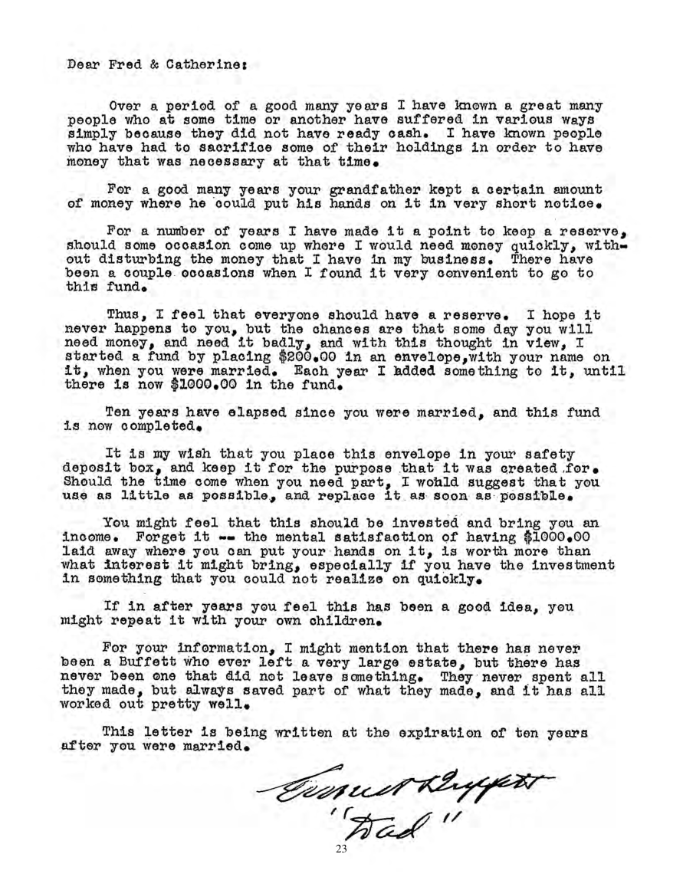

# 巴菲特2010年度致股东信 中英对照


## 原文第1页

### English

## Berkshire’s Corporate Performance vs. the S&P 500

```text
                                                               Annual Percentage Change
                                                                             in Per-Share       in S&P 500
                                                      Book Value of    with Dividends    Relative
                                                                       Berkshire         Included       Results
Year                                                                             (1)                 (2)            (1)-(2)
1965   . . . . . . . . . . . . . . . . . . . . . . . . . . . . . . . . . . . . . . . . . . . . . . . . . . .          23.8            10.0          13.8
1966   . . . . . . . . . . . . . . . . . . . . . . . . . . . . . . . . . . . . . . . . . . . . . . . . . . .          20.3            (11.7)         32.0
1967   . . . . . . . . . . . . . . . . . . . . . . . . . . . . . . . . . . . . . . . . . . . . . . . . . . .          11.0            30.9          (19.9)
1968   . . . . . . . . . . . . . . . . . . . . . . . . . . . . . . . . . . . . . . . . . . . . . . . . . . .          19.0            11.0            8.0
1969   . . . . . . . . . . . . . . . . . . . . . . . . . . . . . . . . . . . . . . . . . . . . . . . . . . .          16.2              (8.4)         24.6
1970   . . . . . . . . . . . . . . . . . . . . . . . . . . . . . . . . . . . . . . . . . . . . . . . . . . .          12.0              3.9            8.1
1971   . . . . . . . . . . . . . . . . . . . . . . . . . . . . . . . . . . . . . . . . . . . . . . . . . . .          16.4            14.6            1.8
1972   . . . . . . . . . . . . . . . . . . . . . . . . . . . . . . . . . . . . . . . . . . . . . . . . . . .          21.7            18.9            2.8
1973   . . . . . . . . . . . . . . . . . . . . . . . . . . . . . . . . . . . . . . . . . . . . . . . . . . .            4.7            (14.8)         19.5
1974   . . . . . . . . . . . . . . . . . . . . . . . . . . . . . . . . . . . . . . . . . . . . . . . . . . .            5.5            (26.4)         31.9
1975   . . . . . . . . . . . . . . . . . . . . . . . . . . . . . . . . . . . . . . . . . . . . . . . . . . .          21.9            37.2          (15.3)
1976   . . . . . . . . . . . . . . . . . . . . . . . . . . . . . . . . . . . . . . . . . . . . . . . . . . .          59.3            23.6          35.7
1977   . . . . . . . . . . . . . . . . . . . . . . . . . . . . . . . . . . . . . . . . . . . . . . . . . . .          31.9              (7.4)         39.3
1978   . . . . . . . . . . . . . . . . . . . . . . . . . . . . . . . . . . . . . . . . . . . . . . . . . . .          24.0              6.4          17.6
1979   . . . . . . . . . . . . . . . . . . . . . . . . . . . . . . . . . . . . . . . . . . . . . . . . . . .          35.7            18.2          17.5
1980   . . . . . . . . . . . . . . . . . . . . . . . . . . . . . . . . . . . . . . . . . . . . . . . . . . .          19.3            32.3          (13.0)
1981   . . . . . . . . . . . . . . . . . . . . . . . . . . . . . . . . . . . . . . . . . . . . . . . . . . .          31.4              (5.0)         36.4
1982   . . . . . . . . . . . . . . . . . . . . . . . . . . . . . . . . . . . . . . . . . . . . . . . . . . .          40.0            21.4          18.6
1983   . . . . . . . . . . . . . . . . . . . . . . . . . . . . . . . . . . . . . . . . . . . . . . . . . . .          32.3            22.4            9.9
1984   . . . . . . . . . . . . . . . . . . . . . . . . . . . . . . . . . . . . . . . . . . . . . . . . . . .          13.6              6.1            7.5
1985   . . . . . . . . . . . . . . . . . . . . . . . . . . . . . . . . . . . . . . . . . . . . . . . . . . .          48.2            31.6          16.6
1986   . . . . . . . . . . . . . . . . . . . . . . . . . . . . . . . . . . . . . . . . . . . . . . . . . . .          26.1            18.6            7.5
1987   . . . . . . . . . . . . . . . . . . . . . . . . . . . . . . . . . . . . . . . . . . . . . . . . . . .          19.5              5.1          14.4
1988   . . . . . . . . . . . . . . . . . . . . . . . . . . . . . . . . . . . . . . . . . . . . . . . . . . .          20.1            16.6            3.5
1989   . . . . . . . . . . . . . . . . . . . . . . . . . . . . . . . . . . . . . . . . . . . . . . . . . . .          44.4            31.7          12.7
1990   . . . . . . . . . . . . . . . . . . . . . . . . . . . . . . . . . . . . . . . . . . . . . . . . . . .            7.4              (3.1)         10.5
1991   . . . . . . . . . . . . . . . . . . . . . . . . . . . . . . . . . . . . . . . . . . . . . . . . . . .          39.6            30.5            9.1
1992   . . . . . . . . . . . . . . . . . . . . . . . . . . . . . . . . . . . . . . . . . . . . . . . . . . .          20.3              7.6          12.7
1993   . . . . . . . . . . . . . . . . . . . . . . . . . . . . . . . . . . . . . . . . . . . . . . . . . . .          14.3            10.1            4.2
1994   . . . . . . . . . . . . . . . . . . . . . . . . . . . . . . . . . . . . . . . . . . . . . . . . . . .          13.9              1.3          12.6
1995   . . . . . . . . . . . . . . . . . . . . . . . . . . . . . . . . . . . . . . . . . . . . . . . . . . .          43.1            37.6            5.5
1996   . . . . . . . . . . . . . . . . . . . . . . . . . . . . . . . . . . . . . . . . . . . . . . . . . . .          31.8            23.0            8.8
1997   . . . . . . . . . . . . . . . . . . . . . . . . . . . . . . . . . . . . . . . . . . . . . . . . . . .          34.1            33.4               .7
1998   . . . . . . . . . . . . . . . . . . . . . . . . . . . . . . . . . . . . . . . . . . . . . . . . . . .          48.3            28.6          19.7
1999   . . . . . . . . . . . . . . . . . . . . . . . . . . . . . . . . . . . . . . . . . . . . . . . . . . .              .5            21.0          (20.5)
2000   . . . . . . . . . . . . . . . . . . . . . . . . . . . . . . . . . . . . . . . . . . . . . . . . . . .            6.5              (9.1)         15.6
2001   . . . . . . . . . . . . . . . . . . . . . . . . . . . . . . . . . . . . . . . . . . . . . . . . . . .            (6.2)            (11.9)           5.7
2002   . . . . . . . . . . . . . . . . . . . . . . . . . . . . . . . . . . . . . . . . . . . . . . . . . . .          10.0            (22.1)         32.1
2003   . . . . . . . . . . . . . . . . . . . . . . . . . . . . . . . . . . . . . . . . . . . . . . . . . . .          21.0            28.7            (7.7)
2004   . . . . . . . . . . . . . . . . . . . . . . . . . . . . . . . . . . . . . . . . . . . . . . . . . . .          10.5            10.9               (.4)
2005   . . . . . . . . . . . . . . . . . . . . . . . . . . . . . . . . . . . . . . . . . . . . . . . . . . .            6.4              4.9            1.5
2006   . . . . . . . . . . . . . . . . . . . . . . . . . . . . . . . . . . . . . . . . . . . . . . . . . . .          18.4            15.8            2.6
2007   . . . . . . . . . . . . . . . . . . . . . . . . . . . . . . . . . . . . . . . . . . . . . . . . . . .          11.0              5.5            5.5
2008   . . . . . . . . . . . . . . . . . . . . . . . . . . . . . . . . . . . . . . . . . . . . . . . . . . .            (9.6)            (37.0)         27.4
2009   . . . . . . . . . . . . . . . . . . . . . . . . . . . . . . . . . . . . . . . . . . . . . . . . . . .          19.8            26.5            (6.7)
2010   . . . . . . . . . . . . . . . . . . . . . . . . . . . . . . . . . . . . . . . . . . . . . . . . . . .          13.0            15.1            (2.1)
```

```text
Compounded Annual Gain – 1965-2010  . . . . . . . . . . . . . . . . . . . . . . .         20.2%          9.4%        10.8
Overall Gain – 1964-2010  . . . . . . . . . . . . . . . . . . . . . . . . . . . . . . . . . .      490,409%        6,262%
```

Notes: Data are for calendar years with these exceptions: 1965 and 1966, year ended 9/30; 1967, 15 months ended 12/31.

Starting in 1979, accounting rules required insurance companies to value the equity securities they hold at market rather than at the lower of cost or market, which was previously the requirement. In this table, Berkshire’s results through 1978 have been restated to conform to the changed rules. In all other respects, the results are calculated using the numbers originally reported.

The S&P 500 numbers are pre-tax whereas the Berkshire numbers are after-tax. If a corporation such as Berkshire were simply to have owned the S&P 500 and accrued the appropriate taxes, its results would have lagged the S&P 500 in years when that index showed a positive return, but would have exceeded the S&P 500 in years when the index showed a negative return. Over the years, the tax costs would have caused the aggregate lag to be substantial.

### 中文

## 伯克希尔公司表现与标普500比较

| 年度 | 伯克希尔每股账面价值年度变动（1） | 标普500含股息年度变动（2） | 相对结果（1－2，百分点） |
| --- | --- | --- | --- |
| 1965 | 23.8% | 10.0% | 13.8 |
| 1966 | 20.3% | (11.7%) | 32.0 |
| 1967 | 11.0% | 30.9% | (19.9) |
| 1968 | 19.0% | 11.0% | 8.0 |
| 1969 | 16.2% | (8.4%) | 24.6 |
| 1970 | 12.0% | 3.9% | 8.1 |
| 1971 | 16.4% | 14.6% | 1.8 |
| 1972 | 21.7% | 18.9% | 2.8 |
| 1973 | 4.7% | (14.8%) | 19.5 |
| 1974 | 5.5% | (26.4%) | 31.9 |
| 1975 | 21.9% | 37.2% | (15.3) |
| 1976 | 59.3% | 23.6% | 35.7 |
| 1977 | 31.9% | (7.4%) | 39.3 |
| 1978 | 24.0% | 6.4% | 17.6 |
| 1979 | 35.7% | 18.2% | 17.5 |
| 1980 | 19.3% | 32.3% | (13.0) |
| 1981 | 31.4% | (5.0%) | 36.4 |
| 1982 | 40.0% | 21.4% | 18.6 |
| 1983 | 32.3% | 22.4% | 9.9 |
| 1984 | 13.6% | 6.1% | 7.5 |
| 1985 | 48.2% | 31.6% | 16.6 |
| 1986 | 26.1% | 18.6% | 7.5 |
| 1987 | 19.5% | 5.1% | 14.4 |
| 1988 | 20.1% | 16.6% | 3.5 |
| 1989 | 44.4% | 31.7% | 12.7 |
| 1990 | 7.4% | (3.1%) | 10.5 |
| 1991 | 39.6% | 30.5% | 9.1 |
| 1992 | 20.3% | 7.6% | 12.7 |
| 1993 | 14.3% | 10.1% | 4.2 |
| 1994 | 13.9% | 1.3% | 12.6 |
| 1995 | 43.1% | 37.6% | 5.5 |
| 1996 | 31.8% | 23.0% | 8.8 |
| 1997 | 34.1% | 33.4% | 0.7 |
| 1998 | 48.3% | 28.6% | 19.7 |
| 1999 | 0.5% | 21.0% | (20.5) |
| 2000 | 6.5% | (9.1%) | 15.6 |
| 2001 | (6.2%) | (11.9%) | 5.7 |
| 2002 | 10.0% | (22.1%) | 32.1 |
| 2003 | 21.0% | 28.7% | (7.7) |
| 2004 | 10.5% | 10.9% | (0.4) |
| 2005 | 6.4% | 4.9% | 1.5 |
| 2006 | 18.4% | 15.8% | 2.6 |
| 2007 | 11.0% | 5.5% | 5.5 |
| 2008 | (9.6%) | (37.0%) | 27.4 |
| 2009 | 19.8% | 26.5% | (6.7) |
| 2010 | 13.0% | 15.1% | (2.1) |
| 1965—2010年年复合增长 | 20.2% | 9.4% | 10.8 |
| 1964—2010年累计增长 | 490,409% | 6,262% | — |

注：除以下情况，数据均按日历年：1965与1966年为截至9月30日的一年；1967年为截至12月31日的十五个月。

自1979年起，会计规则要求，保险公司持有的股票按市价计量，而非此前的成本与市价孰低。本表伯克希尔截至1978年的结果，已按新规则重列；其余方面，都使用原来报告的数字。

标普500为税前数字，伯克希尔为税后。若像伯克希尔这样的公司，只持有标普500并计提相应税款，指数正回报年份，会落后；指数负回报年份，则会领先。长久而言，税收成本会使累计落后相当显著。


## 原文第2页

### English

BERKSHIRE HATHAWAY INC.

To the Shareholders of Berkshire Hathaway Inc.:

The per-share book value of both our Class A and Class B stock increased by 13% in 2010. Over the last 46 years (that is, since present management took over), book value has grown from $19 to $95,453, a rate of 20.2% compounded annually.*

The highlight of 2010 was our acquisition of Burlington Northern Santa Fe, a purchase that’s working out even better than I expected. It now appears that owning this railroad will increase Berkshire’s “normal” earning power by nearly 40% pre-tax and by well over 30% after-tax. Making this purchase increased our share count by 6% and used $22 billion of cash. Since we’ve quickly replenished the cash, the economics of this transaction have turned out very well.

A “normal year,” of course, is not something that either Charlie Munger, Vice Chairman of Berkshire and my partner, or I can define with anything like precision. But for the purpose of estimating our current earning power, we are envisioning a year free of a mega-catastrophe in insurance and possessing a general business climate somewhat better than that of 2010 but weaker than that of 2005 or 2006. Using these assumptions, and several others that I will explain in the “Investment” section, I can estimate that the normal earning power of the assets we currently own is about $17 billion pre-tax and $12 billion after-tax, excluding any capital gains or losses. Every day Charlie and I think about how we can build on this base.

Both of us are enthusiastic about BNSF’s future because railroads have major cost and environmental advantages over trucking, their main competitor. Last year BNSF moved each ton of freight it carried a record 500 miles on a single gallon of diesel fuel. That’s three times more fuel-efficient than trucking is, which means our railroad owns an important advantage in operating costs. Concurrently, our country gains because of reduced greenhouse emissions and a much smaller need for imported oil. When traffic travels by rail, society benefits.

Over time, the movement of goods in the United States will increase, and BNSF should get its full share of the gain. The railroad will need to invest massively to bring about this growth, but no one is better situated than Berkshire to supply the funds required. However slow the economy, or chaotic the markets, our checks will clear.

Last year – in the face of widespread pessimism about our economy – we demonstrated our enthusiasm for capital investment  at Berkshire by spending $6  billion on property and equipment. Of  this amount, $5.4 billion – or 90% of the total – was spent in the United States. Certainly our businesses will expand abroad in the future, but an overwhelming part of their future investments will be at home. In 2011, we will set a new record for capital spending – $8 billion – and spend all of the $2 billion increase in the United States.

Money  will always flow toward  opportunity, and  there  is an abundance of  that  in America. Commentators  today  often  talk  of  “great  uncertainty.” But  think  back,  for example,  to December  6, 1941, October 18, 1987 and September 10, 2001. No matter how serene today may be, tomorrow is always uncertain.

* All per-share figures used in this report apply to Berkshire’s A shares. Figures for the B shares are 1/1500th of those shown for A.

### 中文

伯克希尔·哈撒韦公司

致伯克希尔·哈撒韦公司的股东：

2010年，A类股和B类股的每股账面价值均增长13%。过去46年，也就是现任管理层接手以来，每股账面价值从19美元增至95,453美元，年复合增长率为20.2%。*

2010年的亮点，是我们收购了伯灵顿北方圣太菲铁路。这笔买卖的表现，比我预期还好。如今看来，拥有这家铁路，会使伯克希尔的“正常”税前盈利能力增加近40%，税后增加远超30%。为完成收购，我们的股数增加6%，并动用了220亿美元现金。由于现金很快就已补足，这笔交易的经济账算下来非常漂亮。

当然，所谓“正常年份”，无论伯克希尔副董事长、我的搭档查理·芒格，还是我，都无法给出多么精确的定义。不过，为估计目前的盈利能力，我们设想这样一年：保险没有遇上超级巨灾，整体商业环境比2010年稍好，却弱于2005年或2006年。依据这些假设，以及后面“投资”部分将解释的其他几项假设，我估计，目前所持资产的正常盈利能力，约为税前170亿美元、税后120亿美元，不包括任何资本利得或损失。查理和我每天都在思考，如何在这个基础上继续增长。

我们都对BNSF的未来充满热情，因为相对于主要竞争对手公路货运，铁路具有重大的成本与环保优势。去年，BNSF每消耗一加仑柴油，能将一吨货物运送创纪录的500英里，燃油效率是公路运输的三倍。这意味着铁路在运营成本上拥有重要优势。同时，我国也因温室气体排放减少、进口石油需求大幅降低而获益。货物走铁路，社会得实惠。

随着时间推移，美国货物运输量会增加，BNSF理应分享相应的增长。铁路需要大量投资才能实现这种增长，但没有谁比伯克希尔更有条件提供所需资金。无论经济多么低迷、市场多么混乱，我们的支票都能兑现。

去年，尽管人们普遍对经济悲观，我们仍以60亿美元的房产和设备支出，展示了伯克希尔对资本投资的热情。其中54亿美元，也就是90%，花在美国。当然，未来我们的业务也会向海外扩展，但新增投资的绝大部分仍会留在国内。2011年，我们的资本支出将再创纪录，达到80亿美元，而增加的20亿美元将全部投在美国。

资金总会流向机会，而美国有的是机会。今天，评论家经常谈论“巨大的不确定性”。不过，请回想一下1941年12月6日、1987年10月18日和2001年9月10日。不管今天多么平静，明天永远是不确定的。

*本报告所有每股数字均适用于伯克希尔A类股。B类股相应数字为A类股的1/1500。


## 原文第3页

### English

Don’t let that reality spook you. Throughout my lifetime, politicians and pundits have constantly moaned about terrifying problems facing America. Yet our citizens now live an astonishing six times better than when I was born. The prophets of doom have overlooked the all-important factor that is certain: Human potential is far from exhausted, and the American system for unleashing that potential – a system that has worked wonders for over two centuries despite frequent interruptions for recessions and even a Civil War – remains alive and effective.

We are not natively smarter than we were when our country was founded nor do we work harder. But look around you and see a world beyond the dreams of any colonial citizen. Now, as in 1776, 1861, 1932 and 1941, America’s best days lie ahead.

Performance

Charlie and  I believe  that those entrusted with handling the funds of others should  establish performance goals at the onset of their stewardship. Lacking such standards, managements are tempted to shoot the arrow of performance and then paint the bull’s-eye around wherever it lands.

In Berkshire’s case, we long ago told you that our job is to increase per-share intrinsic value at a rate greater than the increase (including dividends) of the S&P 500. In some years we succeed; in others we fail. But, if we are unable over time to reach that goal, we have done nothing for our investors, who by themselves could have realized an equal or better result by owning an index fund.

The challenge, of course, is the calculation of intrinsic value. Present that task to Charlie and me separately, and you will get two different answers. Precision just isn’t possible.

To eliminate subjectivity, we therefore use an understated proxy for intrinsic-value – book value – when measuring our performance. To be sure, some of our businesses are worth far more than their carrying value on our books. (Later in this report, we’ll present a case study.) But since that premium seldom swings wildly from year to year, book value can serve as a reasonable device for tracking how we are doing.

The table on page 2 shows our 46-year record against the S&P, a performance quite good in the earlier years and now only satisfactory. The bountiful years, we want to emphasize, will never return. The huge sums of capital we currently manage eliminate any chance of exceptional performance. We will strive, however, for better-than-average results and feel it fair for you to hold us to that standard.

Yearly figures, it should be noted, are neither to be ignored nor viewed as all-important. The pace of the earth’s movement around the sun is not synchronized with the time required for either investment ideas or operating decisions to bear fruit. At GEICO, for example, we enthusiastically spent $900 million last year on advertising to obtain policyholders who deliver us no immediate profits. If we could spend twice that amount productively, we would happily do so though short-term results would be further penalized. Many large investments at our railroad and utility operations are also made with an eye to payoffs well down the road.

To provide you a longer-term perspective on performance, we present on the facing page the yearly figures from page 2 recast into a series of five-year periods. Overall, there are 42 of these periods, and they tell an interesting story. On a comparative basis, our best years ended in the early 1980s. The market’s golden period, however, came in the 17 following years, with Berkshire achieving stellar absolute returns even as our relative advantage narrowed.

After 1999, the market stalled (or have you already noticed that?). Consequently, the satisfactory performance relative to the S&P that Berkshire has achieved since then has delivered only moderate absolute results.

Looking forward, we hope to average several points better than the S&P – though that result is, of course, far from a sure thing. If we succeed in that aim, we will almost certainly produce better relative results in bad years for the stock market and suffer poorer results in strong markets.

### 中文

别让这个事实吓住你。我一生中，政客和评论家不断哀叹美国面临种种可怕问题。然而，如今美国人的生活水平，却已达到我出生时惊人的六倍。末日预言家漏掉了那个最重要、而且确定无疑的因素：人类潜能远未用尽，而美国释放这种潜能的制度，依然鲜活有效。两百多年来，这套制度虽然经常被衰退打断，甚至经历一场内战，却创造了奇迹。

我们并不比建国时的人天生更聪明，也不比他们更勤劳。但环顾四周，眼前世界已经超越任何殖民地居民的梦想。正如1776年、1861年、1932年和1941年一样，美国最好的日子仍在前头。

## 业绩

查理和我认为，受托管理他人资金的人，应该在受托之初就确立业绩目标。没有这样的标准，管理层就容易先把业绩之箭射出去，再围着落点画靶心。

对于伯克希尔，我们很早就告诉过你们：我们的任务，是让每股内在价值的增长，超过标普500含股息的涨幅。有些年份成功，有些年份失败。不过，如果长期无法达到这个目标，我们就没有替投资者做成任何事，因为他们自己持有指数基金，就能取得相同、甚至更好的结果。

难点当然在于计算内在价值。把这个任务分别交给查理和我，会得到两个不同答案。精确根本不可能。

因此，为排除主观因素，衡量业绩时，我们使用一个低估内在价值的替代指标：账面价值。诚然，我们有些企业的实际价值，远高于账面列示金额，后面会介绍一个案例。不过，这个溢价通常不会年年剧烈变化，所以账面价值可以合理地追踪我们的进展。

第2页表格列出了我们与标普比较的46年纪录：早期非常出色，如今只是令人满意。我们要强调，硕果累累的年头永远不会回来。如今管理的巨额资本，已经排除了取得非凡业绩的可能。不过，我们仍会努力争取高于平均水平的结果，也认为你们以这个标准要求我们，完全公平。

应当说明，年度数字既不能忽略，也不该视为最重要的一切。地球绕太阳转一圈的速度，并不会与投资想法或经营决定结出果实所需的时间同步。例如，去年GEICO兴致勃勃地花了9亿美元做广告，争取来的投保人并不会立即贡献利润。如果能有效地花两倍的钱，我们也乐意，即使短期业绩会进一步受损。铁路与公用事业的许多大型投资，同样着眼于很久以后的回报。

为了让你们从更长时间看业绩，对页把第2页年度数字改列为一系列五年期表现，共42个期间。它们讲述了一个有趣的故事：相对表现最好的时期，在80年代初已经结束。但接下来的17年，却是市场的黄金时代。即使相对优势收窄，伯克希尔仍取得了耀眼的绝对回报。

1999年以后，市场停滞不前——还是说，你们已经发现了？因此，此后伯克希尔相对于标普令人满意的表现，只带来了中等的绝对结果。

展望未来，我们希望平均每年超过标普几个百分点，当然，这个结果远非稳操胜券。如果实现这个目标，几乎可以肯定，股市糟糕的年份，我们的相对表现会更好；市场强劲时，则会落后。


## 原文第4页

### English

## Berkshire’s Corporate Performance vs. the S&P 500 by Five-Year Periods

```text
                                                               Annual Percentage Change
                                                                             in Per-Share       in S&P 500
                                                      Book Value of    with Dividends    Relative
                                                                       Berkshire         Included       Results
Five-Year Period                                                                (1)                 (2)            (1)-(2)
```

```text
1965-1969 . . . . . . . . . . . . . . . . . . . . . . . . . . . . . . . . . . . . . . . . . . . . . . .        17.2               5.0          12.2
1966-1970 . . . . . . . . . . . . . . . . . . . . . . . . . . . . . . . . . . . . . . . . . . . . . . .        14.7               3.9          10.8
1967-1971 . . . . . . . . . . . . . . . . . . . . . . . . . . . . . . . . . . . . . . . . . . . . . . .        13.9               9.2            4.7
1968-1972 . . . . . . . . . . . . . . . . . . . . . . . . . . . . . . . . . . . . . . . . . . . . . . .        16.8               7.5            9.3
1969-1973 . . . . . . . . . . . . . . . . . . . . . . . . . . . . . . . . . . . . . . . . . . . . . . .        17.7               2.0          15.7
1970-1974 . . . . . . . . . . . . . . . . . . . . . . . . . . . . . . . . . . . . . . . . . . . . . . .        15.0                (2.4)          17.4
1971-1975 . . . . . . . . . . . . . . . . . . . . . . . . . . . . . . . . . . . . . . . . . . . . . . .        13.9               3.2          10.7
1972-1976 . . . . . . . . . . . . . . . . . . . . . . . . . . . . . . . . . . . . . . . . . . . . . . .        20.8               4.9          15.9
1973-1977 . . . . . . . . . . . . . . . . . . . . . . . . . . . . . . . . . . . . . . . . . . . . . . .        23.4                (0.2)          23.6
1974-1978 . . . . . . . . . . . . . . . . . . . . . . . . . . . . . . . . . . . . . . . . . . . . . . .        24.4               4.3          20.1
1975-1979 . . . . . . . . . . . . . . . . . . . . . . . . . . . . . . . . . . . . . . . . . . . . . . .        30.1             14.7          15.4
1976-1980 . . . . . . . . . . . . . . . . . . . . . . . . . . . . . . . . . . . . . . . . . . . . . . .        33.4             13.9          19.5
1977-1981 . . . . . . . . . . . . . . . . . . . . . . . . . . . . . . . . . . . . . . . . . . . . . . .        29.0               8.1          20.9
1978-1982 . . . . . . . . . . . . . . . . . . . . . . . . . . . . . . . . . . . . . . . . . . . . . . .        29.9             14.1          15.8
1979-1983 . . . . . . . . . . . . . . . . . . . . . . . . . . . . . . . . . . . . . . . . . . . . . . .        31.6             17.3          14.3
1980-1984 . . . . . . . . . . . . . . . . . . . . . . . . . . . . . . . . . . . . . . . . . . . . . . .        27.0             14.8          12.2
1981-1985 . . . . . . . . . . . . . . . . . . . . . . . . . . . . . . . . . . . . . . . . . . . . . . .        32.6             14.6          18.0
1982-1986 . . . . . . . . . . . . . . . . . . . . . . . . . . . . . . . . . . . . . . . . . . . . . . .        31.5             19.8          11.7
1983-1987 . . . . . . . . . . . . . . . . . . . . . . . . . . . . . . . . . . . . . . . . . . . . . . .        27.4             16.4          11.0
1984-1988 . . . . . . . . . . . . . . . . . . . . . . . . . . . . . . . . . . . . . . . . . . . . . . .        25.0             15.2            9.8
1985-1989 . . . . . . . . . . . . . . . . . . . . . . . . . . . . . . . . . . . . . . . . . . . . . . .        31.1             20.3          10.8
1986-1990 . . . . . . . . . . . . . . . . . . . . . . . . . . . . . . . . . . . . . . . . . . . . . . .        22.9             13.1            9.8
1987-1991 . . . . . . . . . . . . . . . . . . . . . . . . . . . . . . . . . . . . . . . . . . . . . . .        25.4             15.3          10.1
1988-1992 . . . . . . . . . . . . . . . . . . . . . . . . . . . . . . . . . . . . . . . . . . . . . . .        25.6             15.8            9.8
1989-1993 . . . . . . . . . . . . . . . . . . . . . . . . . . . . . . . . . . . . . . . . . . . . . . .        24.4             14.5            9.9
1990-1994 . . . . . . . . . . . . . . . . . . . . . . . . . . . . . . . . . . . . . . . . . . . . . . .        18.6               8.7            9.9
1991-1995 . . . . . . . . . . . . . . . . . . . . . . . . . . . . . . . . . . . . . . . . . . . . . . .        25.6             16.5            9.1
1992-1996 . . . . . . . . . . . . . . . . . . . . . . . . . . . . . . . . . . . . . . . . . . . . . . .        24.2             15.2            9.0
1993-1997 . . . . . . . . . . . . . . . . . . . . . . . . . . . . . . . . . . . . . . . . . . . . . . .        26.9             20.2            6.7
1994-1998 . . . . . . . . . . . . . . . . . . . . . . . . . . . . . . . . . . . . . . . . . . . . . . .        33.7             24.0            9.7
1995-1999 . . . . . . . . . . . . . . . . . . . . . . . . . . . . . . . . . . . . . . . . . . . . . . .        30.4             28.5            1.9
1996-2000 . . . . . . . . . . . . . . . . . . . . . . . . . . . . . . . . . . . . . . . . . . . . . . .        22.9             18.3            4.6
1997-2001 . . . . . . . . . . . . . . . . . . . . . . . . . . . . . . . . . . . . . . . . . . . . . . .        14.8             10.7            4.1
1998-2002 . . . . . . . . . . . . . . . . . . . . . . . . . . . . . . . . . . . . . . . . . . . . . . .        10.4                (0.6)          11.0
1999-2003 . . . . . . . . . . . . . . . . . . . . . . . . . . . . . . . . . . . . . . . . . . . . . . .          6.0                (0.6)           6.6
2000-2004 . . . . . . . . . . . . . . . . . . . . . . . . . . . . . . . . . . . . . . . . . . . . . . .          8.0                (2.3)          10.3
2001-2005 . . . . . . . . . . . . . . . . . . . . . . . . . . . . . . . . . . . . . . . . . . . . . . .          8.0               0.6            7.4
2002-2006 . . . . . . . . . . . . . . . . . . . . . . . . . . . . . . . . . . . . . . . . . . . . . . .        13.1               6.2            6.9
2003-2007 . . . . . . . . . . . . . . . . . . . . . . . . . . . . . . . . . . . . . . . . . . . . . . .        13.3             12.8            0.5
2004-2008 . . . . . . . . . . . . . . . . . . . . . . . . . . . . . . . . . . . . . . . . . . . . . . .          6.9                (2.2)           9.1
2005-2009 . . . . . . . . . . . . . . . . . . . . . . . . . . . . . . . . . . . . . . . . . . . . . . .          8.6               0.4            8.2
2006-2010 . . . . . . . . . . . . . . . . . . . . . . . . . . . . . . . . . . . . . . . . . . . . . . .        10.0               2.3            7.7
```

Notes: The first two periods cover the five years beginning September 30 of the previous year. The third period covers 63 months beginning September 30, 1966 to December 31, 1971. All other periods involve calendar years.

The other notes on page 2 also apply to this table.

### 中文

## 伯克希尔公司与标普500的五年期表现比较

| 五年期间 | 伯克希尔每股账面价值年变动（1） | 标普500含股息年变动（2） | 相对结果（1－2，百分点） |
| :--- | ---: | ---: | ---: |
| 1965—1969 | 17.2% | 5.0% | 12.2 |
| 1966—1970 | 14.7% | 3.9% | 10.8 |
| 1967—1971 | 13.9% | 9.2% | 4.7 |
| 1968—1972 | 16.8% | 7.5% | 9.3 |
| 1969—1973 | 17.7% | 2.0% | 15.7 |
| 1970—1974 | 15.0% | (2.4%) | 17.4 |
| 1971—1975 | 13.9% | 3.2% | 10.7 |
| 1972—1976 | 20.8% | 4.9% | 15.9 |
| 1973—1977 | 23.4% | (0.2%) | 23.6 |
| 1974—1978 | 24.4% | 4.3% | 20.1 |
| 1975—1979 | 30.1% | 14.7% | 15.4 |
| 1976—1980 | 33.4% | 13.9% | 19.5 |
| 1977—1981 | 29.0% | 8.1% | 20.9 |
| 1978—1982 | 29.9% | 14.1% | 15.8 |
| 1979—1983 | 31.6% | 17.3% | 14.3 |
| 1980—1984 | 27.0% | 14.8% | 12.2 |
| 1981—1985 | 32.6% | 14.6% | 18.0 |
| 1982—1986 | 31.5% | 19.8% | 11.7 |
| 1983—1987 | 27.4% | 16.4% | 11.0 |
| 1984—1988 | 25.0% | 15.2% | 9.8 |
| 1985—1989 | 31.1% | 20.3% | 10.8 |
| 1986—1990 | 22.9% | 13.1% | 9.8 |
| 1987—1991 | 25.4% | 15.3% | 10.1 |
| 1988—1992 | 25.6% | 15.8% | 9.8 |
| 1989—1993 | 24.4% | 14.5% | 9.9 |
| 1990—1994 | 18.6% | 8.7% | 9.9 |
| 1991—1995 | 25.6% | 16.5% | 9.1 |
| 1992—1996 | 24.2% | 15.2% | 9.0 |
| 1993—1997 | 26.9% | 20.2% | 6.7 |
| 1994—1998 | 33.7% | 24.0% | 9.7 |
| 1995—1999 | 30.4% | 28.5% | 1.9 |
| 1996—2000 | 22.9% | 18.3% | 4.6 |
| 1997—2001 | 14.8% | 10.7% | 4.1 |
| 1998—2002 | 10.4% | (0.6%) | 11.0 |
| 1999—2003 | 6.0% | (0.6%) | 6.6 |
| 2000—2004 | 8.0% | (2.3%) | 10.3 |
| 2001—2005 | 8.0% | 0.6% | 7.4 |
| 2002—2006 | 13.1% | 6.2% | 6.9 |
| 2003—2007 | 13.3% | 12.8% | 0.5 |
| 2004—2008 | 6.9% | (2.2%) | 9.1 |
| 2005—2009 | 8.6% | 0.4% | 8.2 |
| 2006—2010 | 10.0% | 2.3% | 7.7 |

注：前两个期间，均为自前一年9月30日起算的五年。第三个期间为1966年9月30日至1971年12月31日，共63个月。其余期间均按日历年。

第2页的其他注释，同样适用于本表。


## 原文第5页

### English

## Intrinsic Value – Today and Tomorrow

Though Berkshire’s intrinsic value cannot be precisely calculated, two of its three key pillars can be measured. Charlie and I rely heavily on these measurements when we make our own estimates of Berkshire’s value.

The first component of value is our investments: stocks, bonds and cash equivalents. At yearend these totaled $158 billion at market value.

Insurance float – money we temporarily hold in our insurance operations that does not belong to us – funds $66 billion of our investments. This float is “free” as long as insurance underwriting breaks even, meaning that the premiums we receive equal the losses and expenses we incur. Of course, underwriting results are volatile, swinging erratically between profits and losses. Over our entire history, though, we’ve been significantly profitable, and I also expect us to average breakeven results or better in the future. If we do that, all of our investments – those funded both by float and by retained earnings – can be viewed as an element of value for Berkshire shareholders.

Berkshire’s second component of value is earnings that come from sources other than investments and insurance underwriting. These earnings are delivered by our 68 non-insurance companies, itemized on page 106. In Berkshire’s early years, we focused on the investment side. During the past two decades, however, we’ve increasingly emphasized the development of earnings from non-insurance businesses, a practice that will continue.

The following tables illustrate this shift. In the first table, we present per-share investments at decade intervals beginning in 1970, three years after we entered the insurance business. We exclude those investments applicable to minority interests.

Per-Share              Compounded Annual Increase Yearend                       Investments     Period         in Per-Share Investments

```text
1970  . . . . . . . . . . . . . . . . . . .    $    66
1980  . . . . . . . . . . . . . . . . . . .        754     1970-1980             27.5%
1990  . . . . . . . . . . . . . . . . . . .       7,798     1980-1990             26.3%
2000  . . . . . . . . . . . . . . . . . . .      50,229     1990-2000             20.5%
2010  . . . . . . . . . . . . . . . . . . .      94,730     2000-2010              6.6%
```

Though our compounded annual increase in per-share investments was a healthy 19.9% over the 40-year period, our rate of increase has slowed sharply as we have focused on using funds to buy operating businesses.

The payoff from this shift is shown in the following table, which illustrates how earnings of our non-insurance businesses have increased, again on a per-share basis and after applicable minority interests.

Per-Share                 Compounded Annual Increase in Year                 Pre-Tax Earnings     Period       Per-Share Pre-Tax Earnings

```text
1970  . . . . . . . . . . . .      $    2.87
1980  . . . . . . . . . . . .           19.01      1970-1980              20.8%
1990  . . . . . . . . . . . .         102.58      1980-1990              18.4%
2000  . . . . . . . . . . . .         918.66      1990-2000              24.5%
2010  . . . . . . . . . . . .        5,926.04      2000-2010              20.5%
```

### 中文

## 内在价值：今天与明天

虽然无法精确计算伯克希尔的内在价值，但支撑它的三根关键支柱中，有两根可以衡量。查理和我自己估算伯克希尔价值时，非常依赖这些指标。

价值的第一部分，是投资：股票、债券和现金等价物。年底，它们的市值合计1,580亿美元。

保险浮存金，也就是我们在保险业务中暂时持有、却不属于我们的钱，为其中660亿美元投资提供了资金。只要保险承保不亏不赚，即收到的保费等于发生的赔款与费用，这些浮存金就是“免费”的。当然，承保结果波动很大，利润和损失之间的摇摆常无规律可循。不过，回看整个历史，我们取得了可观的承保利润；我也预期，未来平均结果能够不亏不赚，或者更好。如果做到，我们所有投资，无论由浮存金还是留存利润提供资金，都可视为伯克希尔股东价值的一部分。

价值的第二部分，是来自投资和保险承保以外的利润。这些利润由68家非保险企业贡献，第106页逐一列出。早年，我们重点放在投资一端；但过去20年，越来越重视发展非保险企业的利润，今后也将继续。

下表展示了这种转变。第一张表，从进入保险行业三年后的1970年开始，以十年为间隔，列出每股投资额。归属于少数股东权益的投资已经剔除。

| 年底 | 每股投资额，美元 | 期间 | 每股投资额年复合增长率 |
| :--- | ---: | :--- | ---: |
| 1970 | 66 | — | — |
| 1980 | 754 | 1970—1980 | 27.5% |
| 1990 | 7,798 | 1980—1990 | 26.3% |
| 2000 | 50,229 | 1990—2000 | 20.5% |
| 2010 | 94,730 | 2000—2010 | 6.6% |

40年间，每股投资额的年复合增长率为19.9%，相当不错。不过，随着我们转向使用资金收购经营企业，这项增长率已经大幅放缓。

转变带来的成果，见下面这张表。它展示了非保险业务利润的增长，同样按每股计算，并扣除适用的少数股东权益。

| 年度 | 每股税前利润，美元 | 期间 | 每股税前利润年复合增长率 |
| :--- | ---: | :--- | ---: |
| 1970 | 2.87 | — | — |
| 1980 | 19.01 | 1970—1980 | 20.8% |
| 1990 | 102.58 | 1980—1990 | 18.4% |
| 2000 | 918.66 | 1990—2000 | 24.5% |
| 2010 | 5,926.04 | 2000—2010 | 20.5% |

两表中“—”为原件空白占位。


## 原文第6页

### English

For the forty years, our compounded annual gain in pre-tax, non-insurance earnings per share is 21.0%. During the same period, Berkshire’s stock price increased at a rate of 22.1% annually. Over time, you can expect our stock price to move in rough tandem with Berkshire’s investments and earnings. Market price and intrinsic value often follow very different paths – sometimes for extended periods – but eventually they meet.

There is a third, more subjective, element to an intrinsic value calculation that can be either positive or negative: the efficacy with which retained earnings will be deployed in the future. We, as well as many other businesses, are likely to retain earnings over the next decade that will equal, or even exceed, the capital we presently employ. Some companies will turn these retained dollars into fifty-cent pieces, others into two-dollar bills.

This  “what-will-they-do-with-the-money”  factor  must  always  be  evaluated  along  with  the “what-do-we-have-now” calculation in order for us, or anybody, to arrive at a sensible estimate of a company’s intrinsic value. That’s because an outside investor stands by helplessly as management reinvests his share of the company’s earnings. If a CEO can be expected to do this job well, the reinvestment prospects add to the company’s current value; if the CEO’s talents or motives are suspect, today’s value must be discounted. The difference in outcome can be huge. A dollar of then-value in the hands of Sears Roebuck’s or Montgomery Ward’s CEOs in the late 1960s had a far different destiny than did a dollar entrusted to Sam Walton.

---

Charlie and I hope that the per-share earnings of our non-insurance businesses continue to increase at a decent rate. But the job gets tougher as the numbers get larger. We will need both good performance from our current businesses and more major acquisitions. We’re prepared. Our elephant gun has been reloaded, and my trigger finger is itchy.

Partially offsetting our anchor of size are several important advantages we have. First, we possess a cadre of truly skilled managers who have an unusual commitment to their own operations and to Berkshire. Many of our CEOs are independently wealthy and work only because they love what they do. They are volunteers, not mercenaries. Because no one can offer them a job they would enjoy more, they can’t be lured away.

At Berkshire, managers can focus on running their businesses: They are not subjected to meetings at headquarters nor financing worries nor Wall Street harassment. They simply get a letter from me every two years (it’s reproduced on pages 104-105) and call me when they wish. And their wishes do differ: There are managers to whom I have not talked in the last year, while there is one with whom I talk almost daily. Our trust is in people rather than process. A “hire well, manage little” code suits both them and me.

Berkshire’s CEOs come in many forms. Some have MBAs; others never finished college. Some use budgets and are by-the-book types; others operate by the seat of their pants. Our team resembles a baseball squad composed of all-stars having vastly different batting styles. Changes in our line-up are seldom required.

Our second advantage relates to the allocation of the money our businesses earn. After meeting the needs of those businesses, we have very substantial sums  left over. Most companies limit themselves to reinvesting funds within the industry in which they have been operating. That often restricts them, however, to a “universe” for capital allocation that is both tiny and quite inferior to what is available in the wider world. Competition for the few opportunities that are available tends to become fierce. The seller has the upper hand, as a girl might if she were the only female at a party attended by many boys. That lopsided situation would be great for the girl, but terrible for the boys.

At Berkshire we face no institutional restraints when we deploy capital. Charlie and I are limited only by our ability to understand the likely future of a possible acquisition. If we clear that hurdle – and frequently we can’t – we are then able to compare any one opportunity against a host of others.

### 中文

这40年间，非保险业务每股税前利润的年复合增长率为21.0%。同期，伯克希尔股价每年增长22.1%。长期而言，可以预期股价大致跟随伯克希尔的投资和利润前进。市价与内在价值常常走在完全不同的路上，有时会持续很久，但最终会相遇。

计算内在价值，还有第三个更主观的因素，可能加分，也可能减分：未来如何有效使用留存利润。未来十年，我们和许多其他企业很可能留存相当于、甚至超过现有投入资本的利润。有些公司会把这些一美元变成五毛钱，另一些则会变成两美元。

无论我们还是其他人，要合理估算一家公司的内在价值，除了计算“现在拥有什么”，都必须评估“他们以后会怎样用这笔钱”。因为管理层把投资者应占的利润重新投入时，外部投资者只能无可奈何地站在一旁。如果可以预期首席执行官能把这件事做好，再投资前景就会增加公司当前的价值；如果他的才能或动机可疑，今天的价值就必须打折。最终结果，可能天差地别。60年代末，交到西尔斯·罗巴克或蒙哥马利·沃德首席执行官手中的一美元当时价值，与托付给山姆·沃尔顿的一美元，命运截然不同。

* * *

查理和我希望，非保险业务每股利润能继续以不错的速度增长。但数字越大，任务就越艰巨。我们既需要现有企业经营良好，也需要更多重大收购。我们已经准备好了。猎象枪重新装满了弹药，我扣扳机的手指直发痒。

我们有几个重要优势，可以部分抵消规模这只沉重的锚。首先，我们有一批真正能干的经理，对自己经营的企业和伯克希尔，都有非同寻常的投入。许多首席执行官早已财务独立，只因热爱自己的工作才继续干。他们是志愿者，不是雇佣兵。没有人能提供让他们更喜欢的工作，因此也就挖不走他们。

在伯克希尔，经理们可以专心经营：不用到总部开会，不必担心融资，也不受华尔街骚扰。他们只是每两年收到我一封信，信件转载在第104—105页；想找我时，就打电话。大家的意愿确实不同：有些经理去年我一次也没交谈，另有一位几乎天天通话。我们相信的是人，而不是流程。“选好人，少管理”，这条准则既合他们意，也合我意。

伯克希尔的首席执行官，各种类型都有。有些拿过MBA，有些大学都没读完；有些使用预算、严格照章办事，有些则凭经验和直觉灵活行事。我们的团队，就像一支由击球风格迥异的全明星组成的棒球队，阵容很少需要调整。

第二个优势，涉及怎样分配各企业赚来的钱。满足企业自身需要以后，我们仍剩下大量资金。多数公司只把钱重新投到原来所在的行业，这往往把它们的资本配置“宇宙”，限制在一个很小、而且远不如外面世界精彩的范围里。有限机会的竞争于是趋于激烈，卖方占尽上风，像一场满是男孩的聚会里唯一的女孩。这种一边倒的局面，对女孩很好，对男孩却很糟。

伯克希尔配置资本时，不受这种制度性限制。查理和我唯一的边界，是能否理解潜在收购对象未来可能的样子。跨过这道门槛以后——而我们经常跨不过去——就能把任何一个机会，同许多其他机会作比较。


## 原文第7页

### English

When I took control of Berkshire in 1965, I didn’t exploit this advantage. Berkshire was then only in textiles, where it had in the previous decade lost significant money. The dumbest thing I could have done was to pursue “opportunities” to improve and expand the existing textile operation – so for years that’s exactly what I did. And then, in a final burst of brilliance, I went out and bought another textile company. Aaaaaaargh! Eventually I came to my senses, heading first into insurance and then into other industries.

There  is even a supplement to this world-is-our-oyster advantage: In addition to evaluating the attractions of one business against a host of others, we also measure businesses against opportunities available in marketable securities, a comparison most managements don’t make. Often, businesses are priced ridiculously high against what can likely be earned from investments in stocks or bonds. At such moments, we buy securities and bide our time.

Our flexibility in respect to capital allocation has accounted for much of our progress to date. We have been able to take money we earn from, say, See’s Candies or Business Wire (two of our best-run businesses, but also two offering limited reinvestment opportunities) and use it as part of the stake we needed to buy BNSF.

Our final advantage is the hard-to-duplicate culture that permeates Berkshire. And in businesses, culture counts.

To  start with, the directors who represent you think and act  like owners. They receive token compensation: no options, no restricted stock and, for that matter, virtually no cash. We do not provide them directors and officers liability insurance, a given at almost every other large public company. If they mess up with your money, they will lose their money as well. Leaving my holdings aside, directors and their families own Berkshire shares worth more than $3 billion. Our directors, therefore, monitor Berkshire’s actions and results with keen interest and an owner’s eye. You and I are lucky to have them as stewards.

This same owner-orientation prevails among our managers. In many cases, these are people who have sought out Berkshire as an acquirer for a business that they and their families have long owned. They came to us with an owner’s mindset, and we provide an environment that encourages them to retain it. Having managers who love their businesses is no small advantage.

Cultures self-propagate. Winston Churchill once said, “You shape your houses and then they shape you.” That wisdom applies to businesses as well. Bureaucratic procedures beget more bureaucracy, and imperial corporate palaces induce imperious behavior. (As one wag put it, “You know you’re no longer CEO when you get in the back seat of your car and it doesn’t move.”) At Berkshire’s “World Headquarters” our annual rent is $270,212. Moreover, the home-office investment in furniture,  art, Coke dispenser, lunch room, high-tech equipment – you name it – totals $301,363. As long as Charlie and I treat your money as if it were our own, Berkshire’s managers are likely to be careful with it as well.

Our compensation programs, our annual meeting and even our annual reports are all designed with an eye to reinforcing the Berkshire culture, and making it one that will repel and expel managers of a different bent. This culture grows stronger every year, and it will remain intact long after Charlie and I have left the scene.

We will need all of the strengths I’ve just described to do reasonably well. Our managers will deliver; you can count on that. But whether Charlie and I can hold up our end in capital allocation depends in part on the competitive environment for acquisitions. You will get our best efforts.

GEICO

Now let me tell you a story that will help you understand how the intrinsic value of a business can far exceed its book value. Relating this tale also gives me a chance to relive some great memories.

Sixty years ago last month, GEICO entered my life, destined to shape it in a huge way. I was then a 20-year-old graduate student at Columbia, having elected to go there because my hero, Ben Graham, taught a once-a-week class at the school.

### 中文

1965年取得伯克希尔控制权时，我没有利用这个优势。当时伯克希尔只做纺织，过去十年亏了不少钱。我能做的最蠢的事，就是继续追逐改善和扩张现有纺织业务的“机会”。所以，好几年里，我干的恰恰就是这个。然后，最后又灵光一闪，出去再买了一家纺织企业。啊——！最终，我总算清醒过来，先进入保险，再进入其他行业。

这种“世界尽在眼前”的优势，还有一个补充：除了把一家企业的吸引力与许多其他企业比较，我们也会把它与可交易证券中的机会比较，多数管理层并不这样做。企业购买价格相对于股票或债券投资可能赚到的收益，常常高得荒唐。那种时候，我们就买证券，耐心等候。

迄今，我们取得的进展，很大一部分来自资本配置的灵活性。例如，我们能够把喜诗糖果或美国商业资讯赚来的钱，拿出来作为购买BNSF所需资金的一部分。这两家都是我们经营得最好的企业，但再投资机会有限。

最后一个优势，是贯穿伯克希尔、难以复制的文化。在商业世界里，文化很重要。

首先，代表你们的董事，像所有者一样思考、行动。他们所得报酬只是象征性的，没有期权，没有限制性股票，说起来，现金也几乎没有。我们也不提供董事及高级管理人员责任保险，而几乎所有其他大型上市公司都把这视为理所当然。如果他们把你们的钱搞砸，自己的钱也会受损。不计我的持股，董事及其家人持有的伯克希尔股票，价值超过30亿美元。因此，他们会怀着浓厚兴趣、用所有者的眼光，审视伯克希尔的行动与结果。你们和我都很幸运，有他们来当管家。

同样的所有者立场，也普遍存在于经理们身上。许多人原先与家人长期拥有自己的企业，后来主动找伯克希尔收购。他们带着所有者心态而来，我们则提供鼓励他们保留这种心态的环境。有一批热爱自身企业的经理，这个优势可不小。

文化会自我繁殖。温斯顿·丘吉尔说过：“我们塑造房屋，随后房屋塑造我们。”这种智慧也适用于企业。官僚程序生出更多官僚程序，帝王式公司宫殿诱发帝王式作风。（有个爱开玩笑的人说：“当你坐进汽车后座，车却不动时，就知道自己已经不是首席执行官了。”）伯克希尔“全球总部”的年租金为270,212美元。另外，总部投入家具、艺术品、可乐机、午餐室、高科技设备，以及你想得到的一切，总共301,363美元。只要查理和我把你们的钱当自己的钱，伯克希尔经理们也很可能谨慎使用。

我们的薪酬计划、股东大会，甚至年报，都着眼于强化伯克希尔文化，使它能排斥并淘汰那些志趣不同的经理。这种文化一年比一年强，在查理和我退场很久以后，也会保持完整。

想取得相当不错的成绩，我们需要刚才谈到的全部优势。经理们会做好他们的工作，这一点你们可以放心。至于查理和我能否在资本配置上尽到责任，部分取决于收购市场的竞争环境。我们会竭尽全力。

## GEICO

现在，讲个故事，帮助你们理解，一家企业的内在价值为什么可以远远超过账面价值。讲这段往事，也让我有机会重温美好的回忆。

上个月往前数整整60年，GEICO走进我的生活，注定要深刻改变它。那时，我是哥伦比亚大学20岁的研究生。选择那所学校，是因为我心目中的英雄本·格雷厄姆，每周在那里教一堂课。


## 原文第8页

### English

One day at the library, I checked out Ben’s entry in Who’s Who in America and found he was chairman of Government Employees Insurance Co. (now called GEICO). I knew nothing of insurance and had never heard of the company. The librarian, however, steered me to a large compendium of insurers and, after reading the page on GEICO, I decided to visit the company. The following Saturday, I boarded an early train for Washington.

Alas, when I arrived at the company’s headquarters, the building was closed. I then rather frantically started pounding on a door, until finally a janitor appeared. I asked him if there was anyone in the office I could talk to, and he steered me to the only person around, Lorimer Davidson.

That was my lucky moment. During the next four hours, “Davy” gave me an education about both insurance and GEICO.  It was the beginning of a wonderful friendship. Soon thereafter,  I graduated from Columbia and became a stock salesman in Omaha. GEICO, of course, was my prime recommendation, which got me off to a great start with dozens of customers. GEICO also jump-started my net worth because, soon after meeting Davy, I made the stock 75% of my $9,800 investment portfolio. (Even so, I felt over-diversified.)

Subsequently, Davy became CEO of GEICO, taking the company to undreamed-of heights before it got into trouble in the mid-1970s, a few years after his retirement. When that happened – with the stock falling by more than 95% – Berkshire bought about one-third of the company in the market, a position that over the years increased to 50% because of GEICO’s repurchases of its own shares. Berkshire’s cost for this half of the business was $46 million. (Despite the size of our position, we exercised no control over operations.)

We then purchased the remaining 50% of GEICO at the beginning of 1996, which spurred Davy, at 95, to make a video tape saying how happy he was that his beloved GEICO would permanently reside with Berkshire. (He also playfully concluded with, “Next time, Warren, please make an appointment.”)

A lot has happened at GEICO during the last 60 years, but its core goal – saving Americans substantial money  on  their  purchase  of  auto  insurance  –  remains  unchanged.  (Try  us  at  1-800-847-7536  or www.GEICO.com.) In other words, get the policyholder’s business by deserving his business. Focusing on this objective, the company has grown to be America’s third-largest auto insurer, with a market share of 8.8%.

When Tony Nicely, GEICO’s CEO, took over in 1993, that share was 2.0%, a level at which it had been stuck for more than a decade. GEICO became a different company under Tony, finding a path to consistent growth while simultaneously maintaining underwriting discipline and keeping its costs low.

Let me quantify Tony’s achievement. When, in 1996, we bought the 50% of GEICO we didn’t already own, it cost us about $2.3 billion. That price implied a value of $4.6 billion for 100%. GEICO then had tangible net worth of $1.9 billion.

The excess over tangible net worth of the implied value – $2.7 billion – was what we estimated GEICO’s “goodwill” to be worth at that time. That goodwill represented the economic value of the policyholders who were then doing business with GEICO. In 1995, those customers had paid the company $2.8 billion in premiums. Consequently, we were valuing GEICO’s customers at about 97% (2.7/2.8) of what they were annually paying the company. By industry standards, that was a very high price. But GEICO was no ordinary insurer: Because of the company’s low costs, its policyholders were consistently profitable and unusually loyal.

Today, premium volume is $14.3 billion and growing. Yet we carry the goodwill of GEICO on our books at only $1.4 billion, an amount that will remain unchanged no matter how much the value of GEICO increases. (Under accounting rules, you write down the carrying value of goodwill  if  its economic value decreases, but leave it unchanged if economic value increases.) Using the 97%-of-premium-volume yardstick we applied to our 1996 purchase, the real value today of GEICO’s economic goodwill is about $14 billion. And this value is likely to be much higher ten and twenty years from now. GEICO – off to a strong start in 2011 – is the gift that keeps giving.

### 中文

一天在图书馆里，我查阅《美国名人录》中关于本的条目，发现他是政府雇员保险公司，也就是今天GEICO的董事长。我对保险一无所知，也从未听过这家公司。不过，图书管理员指引我去看一本厚厚的保险公司汇编。读完有关GEICO的那一页，我决定去拜访。接下来的星期六，我搭上早班火车前往华盛顿。

可惜，到公司总部时，大楼关门了。我于是颇为急切地使劲敲门，终于有位清洁工出现。我问办公室有没有人可以谈谈，他把我带到当时唯一在场的人，洛里默·戴维森面前。

那是我的幸运时刻。接下来四个小时，“戴维”给我上了一堂保险和GEICO的课，一段美好友谊就此开始。不久，我从哥伦比亚毕业，回奥马哈做股票推销员。GEICO自然是我的首选推荐，让我与几十位客户的合作有了极好的开端。GEICO也让我的净资产起步飞奔：见到戴维后不久，我就把9,800美元投资组合的75%，投进了它的股票。（即便如此，我仍觉得过于分散。）

后来，戴维出任GEICO首席执行官，把公司带到前所未想的高度。70年代中期，也就是他退休几年后，公司陷入困境。股价下跌超过95%时，伯克希尔在市场上买下约三分之一股份。随后，GEICO回购自身股票，使我们的持股比例逐年升至50%。这半家公司的成本，为4,600万美元。（虽然持股规模很大，我们并未控制经营。）

1996年初，我们买下余下50%。95岁的戴维因此录了一段视频，表示自己多么高兴，心爱的GEICO将永久安家伯克希尔。（他还俏皮地在结尾说：“沃伦，下次请先预约。”）

60年来，GEICO发生了许多事，但核心目标一直没变：让美国人在购买汽车保险时，省下可观的钱。（拨打1-800-847-7536，或访问www.GEICO.com试试我们。）换句话说，靠值得客户信赖，赢得客户生意。专注于这个目标，公司已经成长为全美第三大汽车保险商，市场份额为8.8%。

1993年，托尼·奈斯利接任首席执行官时，份额为2.0%，此前已在这个水平停滞十多年。在托尼手中，GEICO脱胎换骨，找到了持续增长的道路，同时保持承保纪律，并控制低成本。

让我用数字说明托尼的成就。1996年，我们购买尚未持有的50%股份，花了约23亿美元，这意味着整家公司价值46亿美元。当时，GEICO有形净资产为19亿美元。

隐含企业价值超过有形净资产的27亿美元，就是我们当时估计的GEICO“商誉”。它代表当时与GEICO往来的投保人的经济价值。1995年，这些客户支付了28亿美元保费。因此，我们赋予GEICO客户的价值，约为他们每年向公司付款的97%，即27除以28。按行业标准，这个价格很高。但GEICO不是普通保险商：成本低，使它的投保人持续带来利润，而且格外忠诚。

如今，保费规模为143亿美元，仍在增长。但账上列示的GEICO商誉只有14亿美元，无论GEICO价值怎样增长，这个数字都不会改变。（按会计规则，商誉经济价值下降时，须调低账面价值；经济价值上升时，却保持原数。）使用1996年收购时保费规模97%的尺度，GEICO今天真实的经济商誉价值，约为140亿美元。十年、二十年后，这个价值很可能高得多。2011年开局强劲的GEICO，是一份不断送来回报的礼物。


## 原文第9页

### English

One not-so-small footnote: Under Tony, GEICO has developed one of the country’s largest personal- lines insurance agencies, which primarily sells homeowners policies to our GEICO auto insurance customers. In this business, we represent a number of insurers that are not affiliated with us. They take the risk; we simply sign up the customers. Last year we sold 769,898 new policies at this agency operation, up 34% from the year before. The obvious way this activity aids us is that it produces commission revenue; equally important is the fact that it further strengthens our relationship with our policyholders, helping us retain them.

I owe an enormous debt to Tony and Davy (and, come to think of it, to that janitor as well).

---

Now, let’s examine the four major sectors of Berkshire. Each has vastly different balance sheet and income characteristics from the others. Lumping them together therefore impedes analysis. So we’ll present them as four separate businesses, which is how Charlie and I view them.

We will look first at insurance, Berkshire’s core operation and the engine that has propelled our expansion over the years.

Insurance

Property-casualty (“P/C”) insurers receive premiums upfront and pay claims later. In extreme cases, such as those arising from certain workers’ compensation accidents, payments can stretch over decades. This collect-now, pay-later model leaves us holding large sums – money we call “float” – that will eventually go to others. Meanwhile, we get to invest this float for Berkshire’s benefit. Though individual policies and claims come and go, the amount of  float we hold remains remarkably  stable  in  relation  to premium volume. Consequently, as our business grows, so does our float. And how we have grown: Just take a look at the following table:

Float Yearend                                                        (in $ millions)

1970   . . . . . . . . . . . . . . . . . . . . . . . . . . . . . . . . . . . . . . . .     $    39 1980   . . . . . . . . . . . . . . . . . . . . . . . . . . . . . . . . . . . . . . . .         237 1990   . . . . . . . . . . . . . . . . . . . . . . . . . . . . . . . . . . . . . . . .        1,632 2000   . . . . . . . . . . . . . . . . . . . . . . . . . . . . . . . . . . . . . . . .       27,871 2010   . . . . . . . . . . . . . . . . . . . . . . . . . . . . . . . . . . . . . . . .       65,832

If our premiums exceed the total of our expenses and eventual losses, we register an underwriting profit that adds to the investment income that our float produces. When such a profit occurs, we enjoy the use of free money – and, better yet, get paid for holding it. Alas, the wish of all insurers to achieve this happy result creates intense competition, so vigorous in most years that  it causes the P/C industry as a whole to operate at a significant underwriting loss. This loss, in effect, is what the industry pays to hold its float. For example, State Farm, by far the country’s largest insurer and a well-managed company, has incurred an underwriting loss in seven of the last ten years. During that period, its aggregate underwriting loss was more than $20 billion.

At Berkshire, we have now operated at an underwriting profit for eight consecutive years, our total underwriting gain for the period having been $17 billion. I believe it likely that we will continue to underwrite profitably in most – though certainly not all – future years. If we accomplish that, our float will be better than cost-free. We will benefit just as we would if some party deposited $66 billion with us, paid us a fee for holding its money and then let us invest its funds for our own benefit.

### 中文

再补一个分量不轻的注脚：在托尼领导下，GEICO发展出了全美最大的个人险代理机构之一，主要向GEICO汽车保险客户销售住宅保险。在这项业务中，我们代理若干与自己无关联的保险公司。它们承担风险，我们只负责招揽客户。去年，这项代理业务销售新保单769,898张，比前一年增长34%。显而易见的好处，是产生佣金收入；同样重要的是，它进一步加强与投保人的关系，帮助我们留住客户。

我欠托尼和戴维一份巨大的情——仔细想想，也欠那位清洁工。

* * *

现在，看看伯克希尔的四个主要板块。它们的资产负债表与利润特点大不相同，把它们混在一起，会妨碍分析。所以，我们将它们作为四门独立的生意来介绍，查理和我也是这样看的。

先看保险。它是伯克希尔的核心业务，也是多年来推动我们扩张的发动机。

## 保险

财产及意外伤害保险公司先收保费，后付赔款。在某些极端情况下，例如特定工伤事故，赔款会延续几十年。这种“现在收钱、以后付款”的模式，让我们手中持有大量最终须付给别人的资金，我们称之为“浮存金”。在此期间，我们可以将它用于投资，为伯克希尔获利。虽然一张张保单、一笔笔索赔来来去去，相对于保费规模，浮存金数额却相当稳定。因此，业务增长，浮存金也随之增长。我们的增长可真不小，看看下表就知道：

| 年底 | 浮存金，百万美元 |
| :--- | ---: |
| 1970 | 39 |
| 1980 | 237 |
| 1990 | 1,632 |
| 2000 | 27,871 |
| 2010 | 65,832 |

如果保费超过全部费用与最终赔款，我们就会取得承保利润，再加上浮存金产生的投资收益。有承保利润时，我们不仅免费用钱，更好的是，人家还付钱请我们保管。可惜，所有保险商都想获得这种美好结果，竞争因此极其激烈，多数年份甚至让整个财险行业出现大额承保亏损。这个亏损，实际上就是行业为持有浮存金付出的成本。例如，远远领先全美的最大保险公司、而且经营良好的州立农场保险，过去十年有七年承保亏损，累计承保损失超过200亿美元。

伯克希尔如今已连续八年取得承保利润，这段期间合计为170亿美元。我认为，未来多数年份，虽然肯定不是每一年，我们很可能继续承保盈利。如果做到，浮存金就不只是没有成本。我们得到的好处，就像有人把660亿美元存给我们，付费请我们保管，还让我们把钱拿去投资，为自己获利。


## 原文第10页

### English

Let me emphasize again that cost-free float is not an outcome to be expected for the P/C industry as a whole: In most years, industry premiums have been inadequate to cover claims plus expenses. Consequently, the industry’s overall return on tangible equity has for many decades fallen far short of the average return realized by American industry, a sorry performance almost certain to continue. Berkshire’s outstanding economics exist only because we have some terrific managers running some unusual businesses. We’ve already told you about GEICO, but we have two other very large operations, and a bevy of smaller ones as well, each a star in its own way.

---

First off is the Berkshire Hathaway Reinsurance Group, run by Ajit Jain. Ajit insures risks that no one else has the desire or the capital to take on. His operation combines capacity, speed, decisiveness and, most importantly, brains in a manner that is unique in the insurance business. Yet he never exposes Berkshire to risks that are inappropriate in relation to our resources. Indeed, we are far more conservative than most large insurers in that respect. In the past year, Ajit has significantly increased his life reinsurance operation, developing annual premium volume of about $2 billion that will repeat for decades.

From a standing start in 1985, Ajit has created an insurance business with float of $30 billion and significant underwriting profits, a feat that no CEO of any other insurer has come close to matching. By his accomplishments, he has added a great many billions of dollars to the value of Berkshire. Even kryptonite bounces off Ajit.

---

We have another insurance powerhouse in General Re, managed by Tad Montross.

At bottom, a sound insurance operation requires four disciplines: (1) An understanding of all exposures that might cause a policy to incur losses; (2) A conservative evaluation of the likelihood of any exposure actually causing a loss and the probable cost if it does; (3) The setting of a premium that will deliver a profit, on average, after both prospective loss costs and operating expenses are covered; and (4) The willingness to walk away if the appropriate premium can’t be obtained.

Many insurers pass the first three tests and flunk the fourth. The urgings of Wall Street, pressures from the agency force and brokers, or simply a refusal by a testosterone-driven CEO to accept shrinking volumes has led too many insurers to write business at inadequate prices. “The other guy is doing it so we must as well” spells trouble in any business, but none more so than insurance.

Tad has observed all four of the insurance commandments, and it shows in his results. General Re’s huge float has been better than cost-free under his leadership, and we expect that, on average, it will continue to be.

---

Finally, we own a group of smaller companies, most of them specializing in odd corners of the insurance world. In aggregate, their results have consistently been profitable and, as the table below shows, the float they provide us is substantial. Charlie and I treasure these companies and their managers.

Here is the record of all four segments of our property-casualty and life insurance businesses:

```text
                                       Underwriting Profit         Yearend Float
                                                                     (in millions)
Insurance Operations                   2010       2009       2010       2009
```

```text
   General Re . . . . . . . . . . . . . . . . . . . . . .    $  452      $  477     $20,049     $21,014
BH Reinsurance . . . . . . . . . . . . . . . . . .       176        250       30,370      27,753
 GEICO . . . . . . . . . . . . . . . . . . . . . . . . .      1,117        649       10,272       9,613
   Other Primary  . . . . . . . . . . . . . . . . . . .       268         84        5,141       5,061
                                         $2,013      $1,460     $65,832     $63,441
```

Among large insurance operations, Berkshire’s impresses me as the best in the world.

### 中文

让我再强调一次，不能指望整个财险行业都获得无成本浮存金。多数年份，行业保费不足以覆盖赔款和费用。因此，几十年来，行业整体的有形权益回报率，远低于美国工商企业的平均回报，而这种令人遗憾的表现几乎肯定还会继续。伯克希尔之所以有出色的经济特性，只因为我们有一些出色的经理，经营着一些非同寻常的企业。GEICO已经介绍过，此外，我们还有两项很大的业务，以及一批较小的业务，各自在自己的领域都是明星。

* * *

首先是阿吉特·贾恩掌管的伯克希尔·哈撒韦再保险集团。阿吉特承保的是别人既不愿、或者也没资本承接的风险。他把承保能力、速度、决断，以及最重要的头脑，结合得如此出色，在保险业独一无二。但他从不会让伯克希尔承担相对于资源而言不适当的风险。事实上，在这方面，我们比多数大型保险公司保守得多。过去一年，阿吉特大幅扩展寿险再保险业务，形成约20亿美元的年度保费规模，而且会持续几十年。

1985年从零起步，阿吉特已经创造出一家拥有300亿美元浮存金、并取得可观承保利润的保险企业。其他任何保险公司的首席执行官，都没有接近这样的成就。他的表现，为伯克希尔增添了许许多多十亿美元的价值。就连氪石碰到阿吉特，也会被弹开。

* * *

我们还有另一家保险劲旅，由塔德·蒙特罗斯管理的通用再保险。

归根结底，健全的保险经营，需要四项纪律：（1）理解可能导致保单发生损失的全部风险暴露；（2）保守评估每一种风险实际造成损失的可能性，以及一旦发生的可能成本；（3）确定的保费，在覆盖预期赔款和经营费用以后，平均而言仍能产生利润；（4）拿不到适当保费时，愿意转身离开。

许多保险公司前三项过关，第四项却不及格。华尔街催促、代理人和经纪商施压，或者仅仅因为一位雄性激素旺盛的首席执行官，不肯接受业务量萎缩，都能使太多保险商以不足的价格承保。“别人都这么干，所以我们也得干”，在任何行业都是麻烦的前兆，而保险业尤其如此。

塔德遵守了全部四条保险戒律，成绩说明了一切。在他领导下，通用再保险庞大的浮存金，不仅没有成本，还带来承保利润。我们预期，平均而言，这种情况会继续。

* * *

最后，我们还拥有一批较小公司，多数专注于保险世界里一些特殊角落。合起来看，它们的业绩一直盈利，而且如下表所示，提供的浮存金相当可观。查理和我都珍视这些公司及其经理。

下面是财险和寿险业务全部四个板块的成绩：

| 保险业务 | 2010年承保利润 | 2009年承保利润 | 2010年底浮存金 | 2009年底浮存金 |
| :--- | ---: | ---: | ---: | ---: |
| 通用再保险 | 452 | 477 | 20,049 | 21,014 |
| 伯克希尔再保险 | 176 | 250 | 30,370 | 27,753 |
| GEICO | 1,117 | 649 | 10,272 | 9,613 |
| 其他直接保险 | 268 | 84 | 5,141 | 5,061 |
| 合计 | 2,013 | 1,460 | 65,832 | 63,441 |

单位：百万美元。

在大型保险业务中，伯克希尔在我看来是全世界最好的。


## 原文第11页

### English

## Manufacturing, Service and Retailing Operations

Our activities in this part of Berkshire cover the waterfront. Let’s look, though, at a summary balance sheet and earnings statement for the entire group.

Balance Sheet 12/31/10 (in millions)

Assets                                                          Liabilities and Equity Cash and equivalents  . . . . . . . . . . . . . . . . .  $ 2,673     Notes payable  . . . . . . . . . . . . . . . . . . . . . . .  $ 1,805 Accounts and notes receivable  . . . . . . . . . .    5,396     Other current liabilities   . . . . . . . . . . . . . . .    8,169 Inventory   . . . . . . . . . . . . . . . . . . . . . . . . . .    7,101                                                         Total current liabilities  . . . . . . . . . . . . . . . .    9,974 Other current assets   . . . . . . . . . . . . . . . . . .      550 Total current assets . . . . . . . . . . . . . . . . . . .   15,720

```text
Goodwill and other intangibles   . . . . . . . . .   16,976     Deferred taxes   . . . . . . . . . . . . . . . . . . . . . .    3,001
Fixed assets   . . . . . . . . . . . . . . . . . . . . . . . .   15,421    Term debt and other liabilities  . . . . . . . . . .    6,621
Other assets   . . . . . . . . . . . . . . . . . . . . . . . .    3,029     Equity  . . . . . . . . . . . . . . . . . . . . . . . . . . . . .   31,550
                                        $51,146                                             $51,146
```

Earnings Statement (in millions)

2010    2009    2008

```text
Revenues   . . . . . . . . . . . . . . . . . . . . . . . . . . . . . . . . . . . . . . . . . . . . . . . . . . . . . . . . .  $66,610  $61,665  $66,099
Operating expenses (including depreciation of $1,362 in 2010, $1,422 in 2009
  and $1,280 in 2008)  . . . . . . . . . . . . . . . . . . . . . . . . . . . . . . . . . . . . . . . . . . . . . . .   62,225   59,509   61,937
Interest expense  . . . . . . . . . . . . . . . . . . . . . . . . . . . . . . . . . . . . . . . . . . . . . . . . . . . .      111      98      139
Pre-tax earnings  . . . . . . . . . . . . . . . . . . . . . . . . . . . . . . . . . . . . . . . . . . . . . . . . . . . .    4,274*   2,058*   4,023*
Income taxes and non-controlling interests  . . . . . . . . . . . . . . . . . . . . . . . . . . . . . . .    1,812      945    1,740
Net earnings  . . . . . . . . . . . . . . . . . . . . . . . . . . . . . . . . . . . . . . . . . . . . . . . . . . . . . . .  $ 2,462  $ 1,113  $ 2,283
```

*Does not include purchase-accounting adjustments.

This group of companies sells products ranging from lollipops to jet airplanes. Some of the businesses enjoy terrific economics, measured by earnings on unleveraged net tangible assets that run from 25% after-tax to more than 100%. Others produce good returns in the area of 12-20%. Unfortunately, a few have very poor returns, a result of some serious mistakes I have made in my job of capital allocation. These errors came about because I misjudged either the competitive strength of the business I was purchasing or the future economics of the industry in which it operated. I try to look out ten or twenty years when making an acquisition, but sometimes my eyesight has been poor.

Most of the companies in this section improved their earnings last year and four set records. Let’s look first at the record-breakers.

•   TTI, our electronic components distributor, had sales 21% above its previous high (recorded in 2008) and pre-tax earnings that topped its earlier record by 58%. Its sales gains spanned three continents, with North America at 16%, Europe at 26%, and Asia at 50%. The thousands of items TTI distributes are pedestrian, many selling for less than a dollar. The magic of TTI’s exceptional performance is created by Paul Andrews, its CEO, and his associates.

### 中文

## 制造、服务与零售业务

伯克希尔这部分业务，可谓五花八门、无所不包。不过，先看看整个集团的简要资产负债表和利润表。

### 2010年12月31日资产负债表

| 资产 | 金额 | 负债与权益 | 金额 |
| :--- | ---: | :--- | ---: |
| 现金及现金等价物 | 2,673 | 应付票据 | 1,805 |
| 应收账款及票据 | 5,396 | 其他流动负债 | 8,169 |
| 存货 | 7,101 | 流动负债合计 | 9,974 |
| 其他流动资产 | 550 | — | — |
| 流动资产合计 | 15,720 | — | — |
| 商誉及其他无形资产 | 16,976 | 递延税款 | 3,001 |
| 固定资产 | 15,421 | 长期债务及其他负债 | 6,621 |
| 其他资产 | 3,029 | 权益 | 31,550 |
| 资产合计 | 51,146 | 负债与权益合计 | 51,146 |

单位：百万美元。“—”为空白占位，不代表零。

### 利润表

| 项目 | 2010年 | 2009年 | 2008年 |
| :--- | ---: | ---: | ---: |
| 收入 | 66,610 | 61,665 | 66,099 |
| 营业费用（含折旧） | 62,225 | 59,509 | 61,937 |
| 利息费用 | 111 | 98 | 139 |
| 税前利润* | 4,274 | 2,058 | 4,023 |
| 所得税及非控制性权益 | 1,812 | 945 | 1,740 |
| 净利润 | 2,462 | 1,113 | 2,283 |

单位：百万美元。营业费用所含折旧：2010年1,362，2009年1,422，2008年1,280。

*不包括购买会计调整。

这个集团销售的产品，从棒棒糖到喷气式飞机都有。有些企业的经济特性极佳，按不含杠杆的有形净资产计算，税后回报率从25%到超过100%。另一些取得12%至20%左右的良好回报。不幸的是，少数企业的回报很差，这是我在资本配置工作中犯下严重错误的结果：不是误判了所购企业的竞争实力，就是误判了所在行业未来的经济特性。作收购时，我试图看远十年、二十年，但有时视力欠佳。

这一部分的多数公司，去年利润有所改善，四家更创下纪录。先看看破纪录的企业。

- 电子元器件分销商TTI，销售额比此前2008年的最高纪录高21%，税前利润比原纪录高58%。销售增长遍及三大洲：北美16%，欧洲26%，亚洲50%。TTI分销的成千上万种商品并不起眼，很多售价还不到一美元。这份非凡业绩的魔力，来自首席执行官保罗·安德鲁斯及其同事。


## 原文第12页

### English

•   Forest River, our RV and boat manufacturer, had record sales of nearly $2 billion and record earnings as well. Forest River has 82 plants, and I have yet to visit one (or the home office, for that matter). There’s no need; Pete Liegl, the company’s CEO, runs a terrific operation. Come view his products at the annual meeting. Better yet, buy one.

•  CTB, our farm-equipment company, again set an earnings record. I told you in the 2008 Annual Report about Vic Mancinelli, the company’s CEO. He just keeps getting better. Berkshire paid $140 million for CTB in 2002. It has since paid us dividends of $160 million and eliminated $40 million of debt. Last year it earned $106 million pre-tax. Productivity gains have produced much of this increase. When we bought CTB, sales per employee were $189,365; now they are $405,878.

•  Would you believe shoes? H. H. Brown, run by Jim Issler and best known for its Born brand, set a new record for sales and earnings (helped by its selling 1,110 pairs of shoes at our annual meeting). Jim has brilliantly adapted to major industry changes. His work, I should mention, is overseen by Frank Rooney, 89, a superb businessman and still a dangerous fellow with whom to have a bet on the golf course.

A huge story in this sector’s year-to-year improvement occurred at NetJets. I can’t overstate the breadth and importance of Dave Sokol’s achievements at this company, the leading provider of fractional ownership of jet airplanes. NetJets has long been an operational success, owning a 2010 market share five times that of its nearest competitor. Our overwhelming leadership stems from a wonderful team of pilots, mechanics and service personnel. This crew again did its job in 2010, with customer satisfaction, as delineated in our regular surveys, hitting new highs.

Even though NetJets was consistently a runaway winner with customers, our financial results, since its acquisition in 1998, were a failure. In the 11 years through 2009, the company reported an aggregate pre-tax loss of $157 million, a figure that was far understated since borrowing costs at NetJets were heavily subsidized by its free use of Berkshire’s credit. Had NetJets been operating on a stand-alone basis, its loss over the years would have been several hundreds of millions greater.

We are now charging NetJets an appropriate fee for Berkshire’s guarantee. Despite this fee (which came to $38 million in 2010), NetJets earned $207 million pre-tax in 2010, a swing of $918 million from 2009. Dave’s quick restructuring of management and the company’s rationalization of its purchasing and spending policies has ended the hemorrhaging of cash and turned what was Berkshire’s only major business problem into a solidly profitable operation.

Dave has meanwhile maintained NetJets’ industry-leading reputation for safety and service. In many important ways, our training and operational standards are considerably stronger than those required by the FAA. Maintaining top-of-the-line standards is the right thing to do, but I also have a selfish reason for championing this policy. My family and I have flown more than 5,000 hours on NetJets (that’s equal to being airborne 24 hours a day for seven months) and will fly thousands of hours more in the future. We receive no special treatment and have used a random mix of at least 100 planes and 300 crews. Whichever the plane or crew, we always know we are flying with the best-trained pilots in private aviation.

The largest earner in our manufacturing, service and retailing sector is Marmon, a collection of 130 businesses. We will soon increase our ownership in this company to 80% by carrying out our scheduled purchase of 17% of its stock from the Pritzker family. The cost will be about $1.5 billion. We will then purchase the remaining Pritzker holdings in 2013 or 2014, whichever date is selected by the family. Frank Ptak runs Marmon wonderfully, and we look forward to 100% ownership.

### 中文

- 房车及游艇制造商Forest River，销售额接近20亿美元，利润也同时创下纪录。它有82家工厂，我一家也没参观过，说起来，总部也没去过。没必要，公司首席执行官皮特·利格尔把业务经营得极好。来股东大会看看他的产品吧。更好的是，买一件。

- 农业设备公司CTB再次创下利润纪录。2008年年报里，我介绍过首席执行官维克·曼奇内利，他总是越干越好。伯克希尔2002年以1.4亿美元买下CTB。此后，它向我们支付了1.6亿美元股息，并清偿4,000万美元债务。去年，税前利润为1.06亿美元。增长很大程度上来自生产率提高。购买时，每名员工的销售额为189,365美元，如今为405,878美元。

- 鞋子也能这么出色，你信吗？吉姆·伊斯勒掌管、以Born品牌最为人熟知的H.H.布朗，销售与利润双双创下纪录，年会上卖出的1,110双鞋也帮了忙。吉姆出色地适应了行业重大变化。还应一提，他的工作由89岁的弗兰克·鲁尼监督。弗兰克是一位出色的商人，如今在高尔夫球场跟他打赌，仍然是件危险的事。

这个板块年度业绩改善的一大故事，发生在NetJets。我再怎么强调戴夫·索科尔在这家公务机部分产权龙头企业所取得成就的广度与重要性，都不为过。NetJets长期以来在服务运营上十分成功，2010年市场份额是最接近竞争对手的五倍。我们的压倒性领先，来自优秀的飞行员、机械师和服务人员团队。他们2010年再次尽到责任，定期调查显示，客户满意度又创新高。

尽管NetJets在客户中始终大获成功，自1998年收购以来，财务结果却是失败的。截至2009年的11年，公司报告累计税前亏损1.57亿美元，这个数字还严重低估了损失，因为它免费使用伯克希尔的信用，借款成本得到了大量补贴。如果NetJets独立经营，多年来的亏损还会多出好几亿美元。

如今，我们已向NetJets就伯克希尔提供担保收取适当费用。尽管2010年这项费用达到3,800万美元，NetJets仍赚取2.07亿美元税前利润，比2009年改善9.18亿美元。戴夫迅速重组管理层，理顺采购和支出政策，制止了现金不断流失，把伯克希尔唯一一个重大经营问题，变成了一项稳健盈利的业务。

与此同时，戴夫保持了NetJets在安全和服务方面行业领先的声誉。在许多重要方面，我们的训练与运营标准，都明显高于联邦航空管理局要求。坚持最高标准，是正确的事；不过，我如此支持这项政策，还有个自私的原因。我和家人在NetJets上的飞行已超过5,000小时，相当于每天24小时、连续飞七个月，今后还会再飞几千小时。我们没有特殊待遇，随机使用过至少100架飞机、300组机组。无论哪架飞机、哪组人员，我们都知道，驾驶的是私人航空业训练最充分的飞行员。

制造、服务与零售板块利润最高的，是由130家企业组成的马蒙。我们很快将按计划，从普利兹克家族再购买17%股份，使持股升至80%，成本约15亿美元。随后，我们将在2013年或2014年买下该家族余下持股，具体年份由他们选择。弗兰克·普塔克把马蒙经营得出色，我们期待拥有100%的权益。


## 原文第13页

### English

Next to Marmon, the two largest earners in this sector are Iscar and McLane. Both had excellent years. In 2010, Grady Rosier’s McLane entered the wine and spirits distribution business to supplement its $32 billion operation as a distributor of food products, cigarettes, candy and sundries. In purchasing Empire Distributors, an operator in Georgia and North Carolina, we teamed up with David Kahn, the company’s dynamic CEO. David is leading our efforts to expand geographically. By yearend he had already made his first acquisition, Horizon Wine and Spirits in Tennessee.

At Iscar, profits were up 159% in 2010, and we may well surpass pre-recession levels in 2011. Sales are improving throughout the world, particularly in Asia. Credit Eitan Wertheimer, Jacob Harpaz and Danny Goldman for an exceptional performance, one far superior to that of Iscar’s main competitors.

All that is good news. Our businesses related to home construction, however, continue to struggle. Johns Manville, MiTek, Shaw and Acme Brick have maintained their competitive positions, but their profits are far below the levels of a few years ago. Combined, these operations earned $362 million pre-tax in 2010 compared to $1.3 billion in 2006, and their employment has fallen by about 9,400.

A housing recovery will probably begin within a year or so. In any event, it is certain to occur at some point. Consequently: (1) At MiTek, we have made, or committed to, five bolt-on acquisitions during the past eleven months; (2) At Acme, we just recently acquired the leading manufacturer of brick in Alabama for $50 million; (3) Johns Manville is building a $55 million roofing membrane plant in Ohio, to be completed next year; and (4) Shaw will spend $200 million in 2011 on plant and equipment, all of it situated in America. These businesses entered the recession strong and will exit it stronger. At Berkshire, our time horizon is forever.

## Regulated, Capital-Intensive Businesses

We have two very large businesses, BNSF and MidAmerican Energy, with important common characteristics that distinguish them from our many others. Consequently, we give them their own sector in this letter and split out their financial statistics in our GAAP balance sheet and income statement.

A key characteristic of both companies is the huge investment they have in very long-lived, regulated assets, with these funded by large amounts of long-term debt that is not guaranteed by Berkshire. Our credit is not needed: Both businesses have earning power that, even under very adverse business conditions, amply covers their interest requirements. For example, in recessionary 2010 with BNSF’s car loadings far off peak levels, the company’s interest coverage was 6:1.

Both companies are heavily regulated, and both will have a never-ending need to make major investments in plant and equipment. Both also need to provide efficient, customer-satisfying service to earn the respect of their communities and regulators. In return, both need to be assured that they will be allowed to earn reasonable earnings on future capital investments.

Earlier I explained just how important railroads are to our country’s future. Rail moves 42% of America’s inter-city freight, measured by ton-miles, and BNSF moves more than any other railroad – about 28% of the industry total. A little math will tell you that more than 11% of all inter-city ton-miles of freight in the U.S. is transported by BNSF. Given the shift of population to the West, our share may well inch higher.

All of this adds up to a huge responsibility. We are a major and essential part of the American economy’s circulatory system, obliged to constantly maintain and improve our 23,000 miles of track along with its ancillary bridges, tunnels, engines and cars. In carrying out this job, we must anticipate society’s needs, not merely react to them. Fulfilling our societal obligation, we will regularly spend far more than our depreciation, with this excess amounting to $2 billion in 2011. I’m confident we will earn appropriate returns on our huge incremental investments. Wise regulation and wise investment are two sides of the same coin.

At MidAmerican, we participate in a similar “social compact.” We are expected to put up ever- increasing sums to satisfy the future needs of our customers. If we meanwhile operate reliably and efficiently, we know that we will obtain a fair return on these investments.

### 中文

继马蒙之后，这个板块利润最高的两家企业是伊斯卡和麦克莱恩，去年都表现极佳。2010年，格雷迪·罗齐尔的麦克莱恩，进入葡萄酒和烈酒分销业，为原有320亿美元的食品、香烟、糖果及杂货分销业务增添新内容。收购在佐治亚州和北卡罗来纳州经营的Empire Distributors时，我们与精力充沛的首席执行官戴维·卡恩携手合作。戴维正带领我们拓展地理版图，年底前，他已完成第一笔收购，买下田纳西州的Horizon Wine and Spirits。

伊斯卡2010年利润增长159%，2011年很可能超过衰退前水平。全球销售都在改善，亚洲尤其如此。应当把功劳归于埃坦·韦特海默、雅各布·哈帕兹和丹尼·戈德曼，他们取得的非凡表现，远远胜过伊斯卡的主要竞争对手。

这些都是好消息。不过，住宅建筑相关业务仍在挣扎。约翰斯·曼维尔、MiTek、肖氏和Acme砖业，都保持了竞争地位，但利润远低于几年前。2010年合计税前利润为3.62亿美元，2006年则为13亿美元；员工数减少约9,400人。

住宅市场复苏，大概会在一年左右开始。无论如何，它肯定会在某个时候到来。因此：（1）过去11个月，MiTek已完成或承诺进行五笔补充收购；（2）Acme最近以5,000万美元，买下阿拉巴马州领先的砖制造商；（3）约翰斯·曼维尔正投资5,500万美元，在俄亥俄州建设一座屋面防水卷材工厂，明年完工；（4）肖氏2011年将在厂房和设备上投入2亿美元，全部位于美国。这些企业进入衰退时很强，走出衰退时会更强。在伯克希尔，我们的时间跨度是永远。

## 受监管、资本密集型企业

我们拥有BNSF和中美能源这两家很大的企业。它们有一些共同的重要特征，与旗下其他许多公司不同。因此，本信将它们单列一个板块，并在GAAP资产负债表与利润表中，分别列示财务数据。

一个关键特征是，两家公司都在寿命很长的受监管资产上投入巨资，资金有相当部分来自不由伯克希尔担保的长期债务。它们不需要我们的信用：即使商业环境非常恶劣，盈利能力也足以充分覆盖利息。例如，2010年仍处衰退，BNSF货运装车量远低于峰值，利息保障倍数仍为6倍。

两家公司都受到严格监管，也都将永无止境地需要在厂房设备上投入巨资。两者还都必须提供高效、令客户满意的服务，赢得所在社区和监管者的尊重。作为回报，也都需要得到保证：未来资本投资能获准赚取合理利润。

前面，我解释了铁路对我国未来何等重要。按吨英里计算，铁路承担美国城际货运的42%；而BNSF运量超过任何其他铁路，约占行业28%。简单算一下就知道，美国城际货运总吨英里中，超过11%由BNSF承运。随着人口向西部迁移，我们的份额很可能缓慢提高。

这一切，意味着巨大的责任。我们是美国经济循环系统中重要且不可或缺的一部分，必须不断维护和改善23,000英里的轨道，以及相关桥梁、隧道、机车和车厢。完成这项工作，必须预见社会需求，而不能仅仅被动回应。为履行社会义务，我们的支出通常会远高于折旧，2011年超出部分将达20亿美元。我相信，这些巨额新增投资会取得适当回报。明智的监管与明智的投资，是同一枚硬币的两面。

在中美能源，我们参与着类似的“社会契约”。社会期望我们投入越来越多资金，满足客户未来需要。只要同时做到可靠、高效地经营，我们知道，就能在这些投资上取得公平回报。


## 原文第14页

### English

MidAmerican supplies 2.4 million customers in the U.S. with electricity, operating as the largest supplier in Iowa, Wyoming and Utah and as an important provider in other states as well. Our pipelines transport 8% of the country’s natural gas. Obviously, many millions of Americans depend on us every day.

MidAmerican has delivered outstanding results for both its owners (Berkshire’s interest is 89.8%) and its customers. Shortly  after MidAmerican purchased Northern Natural Gas  pipeline  in 2002,  that company’s performance as a pipeline was rated dead last, 43 out of 43, by the leading authority in the field. In the most recent report published, Northern Natural was ranked second. The top spot was held by our other pipeline, Kern River.

In its electric business, MidAmerican has a comparable record. Iowa rates have not increased since we purchased our operation there in 1999. During the same period, the other major electric utility in the state has raised prices more than 70% and now has rates far above ours. In certain metropolitan areas in which the two utilities operate side by side, electric bills of our customers run far below those of their neighbors. I am told that comparable houses sell at higher prices in these cities if they are located in our service area.

MidAmerican will have 2,909 megawatts of wind generation in operation by the end of 2011, more than any other regulated electric utility in the country. The total amount that MidAmerican has invested or committed to wind is a staggering $5.4 billion. We can make this sort of investment because MidAmerican retains all of its earnings, unlike other utilities that generally pay out most of what they earn.

As you can tell by now, I am proud of what has been accomplished for our society by Matt Rose at BNSF and by David Sokol and Greg Abel at MidAmerican. I am also both proud and grateful for what they have accomplished for Berkshire shareholders. Below are the relevant figures:

```text
MidAmerican                                                                    Earnings (in millions)
                                                                           2010      2009
```

```text
U.K. utilities   . . . . . . . . . . . . . . . . . . . . . . . . . . . . . . . . . . . . . . . . . . . . . . . . . . . . . . . . . . . .   $  333    $  248
Iowa utility   . . . . . . . . . . . . . . . . . . . . . . . . . . . . . . . . . . . . . . . . . . . . . . . . . . . . . . . . . . . . .      279       285
Western utilities   . . . . . . . . . . . . . . . . . . . . . . . . . . . . . . . . . . . . . . . . . . . . . . . . . . . . . . . . .      783       788
Pipelines   . . . . . . . . . . . . . . . . . . . . . . . . . . . . . . . . . . . . . . . . . . . . . . . . . . . . . . . . . . . . . . .      378       457
HomeServices  . . . . . . . . . . . . . . . . . . . . . . . . . . . . . . . . . . . . . . . . . . . . . . . . . . . . . . . . . . .       42        43
Other (net)  . . . . . . . . . . . . . . . . . . . . . . . . . . . . . . . . . . . . . . . . . . . . . . . . . . . . . . . . . . . . . .       47        25
```

```text
Operating earnings before corporate interest and taxes   . . . . . . . . . . . . . . . . . . . . . . . . . . .     1,862      1,846
Interest, other than to Berkshire   . . . . . . . . . . . . . . . . . . . . . . . . . . . . . . . . . . . . . . . . . . . . .      (323)       (318)
Interest on Berkshire junior debt . . . . . . . . . . . . . . . . . . . . . . . . . . . . . . . . . . . . . . . . . . . . .       (30)        (58)
Income tax . . . . . . . . . . . . . . . . . . . . . . . . . . . . . . . . . . . . . . . . . . . . . . . . . . . . . . . . . . . . . .      (271)       (313)
```

Net earnings . . . . . . . . . . . . . . . . . . . . . . . . . . . . . . . . . . . . . . . . . . . . . . . . . . . . . . . . . . . . .    $1,238     $1,157

Earnings applicable to Berkshire*   . . . . . . . . . . . . . . . . . . . . . . . . . . . . . . . . . . . . . . . . . . .    $1,131     $1,071

*Includes interest earned by Berkshire (net of related income taxes) of $19 in 2010 and $38 in 2009.

BNSF

```text
(Historical accounting through 2/12/10; purchase accounting subsequently)                      (in millions)
                                                                           2010      2009
```

```text
Revenues  . . . . . . . . . . . . . . . . . . . . . . . . . . . . . . . . . . . . . . . . . . . . . . . . . . . . . . . . . . . . . . .   $16,850    $14,016
Operating earnings   . . . . . . . . . . . . . . . . . . . . . . . . . . . . . . . . . . . . . . . . . . . . . . . . . . . . . . .     4,495      3,254
Interest (Net)  . . . . . . . . . . . . . . . . . . . . . . . . . . . . . . . . . . . . . . . . . . . . . . . . . . . . . . . . . . . .      507       613
Pre-Tax earnings  . . . . . . . . . . . . . . . . . . . . . . . . . . . . . . . . . . . . . . . . . . . . . . . . . . . . . . . . .     3,988      2,641
Net earnings . . . . . . . . . . . . . . . . . . . . . . . . . . . . . . . . . . . . . . . . . . . . . . . . . . . . . . . . . . . . .     2,459      1,721
```

### 中文

中美能源向美国240万客户供电，是爱荷华、怀俄明和犹他州最大的供应商，在其他州也是重要供应者。我们的管线输送全国8%的天然气。显然，每一天，都有千千万万美国人依赖我们。

中美能源为所有者和客户，都带来了出色成果，伯克希尔持有其中89.8%的权益。2002年收购北方天然气管线后不久，行业领先权威机构曾将它的管线服务表现评为43家中的倒数第一。而最新公布的报告中，北方天然气排名第二，榜首则由我们的另一条管线克恩河占据。

电力业务也有类似纪录。自1999年收购爱荷华业务以来，电价没有上涨。同期，州内另一家主要电力公司的价格提高超过70%，如今已远高于我们。在某些两家并肩经营的都市地区，我们客户的电费远低于邻居。据说，这些城市中条件相仿的住宅，位于我们服务区内的，售价也更高。

到2011年底，中美能源投入运行的风电装机容量将达到2,909兆瓦，超过全美任何其他受监管电力企业。它已投入或承诺投入风电的资金，合计达惊人的54亿美元。能作这种投资，是因为中美能源保留全部利润，不像其他公用事业，通常把大部分利润分掉。

读到这里，你们应该能看出，我为BNSF的马特·罗斯，以及中美能源的戴夫·索科尔和格雷格·阿贝尔，为社会取得的成就感到自豪。他们为伯克希尔股东作出的贡献，也让我既自豪又感激。有关数字如下：

### 中美能源

| 项目 | 2010年 | 2009年 |
| :--- | ---: | ---: |
| 英国公用事业利润 | 333 | 248 |
| 爱荷华州公用事业利润 | 279 | 285 |
| 西部公用事业利润 | 783 | 788 |
| 管线利润 | 378 | 457 |
| HomeServices利润 | 42 | 43 |
| 其他净额 | 47 | 25 |
| 公司层面利息及税前营业利润 | 1,862 | 1,846 |
| 除付给伯克希尔以外的利息 | (323) | (318) |
| 伯克希尔次级债利息 | (30) | (58) |
| 所得税 | (271) | (313) |
| 净利润 | 1,238 | 1,157 |
| 伯克希尔应占收益* | 1,131 | 1,071 |

单位：百万美元。

*包括伯克希尔赚取的利息，扣除相关所得税后，2010年为1,900万美元，2009年为3,800万美元。

### BNSF

截至2010年2月12日采用历史会计，此后采用购买会计。

| 项目 | 2010年 | 2009年 |
| :--- | ---: | ---: |
| 收入 | 16,850 | 14,016 |
| 营业利润 | 4,495 | 3,254 |
| 净利息 | 507 | 613 |
| 税前利润 | 3,988 | 2,641 |
| 净利润 | 2,459 | 1,721 |

单位：百万美元。


## 原文第15页

### English

## Finance and Financial Products

This, our smallest sector, includes two rental companies, XTRA (trailers) and CORT (furniture), and Clayton Homes, the country’s leading producer and financer of manufactured homes.

Both of our leasing businesses improved their performances last year, albeit from a very low base. XTRA increased the utilization of its equipment from 63% in 2009 to 75% in 2010, thereby raising pre-tax earnings to $35 million from $17 million in 2009. CORT experienced a pickup in business as the year progressed and also significantly tightened its operations. The combination increased its pre-tax results from a loss of $3 million in 2009 to $18 million of profit in 2010.

At Clayton, we produced 23,343 homes, 47% of the industry’s total of 50,046. Contrast this to the peak year of 1998, when 372,843 homes were manufactured. (We then had an industry share of 8%.) Sales would have been terrible last year under any circumstances, but the financing problems I commented upon in the 2009 report continue to exacerbate the distress. To explain: Home-financing policies of our government, expressed through the loans found acceptable by FHA, Freddie Mac and Fannie Mae, favor site-built homes and work to negate the price advantage that manufactured homes offer.

We finance more manufactured-home buyers than any other company. Our experience, therefore, should be instructive to those parties preparing to overhaul our country’s home-loan practices. Let’s take a look.

Clayton owns 200,804 mortgages that  it originated.  (It also has some mortgage portfolios that  it purchased.) At the origination of these contracts, the average FICO score of our borrowers was 648, and 47% were 640 or below. Your banker will tell you that people with such scores are generally regarded as questionable credits.

Nevertheless, our portfolio has performed well during conditions of stress. Here’s our loss experience during the last five years for originated loans:

Net Losses as a Percentage Year                                                of Average Loans

2006 . . . . . . . . . . . . . . . . . . . . . . . . . . . . . .            1.53% 2007 . . . . . . . . . . . . . . . . . . . . . . . . . . . . . .            1.27% 2008 . . . . . . . . . . . . . . . . . . . . . . . . . . . . . .            1.17% 2009 . . . . . . . . . . . . . . . . . . . . . . . . . . . . . .            1.86% 2010 . . . . . . . . . . . . . . . . . . . . . . . . . . . . . .            1.72%

Our borrowers get in trouble when they lose their jobs, have health problems, get divorced, etc. The recession has hit them hard. But they want to stay in their homes, and generally they borrowed sensible amounts in relation to their income. In addition, we were keeping the originated mortgages for our own account, which means we were not securitizing or otherwise reselling them. If we were stupid in our lending, we were going to pay the price. That concentrates the mind.

If home buyers throughout the country had behaved like our buyers, America would not have had the crisis that it did. Our approach was simply to get a meaningful down-payment and gear fixed monthly payments to a sensible percentage of income. This policy kept Clayton solvent and also kept buyers in their homes.

Home ownership makes sense for most Americans, particularly at today’s lower prices and bargain interest rates. All things considered, the third best investment I ever made was the purchase of my home, though I would have made far more money had I instead rented and used the purchase money to buy stocks. (The two best investments were wedding rings.) For the $31,500 I paid for our house, my family and I gained 52 years of terrific memories with more to come.

### 中文

## 金融与金融产品

这个最小的板块，包括两家租赁公司：挂车租赁XTRA和家具租赁CORT；以及克莱顿住宅，全美领先的工厂预制住宅生产与融资企业。

两家租赁业务去年都改善了表现，虽然起点很低。XTRA的设备利用率从2009年的63%，升至2010年的75%，税前利润因此从1,700万美元增至3,500万美元。CORT随着一年过去，业务逐渐好转，同时也大幅收紧内部经营。两者结合，使税前结果从2009年亏损300万美元，转为2010年盈利1,800万美元。

克莱顿生产了23,343套住宅，占行业总量50,046套的47%。对比一下，1998年峰值时，行业生产372,843套，那时我们的份额为8%。去年，无论如何销售都不会好，但2009年报告中讨论过的融资问题，继续加重了困境。具体而言，政府通过FHA、房地美和房利美认可哪些贷款，来体现住宅融资政策；这些政策偏向现场建造住宅，抵消了工厂预制住宅所提供的价格优势。

我们为工厂预制住宅买家提供的融资，比任何其他公司都多。因此，我们的经验，对于准备改革全国住房贷款做法的人，应该有启发意义。来看看。

克莱顿持有200,804笔自行发放的按揭，另外也有一些购入的按揭组合。这些贷款发放时，借款人的平均FICO信用分为648分，47%在640分或以下。你的银行家会告诉你，这类分数的人通常被认为信用可疑。

然而，在艰难条件下，我们的组合表现良好。以下是过去五年自行发放贷款的损失纪录：

| 年度 | 净损失占平均贷款余额比例 |
| :--- | ---: |
| 2006 | 1.53% |
| 2007 | 1.27% |
| 2008 | 1.17% |
| 2009 | 1.86% |
| 2010 | 1.72% |

借款人失业、生病、离婚等等，会陷入麻烦，衰退对他们打击很重。但他们想留在自己的家里，而且借款额相对于收入，通常是合理的。另外，我们把自行发放的按揭留在自己账上，并未证券化或以其他方式转卖。如果放贷时犯蠢，代价就得自己付。这会让人精神高度集中。

如果全国购房者都像我们的买家一样行事，美国就不会遭遇那场危机。我们的做法很简单：收取有实质分量的首付，并让固定月供占收入的比例合理。这项政策既让克莱顿保持偿付能力，也让买家保住了家。

对多数美国人而言，拥有住宅是合理的，尤其是在今天房价较低、利率便宜的时候。综合起来，我有生以来第三好的投资，就是买下自己的房子。当然，如果当时租房，把购房款用于买股票，我会赚得多得多。（前两名投资是结婚戒指。）买房花了31,500美元，我和家人由此收获了52年的美好回忆，今后还会更多。


## 原文第16页

### English

But a house can be a nightmare if the buyer’s eyes are bigger than his wallet and if a lender – often protected by a government guarantee – facilitates his fantasy. Our country’s social goal should not be to put families into the house of their dreams, but rather to put them into a house they can afford.

Investments

Below we show our common stock investments that at yearend had a market value of more than $1 billion.

```text
                                                                                  12/31/10
                                                                    Percentage of
                                                          Company
   Shares                       Company                      Owned      Cost *   Market
                                                                                                         (in millions)
151,610,700   American Express Company . . . . . . . . . . . . . . . . . . . . . . . .       12.6      $ 1,287  $ 6,507
225,000,000  BYD Company, Ltd.  . . . . . . . . . . . . . . . . . . . . . . . . . . . . . .        9.9         232    1,182
200,000,000   The Coca-Cola Company  . . . . . . . . . . . . . . . . . . . . . . . . . .        8.6         1,299   13,154
 29,109,637   ConocoPhillips  . . . . . . . . . . . . . . . . . . . . . . . . . . . . . . . . . .        2.0         2,028    1,982
 45,022,563   Johnson & Johnson  . . . . . . . . . . . . . . . . . . . . . . . . . . . . . . .        1.6         2,749    2,785
 97,214,584    Kraft Foods Inc.   . . . . . . . . . . . . . . . . . . . . . . . . . . . . . . . . .        5.6         3,207    3,063
 19,259,600   Munich Re . . . . . . . . . . . . . . . . . . . . . . . . . . . . . . . . . . . . . .       10.5         2,896    2,924
  3,947,555  POSCO  . . . . . . . . . . . . . . . . . . . . . . . . . . . . . . . . . . . . . . . .        4.6         768    1,706
 72,391,036   The Procter & Gamble Company  . . . . . . . . . . . . . . . . . . . .        2.6         464    4,657
 25,848,838   Sanofi-Aventis   . . . . . . . . . . . . . . . . . . . . . . . . . . . . . . . . . .        2.0         2,060    1,656
242,163,773   Tesco plc  . . . . . . . . . . . . . . . . . . . . . . . . . . . . . . . . . . . . . . .        3.0         1,414    1,608
 78,060,769   U.S. Bancorp . . . . . . . . . . . . . . . . . . . . . . . . . . . . . . . . . . . .        4.1         2,401    2,105
 39,037,142   Wal-Mart Stores, Inc.  . . . . . . . . . . . . . . . . . . . . . . . . . . . . .        1.1         1,893    2,105
358,936,125   Wells Fargo & Company   . . . . . . . . . . . . . . . . . . . . . . . . . .        6.8         8,015   11,123
               Others  . . . . . . . . . . . . . . . . . . . . . . . . . . . . . . . . . . . . . . . . .                   3,020    4,956
```

Total Common Stocks Carried at Market  . . . . . . . . . . . . . .                $33,733  $61,513

*This is our actual purchase price and also our tax basis; GAAP “cost” differs in a few cases because of write-ups or write-downs that have been required.

In our reported earnings we reflect only the dividends our portfolio companies pay us. Our share of the undistributed earnings of these investees, however, was more than $2 billion last year. These retained earnings are important. In our experience – and, for that matter, in the experience of investors over the past century – undistributed earnings have been either matched or exceeded by market gains, albeit in a highly irregular manner. (Indeed, sometimes the correlation goes in reverse. As one investor said in 2009: “This is worse than divorce. I’ve lost half my net worth – and I still have my wife.”) In the future, we expect our market gains to eventually at least equal the earnings our investees retain.

---

In our earlier estimate of Berkshire’s normal earning power, we made three adjustments that relate to future investment income (but did not include anything for the undistributed earnings factor  I have  just described).

The  first adjustment was decidedly  negative. Last  year, we discussed  five  large fixed-income investments that have been contributing substantial sums to our reported earnings. One of these – our Swiss Re note – was redeemed in the early days of 2011, and two others – our Goldman Sachs and General Electric preferred stocks – are likely to be gone by yearend. General Electric is entitled to call our preferred in October and has stated its intention to do so. Goldman Sachs has the right to call our preferred on 30 days notice, but has been held back by the Federal Reserve (bless it!), which unfortunately will likely give Goldman the green light before long.

### 中文

但如果买家眼大肚皮小、钱包跟不上梦想，而贷款人又帮他实现幻想，住宅就可能变成噩梦；这种贷款人还常常受到政府担保保护。我们国家的社会目标，不该是让家庭住进梦想中的房子，而该是让他们住进负担得起的房子。

## 投资

下表列出年底市值超过10亿美元的普通股投资：

| 股数 | 公司 | 持有公司比例（%） | 成本* | 2010年12月31日市值 |
| ---: | :--- | ---: | ---: | ---: |
| 151,610,700 | 美国运通 | 12.6 | 1,287 | 6,507 |
| 225,000,000 | 比亚迪 | 9.9 | 232 | 1,182 |
| 200,000,000 | 可口可乐 | 8.6 | 1,299 | 13,154 |
| 29,109,637 | 康菲石油 | 2.0 | 2,028 | 1,982 |
| 45,022,563 | 强生 | 1.6 | 2,749 | 2,785 |
| 97,214,584 | 卡夫食品 | 5.6 | 3,207 | 3,063 |
| 19,259,600 | 慕尼黑再保险 | 10.5 | 2,896 | 2,924 |
| 3,947,555 | 浦项钢铁（POSCO） | 4.6 | 768 | 1,706 |
| 72,391,036 | 宝洁 | 2.6 | 464 | 4,657 |
| 25,848,838 | 赛诺菲—安万特 | 2.0 | 2,060 | 1,656 |
| 242,163,773 | 乐购（Tesco） | 3.0 | 1,414 | 1,608 |
| 78,060,769 | 合众银行（U.S. Bancorp） | 4.1 | 2,401 | 2,105 |
| 39,037,142 | 沃尔玛 | 1.1 | 1,893 | 2,105 |
| 358,936,125 | 富国银行 | 6.8 | 8,015 | 11,123 |
| — | 其他 | — | 3,020 | 4,956 |
| — | 按市值列示的普通股合计 | — | 33,733 | 61,513 |

成本与市值单位：百万美元。“—”为空白占位。

*这是实际购买价，也是计税基础；少数情况下，由于规定的调增或调减，GAAP“成本”有所不同。

报告利润中，我们只计入投资组合公司实际付来的股息。不过，去年我们应占的这些公司未分配利润，超过20亿美元。这些留存利润很重要。根据我们的经验，也根据过去一个世纪投资者的经验，市值增长通常等于或超过未分配利润，虽然过程极不规则。（实际上，有时关联还会倒过来。2009年一位投资者说：“这比离婚还糟。我的净资产没了一半，老婆却还在。”）未来，我们预期最终取得的市值增长，至少等于被投资企业留存的利润。

* * *

前面估计伯克希尔正常盈利能力时，我们对未来投资收益作了三项调整，但没有把刚才所说的未分配利润因素算进去。

第一项调整，显然是负面的。去年，我们谈过五项大型固定收益投资，它们为报告利润贡献了可观金额。其中瑞士再保险的票据，已于2011年初赎回；另外两项，高盛和通用电气优先股，很可能年底前也会离开。通用电气有权在10月赎回，并已表示打算如此。高盛提前30天通知，就有权赎回，但一直被美联储拦着，愿上帝保佑美联储！可惜，它大概不久就会给高盛开绿灯。


## 原文第17页

### English

All three of the companies redeeming must pay us a premium to do so – in aggregate about $1.4 billion – but all of the redemptions are nevertheless unwelcome. After they occur, our earning power will be significantly reduced. That’s the bad news.

There are two probable offsets. At yearend we held $38 billion of cash equivalents that have been earning a pittance throughout 2010. At some point, however, better rates will return. They will add at least $500 million – and perhaps much more – to our investment income. That sort of increase in money-market yields is unlikely to come soon. It is appropriate, nevertheless, for us to include improved rates in an estimate of “normal” earning power. Even before higher rates come about, furthermore, we could get lucky and find an opportunity to use some of our cash hoard at decent returns. That day can’t come too soon for me: To update Aesop, a girl in a convertible is worth five in the phone book.

In addition, dividends on our current common stock holdings will almost certainly increase. The largest gain is likely to come at Wells Fargo. The Federal Reserve, our friend in respect to Goldman Sachs, has frozen dividend levels at major banks, whether strong or weak, during the  last two years. Wells Fargo, though consistently prospering throughout the worst of the recession and currently enjoying enormous financial strength and earning power, has therefore been forced to maintain an artificially low payout. (We don’t fault the Fed: For various reasons, an across-the-board freeze made sense during the crisis and its immediate aftermath.)

At some point, probably soon, the Fed’s restrictions will cease. Wells Fargo can then reinstate the rational dividend policy that its owners deserve. At that time, we would expect our annual dividends from just this one security to increase by several hundreds of millions of dollars annually.

Other companies we hold are likely to increase their dividends as well. Coca-Cola paid us $88 million in 1995, the year after we finished purchasing the stock. Every year since, Coke has increased its dividend. In 2011, we will almost certainly receive $376 million from Coke, up $24 million from last year. Within ten years, I would expect that $376 million to double. By the end of that period, I wouldn’t be surprised to see our share of Coke’s annual earnings exceed 100% of what we paid for the investment. Time is the friend of the wonderful business.

Overall, I believe our “normal” investment income will at least equal what we realized in 2010, though the redemptions I described will cut our take in 2011 and perhaps 2012 as well.

---

Last summer, Lou Simpson told me he wished to retire. Since Lou was a mere 74 – an age Charlie and I regard as appropriate only for trainees at Berkshire – his call was a surprise.

Lou joined GEICO as its investment manager in 1979, and his service to that company has been invaluable. In the 2004 Annual Report, I detailed his record with equities, and I have omitted updates only because his performance made mine look bad. Who needs that?

Lou has never been one to advertise his talents. But I will: Simply put, Lou is one of the investment greats. We will miss him.

---

Four years ago, I told you that we needed to add one or more younger investment managers to carry on when Charlie, Lou and I weren’t around. At that time we had multiple outstanding candidates immediately available for my CEO job (as we do now), but we did not have backup in the investment area.

It’s easy to identify many investment managers with great recent records. But past results, though important, do not suffice when prospective performance is being judged. How the record has been achieved is crucial, as is the manager’s understanding of – and sensitivity to – risk (which in no way should be measured by beta, the choice of too many academics). In respect to the risk criterion, we were looking for someone with a hard-to-evaluate skill: the ability to anticipate the effects of economic scenarios not previously observed. Finally, we wanted someone who would regard working for Berkshire as far more than a job.

### 中文

这三家公司赎回时，都必须向我们支付溢价，合计约14亿美元。不过，这些赎回仍然不受欢迎。完成以后，我们的盈利能力会明显下降。这是坏消息。

有两个可能的抵消因素。年底，我们持有380亿美元现金等价物，2010年整年只赚到微薄收益。不过，总有一天，利率会回到较好水平，届时至少会增加5亿美元投资收益，甚至可能多得多。货币市场收益率这种程度的上升，大概不会很快出现。尽管如此，估计“正常”盈利能力时，计入利率改善仍是适当的。而且，在利率上升之前，我们也可能走运，找到能让部分囤积现金取得不错回报的机会。对我来说，这一天越早越好。给伊索寓言来个现代版：敞篷车里坐着一个姑娘，胜过电话簿上有五个姑娘。

另外，现有普通股持仓的股息，几乎肯定会增加。最大的增长很可能来自富国银行。过去两年，在高盛问题上是我们朋友的美联储，却冻结了所有大银行的股息水平，不论它强还是弱。因此，尽管富国银行在衰退最严重时始终经营良好，如今财务实力和盈利能力也极其雄厚，仍被迫维持人为压低的派息。（我们并不责怪美联储：出于种种原因，危机及其刚过之后，一刀切地冻结是有道理的。）

总有一天，很可能不久，联储限制就会取消。届时，富国银行可以恢复股东理应享有的合理股息政策。我们预期，仅这只股票，就会让每年收到的股息增加数亿美元。

其他持股公司，很可能也会增加股息。1995年，也就是我们完成买入可口可乐的次年，它付给我们8,800万美元。此后，每年都提高股息。2011年，我们几乎肯定会从可口可乐收到3.76亿美元，比去年增加2,400万美元。我预期，十年内，这3.76亿美元会翻倍。到那段时期结束时，即使我们应占的可口可乐年度利润，超过最初投资成本的100%，我也不会惊讶。时间是优秀企业的朋友。

总体上，我相信“正常”投资收益至少会等于2010年的实际水平，不过，刚才所说的赎回，会减少2011年的收入，也可能影响2012年。

* * *

去年夏天，卢·辛普森告诉我，他想退休。卢才74岁，这在查理和我看来，只适合在伯克希尔当见习生，所以这通电话让我意外。

卢1979年加入GEICO担任投资经理，对公司的贡献无可估量。2004年年报中，我详细列过他的股票投资纪录。后来没再更新，只是因为他的表现把我衬得太差，谁需要这个呀？

卢从来不喜欢宣传自己的才华。不过，我会替他说：简单讲，卢是一位投资巨匠。我们会想念他。

* * *

四年前，我告诉过你们，需要增加一位或几位更年轻的投资经理，在查理、卢和我不在以后接班。当时，首席执行官职位有好几位可以立即接任的杰出候选人，如今也一样；但投资领域没有后备。

找到许多近期业绩漂亮的投资经理，并不难。但判断未来表现，过去成绩虽然重要，却不够。成绩如何取得，至关重要；经理对风险的理解与敏感，也一样重要，而风险绝不应该用贝塔衡量，尽管太多学者喜欢这样做。就风险这一项而言，我们寻找的是一种难以评估的能力：预见从未出现过的经济情景，会产生什么影响。最后，我们还希望，这个人会把在伯克希尔工作，看得远远超过一份职业。


## 原文第18页

### English

When Charlie and I met Todd Combs, we knew he fit our requirements. Todd, as was the case with Lou, will be paid a salary plus a contingent payment based on his performance relative to the S&P. We have arrangements in place for deferrals and carryforwards that will prevent see-saw performance being met by undeserved payments. The hedge-fund world has witnessed some terrible behavior by general partners who have received huge payouts on the upside and who then, when bad results occurred, have walked away rich, with their limited partners losing back their earlier gains. Sometimes these same general partners thereafter quickly started another fund so that they could immediately participate in future profits without having to overcome their past losses. Investors who put money with such managers should be labeled patsies, not partners.

As long as I am CEO, I will continue to manage the great majority of Berkshire’s holdings, both bonds and equities. Todd initially will manage funds in the range of one to three billion dollars, an amount he can reset annually. His focus will be equities but he is not restricted to that form of investment. (Fund consultants like to require style boxes such as “long-short,” “macro,” “international equities.” At Berkshire our only style box is “smart.”)

Over time, we may add one or two investment managers if we find the right individuals. Should we do that, we will probably have 80% of each manager’s performance compensation be dependent on his or her own portfolio and 20% on that of the other manager(s). We want a compensation system that pays off big for individual success but that also fosters cooperation, not competition.

When Charlie and I are no longer around, our investment manager(s) will have responsibility for the entire portfolio in a manner then set by the CEO and Board of Directors. Because good investors bring a useful perspective to the purchase of businesses, we would expect them to be consulted – but not to have a vote – on the wisdom of possible acquisitions. In the end, of course, the Board will make the call on any major acquisition.

One footnote: When we issued a press release about Todd’s joining us, a number of commentators pointed out that he was “little-known” and expressed puzzlement that we didn’t seek a “big-name.” I wonder how many of them would have known of Lou in 1979, Ajit in 1985, or, for that matter, Charlie in 1959. Our goal was to find a 2-year-old Secretariat, not a 10-year-old Seabiscuit. (Whoops – that may not be the smartest metaphor for an 80-year-old CEO to use.)

Derivatives

Two years ago, in the 2008 Annual Report, I told you that Berkshire was a party to 251 derivatives contracts (other than those used for operations at our subsidiaries, such as MidAmerican, and the few left over at Gen Re). Today, the comparable number is 203, a figure reflecting both a few additions to our portfolio and the unwinding or expiration of some contracts.

Our continuing positions, all of which I am personally responsible for, fall largely into two categories. We view both categories as engaging us in insurance-like activities in which we receive premiums for assuming risks that others wish to shed. Indeed, the thought processes we employ in these derivatives transactions are identical to those we use in our insurance business. You should also understand that we get paid up-front when we enter into the contracts and therefore run no counterparty risk. That’s important.

Our first category of derivatives consists of a number of contracts, written in 2004-2008, that required payments by us if there were bond defaults by companies included in certain high-yield indices. With minor exceptions, we were exposed to these risks for five years, with each contract covering 100 companies.

In aggregate, we received premiums of $3.4 billion for these contracts. When I originally told you in our 2007 Annual Report about them, I said that I expected the contracts would deliver us an “underwriting profit,” meaning that our losses would be less than the premiums we received. In addition, I said we would benefit from the use of float.

### 中文

查理和我见到托德·康布斯时，就知道他符合要求。和卢一样，托德将领取工资，另外根据相对标普的业绩，取得或有报酬。我们已安排递延及结转机制，防止业绩忽上忽下，却产生不应得的奖励。对冲基金世界里，有些普通合伙人的行为糟糕透顶：上涨时领取巨额分成，随后业绩变差，他们带着财富离开，有限合伙人却把此前赚的钱又亏回去。有时，同一批普通合伙人很快另起一只基金，这样不必弥补过去损失，就能立即参与未来利润。把钱交给这种经理的投资者，该叫冤大头，不该叫合伙人。

只要我仍任首席执行官，就会继续管理伯克希尔绝大部分债券和股票持仓。托德起初将管理10亿至30亿美元资金，金额可由他每年重新确定。他主要专注股票，但不限于这种投资形式。（基金顾问喜欢要求“多空”“宏观”“国际股票”这类风格框框。在伯克希尔，我们唯一的风格框框叫“聪明”。）

今后，如果找到合适的人，我们可能再增加一两位投资经理。若如此，每位经理的业绩报酬，大概80%取决于自身组合，20%取决于其他经理的组合。我们希望，薪酬制度既能大大奖励个人成功，又能鼓励合作，而不是相互竞争。

查理和我都不在以后，投资经理将按届时首席执行官与董事会确定的方式，负责全部投资组合。优秀投资者对收购企业能提供有用的视角，因此，我们预期会就潜在收购是否明智，征询他们意见，但不给他们表决权。当然，任何重大收购，最终都由董事会决定。

补充一点：公布托德加入的新闻稿后，不少评论家指出他“鲜为人知”，不理解我们为何不找“大名鼎鼎”的人。我很好奇，其中多少人在1979年听说过卢，1985年听说过阿吉特，或者1959年听说过查理。我们的目标，是找一匹两岁的赛马“Secretariat”，而不是十岁的“Seabiscuit”。（哎呀，这大概不是一个80岁首席执行官该用的聪明比喻。）

## 衍生品

两年前，2008年年报中，我告诉你们，伯克希尔参与了251份衍生合约，不包括中美能源等子公司经营所用合约，以及通用再保险留下的少数旧合约。如今，可比数字为203份，反映出一些新增头寸，也有一些合约平仓或到期。

现有头寸都由我亲自负责，大致分两类。我们把两类都看作类似保险的活动：收取保费，承担别人想摆脱的风险。事实上，作这些衍生交易时，我们运用的思考过程，与保险业务完全一样。你们还应该明白，订立合约时，我们先收到钱，因此没有交易对手风险。这很重要。

第一类是在2004—2008年签发的若干合约。如果特定高收益债券指数内的公司发生债券违约，我们就须付款。除少量例外，风险期限为五年，每份合约涵盖100家公司。

这些合约合计收取34亿美元保费。2007年年报首次介绍时，我说过，预期它们能带来“承保利润”，即损失少于所收保费。另外，我说我们还会受益于浮存金的使用。


## 原文第19页

### English

Subsequently, as you know too well, we encountered both a financial panic and a severe recession. A number of the companies in the high-yield indices failed, which required us to pay losses of $2.5 billion. Today, however, our exposure is largely behind us because most of our higher-risk contracts have expired. Consequently, it appears almost certain that we will earn an underwriting profit as we originally anticipated. In addition, we have had the use of interest-free float that averaged about $2 billion over the life of the contracts. In short, we charged the right premium, and that protected us when business conditions turned terrible three years ago.

Our other large derivatives position – whose contracts go by the name of “equity puts” – involves insurance we wrote for parties wishing to protect themselves against a possible decline in equity prices in the U.S., U.K., Europe and Japan. These contracts are tied to various equity indices, such as the S&P 500 in the U.S. and the FTSE 100 in the U.K. In the 2004-2008 period, we received $4.8 billion of premiums for 47 of these contracts, most of which ran for 15 years. On these contracts, only the price of the indices on the termination date counts: No payments can be required before then.

As a first step in updating you about these contracts, I can report that late in 2010, at the instigation of our counterparty, we unwound eight contracts, all of them due between 2021 and 2028. We had originally received $647 million in premiums for these contracts, and the unwinding required us to pay $425 million. Consequently, we realized a gain of $222 million and also had the interest-free and unrestricted use of that $647 million for about three years.

Those 2010 transactions left us with 39 equity put contracts remaining on our books at yearend. On these, at their initiation, we received premiums of $4.2 billion.

The future of these contracts is, of course, uncertain. But here is one perspective on them. If the prices of the relevant indices are the same at the contract expiration dates as these prices were on December 31, 2010 – and foreign exchange rates are unchanged – we would owe $3.8 billion on expirations occurring from 2018 to 2026. You can call this amount “settlement value.”

On our yearend balance sheet, however, we carry the liability for those remaining equity puts at $6.7 billion. In other words, if the prices of the relevant indices remain unchanged from that date, we will record a $2.9 billion gain in the years to come, that being the difference between the liability figure of $6.7 billion and the settlement value of $3.8 billion. I believe that equity prices will very likely increase and that our liability will fall significantly between now and settlement date. If so, our gain from this point will be even greater. But that, of course, is far from a sure thing.

What is sure is that we will have the use of our remaining “float” of $4.2 billion for an average of about 10 more years. (Neither this float nor that arising from the high-yield contracts is included in the insurance float figure of $66 billion.) Since money is fungible, think of a portion of these funds as contributing to the purchase of BNSF.

As I have told you before, almost all of our derivatives contracts are free of any obligation to post collateral – a fact that cut the premiums we could otherwise have charged. But that fact also left us feeling comfortable during the financial crisis, allowing us in those days to commit to some advantageous purchases. Foregoing some additional derivatives premiums proved to be well worth it.

## On Reporting and Misreporting: The Numbers That Count and Those That Don’t

Earlier in this letter, I pointed out some numbers that Charlie and I find useful in valuing Berkshire and measuring its progress.

Let’s focus here on a number we omitted, but which many in the media feature above all others: net income. Important though that number may be at most companies, it is almost always meaningless at Berkshire. Regardless of how our businesses might be doing, Charlie and I could – quite legally – cause net income in any given period to be almost any number we would like.

### 中文

后来，如你们十分清楚的，我们遭遇了金融恐慌和严重衰退。高收益指数中若干公司倒闭，我们因此支付了25亿美元赔款。不过，如今多数高风险合约已到期，风险暴露大部分已成为过去。因此，我们几乎肯定会取得最初预期的承保利润。另外，在合约存续期间，我们还使用了平均约20亿美元的无息浮存金。说到底，我们收对了保费，三年前商业环境变得糟糕时，这就保护了我们。

另一项大型衍生品头寸，合约名叫“股票看跌期权”，实质上是我们为那些希望防范美国、英国、欧洲和日本股价下跌的人提供保险。它们与各类股票指数挂钩，例如美国标普500和英国富时100。2004—2008年，我们为47份合约收取48亿美元保费，多数期限为15年。只有到期日的指数水平才算数，在此之前，不能要求任何付款。

先报告一项最新进展：2010年底，应交易对手要求，我们平掉八份原定2021—2028年到期的合约。最初所收保费为6.47亿美元，平仓支付4.25亿美元。因此，我们实现2.22亿美元收益，还无息、无使用限制地运用了那6.47亿美元约三年。

完成这些交易后，年底账上剩余39份股票看跌期权合约。它们订立时，我们收取保费42亿美元。

这些合约的未来，当然不确定。不过，可以这样看：如果各相关指数在合约到期日的水平，与2010年12月31日相同，汇率也不变，我们就须在2018—2026年陆续到期时，支付38亿美元。可以把这个数叫作“结算价值”。

但在年底资产负债表上，剩余股票看跌期权负债列为67亿美元。换句话说，如果相关指数从那天起保持不变，未来几年我们将确认29亿美元收益，即67亿美元账面负债与38亿美元结算价值的差额。我认为，股票价格很可能上涨，到结算日，我们的负债会明显下降。若如此，从现在算起的收益还会更大。不过，这当然远非定局。

确定的是，剩余42亿美元“浮存金”，还能供我们平均使用约十年。它以及高收益合约产生的浮存金，都没有计入660亿美元保险浮存金。钱是可以相互替代的，所以，不妨把其中一部分看作买BNSF的出资。

以前说过，我们几乎所有衍生合约都没有提供抵押品的义务，这使本来能收取的保费减少。不过，也正因此，金融危机中我们得以安心，在那些日子承诺进行几笔有利的购买。放弃部分额外衍生品保费，证明非常值得。

## 报道与误报：哪些数字重要，哪些不重要

前面，我指出了查理和我认为有助于评估伯克希尔价值、衡量其进展的一些数字。

现在，看看一个被我们省略、媒体却往往摆在首位的数字：净利润。它对多数公司也许重要，但对伯克希尔，几乎总是没有意义。无论业务实际表现如何，查理和我都能完全合法地，让任何指定期间的净利润，变成几乎任何我们想要的数字。


## 原文第20页

### English

We have that flexibility because realized gains or losses on investments go into the net income figure, whereas unrealized gains (and, in most cases, losses) are excluded. For example, imagine that Berkshire had a $10 billion increase in unrealized gains in a given year and concurrently had $1 billion of realized losses. Our net income – which would count only the loss – would be reported as less than our operating income. If we had meanwhile realized gains in the previous year, headlines might proclaim that our earnings were down X% when in reality our business might be much improved.

If we really thought net income important, we could regularly feed realized gains into it simply because we have a huge amount of unrealized gains upon which to draw. Rest assured, though, that Charlie and I have never sold a security because of the effect a sale would have on the net income we were soon to report. We both have a deep disgust for “game playing” with numbers, a practice that was rampant throughout corporate America in the 1990s and still persists, though it occurs less frequently and less blatantly than it used to.

Operating earnings, despite having some shortcomings, are in general a reasonable guide as to how our businesses are doing. Ignore our net income figure, however. Regulations require that we report it to you. But if you find reporters focusing on it, that will speak more to their performance than ours.

Both realized and unrealized gains and losses are fully reflected in the calculation of our book value. Pay attention to the changes in that metric and to the course of our operating earnings, and you will be on the right track.

---

As a p.s., I can’t resist pointing out just how capricious reported net income can be. Had our equity puts had a termination date of June 30, 2010, we would have been required to pay $6.4 billion to our counterparties at that date. Security prices then generally rose in the next quarter, a move that brought the corresponding figure down to $5.8 billion on September 30th. Yet the Black-Scholes formula that we use in valuing these contracts required us to increase our balance-sheet liability during this period from $8.9 billion to $9.6 billion, a change that, after the effect of tax accruals, reduced our net income for the quarter by $455 million.

Both Charlie and I believe that Black-Scholes produces wildly inappropriate values when applied to long-dated options. We set out one absurd example in these pages two years ago. More tangibly, we put our money where our mouth was by entering into our equity put contracts. By doing so, we implicitly asserted that the Black-Scholes calculations used by our counterparties or their customers were faulty.

We continue, nevertheless, to use that formula in presenting our financial statements. Black-Scholes is the accepted standard for option valuation – almost all leading business schools teach it – and we would be accused of shoddy accounting  if we deviated from  it. Moreover, we would present our auditors with an insurmountable problem were we to do that: They have clients who are our counterparties and who use Black- Scholes values for the same contracts we hold. It would be impossible for our auditors to attest to the accuracy of both their values and ours were the two far apart.

Part of the appeal of Black-Scholes to auditors and regulators is that it produces a precise number. Charlie and I can’t supply one of those. We believe the true liability of our contracts to be far lower than that calculated by Black-Scholes, but we can’t come up with an exact figure – anymore than we can come up with a precise value for GEICO, BNSF, or for Berkshire Hathaway itself. Our inability to pinpoint a number doesn’t bother us: We would rather be approximately right than precisely wrong.

John Kenneth Galbraith once slyly observed that economists were most economical with ideas: They made the ones learned in graduate school last a lifetime. University finance departments often behave similarly. Witness the tenacity with which almost all clung to the theory of efficient markets throughout the 1970s and 1980s, dismissively calling powerful facts that refuted it “anomalies.” (I always love explanations of that kind: The Flat Earth Society probably views a ship’s circling of the globe as an annoying, but inconsequential, anomaly.)

### 中文

我们之所以有这种灵活性，是因为已实现投资损益计入净利润，而未实现收益，以及多数情况下的未实现损失，却不计入。例如，假设某年伯克希尔未实现收益增加100亿美元，同时有10亿美元已实现损失。净利润只计算那笔损失，就会低于营业利润。如果上一年我们又曾实现投资收益，标题可能宣布利润下跌百分之多少，而实际业务也许改善了很多。

如果我们真把净利润看得很重要，完全可以经常向里面注入已实现收益，因为我们储备着大量未实现收益，随时可用。不过，请放心，查理和我从未为了影响即将公布的净利润，而卖出一只证券。我们都深深厌恶拿数字“玩游戏”。这种做法90年代在美国企业中十分猖獗，如今仍存在，虽然频率和明目张胆程度都不及从前。

营业利润虽有缺点，总体上仍能合理指示业务经营状况。但请忽略净利润数字。规定要求我们向你们报告它；如果记者却只盯着它，那反映的更多是记者自己的表现，而不是我们的表现。

已实现和未实现损益，都会完整反映在账面价值计算中。关注这个指标的变化，以及营业利润的进展，你就走在正确道路上。

* * *

再添一个附注，我忍不住要说明，报告的净利润能有多么任性。假如股票看跌期权在2010年6月30日到期，我们当天须向对手支付64亿美元。接下来一个季度，证券价格普遍上涨，使对应金额在9月30日降至58亿美元。然而，我们用来估值的布莱克—斯科尔斯公式，却要求同期把资产负债表负债从89亿美元提高到96亿美元。计入应计税款影响后，这个变化使当季净利润减少4.55亿美元。

查理和我都认为，布莱克—斯科尔斯用于长期期权时，会产生极不适当的估值。两年前，我们在这里举过一个荒谬的例子。更实在的是，我们通过订立股票看跌期权合约，拿真金白银支持自己的看法。这样做，实际上就是认定交易对手或其客户使用的布莱克—斯科尔斯计算有缺陷。

尽管如此，编制财务报表，我们仍继续用这个公式。布莱克—斯科尔斯是公认的期权估值标准，几乎所有领先商学院都教；如果偏离，就会有人指责我们的会计不规范。而且，这还会给审计师出一个无解的难题：他们也有客户是我们的交易对手，对同样的合约使用布莱克—斯科尔斯估值。如果两边数字相差很大，审计师就不可能同时证明双方估值准确。

这个公式吸引审计师和监管者的原因之一，是它能给出一个精确数字。查理和我给不出。我们相信，合约真实负债远低于公式算出的金额，却无法算出确切数目，就像无法精确计算GEICO、BNSF，甚至伯克希尔·哈撒韦自身的价值。不能把数字钉死，并不让我们烦恼。我们宁要大致正确，也不要精确错误。

约翰·肯尼斯·加尔布雷思曾狡黠地说，经济学家在思想上最懂得节约：研究生阶段学的那几套，够用一辈子。大学金融系也常如此。看看70、80年代，几乎所有人都怎样顽强抱住有效市场理论，把强有力的反证不屑地叫作“异常”。（我总喜欢这种解释：地平说协会大概也把船绕地球一圈，看作令人烦恼、却无关紧要的异常。）


## 原文第21页

### English

Academics’ current practice of teaching Black-Scholes as revealed truth needs re-examination. For that matter, so does the academic’s inclination to dwell on the valuation of options. You can be highly successful as an investor without having the slightest ability to value an option. What students should be learning is how to value a business. That’s what investing is all about.

## Life and Debt

The fundamental principle of auto racing is that to finish first, you must first finish. That dictum is equally applicable to business and guides our every action at Berkshire.

Unquestionably, some people have become very rich through the use of borrowed money. However, that’s also been a way to get very poor. When leverage works, it magnifies your gains. Your spouse thinks you’re clever, and your neighbors get envious. But leverage is addictive. Once having profited from its wonders, very few people retreat to more conservative practices. And as we all learned in third grade – and some relearned in 2008 – any series of positive numbers, however impressive the numbers may be, evaporates when multiplied by a single zero. History tells us that leverage all too often produces zeroes, even when it is employed by very smart people.

Leverage, of course, can be lethal to businesses as well. Companies with large debts often assume that these obligations can be refinanced as they mature. That assumption is usually valid. Occasionally, though, either because of company-specific problems or a worldwide shortage of credit, maturities must actually be met by payment. For that, only cash will do the job.

Borrowers then learn that credit is like oxygen. When either is abundant, its presence goes unnoticed. When either is missing, that’s all that is noticed. Even a short absence of credit can bring a company to its knees. In September 2008, in fact, its overnight disappearance in many sectors of the economy came dangerously close to bringing our entire country to its knees.

Charlie and I have no interest in any activity that could pose the slightest threat to Berkshire’s well- being. (With our having a combined age of 167, starting over is not on our bucket list.) We are forever conscious of the fact that you, our partners, have entrusted us with what in many cases is a major portion of your savings. In addition, important philanthropy is dependent on our prudence. Finally, many disabled victims of accidents caused by our insureds are counting on us to deliver sums payable decades from now. It would be irresponsible for us to risk what all these constituencies need just to pursue a few points of extra return.

A little personal history may partially explain our extreme aversion to financial adventurism. I didn’t meet Charlie until he was 35, though he grew up within 100 yards of where I have lived for 52 years and also attended the same inner-city public high school in Omaha from which my father, wife, children and two grandchildren graduated. Charlie and I did, however, both work as young boys at my grandfather’s grocery store, though our periods of employment were separated by about five years. My grandfather’s name was Ernest, and perhaps no man was more aptly named. No one worked for Ernest, even as a stock boy, without being shaped by the experience.

On the facing page you can read a letter sent in 1939 by Ernest to his youngest son, my Uncle Fred. Similar letters went to his other four children. I still have the letter sent to my Aunt Alice, which I found – along with $1,000 of cash – when, as executor of her estate, I opened her safe deposit box in 1970.

Ernest never went to business school – he never in fact finished high school – but he understood the importance of liquidity as a condition for assured survival. At Berkshire, we have taken his $1,000 solution a bit further and have pledged that we will hold at least $10 billion of cash, excluding that held at our regulated utility and railroad businesses. Because of that commitment, we customarily keep at least $20 billion on hand so that we can both withstand unprecedented insurance losses (our largest to date having been about $3 billion from Katrina, the insurance industry’s most expensive catastrophe) and quickly seize acquisition or investment opportunities, even during times of financial turmoil.

### 中文

如今学界把布莱克—斯科尔斯当作启示真理来传授，需要重新审视。说起来，学者热衷于钻研期权估值这件事，也需要重新审视。即使对期权估值一窍不通，你也完全可以成为极其成功的投资者。学生真正该学的，是如何评估一家企业。这才是投资的全部要义。

## 人生与债务

赛车的基本原则是：要第一个冲线，首先得能跑完。这句话同样适用于企业，指引着伯克希尔的每一个行动。

毫无疑问，有些人靠借来的钱变得很富。但借钱也能让人变得很穷。杠杆奏效时，放大收益，配偶觉得你聪明，邻居看得眼红。可是，杠杆会上瘾。领略它的神奇并获利以后，很少有人会退回更保守的做法。而我们三年级就都学过，有些人在2008年又重学了一遍：一串正数无论多么漂亮，只要乘上一个零，就全没了。历史告诉我们，杠杆太容易产生零，即使使用它的是绝顶聪明的人。

当然，杠杆对企业也可能致命。负债累累的公司，常常假定到期可以再融资。这种假定通常成立。但偶尔，由于公司自身问题，或者全球信用紧缺，到期债务就真的必须偿还。这时候，只有现金管用。

借款人于是明白，信用就像氧气。充足时，没人注意它的存在；没有时，所有人只关心它。哪怕信用短暂缺席，也能让企业跪倒。事实上，2008年9月，许多经济领域的信用一夜消失，危险到差一点使整个国家跪下。

查理和我对任何可能稍稍威胁伯克希尔安康的活动，都没有兴趣。（我们俩合计167岁，人生愿望清单里，可没有从头再来这一项。）我们始终记得，你们这些伙伴，许多人把积蓄中的很大一部分托付给了我们。此外，重要的慈善事业也依赖我们的审慎。最后，由我们承保对象造成的事故中，许多伤残受害者，正指望我们在几十年后按约支付款项。为了多几个百分点的回报，就拿这些人所需要的东西冒险，是不负责任的。

一点个人经历，或许能部分解释，我们为什么如此厌恶财务冒险。查理35岁时，我才认识他，虽然他成长的地方，离我住了52年的房子不到100码。他也就读于奥马哈同一所市区公立高中，我父亲、妻子、孩子和两个孙辈都毕业于那里。不过，少年时，查理和我确实都在祖父的杂货店工作过，只是前后相隔约五年。祖父名叫欧内斯特，这个名字有“认真、诚挚”的意思，也许没有谁比他更名副其实。无论做什么，哪怕只是货架理货员，只要替他工作，就不可能不受那段经历影响。

对页是欧内斯特1939年寄给小儿子，也就是我弗雷德叔叔的一封信。他也给其他四个孩子寄过类似信。1970年，我担任爱丽丝姑姑遗产执行人，打开她的银行保管箱时，找到寄给她的那封，旁边还放着1,000美元现金，如今信仍在我手中。

欧内斯特没上过商学院，实际上高中也没毕业，但他理解：要确保生存，流动性不可或缺。在伯克希尔，我们把他那1,000美元的办法稍稍放大，承诺至少持有100亿美元现金，不包括受监管公用事业和铁路持有的现金。为了履行这项承诺，我们通常手头保留至少200亿美元。这样，既能承受前所未见的保险损失，迄今最大的是保险业最昂贵巨灾卡特里娜，约30亿美元，也能在金融动荡时迅速抓住收购或投资机会。


## 原文第22页

### English

23



### 中文

## 祖父欧内斯特的家书

亲爱的弗雷德和凯瑟琳：

这些年来，我认识过许多人，他们在某个时候，只因手头没有现钱，就吃过种种苦头。我也见过有人，为了在需要的时候拿到钱，不得不牺牲自己的一部分资产。

很多年来，你的祖父总会留一笔钱，放在需要时很快就能拿到的地方。

我自己这些年，也一直刻意保留一笔储备。如果突然需要钱，就能迅速拿出来，而不必动用投在生意里的资金。有过那么两次，我发现取用这笔钱，非常方便。

所以，我觉得每个人都应该有一笔储备。我希望这种情况永远不会发生在你身上，但很可能有一天，你会急需用钱。考虑到这一点，你结婚时，我就在一个写着你名字的信封里，放进200美元，开始积累这笔钱。以后每年添上一些，到现在，里面已共有1,000美元。

从你结婚至今，已过十年，这笔储备如今也备齐了。

我希望，你把这个信封放进银行保管箱，留作最初设立它的用途。如果有一天需要动用一部分，我建议尽量少用，并尽快补回。

你也许觉得，这笔钱应该拿去投资，带来收入。忘掉这个念头吧。知道自己有1,000美元放在随时能拿到的地方，那种心安，比它可能赚到的利息更值钱。尤其是如果把钱投在不能迅速变现的东西上，就更是如此。

如果若干年后，你觉得这个办法不错，也可以对自己的孩子照着做。

顺便告诉你，据我所知，从没有一个巴菲特留下过特别庞大的遗产，但也从没有谁什么都没留下。他们从来不会把赚来的全花掉，总会存下一部分，而结果一直相当不错。

写这封信的时候，正是你们结婚满十年。

欧内斯特·巴菲特
“爸爸”

[译者注：本页为原件中的打字家书扫描件，落款为手写；原PDF文字层仅提取到页码。译文依据第22个PDF页面图像逐段转译。原页未列具体年月日；1939年的年份来自前页巴菲特的介绍。]


## 原文第23页

### English

We keep our cash largely in U.S. Treasury bills and avoid other short-term securities yielding a few more basis points, a policy we adhered to long before the frailties of commercial paper and money market funds became apparent in September 2008. We agree with investment writer Ray DeVoe’s observation, “More money has been lost reaching for yield than at the point of a gun.” At Berkshire, we don’t rely on bank lines, and we don’t enter into contracts that could require postings of collateral except for amounts that are tiny in relation to our liquid assets.

Furthermore, not a dime of cash has left Berkshire for dividends or share repurchases during the past 40 years. Instead, we have retained all of our earnings to strengthen our business, a reinforcement now running about $1 billion per month. Our net worth has thus increased from $48 million to $157 billion during those four decades and our intrinsic value has grown far more. No other American corporation has come close to building up its financial strength in this unrelenting way.

By being so cautious in respect to leverage, we penalize our returns by a minor amount. Having loads of liquidity, though, lets us sleep well. Moreover, during the episodes of financial chaos that occasionally erupt in our economy, we will be equipped both financially and emotionally to play offense while others scramble for survival. That’s what allowed us to invest $15.6 billion in 25 days of panic following the Lehman bankruptcy in 2008.

## The Annual Meeting

The annual meeting will be held on Saturday, April 30th. Carrie Kizer from our home office will be the ringmaster, and her theme this year is Planes, Trains and Automobiles. This gives NetJets, BNSF and BYD a chance to show off.

As always, the doors will open at the Qwest Center at 7 a.m., and a new Berkshire movie will be shown at 8:30. At 9:30 we will go directly to the question-and-answer period, which (with a break for lunch at the Qwest’s stands) will last until 3:30. After a short recess, Charlie and I will convene the annual meeting at 3:45. If you decide to leave during the day’s question periods, please do so while Charlie is talking. (Act fast; he can be terse.)

The best reason to exit, of course, is to shop. We will help you do that by filling the 194,300-square- foot hall that adjoins the meeting area with products from dozens of Berkshire subsidiaries. Last year, you did your part, and most locations racked up record sales. In a nine-hour period, we sold 1,053 pairs of Justin boots, 12,416 pounds of See’s candy, 8,000 Dairy Queen Blizzards® and 8,800 Quikut knives (that’s 16 knives per minute). But you can do better. Remember: Anyone who says money can’t buy happiness simply hasn’t learned where to shop.

GEICO will have a booth staffed by a number of its top counselors from around the country, all of them ready to supply you with auto insurance quotes. In most cases, GEICO will be able to give you a shareholder discount (usually 8%). This special offer is permitted by 44 of the 51 jurisdictions in which we operate. (One supplemental point: The discount is not additive if you qualify for another, such as that given certain groups.) Bring the details of your existing insurance and check out whether we can save you money. For at least half of you, I believe we can.

Be sure to visit the Bookworm. It will carry more than 60 books and DVDs, including the Chinese language edition of Poor Charlie’s Almanack, the ever-popular book about my partner. So what if you can’t read Chinese? Just buy a copy and carry it around; it will make you look urbane and erudite. Should you need to ship your book purchases, a shipping service will be available nearby.

If you are a big spender – or merely a gawker – visit Elliott Aviation on the east side of the Omaha airport between noon and 5:00 p.m. on Saturday. There we will have a fleet of NetJets aircraft that will get your pulse racing. Come by bus; leave by private jet.

### 中文

我们的现金大多放在美国短期国债中，回避那些收益多几个基点的其他短期证券。早在2008年9月商业票据和货币市场基金的脆弱性暴露之前，我们就一直遵循这项政策。我们赞同投资作家雷·德沃的话：“为追逐收益率损失的钱，比在枪口下失去的还多。”在伯克希尔，我们不依赖银行授信额度，也不签订可能要求提供抵押品的合约，除非金额相对于流动资产极其微小。

另外，过去40年，没有一分钱现金，以股息或股票回购的形式离开伯克希尔。相反，我们留存全部利润，增强企业实力，如今每月增加约10亿美元。因此，四十年间，净资产从4,800万美元增至1,570亿美元，内在价值增长更大。没有其他美国公司，以这样持续不懈的方式积累财务实力，达到接近我们的程度。

对杠杆如此谨慎，的确使回报少了一点。不过，拥有大量流动性，让我们睡得安稳。而且，当经济中偶尔爆发金融混乱、别人忙于求生时，我们在财务和心理上，都已准备好主动出击。正因此，2008年雷曼破产后的25个恐慌日里，我们能投入156亿美元。

## 股东大会

年度大会定于4月30日星期六举行。总部的卡丽·凯泽将担任总调度，今年主题是“飞机、火车与汽车”，让NetJets、BNSF和比亚迪都有机会露一手。

照例，Qwest中心早上7点开门，8点30分放映一部新的伯克希尔电影。9点30分直接进入问答环节，持续到下午3点30分，中间休息吃午餐，可在中心餐饮摊位购买。短暂休息后，查理和我将在3点45分召开正式年度股东大会。如果决定在问答期间离开，请选查理说话时走。（动作要快，他说话有时很简短。）

当然，离场最好的理由是购物。我们会在会场旁194,300平方英尺的展厅，摆满几十家伯克希尔子公司的产品，助你一臂之力。去年，你们尽了力，多数展位创下销售纪录。九个小时内，我们卖出了1,053双Justin靴子、12,416磅喜诗糖果、8,000杯冰雪皇后暴风雪冰淇淋，以及8,800把Quikut刀具，也就是每分钟16把。但你们还能做得更好。记住，谁要说钱买不到幸福，只不过还没学会去哪儿购物。

GEICO展位将由从全国各地赶来的多位资深顾问坐镇，随时为你提供汽车保险报价。多数情况下，GEICO可以给予股东折扣，通常为8%。我们经营的51个司法辖区中，有44个允许这项特别优惠。（补充一点：如果你已享有其他折扣，例如特定团体折扣，就不能叠加。）带上现有保单详细资料，看看我们能否帮你省钱。我相信，你们当中至少一半人可以省下来。

一定去逛逛Bookworm书店。它将出售60多种书籍和DVD，包括介绍我搭档、一直受欢迎的《穷查理宝典》中文版。不会中文又怎样？买一本拿在手里走来走去，也能显得风雅博学。如果需要邮寄所购书籍，附近提供寄送服务。

如果你出手阔绰，或者只是想看热闹，星期六中午至下午5点，请去奥马哈机场东侧的Elliott Aviation。我们将展示一支NetJets机队，保证让你心跳加快。坐巴士来，坐私人飞机走。


## 原文第24页

### English

An attachment to the proxy material that is enclosed with this report explains how you can obtain the credential you will need for admission to the meeting and other events. As for plane, hotel and car reservations, we have again signed up American Express (800-799-6634) to give you special help. Carol Pedersen, who handles these matters, does a terrific job for us each year, and I thank her for it. Hotel rooms can be hard to find, but work with Carol and you will get one.

Airlines have often jacked up prices – sometimes dramatically so – for the Berkshire weekend. If you are coming from far away, compare the cost of flying to Kansas City versus Omaha. The drive is about 21⁄2 hours and it may be that you can save significant money, particularly if you had planned to rent a car in Omaha.

At Nebraska Furniture Mart, located on a 77-acre site on 72nd Street between Dodge and Pacific, we will again be having “Berkshire Weekend” discount pricing. Last year the store did $33.3 million of business during its annual meeting sale, a volume that – as far as I know – exceeds the one-week total of any retail store anyplace. To obtain the Berkshire discount, you must make your purchases between Tuesday, April 26th and Monday, May 2nd inclusive, and also present your meeting credential. The period’s special pricing will even apply  to  the products  of  several  prestigious manufacturers  that normally have  ironclad  rules  against discounting  but which,  in  the  spirit  of our  shareholder weekend, have made an exception  for you. We appreciate their cooperation. NFM is open from 10 a.m. to 9 p.m. Monday through Saturday, and 10 a.m. to 6 p.m. on Sunday. On Saturday this year, from 5:30 p.m. to 8 p.m., NFM is having a picnic to which you are all invited.

At Borsheims, we will again have two shareholder-only events. The first will be a cocktail reception from 6 p.m. to 9 p.m. on Friday, April 29th. The second, the main gala, will be held on Sunday, May 1st , from 9 a.m. to 4 p.m. On Saturday, we will be open until 6 p.m. On Sunday, around 1 p.m., I will be at Borsheims with a smile and a shoeshine, selling jewelry just as I sold men’s shirts at J.C. Penney’s 63 years ago. I’ve told Susan Jacques, Borsheims’ CEO, that I’m still a hotshot salesman. But I see doubt in her eyes. So cut loose and buy something from me for your wife or sweetheart (presumably the same person). Make me look good.

We will have huge crowds at Borsheims throughout the weekend. For your convenience, therefore, shareholder prices will be available from Monday, April 25th through Saturday, May 7th. During that period, please identify yourself as a shareholder by presenting your meeting credentials or a brokerage statement that shows you are a Berkshire shareholder.

On Sunday, in the mall outside of Borsheims, a blindfolded Patrick Wolff, twice U.S. chess champion, will take on all comers – who will have their eyes wide open – in groups of six. Nearby, Norman Beck, a remarkable magician from Dallas, will bewilder onlookers. Additionally, we will have Bob Hamman and Sharon Osberg, two of the world’s top bridge experts, available to play bridge with our shareholders on Sunday afternoon.

Gorat’s and Piccolo’s will again be open exclusively for Berkshire shareholders on Sunday, May 1st. Both will be serving until 10 p.m., with Gorat’s opening at 1 p.m. and Piccolo’s opening at 4 p.m. These restaurants are my favorites and – still being a growing boy – I will eat at both of them on Sunday evening. Remember: To make a reservation at Gorat’s, call 402-551-3733 on April 1st (but not before) and at Piccolo’s call 402-342-9038.

We will again have the same three financial journalists lead the question-and-answer period, asking Charlie and me questions that shareholders have submitted to them by e-mail. The journalists and their e-mail addresses are: Carol Loomis, of Fortune, who may be emailed at cloomis@fortunemail.com; Becky Quick, of CNBC,  at  BerkshireQuestions@cnbc.com,  and  Andrew  Ross  Sorkin,  of  The New  York  Times,  at arsorkin@nytimes.com.

From the questions submitted, each journalist will choose the dozen or so he or she decides are the most interesting and important. The journalists have told me your question has the best chance of being selected if you keep it concise, avoid sending it in at the last moment, make it Berkshire-related and include no more than two questions in any email you send them. (In your email, let the journalist know if you would like your name mentioned if your question is selected.)

Neither Charlie nor I will get so much as a clue about the questions to be asked. We know the journalists will pick some tough ones, and that’s the way we like it.

### 中文

随本报告附上的委托投票材料中，有附件说明如何取得大会及其他活动的入场证。至于机票、酒店和租车，我们再次请美国运通（800-799-6634）提供特别协助。负责此事的卡罗尔·佩德森，每年都为我们干得漂亮，我在此向她致谢。酒店房间可能难找，但跟着卡罗尔安排，你就能找到。

航空公司常在伯克希尔周末抬高票价，有时涨得相当厉害。如果你从远方来，不妨比较一下飞堪萨斯城和飞奥马哈的费用。两地车程约两个半小时，也许能省不少钱，尤其是原本就打算在奥马哈租车的人。

内布拉斯加家具卖场坐落在第72街、Dodge街与Pacific街之间，占地77英亩。今年仍将推出“伯克希尔周末”优惠价。去年，年会促销期间，该店做了3,330万美元生意。据我所知，这超过世界上任何地方任何一家零售店一周的销售总额。要享受折扣，须在4月26日星期二至5月2日星期一购物，首尾两天都包括在内，并出示大会入场证。这段时间的优惠价，甚至适用于几家知名厂商的产品。它们平时严禁打折，这次为了股东周末，专门为你们破了例。我们感谢它们的配合。卖场周一至周六上午10点到晚上9点营业，星期日上午10点到下午6点。今年星期六下午5点30分至晚上8点，卖场还将举行野餐会，欢迎大家参加。

波仙珠宝仍将举办两场股东专享活动。第一场是4月29日星期五晚上6点至9点的鸡尾酒会，第二场主要庆典定于5月1日星期日上午9点至下午4点。星期六营业至下午6点。星期日下午1点左右，我会带着笑容、擦亮皮鞋，站在波仙珠宝卖首饰，就像63年前在J.C.彭尼卖男式衬衫那样。我告诉首席执行官苏珊·雅克，我仍是个顶尖推销员，可我从她眼神里看出了怀疑。所以，放开手脚，向我买点东西，送给妻子或心上人吧，想来应该是同一个人。给我长长脸。

整个周末，波仙珠宝都会人潮汹涌。为方便大家，股东优惠价从4月25日星期一持续到5月7日星期六。在此期间，请出示大会入场证，或能证明你持有伯克希尔股票的券商对账单，以表明股东身份。

星期日，在波仙珠宝外的商场里，两届美国国际象棋冠军帕特里克·沃尔夫将蒙上双眼，每组六人，接受所有挑战者的对弈，挑战者倒可以把眼睛睁得大大的。附近，来自达拉斯的出色魔术师诺曼·贝克，将让观众看得摸不着头脑。另外，两位世界顶尖桥牌高手鲍勃·哈曼和莎伦·奥斯伯格，将在星期日下午与股东们打桥牌。

5月1日星期日，Gorat’s和Piccolo’s将再次只招待伯克希尔股东，两家都营业至晚上10点，前者下午1点开门，后者下午4点开门。这两家是我最喜欢的餐厅，而我还是个正在长身体的男孩，所以星期日晚餐，我两家都吃。记住：预订Gorat’s，请在4月1日致电402-551-3733，别提前打；预订Piccolo’s，请致电402-342-9038。

我们将再次邀请同样三位财经记者参与问答，把股东通过电子邮件提交的问题，向查理和我提出。记者及其邮箱分别是：《财富》的卡萝尔·卢米斯，cloomis@fortunemail.com；CNBC的贝姬·奎克，BerkshireQuestions@cnbc.com；《纽约时报》的安德鲁·罗斯·索尔金，arsorkin@nytimes.com。

每位记者将从收到的问题中，挑出自己认为最有趣、最重要的十来个。他们告诉我，问题写得简洁、不拖到最后一刻才发、与伯克希尔有关，而且每封邮件不超过两个问题，入选机会最大。（发邮件时，请告诉记者：如果问题入选，你是否希望提及姓名。）

查理和我事先连一丁点问题线索都不会得到。我们知道，记者们会挑些难题，而我们就喜欢这样。


## 原文第25页

### English

We will again have a drawing  at 8:15 a.m. on Saturday  at each of 13 microphones for those shareholders wishing to ask questions themselves. At the meeting, I will alternate the questions asked by the journalists with those from the winning shareholders. We hope to answer at least 60 questions. From our standpoint, the more the better. Our goal, which we pursue both through these annual letters and by our meeting discussions, is to give you a better understanding of the business that you own.

---

For good reason, I regularly extol the accomplishments of our operating managers. Equally important, however, are the 20 men and women who work with me at our corporate office (all on one floor, which is the way we intend to keep it!).

This group efficiently deals with a multitude of SEC and other regulatory requirements, files a 14,097- page Federal income tax return along with state and foreign returns, responds to countless shareholder and media inquiries, gets out the annual report, prepares for the country’s largest annual meeting, coordinates the Board’s activities – and the list goes on and on.

They handle all of these business tasks cheerfully and with unbelievable efficiency, making my life easy and joyful. Their efforts go beyond activities strictly related to Berkshire: They deal with 48 universities (selected from 200 applicants) who will send students to Omaha this school year for a day with me and also handle all kinds of requests that I receive, arrange my travel, and even get me hamburgers for lunch. No CEO has it better.

This home office crew has my deepest thanks and deserves yours as well. Come to our Woodstock for Capitalism on April 30th and tell them so.

February 26, 2011                        Warren E. Buffett Chairman of the Board

### 中文

星期六早上8点15分，我们将再次在13个麦克风前分别抽签，让希望亲自提问的股东参加。会上，我会让记者与抽中的股东交替提问。我们希望至少回答60个问题。对我们而言，越多越好。无论通过这些年度信，还是大会讨论，我们追求的目标，都是让你更了解自己拥有的企业。

* * *

我经常赞扬经营经理们的成绩，这完全有道理。不过，同样重要的，是总部里与我共事的20位男女同事，所有人都在同一层楼，我们也打算一直如此！

他们高效处理大量证券交易委员会及其他监管要求，申报一份14,097页的联邦所得税申报表，以及州和外国税表，回复无数股东与媒体询问，出版年报，筹备全国规模最大的年度股东大会，协调董事会活动，清单还可以继续列下去。

他们愉快地完成全部事务，效率高得不可思议，让我的生活轻松而快乐。而且，工作还不限于严格意义上的伯克希尔事务：本学年，有48所大学从200所申请者中获选，将派学生到奥马哈与我共度一天，他们负责接洽；他们还处理我收到的各种请求，安排旅行，甚至替我买午餐汉堡。没有哪个首席执行官比我更享福。

我对总部团队深表感谢，你们也该感谢他们。4月30日，来参加我们的“资本主义伍德斯托克音乐节”，当面向他们道谢吧。

2011年2月26日

沃伦·E.巴菲特
董事会主席


## 原文第26页

### English

Memo

To:     Berkshire Hathaway Managers (“The All-Stars”)

## cc:     Berkshire Directors

## From:  Warren E. Buffett

Date:   July 26, 2010

This is my biennial letter to reemphasize Berkshire’s top priority and to get your help on succession planning (yours, not mine!).

The priority is that all of us continue to zealously guard Berkshire’s reputation. We can’t be perfect but we can try to be. As I’ve said in these memos for more than 25 years: “We can afford to lose money – even a lot of money. But we can’t afford to lose reputation – even a shred of reputation.” We must continue to measure every act against not only what is legal but also what we would be happy to have written about on the front page of a national newspaper in an article written by an unfriendly but intelligent reporter.

Sometimes your associates will say “Everybody else is doing it.” This rationale is almost always a bad one if it is the main justification for a business action. It is totally unacceptable when evaluating a moral decision. Whenever somebody offers that phrase as a rationale, in effect they are saying that they can’t come up with a good reason. If anyone gives this explanation, tell them to try using it with a reporter or a judge and see how far it gets them.

If you see anything whose propriety or legality causes you to hesitate, be sure to give me a call. However, it’s very likely that if a given course of action evokes such hesitation, it’s too close to the line and should be abandoned. There’s plenty of money to be made in the center of the court.  If  it’s questionable whether some action is close to the line, just assume it is outside and forget it.

As a corollary, let me know promptly if there’s any significant bad news. I can handle bad news but I don’t like to deal with it after it has festered for awhile. A reluctance to face up immediately to bad news is what turned a problem at Salomon from one that could have easily been disposed of into one that almost caused the demise of a firm with 8,000 employees.

### 中文

## 附录：致伯克希尔经理的备忘录

致：伯克希尔·哈撒韦各位经理（“全明星”）

抄送：伯克希尔董事

发自：沃伦·E.巴菲特

日期：2010年7月26日

这是我每两年一封的信，再次强调伯克希尔的首要任务，并请你们协助做好接班规划，是你们的，不是我的！

首要任务，是我们所有人继续竭尽全力，维护伯克希尔的声誉。我们不可能完美，但可以努力追求。25多年来，这些备忘录里，我一直说：“我们承受得起金钱损失，甚至很大的损失。但承受不起声誉损失，哪怕一丁点。”衡量每个行动时，我们不能只看是否合法，还必须问：如果一位不友好却聪明的记者，把这件事写在全国性报纸头版上，我们是否乐于见到？

有时，你的同事会说：“别人都这么干。”如果它是某项商业行动的主要理由，几乎总是个坏理由；判断道德问题时，则完全不能接受。谁拿这句话作解释，实际上就是说，自己找不到好理由。如果有人这样说，请他试着拿去对记者或法官讲讲，看能走多远。

发现任何事情，其正当性或合法性让你犹豫，务必给我打电话。不过，很可能一项做法既然已经让你犹豫，就说明离边线太近，应该放弃。球场中央，有的是钱可以赚。如果拿不准某个行动是不是靠近边线，干脆当它出界，别去碰。

由此还要说，有任何重大的坏消息，及时告诉我。坏消息我处理得了，但不喜欢等它发酵一阵后才来处理。所罗门公司的一个问题，本来很容易解决，就因为不愿立即面对坏消息，最后几乎导致一家拥有8,000名员工的公司倒闭。


## 原文第27页

### English

Somebody is doing something today at Berkshire that you and I would be unhappy about if we knew of it. That’s inevitable: We now employ more than 250,000 people and the chances of that number getting through the day without any bad behavior occurring is nil. But we can have a huge effect in minimizing such activities by jumping on anything immediately when there  is the slightest odor of impropriety. Your attitude on such matters, expressed by behavior as well as words, will be the most important factor in how the culture of your business develops. Culture, more than rule books, determines how an organization behaves.

In other respects, talk to me about what is going on as little or as much as you wish. Each of you does a first-class job of running your operation with your own individual style and you don’t need me to help. The only items you need to clear with me are any changes in post-retirement benefits and any unusually large capital expenditures or acquisitions.

---

I need your help in respect to the question of succession. I’m not looking for any of you to retire and I hope you all live to 100. (In Charlie’s case, 110.) But just in case you don’t, please send me a letter (at home if you wish) giving your recommendation as who should take over tomorrow if you should become incapacitated overnight. These letters will be seen by no one but me unless I’m no longer CEO, in which case my successor will need the information. Please summarize the strengths and weaknesses of your primary candidate as well as any possible alternates you may wish to include. Most of you have participated in this exercise in the past and others have offered your ideas verbally. However,  it’s important to me to get a periodic update, and now that we have added so many businesses, I need to have your thoughts in writing rather than trying to carry them around in my memory. Of course, there are a few operations that are run by two or more of you – such as the Blumkins, the Merschmans, the pair at Applied Underwriters, etc. – and in these cases, just forget about this item. Your note can be short, informal, handwritten, etc. Just mark it “Personal for Warren.”

Thanks for your help on all of this. And thanks for the way you run your businesses. You make my job easy.

WEB/db

P.S. Another minor request: Please turn down all proposals for me to speak, make contributions, intercede with the Gates Foundation,  etc. Sometimes these requests for you to act as intermediary  will be accompanied by “It can’t hurt to ask.” It will be easier for both of us if you just say “no.” As an added favor, don’t suggest that they instead write or call me. Multiply 76 businesses by the periodic “I think he’ll be interested in this one” and you can understand why it is better to say no firmly and immediately.

### 中文

今天，伯克希尔肯定有人在做某件事，如果你我知道了，都会不高兴。这不可避免。如今员工超过250,000人，要这么多人过完一天却没有任何不良行为，概率为零。不过，只要闻到一丝不当行为的气味，我们就立即介入，对减少这类事情，能产生巨大影响。你在这些问题上的态度，不仅是言语，更是行动，将是决定企业文化如何发展的最重要因素。决定一个组织怎样行动的，是文化，甚于规则手册。

其他方面，愿意多谈或少谈业务情况，都由你。你们每个人都以自己的风格，把业务经营得一流，不需要我帮忙。唯一需要事先取得我同意的，是退休后福利的任何变动，以及异常大额的资本支出或收购。

* * *

接班问题，需要你们帮助。我并不是想让谁退休，希望大家都活到100岁，查理则是110岁。不过，以防万一，请给我写封信，愿意的话也可以寄到家里，推荐假如你一夜之间无法工作，明天该由谁接手。除了我，没人会看到这些信；除非我不再担任首席执行官，届时我的继任者会需要这些信息。请概述首选候选人的优点、弱点，以及你愿意列出的其他可能人选。多数人过去都参与过这项工作，另一些口头谈过想法。不过，对我来说，定期更新很重要。如今又增加了这么多企业，我需要你们写下来，而不是试着把所有意见都装在脑子里。当然，有少数企业由两位或更多人共同经营，例如布卢姆金家族、默施曼家族、Applied Underwriters的两位等等，这种情况就不用管这一项。短一点、随意一点、手写都可以，只要标注“沃伦亲启”。

感谢你们在这些事情上的帮助。也感谢你们经营企业的方式，让我的工作轻松。

WEB/db

附言：还有一个小请求：凡是请我演讲、捐款、向盖茨基金会说项等等的提议，请一律谢绝。有时，别人请你当中间人，会附带一句“问问总没坏处”。如果你直接说“不”，我们双方都省事。再帮一个忙，也别建议他们改成写信或打电话找我。把76家企业，乘以隔一阵来一次的“我觉得这件他会感兴趣”，你就能理解，为什么最好立即、坚决地拒绝。
