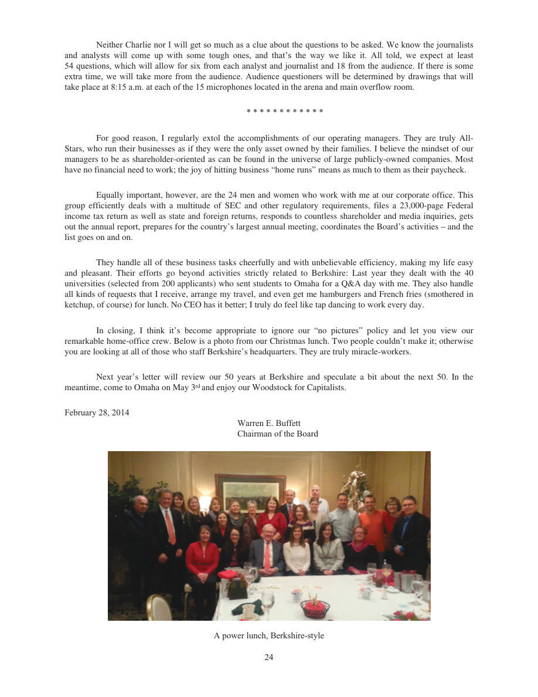
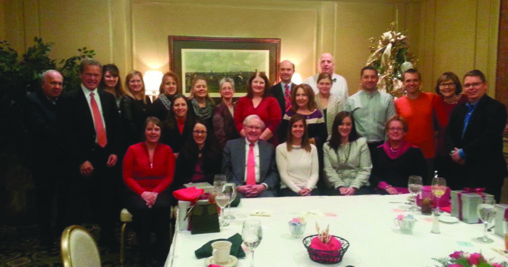

# 巴菲特2013年度致股东信 中英对照


## 原文第1页

### English

## Berkshire’s Corporate Performance vs. the S&P 500

```text
                                                                  Annual Percentage Change
                                                                                 in Per-Share      in S&P 500
                                                         Book Value of   with Dividends   Relative
                                                                          Berkshire        Included      Results
Year                                                                                 (1)                (2)           (1)-(2)
```

```text
1965  . . . . . . . . . . . . . . . . . . . . . . . . . . . . . . . . . . . . . . . . . . . . . . . . . . . . . . . .         23.8            10.0         13.8
1966  . . . . . . . . . . . . . . . . . . . . . . . . . . . . . . . . . . . . . . . . . . . . . . . . . . . . . . . .         20.3            (11.7)         32.0
1967  . . . . . . . . . . . . . . . . . . . . . . . . . . . . . . . . . . . . . . . . . . . . . . . . . . . . . . . .         11.0            30.9         (19.9)
1968  . . . . . . . . . . . . . . . . . . . . . . . . . . . . . . . . . . . . . . . . . . . . . . . . . . . . . . . .         19.0            11.0           8.0
1969  . . . . . . . . . . . . . . . . . . . . . . . . . . . . . . . . . . . . . . . . . . . . . . . . . . . . . . . .         16.2              (8.4)         24.6
1970  . . . . . . . . . . . . . . . . . . . . . . . . . . . . . . . . . . . . . . . . . . . . . . . . . . . . . . . .         12.0              3.9           8.1
1971  . . . . . . . . . . . . . . . . . . . . . . . . . . . . . . . . . . . . . . . . . . . . . . . . . . . . . . . .         16.4            14.6           1.8
1972  . . . . . . . . . . . . . . . . . . . . . . . . . . . . . . . . . . . . . . . . . . . . . . . . . . . . . . . .         21.7            18.9           2.8
1973  . . . . . . . . . . . . . . . . . . . . . . . . . . . . . . . . . . . . . . . . . . . . . . . . . . . . . . . .           4.7            (14.8)         19.5
1974  . . . . . . . . . . . . . . . . . . . . . . . . . . . . . . . . . . . . . . . . . . . . . . . . . . . . . . . .           5.5            (26.4)         31.9
1975  . . . . . . . . . . . . . . . . . . . . . . . . . . . . . . . . . . . . . . . . . . . . . . . . . . . . . . . .         21.9            37.2         (15.3)
1976  . . . . . . . . . . . . . . . . . . . . . . . . . . . . . . . . . . . . . . . . . . . . . . . . . . . . . . . .         59.3            23.6         35.7
1977  . . . . . . . . . . . . . . . . . . . . . . . . . . . . . . . . . . . . . . . . . . . . . . . . . . . . . . . .         31.9              (7.4)         39.3
1978  . . . . . . . . . . . . . . . . . . . . . . . . . . . . . . . . . . . . . . . . . . . . . . . . . . . . . . . .         24.0              6.4         17.6
1979  . . . . . . . . . . . . . . . . . . . . . . . . . . . . . . . . . . . . . . . . . . . . . . . . . . . . . . . .         35.7            18.2         17.5
1980  . . . . . . . . . . . . . . . . . . . . . . . . . . . . . . . . . . . . . . . . . . . . . . . . . . . . . . . .         19.3            32.3         (13.0)
1981  . . . . . . . . . . . . . . . . . . . . . . . . . . . . . . . . . . . . . . . . . . . . . . . . . . . . . . . .         31.4              (5.0)         36.4
1982  . . . . . . . . . . . . . . . . . . . . . . . . . . . . . . . . . . . . . . . . . . . . . . . . . . . . . . . .         40.0            21.4         18.6
1983  . . . . . . . . . . . . . . . . . . . . . . . . . . . . . . . . . . . . . . . . . . . . . . . . . . . . . . . .         32.3            22.4           9.9
1984  . . . . . . . . . . . . . . . . . . . . . . . . . . . . . . . . . . . . . . . . . . . . . . . . . . . . . . . .         13.6              6.1           7.5
1985  . . . . . . . . . . . . . . . . . . . . . . . . . . . . . . . . . . . . . . . . . . . . . . . . . . . . . . . .         48.2            31.6         16.6
1986  . . . . . . . . . . . . . . . . . . . . . . . . . . . . . . . . . . . . . . . . . . . . . . . . . . . . . . . .         26.1            18.6           7.5
1987  . . . . . . . . . . . . . . . . . . . . . . . . . . . . . . . . . . . . . . . . . . . . . . . . . . . . . . . .         19.5              5.1         14.4
1988  . . . . . . . . . . . . . . . . . . . . . . . . . . . . . . . . . . . . . . . . . . . . . . . . . . . . . . . .         20.1            16.6           3.5
1989  . . . . . . . . . . . . . . . . . . . . . . . . . . . . . . . . . . . . . . . . . . . . . . . . . . . . . . . .         44.4            31.7         12.7
1990  . . . . . . . . . . . . . . . . . . . . . . . . . . . . . . . . . . . . . . . . . . . . . . . . . . . . . . . .           7.4              (3.1)         10.5
1991  . . . . . . . . . . . . . . . . . . . . . . . . . . . . . . . . . . . . . . . . . . . . . . . . . . . . . . . .         39.6            30.5           9.1
1992  . . . . . . . . . . . . . . . . . . . . . . . . . . . . . . . . . . . . . . . . . . . . . . . . . . . . . . . .         20.3              7.6         12.7
1993  . . . . . . . . . . . . . . . . . . . . . . . . . . . . . . . . . . . . . . . . . . . . . . . . . . . . . . . .         14.3            10.1           4.2
1994  . . . . . . . . . . . . . . . . . . . . . . . . . . . . . . . . . . . . . . . . . . . . . . . . . . . . . . . .         13.9              1.3         12.6
1995  . . . . . . . . . . . . . . . . . . . . . . . . . . . . . . . . . . . . . . . . . . . . . . . . . . . . . . . .         43.1            37.6           5.5
1996  . . . . . . . . . . . . . . . . . . . . . . . . . . . . . . . . . . . . . . . . . . . . . . . . . . . . . . . .         31.8            23.0           8.8
1997  . . . . . . . . . . . . . . . . . . . . . . . . . . . . . . . . . . . . . . . . . . . . . . . . . . . . . . . .         34.1            33.4           0.7
1998  . . . . . . . . . . . . . . . . . . . . . . . . . . . . . . . . . . . . . . . . . . . . . . . . . . . . . . . .         48.3            28.6         19.7
1999  . . . . . . . . . . . . . . . . . . . . . . . . . . . . . . . . . . . . . . . . . . . . . . . . . . . . . . . .           0.5            21.0         (20.5)
2000  . . . . . . . . . . . . . . . . . . . . . . . . . . . . . . . . . . . . . . . . . . . . . . . . . . . . . . . .           6.5              (9.1)         15.6
2001  . . . . . . . . . . . . . . . . . . . . . . . . . . . . . . . . . . . . . . . . . . . . . . . . . . . . . . . .           (6.2)           (11.9)          5.7
2002  . . . . . . . . . . . . . . . . . . . . . . . . . . . . . . . . . . . . . . . . . . . . . . . . . . . . . . . .         10.0            (22.1)         32.1
2003  . . . . . . . . . . . . . . . . . . . . . . . . . . . . . . . . . . . . . . . . . . . . . . . . . . . . . . . .         21.0            28.7           (7.7)
2004  . . . . . . . . . . . . . . . . . . . . . . . . . . . . . . . . . . . . . . . . . . . . . . . . . . . . . . . .         10.5            10.9           (0.4)
2005  . . . . . . . . . . . . . . . . . . . . . . . . . . . . . . . . . . . . . . . . . . . . . . . . . . . . . . . .           6.4              4.9           1.5
2006  . . . . . . . . . . . . . . . . . . . . . . . . . . . . . . . . . . . . . . . . . . . . . . . . . . . . . . . .         18.4            15.8           2.6
2007  . . . . . . . . . . . . . . . . . . . . . . . . . . . . . . . . . . . . . . . . . . . . . . . . . . . . . . . .         11.0              5.5           5.5
2008  . . . . . . . . . . . . . . . . . . . . . . . . . . . . . . . . . . . . . . . . . . . . . . . . . . . . . . . .           (9.6)           (37.0)         27.4
2009  . . . . . . . . . . . . . . . . . . . . . . . . . . . . . . . . . . . . . . . . . . . . . . . . . . . . . . . .         19.8            26.5           (6.7)
2010  . . . . . . . . . . . . . . . . . . . . . . . . . . . . . . . . . . . . . . . . . . . . . . . . . . . . . . . .         13.0            15.1           (2.1)
2011  . . . . . . . . . . . . . . . . . . . . . . . . . . . . . . . . . . . . . . . . . . . . . . . . . . . . . . . .           4.6              2.1           2.5
2012  . . . . . . . . . . . . . . . . . . . . . . . . . . . . . . . . . . . . . . . . . . . . . . . . . . . . . . . .         14.4            16.0           (1.6)
2013  . . . . . . . . . . . . . . . . . . . . . . . . . . . . . . . . . . . . . . . . . . . . . . . . . . . . . . . .         18.2            32.4         (14.2)
```

```text
Compounded Annual Gain – 1965-2013   . . . . . . . . . . . . . . . . . . . . . . . . . . .        19.7%         9.8%         9.9
Overall Gain – 1964-2013  . . . . . . . . . . . . . . . . . . . . . . . . . . . . . . . . . . . . . . .     693,518%       9,841%
```

Notes: Data are for calendar years with these exceptions: 1965 and 1966, year ended 9/30; 1967, 15 months ended 12/31. Starting in 1979, accounting rules required insurance companies to value the equity securities they hold at market rather than at the lower of cost or market, which was previously the requirement. In this table, Berkshire’s results through 1978 have been restated to conform to the changed rules. In all other respects, the results are calculated using the numbers originally reported. The S&P 500 numbers are pre-tax whereas the Berkshire numbers are after- tax. If a corporation such as Berkshire were simply to have owned the S&P 500 and accrued the appropriate taxes, its results would have lagged the S&P 500 in years when that index showed a positive return, but would have exceeded the S&P 500 in years when the index showed a negative return. Over the years, the tax costs would have caused the aggregate lag to be substantial.

### 中文

## 伯克希尔公司表现与标普500比较

| 年度 | 伯克希尔每股账面价值年度变动（1） | 标普500含股息年度变动（2） | 相对结果（1－2，百分点） |
| --- | --- | --- | --- |
| 1965 | 23.8% | 10.0% | 13.8 |
| 1966 | 20.3% | (11.7%) | 32.0 |
| 1967 | 11.0% | 30.9% | (19.9) |
| 1968 | 19.0% | 11.0% | 8.0 |
| 1969 | 16.2% | (8.4%) | 24.6 |
| 1970 | 12.0% | 3.9% | 8.1 |
| 1971 | 16.4% | 14.6% | 1.8 |
| 1972 | 21.7% | 18.9% | 2.8 |
| 1973 | 4.7% | (14.8%) | 19.5 |
| 1974 | 5.5% | (26.4%) | 31.9 |
| 1975 | 21.9% | 37.2% | (15.3) |
| 1976 | 59.3% | 23.6% | 35.7 |
| 1977 | 31.9% | (7.4%) | 39.3 |
| 1978 | 24.0% | 6.4% | 17.6 |
| 1979 | 35.7% | 18.2% | 17.5 |
| 1980 | 19.3% | 32.3% | (13.0) |
| 1981 | 31.4% | (5.0%) | 36.4 |
| 1982 | 40.0% | 21.4% | 18.6 |
| 1983 | 32.3% | 22.4% | 9.9 |
| 1984 | 13.6% | 6.1% | 7.5 |
| 1985 | 48.2% | 31.6% | 16.6 |
| 1986 | 26.1% | 18.6% | 7.5 |
| 1987 | 19.5% | 5.1% | 14.4 |
| 1988 | 20.1% | 16.6% | 3.5 |
| 1989 | 44.4% | 31.7% | 12.7 |
| 1990 | 7.4% | (3.1%) | 10.5 |
| 1991 | 39.6% | 30.5% | 9.1 |
| 1992 | 20.3% | 7.6% | 12.7 |
| 1993 | 14.3% | 10.1% | 4.2 |
| 1994 | 13.9% | 1.3% | 12.6 |
| 1995 | 43.1% | 37.6% | 5.5 |
| 1996 | 31.8% | 23.0% | 8.8 |
| 1997 | 34.1% | 33.4% | 0.7 |
| 1998 | 48.3% | 28.6% | 19.7 |
| 1999 | 0.5% | 21.0% | (20.5) |
| 2000 | 6.5% | (9.1%) | 15.6 |
| 2001 | (6.2%) | (11.9%) | 5.7 |
| 2002 | 10.0% | (22.1%) | 32.1 |
| 2003 | 21.0% | 28.7% | (7.7) |
| 2004 | 10.5% | 10.9% | (0.4) |
| 2005 | 6.4% | 4.9% | 1.5 |
| 2006 | 18.4% | 15.8% | 2.6 |
| 2007 | 11.0% | 5.5% | 5.5 |
| 2008 | (9.6%) | (37.0%) | 27.4 |
| 2009 | 19.8% | 26.5% | (6.7) |
| 2010 | 13.0% | 15.1% | (2.1) |
| 2011 | 4.6% | 2.1% | 2.5 |
| 2012 | 14.4% | 16.0% | (1.6) |
| 2013 | 18.2% | 32.4% | (14.2) |
| 1965—2013年年复合增长 | 19.7% | 9.8% | 9.9 |
| 1964—2013年累计增长 | 693,518% | 9,841% | — |

注：除以下情况，数据均按日历年：1965与1966年为截至9月30日的一年；1967年为截至12月31日的十五个月。

自1979年起，会计规则要求，保险公司持有的股票按市价计量，而非此前的成本与市价孰低。本表伯克希尔截至1978年的结果，已按新规则重列；其余方面，都使用原来报告的数字。

标普500为税前数字，伯克希尔为税后。若像伯克希尔这样的公司，只持有标普500并计提相应税款，指数正回报年份，会落后；指数负回报年份，则会领先。长久而言，税收成本会使累计落后相当显著。


## 原文第2页

### English

BERKSHIRE HATHAWAY INC.

To the Shareholders of Berkshire Hathaway Inc.:

Berkshire’s gain in net worth during 2013 was $34.2 billion. That gain was after our deducting $1.8 billion of charges – meaningless economically, as I will explain later – that arose from our purchase of the minority interests in Marmon and Iscar. After those charges, the per-share book value of both our Class A and Class B stock increased by 18.2%. Over the last 49 years (that is, since present management took over), book value has grown from $19 to $134,973, a rate of 19.7% compounded annually.*

On the facing page, we show our long-standing performance measurement: The yearly change in Berkshire’s per-share book value versus the market performance of the S&P 500. What counts, of course, is per- share intrinsic value. But that’s a subjective figure, and book value is useful as a rough tracking indicator. (An extended discussion of intrinsic value is included in our Owner-Related Business Principles on pages 103 - 108. Those principles have been included in our reports for 30 years, and we urge new and prospective shareholders to read them.)

As I’ve long told you, Berkshire’s intrinsic value far exceeds its book value. Moreover, the difference has widened considerably in recent years. That’s why our 2012 decision to authorize the repurchase of shares at 120% of book value made sense. Purchases at that level benefit continuing shareholders because per-share intrinsic value exceeds that percentage of book value by a meaningful amount. We did not purchase shares during 2013, however, because the stock price did not descend to the 120% level. If it does, we will be aggressive.

Charlie Munger, Berkshire’s vice chairman and my partner, and I believe both Berkshire’s book value and intrinsic value will outperform the S&P in years when the market is down or moderately up. We expect to fall short, though, in years when the market is strong – as we did in 2013. We have underperformed in ten of our 49 years, with all but one of our shortfalls occurring when the S&P gain exceeded 15%.

Over the stock market cycle between yearends 2007 and 2013, we overperformed the S&P. Through full cycles in future years, we expect to do that again. If we fail to do so, we will not have earned our pay. After all, you could always own an index fund and be assured of S&P results.

## The Year at Berkshire

On the operating front, just about everything turned out well for us last year – in certain cases very well. Let me count the ways:

Š  We completed two large acquisitions, spending almost $18 billion to purchase all of NV Energy and a major interest in H. J. Heinz. Both companies fit us well and will be prospering a century from now.

With the Heinz purchase, moreover, we created a partnership template that may be used by Berkshire in future acquisitions of size. Here, we teamed up with investors at 3G Capital, a firm led by my friend, Jorge Paulo Lemann. His talented associates – Bernardo Hees, Heinz’s new CEO, and Alex Behring,  its Chairman – are responsible for operations.

* All per-share figures used in this report apply to Berkshire’s A shares. Figures for the B shares are 1/1500th of those shown for A.

### 中文

伯克希尔·哈撒韦公司

致伯克希尔·哈撒韦公司的股东：

2013年，伯克希尔净资产增加342亿美元。这已扣除购买马蒙与伊斯卡少数股权所产生的18亿美元费用，后面会解释，它在经济上毫无意义。扣除后，A类股与B类股每股账面价值均增长18.2%。过去49年，也就是现任管理层接手以来，每股账面价值从19美元增至134,973美元，年复合增长率19.7%。*

对页列着长期使用的业绩尺度：伯克希尔每股账面价值年度变动，与标普500市场表现比较。当然，真正重要的是每股内在价值。但它是主观数字，账面价值可作粗略追踪指标。第103—108页《与所有者有关的经营原则》，详细讨论内在价值。原则列入年报已有30年，我们敦促新股东与潜在股东阅读。

长期以来，我一直告诉你们，内在价值远超账面价值，而且近年差距明显扩大。因此，2012年授权以账面价值120%回购，很有道理。每股内在价值显著超过这个比例，按此购买，会让继续持有的股东获益。不过，2013年没有回购，因为价格没跌到120%。真到了，我们会积极出手。

伯克希尔副董事长、我的搭档查理·芒格和我相信，市场下跌或温和上涨时，账面价值与内在价值都会超过标普；市场强劲时，则预期落后，2013年就是如此。49年中，十年落后，除一年外，都发生在标普上涨超过15%时。

2007年底到2013年底的整个股市周期，我们胜过标普。未来完整周期，预期仍能做到。如果不行，就没挣到工资。毕竟，你们随时可以买指数基金，确保得到标普结果。

## 伯克希尔这一年

经营方面，去年几乎事事顺利，有些极其顺利。容我逐一道来：

- 我们完成两项大型收购，花近180亿美元，全资买下NV Energy，并取得亨氏重大权益。两家都很适合我们，一个世纪后仍会兴旺。

收购亨氏，还创造了一种未来大型收购可用的合作模式。伙伴是3G Capital的投资者，由朋友若热·保罗·雷曼领导。能干的同事，亨氏新首席执行官贝尔纳多·希斯，以及董事长亚历克斯·贝林，负责经营。

*本报告所有每股数字均适用于伯克希尔A类股，B类股相应数字为A类股的1/1500。


## 原文第3页

### English

Berkshire is the financing partner. In that role, we purchased $8 billion of Heinz preferred stock that carries a 9% coupon but also possesses other features that should increase the preferred’s annual return to 12% or so. Berkshire and 3G each purchased half of the Heinz common stock for $4.25 billion.

Though the Heinz acquisition has some similarities to a “private equity” transaction, there is a crucial difference: Berkshire never intends to sell a share of the company. What we would like, rather, is to buy more, and that could happen: Certain 3G investors may sell some or all of their shares in the future, and we might increase our ownership at such times. Berkshire and 3G could also decide at some point that it would be mutually beneficial if we were to exchange some of our preferred for common shares (at an equity valuation appropriate to the time).

Our partnership took control of Heinz in June, and operating results so far are encouraging. Only minor earnings from Heinz, however, are reflected in those we report for Berkshire this year: One-time charges incurred in the purchase and subsequent restructuring of operations totaled $1.3 billion. Earnings in 2014 will be substantial.

With Heinz, Berkshire now owns 81⁄2 companies that, were they stand-alone businesses, would be in the Fortune 500. Only 4911⁄2 to go.

NV Energy, purchased for $5.6 billion by MidAmerican Energy, our utility subsidiary, supplies electricity to about 88% of Nevada’s population. This acquisition  fits nicely into our existing  electric-utility operation and offers many possibilities for large investments in renewable energy. NV Energy will not be MidAmerican’s last major acquisition.

Š   MidAmerican is one of our “Powerhouse Five” – a collection of large non-insurance businesses that, in aggregate, had a record $10.8 billion of pre-tax earnings in 2013, up $758 million from 2012. The other companies in this sainted group are BNSF, Iscar, Lubrizol and Marmon.

Of the five, only MidAmerican, then earning $393 million pre-tax, was owned by Berkshire nine years ago. Subsequently, we purchased another three of the five on an all-cash basis. In acquiring the fifth, BNSF, we paid about 70% of the cost in cash, and, for the remainder, issued shares that increased the number outstanding by 6.1%. In other words, the $10.4 billion gain in annual earnings delivered Berkshire by the five companies over the nine-year span has been accompanied by only minor dilution. That satisfies our goal of not simply growing, but rather increasing per-share results.

If the U.S. economy continues to improve in 2014, we can expect earnings of our Powerhouse Five to improve also – perhaps by $1 billion or so pre-tax.

Š   Our many dozens of smaller non-insurance businesses earned $4.7 billion pre-tax last year, up from $3.9 billion in 2012. Here, too, we expect further gains in 2014.

Š   Berkshire’s extensive insurance operation again operated at an underwriting profit in 2013 – that makes 11 years in a row – and increased its float. During that 11-year stretch, our float – money that doesn’t belong to us but that we can invest for Berkshire’s benefit – has grown from $41 billion to $77 billion. Concurrently, our underwriting profit has aggregated $22 billion pre-tax, including $3 billion realized in 2013. And all of this all began with our 1967 purchase of National Indemnity for $8.6 million.

We now own a wide variety of exceptional insurance operations. Best known is GEICO, the car insurer Berkshire acquired in full at yearend 1995 (having for many years prior owned a partial interest). GEICO in 1996 ranked number seven among U.S. auto insurers. Now, GEICO is number two, having recently passed Allstate. The reasons for this amazing growth are simple: low prices and reliable service. You can do yourself a favor by calling 1-800-847-7536 or checking Geico.com to see if you, too, can cut your insurance costs. Buy some of Berkshire’s other products with the savings.

### 中文

伯克希尔是出资伙伴。我们购买80亿美元亨氏优先股，票面股息率9%，还有其他特点，应使年度回报达到约12%。另外，伯克希尔与3G各花42.5亿美元，买下亨氏普通股一半。

虽有些像“私募股权”交易，却有关键不同：伯克希尔从不打算卖一股，反而想多买，而且可能实现。3G某些投资者未来可能卖部分或全部，届时我们可以增持。未来某时，双方也可能认为，以适当的当时股权估值，把部分优先股换普通股，互相有利。

合作企业6月取得亨氏控制权，迄今经营结果令人鼓舞。但本年报告利润里，亨氏贡献很少，因为购买及随后重组，一次性费用合计13亿美元。2014年利润会很可观。

算上亨氏，我们如今拥有八家半若独立存在就能进《财富》500强的公司。只剩491家半了。

公用事业子公司中美能源，以56亿美元买下NV Energy，向内华达州约88%人口供电。这项收购很适合现有电力业务，也带来许多可再生能源大规模投资机会。它不会是中美能源最后一项大型收购。

- 中美能源是“五台强力发动机”之一，这批大型非保险企业，2013年合计税前利润创纪录，达108亿美元，比2012年多7.58亿美元。其余四家是BNSF、伊斯卡、路博润和马蒙。

九年前，五家之中我们只拥有中美能源，当时税前赚3.93亿美元。此后另外三家全用现金买下；第五家BNSF，约70%成本用现金，其余发行股票，使流通股数增6.1%。换句话说，九年间，五家每年给伯克希尔增加104亿美元利润，只伴随少量稀释。符合我们的目标：不仅增长，更要增加每股结果。

如果2014年美国经济继续改善，可以预期五家利润也提高，也许税前增加约10亿美元。

- 数十家较小非保险企业，去年税前赚47亿美元，2012年39亿美元，2014年也预期再进步。

- 庞大的保险业务，2013年又承保盈利，连续11年，还增加了浮存金。11年间，这些不属于我们、却能供伯克希尔投资获利的资金，从410亿美元增至770亿美元；同时，累计税前承保利润220亿美元，包括2013年的30亿美元。一切，始于1967年以860万美元购买国民赔偿。

如今，我们拥有多种非凡保险业务。最知名的GEICO，1995年底全资收购，更早多年已持有部分。1996年，全美汽车保险商排第七，如今刚超过好事达，名列第二。惊人增长，理由简单：低价与可靠服务。拨打1-800-847-7536或访问Geico.com，看看能否降低保险成本，帮自己一个忙。省下的钱，买点伯克希尔其他产品。


## 原文第4页

### English

Š   While Charlie and I search for elephants, our many subsidiaries are regularly making bolt-on acquisitions. Last year, we contracted for 25 of these, scheduled to cost $3.1 billion in aggregate. These transactions ranged from $1.9 million to $1.1 billion in size.

Charlie and I encourage these deals. They deploy capital in activities that fit with our existing businesses and that will be managed by our corps of expert managers. The result is no more work for us and more earnings for you. Many more of these bolt-on deals will be made in future years. In aggregate, they will be meaningful.

Š   Last year we invested $3.5 billion in the surest sort of bolt-on: the purchase of additional shares in two wonderful businesses that we already controlled. In one case – Marmon – our purchases brought us to the 100% ownership we had signed up for in 2008. In the other instance – Iscar – the Wertheimer family elected to exercise a put option it held, selling us the 20% of the business it retained when we bought control in 2006.

These purchases added about $300 million pre-tax to our current earning power and also delivered us $800 million of cash. Meanwhile, the same nonsensical accounting rule that I described in last year’s letter required that we enter these purchases on our books at $1.8 billion less than we paid, a process that reduced Berkshire’s book value. (The charge was made to “capital in excess of par value”; figure that one out.) This weird accounting, you should understand, instantly increased Berkshire’s excess of intrinsic value over book value by the same $1.8 billion.

Š   Our subsidiaries spent a record $11 billion on plant and equipment during 2013, roughly twice our depreciation charge. About 89% of that money was spent in the United States. Though we invest abroad as well, the mother lode of opportunity resides in America.

Š   In a year in which most equity managers found  it impossible to outperform the S&P 500, both Todd Combs and Ted Weschler handily did so. Each now runs a portfolio exceeding $7 billion. They’ve earned it.

I must again confess that their investments outperformed mine. (Charlie says I should add “by a lot.”) If such humiliating comparisons continue, I’ll have no choice but to cease talking about them.

Todd and Ted have also created significant value for you in several matters unrelated to their portfolio activities. Their contributions are just beginning: Both men have Berkshire blood in their veins.

Š   Berkshire’s yearend employment – counting Heinz – totaled a record 330,745, up 42,283 from last year. The  increase,  I must admit, included one person  at our Omaha home  office. (Don’t panic: The headquarters gang still fits comfortably on one floor.)

Š   Berkshire increased its ownership interest last year in each of its “Big Four” investments – American Express, Coca-Cola, IBM and Wells Fargo. We purchased additional shares of Wells Fargo (increasing our ownership to 9.2% versus 8.7% at yearend 2012) and IBM (6.3% versus 6.0%). Meanwhile, stock repurchases at Coca-Cola and American Express raised our percentage ownership. Our equity in Coca- Cola grew from 8.9% to 9.1% and our interest in American Express from 13.7% to 14.2%. And, if you think tenths of a percent aren’t important, ponder this math: For the four companies in aggregate, each increase of one-tenth of a percent in our share of their equity raises Berkshire’s share of their annual earnings by $50 million.

### 中文

- 查理和我找大象时，众多子公司经常作补充收购。去年签约25项，预计总成本31亿美元，单笔从190万美元到11亿美元。

我们鼓励这些交易，把资本投入与现有业务相配、由专家经理经营的活动。结果是我们不用多干活，你们多赚利润。未来还会有许多，合计将十分重要。

- 去年，35亿美元投在最有把握的补充收购：增持两家已经控制的优秀企业。马蒙的购买，让持股达到2008年约定的100%；伊斯卡方面，韦特海默家族行使出售选择权，把2006年控制权收购时留下的20%，卖给我们。

购买使当前税前盈利能力增加约3亿美元，还带来8亿美元现金。同时，去年信中所说同一条荒唐会计规则，要求按比实付款低18亿美元入账，从而减少账面价值。费用记入“超过面值的资本”，你们琢磨一下吧。这项古怪会计，立即使伯克希尔内在价值超过账面价值的差额，也增加同样18亿美元。

- 子公司厂房设备支出创纪录，达110亿美元，约为折旧两倍，约89%花在美国。虽也海外投资，机会的主矿脉仍在美国。

- 多数股票经理都觉得无法胜过标普500的一年，托德·康布斯和特德·韦施勒却轻松做到。如今，每人管理超过70亿美元，他们配得上。

我又得承认，他们投资表现超过我，查理说应该加“多得多”。这种羞辱性比较再继续，我只好不再谈他们。

除了组合活动，托德和特德还在几件事上，为你们创造重大价值。贡献才刚开始，两人血管里都流着伯克希尔的血。

- 年底含亨氏，员工总数创纪录，达330,745人，比上年多42,283人。必须承认，奥马哈总部也增加一人。别慌，大家仍能舒舒服服待在一层楼。

- “四大”投资，美国运通、可口可乐、IBM与富国银行，持股比例全部提高。增持使富国银行从2012年底8.7%升至9.2%，IBM从6.0%升至6.3%；回购让可口可乐从8.9%升至9.1%，美国运通从13.7%升至14.2%。如果觉得零点几个百分点不重要，想想：合计而言，四家权益每增加0.1个百分点，就使伯克希尔应占年度利润多5,000万美元。


## 原文第5页

### English

The four companies possess excellent businesses and are run by managers who are both talented and shareholder-oriented. At Berkshire, we much prefer owning a non-controlling but substantial portion of a wonderful company to owning 100% of a so-so business; it’s better to have a partial interest in the Hope diamond than to own all of a rhinestone.

Going by our yearend holdings, our portion of the “Big Four’s” 2013 earnings amounted to $4.4 billion. In the earnings we report to you, however, we include only the dividends we receive – about $1.4 billion last year. But make no mistake: The $3 billion of their earnings we don’t report is every bit as valuable to us as the portion Berkshire records.

The earnings that these four companies retain are often used for repurchases of their own stock – a move that enhances our share of future earnings – as well as for funding business opportunities that usually turn out to be advantageous. All that leads us to expect that the per-share earnings of these four investees will grow substantially over time. If they do, dividends to Berkshire will increase and, even more important, our unrealized capital gains will, too. (For the four, unrealized gains already totaled $39 billion at yearend.)

Our flexibility in capital allocation – our willingness to invest large sums passively in non-controlled businesses – gives us a significant advantage over companies that limit themselves to acquisitions they can operate. Woody Allen stated the general idea when he said: “The advantage of being bi-sexual is that it doubles your chances for a date on Saturday night.” Similarly, our appetite for either operating businesses or passive investments doubles our chances of finding sensible uses for our endless gusher of cash.

---

Late in 2009, amidst the gloom of the Great Recession, we agreed to buy BNSF, the largest purchase in Berkshire’s history. At the time, I called the transaction an “all-in wager on the economic future of the United States.”

That kind of commitment was nothing new for us: We’ve been making similar wagers ever since Buffett Partnership Ltd. acquired control of Berkshire in 1965. For good reason, too. Charlie and I have always considered a “bet” on ever-rising U.S. prosperity to be very close to a sure thing.

Indeed, who has ever benefited during the past 237 years by betting against America? If you compare our country’s present condition to that existing in 1776, you have to rub your eyes in wonder. And the dynamism embedded in our market economy will continue to work its magic. America’s best days lie ahead.

With this tailwind working for us, Charlie and I hope to build Berkshire’s per-share intrinsic value by (1) constantly improving the basic earning power of our many subsidiaries; (2) further increasing their earnings through bolt-on acquisitions; (3) benefiting from the growth of our investees; (4) repurchasing Berkshire shares when they are available at a meaningful discount from intrinsic value; and (5) making an occasional large acquisition. We will also try to maximize results for you by rarely, if ever, issuing Berkshire shares.

Those building blocks rest on a rock-solid foundation. A century hence, BNSF and MidAmerican Energy will still be playing major roles in our economy. Insurance will concomitantly be essential for both businesses and individuals – and no company brings greater human and financial resources to that business than Berkshire.

Moreover, we will always maintain supreme financial strength, operating with at least $20 billion of cash equivalents and never incurring material amounts of short-term obligations. As we view these and other strengths, Charlie and I like your company’s prospects. We feel fortunate to be entrusted with its management.

### 中文

四家公司业务优秀，经理既有才干，又为股东着想。相比全资拥有平平企业，我们更喜欢不控股、但大量持有优秀企业。拥有希望钻石的一部分，比整颗水钻强。

按年底持仓，应占四家公司2013年利润为44亿美元，但报告利润只包括收到的股息，去年约14亿美元。请别误会，没报告的30亿美元，和入账的一样有价值。

四家留存利润，常用于回购自身股票，扩大我们对未来利润的份额，也为通常有利的经营机会融资。因此，我们预期，每股利润会随时间显著增长。若如此，伯克希尔收到股息会增加；更重要的，未实现资本利得也增加，年底四家已合计390亿美元。

资本配置灵活，愿把大笔资金被动投在不控制的企业，让我们比那些只愿收购自己能经营企业的公司有显著优势。伍迪·艾伦概括过：“双性恋的优势，是让星期六晚上约会的机会翻倍。”类似地，经营企业和被动投资，我们都吃得下，就让源源喷出的现金，找到合理用途的机会翻倍。

* * *

2009年底，大衰退阴霾中，我们同意收购BNSF，是伯克希尔史上最大购买。我当时称之为“对美国经济未来的全押”。

这种承诺，不是新事。自1965年巴菲特合伙企业取得控制权，就一直作类似下注，理由充分。查理和我始终认为，押美国繁荣持续增长，几乎是稳操胜券。

过去237年，谁曾靠看空美国获益？把今天与1776年比较，你简直要揉眼睛惊叹。市场经济内在活力，会继续创造魔力。美国最好的日子仍在前头。

顺风相助，查理和我希望，通过五种方式增加每股内在价值：（1）不断改善子公司基本盈利能力；（2）补充收购，进一步增加利润；（3）受益于被投资公司成长；（4）股价显著低于内在价值时回购；（5）偶尔作大型收购。也会尽可能少发行伯克希尔股票，最好不发行，来最大化你们的结果。

这些积木，立在坚如磐石的基础上。一世纪后，BNSF和中美能源仍是经济重要角色。企业与个人始终需要保险，没有公司能带来比伯克希尔更多的人才与财力。

另外，始终维持最强财务实力，至少持有200亿美元现金等价物，绝不承担重大短期义务。看到这些及其他优势，查理和我喜欢你们公司的前景，觉得受托管理，非常幸运。


## 原文第6页

### English

## Intrinsic Business Value

As much as Charlie and I talk about intrinsic business value, we cannot tell you precisely what that number is for Berkshire shares (nor, in fact, for any other stock). In our 2010 annual report, however, we laid out the three elements – one of them qualitative – that we believe are the keys to a sensible estimate of Berkshire’s intrinsic value. That discussion is reproduced in full on pages 109 - 110.

Here is an update of the two quantitative factors: In 2013 our per-share investments increased 13.6% to $129,253 and our pre-tax earnings from businesses other than insurance and investments increased 12.8% to $9,116 per share.

Since 1970, our per-share investments have increased at a rate of 19.3% compounded annually, and our earnings figure has grown at a 20.6% clip. It is no coincidence that the price of Berkshire stock over the 43-year period has increased at a rate very similar to that of our two measures of value. Charlie and I like to see gains in both sectors, but we will most strongly focus on building operating earnings.

---

Now, let’s examine the four major sectors of our operations. Each has vastly different balance sheet and income characteristics from the others. So we’ll present them as four separate businesses, which is how Charlie and I view them (though there are important and enduring advantages to having them all under one roof). Our goal is to provide you with the information we would wish to have if our positions were reversed, with you being the reporting manager and we the absentee shareholders. (But don’t get any ideas!)

Insurance

“Our investment in the insurance companies reflects a first major step in our efforts to achieve a more diversified base of earning power.” — 1967 Annual Report

Let’s look first at insurance, Berkshire’s core operation and the engine that has consistently propelled our expansion since that 1967 report was published.

Property-casualty (“P/C”) insurers receive premiums upfront and pay claims later. In extreme cases, such as those arising from certain workers’ compensation accidents, payments can stretch over decades. This collect- now, pay-later model leaves P/C companies holding large sums – money we call “float” – that will eventually go to others. Meanwhile, insurers get to invest this float for their benefit. Though individual policies and claims come and go, the amount of float an insurer holds usually remains fairly stable in relation to premium volume. Consequently, as our business grows, so does our float. And how we have grown, as the following table shows:

Year                           Float (in $ millions)

```text
1970                            $    39
1980                               237
1990                                 1,632
2000                               27,871
2010                               65,832
2013                               77,240
```

Further gains in float will be tough to achieve. On the plus side, GEICO’s float will almost certainly grow. In National Indemnity’s reinsurance division, however, we have a number of run-off contracts whose float drifts downward. If we do experience a decline in float at some future time, it will be very gradual – at the outside no more than 3% in any year. The nature of our insurance contracts is such that we can never be subject to immediate demands for sums that are large compared to our cash resources. (In this respect, property-casualty insurance differs in an important way from certain forms of life insurance.)

### 中文

## 企业内在价值

虽然查理和我经常谈企业内在价值，却不能精确告诉你们，伯克希尔股票，乃至任何股票，这个数字究竟多少。不过，2010年年报提出三项关键因素，其中一项定性，帮助合理估值，全文转载在第109—110页。

更新两项数量指标：2013年，每股投资额增13.6%，至129,253美元；保险与投资以外业务的每股税前利润，增12.8%，至9,116美元。

1970年以来，每股投资额年复合增19.3%，利润增20.6%。43年间，股价以与两项价值尺度非常相近的速度上升，并非巧合。查理和我喜欢两端都进步，但最侧重的，仍是增加经营利润。

* * *

现在，看看四个主要板块。资产负债表与利润特点彼此迥异，因此会当成四门独立生意介绍，查理和我也是这样看的，虽然放在同一屋檐下，有重要而持久的优势。目标是提供这样的信息：如果位置对调，你们报告经营，我们当不管事的股东，自己希望知道什么。不过，别动什么念头！

## 保险

“我们对保险公司的投资，是努力建立更多样盈利基础的第一个重大步骤。”

——1967年年报

先看保险。它是核心业务，自1967年报告以来，一直是推动扩张的发动机。

财产及意外伤害保险公司先收保费，后付赔款。极端情形，例如特定工伤事故，付款可能延续几十年。这种“现在收钱、以后付款”的模式，让财险公司握着大量最终须付给别人的资金，称为“浮存金”。期间，保险商可以拿去投资，为自身获利。虽然单张保单与索赔来来去去，相对于保费规模，浮存金通常相当稳定。所以，业务增长，浮存金也增长。看下表，我们增长可真不少：

| 年度 | 浮存金，百万美元 |
| :--- | ---: |
| 1970 | 39 |
| 1980 | 237 |
| 1990 | 1,632 |
| 2000 | 27,871 |
| 2010 | 65,832 |
| 2013 | 77,240 |

进一步增长不容易。好的一面，GEICO几乎肯定增加；但国民赔偿再保险部门，有一些逐步退出的合约，浮存金缓缓减少。如果未来某时下降，会非常渐进，一年最多不超过3%。合约性质决定，我们绝不可能被立即要求支付相对于现金资源而言很大的金额。这方面，财险与某些寿险有重要区别。


## 原文第7页

### English

If our premiums exceed the total of our expenses and eventual losses, we register an underwriting profit that adds to the investment income our float produces. When such a profit is earned, we enjoy the use of free money – and, better yet, get paid for holding it.

Unfortunately, the wish of all insurers to achieve this happy result creates intense competition, so vigorous in most years that it causes the P/C industry as a whole to operate at a significant underwriting loss. This loss, in effect, is what the industry pays to hold its float. For example, State Farm, by far the country’s largest insurer and a well-managed company besides, incurred an underwriting loss in nine of the twelve years ending in 2012 (the latest year for which their financials are available, as I write this). Competitive dynamics almost guarantee that the insurance industry – despite the float income all companies enjoy – will continue its dismal record of earning subnormal returns as compared to other businesses.

As noted in the first section of this report, we have now operated at an underwriting profit for eleven consecutive years, our pre-tax gain for the period having totaled $22 billion. Looking ahead, I believe we will continue to underwrite profitably in most years. Doing so is the daily focus of all of our insurance managers who know that while float is valuable, it can be drowned by poor underwriting results.

So how does our float affect intrinsic value? When Berkshire’s book value is calculated, the full amount of our float is deducted as a liability, just as if we had to pay it out tomorrow and could not replenish it. But to think of float as strictly a liability is incorrect; it should instead be viewed as a revolving fund. Daily, we pay old claims – some $17 billion to more than five million claimants in 2013 – and that reduces float. Just as surely, we each day write new business and thereby generate new claims that add to float. If our revolving float is both costless and long-enduring, which I believe it will be, the true value of this liability is dramatically less than the accounting liability.

A counterpart to this overstated liability is $15.5 billion of “goodwill” that is attributable to our insurance companies and included in book value as an asset. In very large part, this goodwill represents the price we paid for the float-generating capabilities of our insurance operations. The cost of the goodwill, however, has no bearing on its true value. For example, if an insurance business sustains large and prolonged underwriting losses, any goodwill asset carried on the books should be deemed valueless, whatever its original cost.

Fortunately, that does not describe Berkshire. Charlie and I believe the true economic value of our insurance goodwill – what we would happily pay to purchase an insurance operation possessing float of similar quality to that we have – to be far in excess of its historic carrying value. The value of our float is one reason – a huge reason – why we believe Berkshire’s intrinsic business value substantially exceeds its book value.

---

Berkshire’s attractive insurance economics exist only because we have some terrific managers running disciplined operations that possess strong, hard-to-replicate business models. Let me tell you about the major units.

First by float size is the Berkshire Hathaway Reinsurance Group, managed by Ajit Jain. Ajit insures risks that no one else has the desire or the capital to take on. His operation combines capacity, speed, decisiveness and, most important, brains in a manner unique in the insurance business. Yet he never exposes Berkshire to risks that are inappropriate in relation to our resources. Indeed, we are far more conservative in avoiding risk than most large insurers. For example,  if the insurance industry should experience a $250  billion  loss from some mega- catastrophe – a loss about triple anything it has ever experienced – Berkshire as a whole would likely record a significant profit for the year because of its many streams of earnings. And we would remain awash in cash, looking for large opportunities if the catastrophe caused markets to go into shock. All other major insurers and reinsurers would meanwhile be far in the red, with some facing insolvency.

From a standing start in 1985, Ajit has created an insurance business with float of $37 billion and a large cumulative underwriting profit, a feat no other insurance CEO has come close to matching. Ajit’s mind is an idea factory that is always looking for more lines of business he can add to his current assortment.

### 中文

保费超过全部费用与最终赔款，就有承保利润，再加上浮存金投资收益。如此，我们不仅免费用钱，更好的是，还拿钱替人保管。

不幸的是，保险商全想这样，竞争激烈到多数年份，整个财险行业都大额承保亏损。这实际上是行业持有浮存金的成本。例如，全美遥遥领先的最大保险商、而且经营良好的州立农场保险，截至2012年的12年，九年承保亏损，写信时最新财务数据只到2012年。竞争态势几乎保证，即使都享有浮存金收益，保险业相对于其他行业，仍会延续低于正常水平的惨淡回报。

前面说过，我们连续11年承保盈利，累计税前220亿美元。我相信，未来多数年份继续如此。所有保险经理每天都专注于此，知道浮存金虽宝贵，糟糕承保却能把它淹没。

浮存金怎样影响内在价值？计算账面价值时，全额当负债扣除，仿佛明天就得付出，而且无法补充。但完全只当负债，是错误的，应该看作循环资金。每天赔付旧索赔，2013年向超过500万索赔人付约170亿美元，使浮存金减少；每天又承接新业务，产生新赔偿责任，增加浮存金。如果循环资金无成本、又长存，我相信会如此，其真实负债价值就大幅低于会计负债。

与这个高估负债相对应的，是账面作为资产列示、属于保险企业的155亿美元“商誉”。很大程度上，代表我们为产生浮存金的能力支付的价格。但商誉成本与真实价值无关。例如，长期大额承保亏损的企业，账面商誉不论成本多少，都应视为毫无价值。

幸好，伯克希尔不是如此。查理和我相信，真实经济商誉，也就是我们愿为拥有同样质量浮存金的保险企业支付的价格，远高于历史账面值。浮存金价值，是内在价值显著超过账面价值的一个原因，而且是极大的原因。

* * *

诱人的保险经济特性，只因为有出色经理，经营着有纪律、商业模式强大而难以复制的企业。下面介绍主要单位。

按浮存金规模居首，是阿吉特·贾恩管理的伯克希尔·哈撒韦再保险集团。他承保别人不愿、或没有资本承接的风险，把承保能力、速度、决断，尤其头脑，独一无二地结合。但绝不让伯克希尔承担相对于资源不适当的风险。事实上，回避风险这方面，比多数大型保险商保守得多。例如，某次超级巨灾若使行业损失2,500亿美元，约为以往任何一次三倍，凭众多利润来源，伯克希尔整体很可能当年仍取得可观利润，现金也充盈。若灾难震动市场，我们还能寻找大机会。同时，其他大型保险商、再保险商都会严重亏损，有些无力偿付。

1985年从零起步，阿吉特创造出一家370亿美元浮存金、累计承保利润巨大的企业，没有其他保险首席执行官接近。他的脑子是点子工厂，总在寻找能加入现有组合的新业务。


## 原文第8页

### English

One venture materialized last June when he formed Berkshire Hathaway Specialty Insurance (“BHSI”). This initiative took us into commercial insurance, where we were instantly accepted by both major insurance brokers and corporate risk managers throughout America. These professionals recognize that no other insurer can match the financial strength of Berkshire, which guarantees that legitimate claims arising many years in the future will be paid promptly and fully.

BHSI is led by Peter Eastwood, an experienced underwriter who is widely respected in the insurance world. Peter has assembled a spectacular team that is already writing a substantial amount of business with many Fortune 500 companies and with smaller operations as well. BHSI will be a major asset for Berkshire, one that will generate volume in the billions within a few years. Give Peter a Berkshire greeting when you see him at the annual meeting.

---

We have another reinsurance powerhouse in General Re, managed by Tad Montross.

At bottom, a sound insurance operation needs to adhere to four disciplines. It must (1) understand all exposures that might cause a policy to incur losses; (2) conservatively assess the likelihood of any exposure actually causing a loss and the probable cost if it does; (3) set a premium that, on average, will deliver a profit after both prospective loss costs and operating expenses are covered; and (4) be willing to walk away if the appropriate premium can’t be obtained.

Many insurers pass the first three tests and flunk the fourth. They simply can’t turn their back on business that is being eagerly written by their competitors. That old line, “The other guy is doing it, so we must as well,” spells trouble in any business, but in none more so than insurance.

Tad has observed all four of the insurance commandments, and it shows in his results. General Re’s huge float has been better than cost-free under his leadership, and we expect that, on average, to continue. We are particularly enthusiastic about General Re’s international life reinsurance business, which has grown consistently and profitably since we acquired the company in 1998.

It can be remembered that soon after we purchased General Re, the company was beset by problems that caused commentators – and me as well, briefly – to believe I had made a huge mistake. That day is long gone. General Re is now a gem.

---

Finally, there is GEICO, the insurer on which I cut my teeth 63 years ago. GEICO is managed by Tony Nicely, who joined the company at 18 and completed 52 years of service in 2013. Tony became CEO in 1993, and since then the company has been flying.

When I was first introduced to GEICO in January 1951, I was blown away by the huge cost advantage the company enjoyed compared to the expenses borne by the giants of the industry. That operational efficiency continues today and is an all-important asset. No one likes to buy auto insurance. But almost everyone likes to drive. The insurance needed is a major expenditure for most families. Savings matter to them – and only a low-cost operation can deliver these.

GEICO’s cost advantage is the factor that has enabled the company to gobble up market share year after year. Its low costs create a moat – an enduring one – that competitors are unable to cross. Meanwhile, our little gecko continues to tell Americans how GEICO can save them important money. With our latest reduction in operating costs, his story has become even more compelling.

### 中文

去年6月，一个新项目成真：成立伯克希尔·哈撒韦特种保险，简称BHSI，进入商业保险。美国大型保险经纪商和企业风险经理，立即接纳。他们知道，其他保险商没有谁能匹敌伯克希尔财务实力，确保多年以后出现的有效索赔，及时、足额支付。

BHSI由彼得·伊斯特伍德领导。他承保经验丰富，广受尊重，组建了一支出色团队，已经与许多《财富》500强及较小公司，承接大量业务。几年内将有数十亿美元业务量，会是重要资产。年会遇见彼得，请给他一个伯克希尔式欢迎。

* * *

另一家再保险劲旅，是塔德·蒙特罗斯管理的通用再保险。

归根结底，健全保险经营，需要四项纪律：（1）理解可能造成保单损失的全部风险暴露；（2）保守评估每项风险造成损失的概率及可能成本；（3）确定的保费，覆盖预期赔款与经营费用后，平均而言仍盈利；（4）得不到适当保费时，愿意转身离开。

许多保险商前三项过关，第四项却不及格，就是不能拒绝竞争者抢着承接的业务。“别人干，所以我们也得干”，在任何行业都意味着麻烦，保险业尤其如此。

塔德遵守全部四条戒律，结果说明一切。他领导下，巨额浮存金不仅无成本，还带来承保利润，预期平均而言会持续。我们尤其喜欢国际寿险再保险，自1998年收购以来，持续而有利润地成长。

还记得刚收购不久，问题接踵而来，评论家，连我也短暂认为，犯了巨大错误。那时已远去，如今通用再保险是一块宝石。

* * *

最后是GEICO，63年前我从它开始摸索保险。托尼·奈斯利管理，18岁加入，2013年服务满52年。1993年出任首席执行官，此后公司一路高飞。

1951年1月初识GEICO，巨大的成本优势让我震撼，费用远低于行业巨头。效率保持至今，是最重要的资产。没人喜欢买车险，却几乎人人喜欢开车；必要保险，是多数家庭重大支出。省钱重要，只有低成本经营才能提供。

成本优势，让它年复一年吞食市场份额。低成本构成持久护城河，竞争者过不来。同时，小壁虎继续告诉美国人，GEICO能省可观的钱。最新经营成本下降，让故事更有说服力。


## 原文第9页

### English

In 1995, we purchased the half of GEICO that we didn’t already own, paying $1.4 billion more than the net tangible assets we acquired. That’s “goodwill,” and it will forever remain unchanged on our books. As GEICO’s business grows, however, so does its true economic goodwill. I believe that figure to be approaching $20 billion.

---

In addition to our three major insurance operations, we own a group of smaller companies, most of them plying their trade in odd corners of the insurance world. In aggregate, these companies are a growing operation that consistently delivers an underwriting profit. Moreover, as the table below shows, they also provide us with substantial float. Charlie and I treasure these companies and their managers.

```text
                                  Underwriting Profit       Yearend Float
                                                               (in millions)
Insurance Operations               2013      2012      2013      2012
```

```text
BH Reinsurance   . . . . . . . . . . . . . .    $1,294    $  304    $37,231    $34,821
   General Re   . . . . . . . . . . . . . . . . . .      283      355     20,013     20,128
 GEICO   . . . . . . . . . . . . . . . . . . . . .      1,127      680     12,566     11,578
   Other Primary  . . . . . . . . . . . . . . . .      385      286       7,430       6,598
```

$3,089    $1,625    $77,240    $73,125

---

Simply put, insurance is the sale of promises. The “customer” pays money now; the insurer promises to pay money in the future if certain events occur.

Sometimes, the promise will not be tested for decades. (Think of life insurance bought by those in their 20s.) Therefore, both the ability and willingness of the insurer to pay – even if economic chaos prevails when payment time arrives – is all-important.

Berkshire’s promises have no equal, a fact affirmed in recent years by the actions of the world’s largest and most sophisticated insurers, some of which have wanted to shed themselves of huge and exceptionally long- lived liabilities, particularly those involving asbestos claims. That is, these insurers wished to “cede” their liabilities to a reinsurer. Choosing the wrong reinsurer, however – one that down the road proved to be financially strapped or a bad actor – would put the original insurer in danger of getting the liabilities right back in its lap.

Almost without exception, the largest insurers seeking aid came to Berkshire. Indeed, in the largest such transaction ever recorded, Lloyd’s in 2007 turned over to us both many thousands of known claims arising from policies written before 1993 and an unknown but huge number of claims from that same period sure to materialize in the future. (Yes, we will be receiving claims decades from now that apply to events taking place prior to 1993.)

Berkshire’s ultimate payments arising from the Lloyd’s transaction are today unknowable. What is certain, however, is that Berkshire will pay all valid claims up to the $15 billion limit of our policy. No other insurer’s promise would have given Lloyd’s the comfort provided by its agreement with Berkshire. The CEO of the entity then handling Lloyd’s claims said it best: “Names [the original insurers at Lloyd’s] wanted to sleep easy at night, and we think we’ve just bought them the world’s best mattress.”

---

Berkshire’s great managers, premier financial strength and a variety of business models possessing wide moats form something unique in the insurance world. The combination is a huge asset for Berkshire shareholders that will only get more valuable with time.

### 中文

1995年，我们买下尚未持有的另一半GEICO，支付价比所取得有形净资产多14亿美元。这就是“商誉”，会永远原样留在账上。但业务成长，真实经济商誉也增长，我认为已接近200亿美元。

* * *

三大保险业务以外，还有一批小公司，多数在保险世界特殊角落做生意。合起来不断增长，持续承保盈利，而且如下表，也提供可观浮存金。查理和我珍视这些公司及其经理。

| 保险业务 | 2013年承保利润 | 2012年承保利润 | 2013年底浮存金 | 2012年底浮存金 |
| :--- | ---: | ---: | ---: | ---: |
| 伯克希尔再保险 | 1,294 | 304 | 37,231 | 34,821 |
| 通用再保险 | 283 | 355 | 20,013 | 20,128 |
| GEICO | 1,127 | 680 | 12,566 | 11,578 |
| 其他直接保险 | 385 | 286 | 7,430 | 6,598 |
| 合计 | 3,089 | 1,625 | 77,240 | 73,125 |

单位：百万美元。

* * *

简单说，保险是卖承诺。客户现在付款，保险商答应，如果特定事件发生，将来付钱。

有时，承诺几十年才受检验，比如20多岁买的寿险。所以，即使付款时经济混乱，保险商的支付能力和意愿，都至关重要。

伯克希尔的承诺无可匹敌。近年，全球最大、最精明保险商的行动，证实这一点。有些想摆脱巨额、期限极长的负债，尤其石棉索赔，也就是向再保险商“分出”责任。但选错人，未来财务吃紧或不守信用，责任就可能回到原保险商怀里。

寻求帮助的大型保险商，几乎无一例外都来伯克希尔。最大一项交易，是2007年劳合社，把1993年以前保单产生的数以万计已知索赔，加上同一时期以后肯定出现、数量未知却极大的索赔，一并交给我们。没错，几十年后，仍会收到针对1993年前事件的索赔。

最终要付多少，今天不知道。但确定的是，150亿美元保单上限内，全部有效索赔都会支付。没有其他保险商的承诺，能给劳合社同等安心。当时处理其索赔的实体首席执行官，说得最好：“Names，也就是劳合社原承保人，想晚上睡得安稳，我想我们刚替他们买下了全世界最好的床垫。”

* * *

出色经理、顶级财务实力，以及多种拥有宽护城河的商业模式，组合成保险世界独一无二的东西。这是股东巨大资产，而且只会越来越有价值。


## 原文第10页

### English

## Regulated, Capital-Intensive Businesses

“Though there are many regulatory restraints in the utility industry, it’s possible that we will make additional commitments in the field. If we do, the amounts involved could be large.” — 1999 Annual Report

We have two major operations, BNSF and MidAmerican Energy, that share important characteristics distinguishing them from our other businesses. Consequently, we assign them their own section in this letter and split out their combined financial statistics in our GAAP balance sheet and income statement.

A key characteristic of both companies is their huge investment in very long-lived, regulated assets, with these partially funded by large amounts of long-term debt that is not guaranteed by Berkshire. Our credit is in fact not needed because each company has earning power that even under terrible economic conditions will far exceed its interest requirements. Last year, for example, BNSF’s interest coverage was 9:1. (Our definition of coverage is pre-tax earnings/interest, not EBITDA/interest, a commonly-used measure we view as seriously flawed.)

At MidAmerican, meanwhile, two factors ensure the company’s ability to service  its debt under all circumstances. The first is common to all utilities: recession-resistant earnings, which result from these companies exclusively offering an essential service. The second is enjoyed by few other utilities: a great diversity of earnings streams, which shield us from being seriously harmed by any single regulatory body. Now, with the acquisition of NV Energy, MidAmerican’s earnings base has further broadened. This particular strength, supplemented by Berkshire’s ownership, has enabled MidAmerican and its utility subsidiaries to significantly lower their cost of debt. This advantage benefits both us and our customers.

Every day, our two subsidiaries power the American economy in major ways:

Š  BNSF carries about 15% (measured by ton-miles) of all inter-city freight, whether it is transported by truck, rail, water, air, or pipeline. Indeed, we move more ton-miles of goods than anyone else, a fact establishing BNSF as the most important artery in our economy’s circulatory system. Its hold on the number-one position strengthened in 2013.

BNSF, like all railroads, also moves its cargo in an extraordinarily fuel-efficient and environmentally friendly way, carrying a ton of freight about 500 miles on a single gallon of diesel fuel. Trucks taking on the same job guzzle about four times as much fuel.

Š   MidAmerican’s utilities serve regulated retail customers in eleven states. No utility company stretches further. In addition, we are the leader in renewables: From a standing start nine years ago, MidAmerican now accounts for 7% of the country’s wind generation capacity, with more on the way. Our share in solar – most of which is still in construction – is even larger.

MidAmerican can make these investments because it retains all of its earnings. Here’s a little known fact: Last year MidAmerican retained more dollars of earnings – by far – than any other American electric utility. We and our regulators see this as an important advantage – one almost certain to exist five, ten and twenty years from now.

When our current projects are completed, MidAmerican’s renewables portfolio will have cost $15 billion. We relish making such commitments as long as they promise reasonable returns. And, on that front, we put a large amount of trust in future regulation.

### 中文

## 受监管、资本密集型企业

“公用事业虽有许多监管限制，我们仍可能增加投入。若如此，金额可能很大。”

——1999年年报

BNSF与中美能源两大业务，有重要共同特征，与其他企业不同。所以，本信单列一节，也在GAAP资产负债表、利润表中，分别列示合计数据。

关键之一，是在寿命很长的受监管资产上投入巨资，部分资金来自不由伯克希尔担保的大额长期债务。实际不需要我们的信用，因为即使经济极差，盈利能力也远超利息需求。例如，去年BNSF利息保障倍数为9倍。我们定义为税前利润除以利息，不是普遍使用、却认为缺陷严重的EBITDA除以利息。

中美能源有两项因素，确保任何情况下都能偿债。第一，所有公用事业都有：独家提供必要服务，带来抗衰退利润。第二，其他很少有：利润来源高度多样，不会被单一监管机构严重伤害。NV Energy又拓宽盈利基础。这份实力，加上伯克希尔持有，使中美能源及其公用事业子公司，能明显降低债务成本，我们和客户都受益。

每天，两家子公司大力推动经济：

- BNSF按吨英里承担约15%的全部城际货物，不论货物走卡车、铁路、水路、航空或管线。货运吨英里超过任何其他承运者，是经济循环系统最重要的动脉，2013年第一地位进一步加强。

像所有铁路一样，BNSF极其节能环保，一加仑柴油把一吨货送约500英里。同样任务，卡车吞掉的燃油约四倍。

- 中美能源在11州服务受监管零售客户，没有公用事业公司覆盖更广。另外，也是可再生能源龙头，九年前从零起步，如今占全美风电装机7%，还会增加。太阳能份额更大，其中大部分仍在建设。

能这样投资，是因为保留全部利润。少有人知：去年留存利润金额，远超美国任何其他电力公用事业。我们与监管者都视为重要优势，五年、十年、二十年后，几乎肯定依然存在。

现有项目完成时，可再生能源组合成本150亿美元。只要预期合理回报，我们乐于承诺，而这方面，对未来监管抱有很大信任。


## 原文第11页

### English

Our confidence is justified both by our past experience and by the knowledge that society will forever need massive investments in both transportation and energy. It is in the self-interest of governments to treat capital providers in a manner that will ensure the continued flow of funds to essential projects. It is meanwhile in our self- interest to conduct our operations in a way that earns the approval of our regulators and the people they represent.

Tangible proof of our dedication to that duty was delivered last year in a poll of customer satisfaction covering 52 holding companies and their 101 operating electric utilities. Our MidAmerican group ranked number one, with 95.3% of respondents giving us a “very satisfied” vote and not a single customer rating us “dissatisfied.” The bottom score in the survey, incidentally, was a dismal 34.5%.

All three of our companies were ranked far lower by this measure before they were acquired by MidAmerican. The extraordinary customer satisfaction we have achieved is of great importance as we expand: Regulators in states we hope to enter are glad to see us, knowing we will be responsible operators.

Our railroad has been diligent as well in anticipating the needs of its customers. Whatever you may have heard about our country’s crumbling infrastructure in no way applies to BNSF or railroads generally. America’s rail system has never been in better shape, a consequence of huge investments by the industry. We are not, however, resting: BNSF spent $4 billion on the railroad in 2013, double its depreciation charge and a single-year record for any railroad. And, we will spend considerably more in 2014. Like Noah, who foresaw early on the need for dependable transportation, we know it’s our job to plan ahead.

Leading our two capital-intensive companies are Greg Abel, at MidAmerican, and the team of Matt Rose and Carl Ice at BNSF. The three are extraordinary managers who have my gratitude and deserve yours as well. Here are the key figures for their businesses:

```text
MidAmerican (89.8% owned)                                                     Earnings (in millions)
                                                                      2013     2012     2011
```

```text
U.K. utilities  . . . . . . . . . . . . . . . . . . . . . . . . . . . . . . . . . . . . . . . . . . . . . . . . . . . . . . . .  $  362  $  429  $  469
Iowa utility  . . . . . . . . . . . . . . . . . . . . . . . . . . . . . . . . . . . . . . . . . . . . . . . . . . . . . . . . .      230      236      279
Western utilities  . . . . . . . . . . . . . . . . . . . . . . . . . . . . . . . . . . . . . . . . . . . . . . . . . . . . .      982      737      771
Pipelines  . . . . . . . . . . . . . . . . . . . . . . . . . . . . . . . . . . . . . . . . . . . . . . . . . . . . . . . . . . .      385      383      388
HomeServices . . . . . . . . . . . . . . . . . . . . . . . . . . . . . . . . . . . . . . . . . . . . . . . . . . . . . . .      139       82       39
Other (net)   . . . . . . . . . . . . . . . . . . . . . . . . . . . . . . . . . . . . . . . . . . . . . . . . . . . . . . . . .        4       91       36
```

```text
Operating earnings before corporate interest and taxes  . . . . . . . . . . . . . . . . . . . . . . .    2,102     1,958     1,982
Interest  . . . . . . . . . . . . . . . . . . . . . . . . . . . . . . . . . . . . . . . . . . . . . . . . . . . . . . . . . . . .      296      314      336
Income taxes . . . . . . . . . . . . . . . . . . . . . . . . . . . . . . . . . . . . . . . . . . . . . . . . . . . . . . . .      170      172      315
```

Net earnings  . . . . . . . . . . . . . . . . . . . . . . . . . . . . . . . . . . . . . . . . . . . . . . . . . . . . . . . .  $ 1,636  $ 1,472  $ 1,331

Earnings applicable to Berkshire  . . . . . . . . . . . . . . . . . . . . . . . . . . . . . . . . . . . . . . . .  $ 1,470  $ 1,323  $ 1,204

```text
BNSF                                                                         Earnings (in millions)
                                                                      2013     2012     2011
```

```text
Revenues   . . . . . . . . . . . . . . . . . . . . . . . . . . . . . . . . . . . . . . . . . . . . . . . . . . . . . . . . . .  $22,014   $20,835   $19,548
Operating expenses   . . . . . . . . . . . . . . . . . . . . . . . . . . . . . . . . . . . . . . . . . . . . . . . . . .   15,357    14,835    14,247
```

```text
Operating earnings before interest and taxes  . . . . . . . . . . . . . . . . . . . . . . . . . . . . . . .    6,657     6,000     5,301
Interest (net)  . . . . . . . . . . . . . . . . . . . . . . . . . . . . . . . . . . . . . . . . . . . . . . . . . . . . . . . .      729      623      560
Income taxes . . . . . . . . . . . . . . . . . . . . . . . . . . . . . . . . . . . . . . . . . . . . . . . . . . . . . . . .    2,135     2,005     1,769
```

Net earnings  . . . . . . . . . . . . . . . . . . . . . . . . . . . . . . . . . . . . . . . . . . . . . . . . . . . . . . . .  $ 3,793  $ 3,372  $ 2,972

### 中文

信心来自经验，也来自认识：社会永远需要在交通和能源上巨额投资。确保资金持续流向必要项目，善待资本提供者，符合政府自身利益；以赢得监管者及其代表公众认可的方式经营，也符合我们自身利益。

去年，客户满意度调查覆盖52家控股公司及101家电力经营企业，我们以行动证明尽责。中美能源集团排第一，95.3%受访者给“非常满意”，没有一个给“不满意”。顺便说，垫底成绩只有惨淡的34.5%。

三家公司被收购前，排名都远低得多。扩张时，这种非凡满意度极重要。希望进入州的监管者，知道我们负责任，很乐意迎来我们。

铁路同样勤于预见客户需求。关于美国基础设施破败，无论听到什么，都不适用于BNSF或整个铁路业。巨额投资，使系统从未更好。但我们不停歇，2013年BNSF投40亿美元，是折旧两倍，也创铁路单年纪录，2014年还会多得多。就像诺亚早早预见需要可靠交通，我们知道，提前规划是职责。

两家资本密集企业，由中美能源格雷格·阿贝尔，以及BNSF马特·罗斯、卡尔·艾斯团队领导。三位非凡经理，值得我和你们感谢。主要数字如下：

### 中美能源（持股89.8%）

| 项目 | 2013年 | 2012年 | 2011年 |
| :--- | ---: | ---: | ---: |
| 英国公用事业利润 | 362 | 429 | 469 |
| 爱荷华州公用事业利润 | 230 | 236 | 279 |
| 西部公用事业利润 | 982 | 737 | 771 |
| 管线利润 | 385 | 383 | 388 |
| HomeServices利润 | 139 | 82 | 39 |
| 其他净额 | 4 | 91 | 36 |
| 公司层面利息及税前营业利润 | 2,102 | 1,958 | 1,982 |
| 利息 | 296 | 314 | 336 |
| 所得税 | 170 | 172 | 315 |
| 净利润 | 1,636 | 1,472 | 1,331 |
| 伯克希尔应占收益 | 1,470 | 1,323 | 1,204 |

单位：百万美元。利息与税按原表列为正数费用。

### BNSF

| 项目 | 2013年 | 2012年 | 2011年 |
| :--- | ---: | ---: | ---: |
| 收入 | 22,014 | 20,835 | 19,548 |
| 营业费用 | 15,357 | 14,835 | 14,247 |
| 利息及税前营业利润 | 6,657 | 6,000 | 5,301 |
| 净利息 | 729 | 623 | 560 |
| 所得税 | 2,135 | 2,005 | 1,769 |
| 净利润 | 3,793 | 3,372 | 2,972 |

单位：百万美元。


## 原文第12页

### English

Ron Peltier continues to build HomeServices, MidAmerican’s real estate brokerage subsidiary. Last year his operation made four acquisitions, the most significant being Fox & Roach, a Philadelphia-based company that is the largest single-market realtor in the country.

HomeServices now has 22,114  agents  (listed by geography on page  112), up 38% from 2012. HomeServices also owns 67% of the Prudential and Real Living franchise operations, which are in the process of rebranding their franchisees as Berkshire Hathaway HomeServices. If you haven’t yet, many of you will soon be seeing our name on “for sale” signs.

## Manufacturing, Service and Retailing Operations

“See that store,” Warren says, pointing at Nebraska Furniture Mart. “That’s a really good business.” “Why don’t you buy it?” I said. “It’s privately held,” Warren said. “Oh,” I said. “I might buy it anyway,” Warren said. “Someday.” — Supermoney by Adam Smith (1972)

Our activities in this part of Berkshire cover the waterfront. Let’s look, though, at a summary balance sheet and earnings statement for the entire group.

Balance Sheet 12/31/13 (in millions)

## Assets                                                               Liabilities and Equity

Cash and equivalents   . . . . . . . . . . . . . . . . . . .   $ 6,625     Notes payable   . . . . . . . . . . . . . . . . . . . .   $ 1,615 Accounts and notes receivable  . . . . . . . . . . . .      7,749     Other current liabilities  . . . . . . . . . . . . .      8,965

Inventory . . . . . . . . . . . . . . . . . . . . . . . . . . . . .      9,945      Total current liabilities   . . . . . . . . . . . . .    10,580 Other current assets . . . . . . . . . . . . . . . . . . . . .      716

Total current assets  . . . . . . . . . . . . . . . . . . . . .    25,035 Deferred taxes  . . . . . . . . . . . . . . . . . . . .      5,184 Goodwill and other intangibles . . . . . . . . . . . .    25,617    Term debt and other liabilities   . . . . . . .      4,405 Fixed assets  . . . . . . . . . . . . . . . . . . . . . . . . . . .    19,389      Non-controlling interests . . . . . . . . . . . .      456 Other assets  . . . . . . . . . . . . . . . . . . . . . . . . . . .      4,274      Berkshire equity   . . . . . . . . . . . . . . . . . .    53,690

$74,315                                           $74,315

```text
Earnings Statement (in millions)
                                                                     2013      2012      2011
```

```text
Revenues  . . . . . . . . . . . . . . . . . . . . . . . . . . . . . . . . . . . . . . . . . . . . . . . . . . . . . . . .   $95,291   $83,255   $72,406
Operating expenses   . . . . . . . . . . . . . . . . . . . . . . . . . . . . . . . . . . . . . . . . . . . . . . . .    88,414    76,978    67,239
Interest expense  . . . . . . . . . . . . . . . . . . . . . . . . . . . . . . . . . . . . . . . . . . . . . . . . . . .      135      146      130
```

```text
Pre-tax earnings  . . . . . . . . . . . . . . . . . . . . . . . . . . . . . . . . . . . . . . . . . . . . . . . . . . .      6,742      6,131      5,037
Income taxes and non-controlling interests  . . . . . . . . . . . . . . . . . . . . . . . . . . . . . .      2,512      2,432      1,998
```

Net earnings  . . . . . . . . . . . . . . . . . . . . . . . . . . . . . . . . . . . . . . . . . . . . . . . . . . . . . .   $ 4,230   $ 3,699   $ 3,039

Our income and expense data conforming to Generally Accepted Accounting Principles (“GAAP”) is on page 29. In contrast, the operating expense figures above are non-GAAP and exclude some purchase-accounting items (primarily the amortization of certain intangible assets). We present the data in this manner because Charlie and I believe the adjusted numbers more accurately reflect the true economic expenses and profits of the businesses aggregated in the table than do GAAP figures.

### 中文

罗恩·佩尔蒂埃继续建设中美能源的地产经纪子公司HomeServices。去年四项收购，最重要的是费城Fox & Roach，全美最大的单一市场房地产经纪商。

如今经纪人22,114名，比2012年多38%，第112页按地区列出。另持Prudential与Real Living特许业务67%，正逐步将加盟商改名Berkshire Hathaway HomeServices。如果还没见到，许多人很快会在“出售”牌上看见我们的名字。

## 制造、服务与零售业务

“看那家店，”沃伦指着内布拉斯加家具卖场说，“真是门好生意。”

“为什么不买？”我问。

“私人持有。”沃伦说。

“哦。”我说。

“也许还是会买，”沃伦说，“总有一天。”

——亚当·斯密《超级金钱》（1972年）

本板块五花八门、无所不包。不过，先看合计简要资产负债表和利润表。

### 2013年12月31日资产负债表

| 资产 | 金额 | 负债与权益 | 金额 |
| :--- | ---: | :--- | ---: |
| 现金及现金等价物 | 6,625 | 应付票据 | 1,615 |
| 应收账款及票据 | 7,749 | 其他流动负债 | 8,965 |
| 存货 | 9,945 | 流动负债合计 | 10,580 |
| 其他流动资产 | 716 | 递延税款 | 5,184 |
| 流动资产合计 | 25,035 | — | — |
| 商誉及其他无形资产 | 25,617 | 长期债务及其他负债 | 4,405 |
| 固定资产 | 19,389 | 非控制性权益 | 456 |
| 其他资产 | 4,274 | 伯克希尔权益 | 53,690 |
| 资产合计 | 74,315 | 负债与权益合计 | 74,315 |

单位：百万美元。左右项目分别排列，“—”为空白占位，不代表零。

### 利润表

| 项目 | 2013年 | 2012年 | 2011年 |
| :--- | ---: | ---: | ---: |
| 收入 | 95,291 | 83,255 | 72,406 |
| 营业费用 | 88,414 | 76,978 | 67,239 |
| 利息费用 | 135 | 146 | 130 |
| 税前利润 | 6,742 | 6,131 | 5,037 |
| 所得税及非控制性权益 | 2,512 | 2,432 | 1,998 |
| 净利润 | 4,230 | 3,699 | 3,039 |

单位：百万美元。

GAAP收入与费用见第29页。上表营业费用则为非GAAP，剔除部分购买会计项目，主要是某些无形资产摊销。因为查理和我认为，调整数字比GAAP，更准确反映这些企业真实经济费用与利润。


## 原文第13页

### English

I won’t explain all of the adjustments – some are tiny and arcane – but serious investors should understand the disparate nature of intangible assets: Some truly deplete over time while others in no way lose value. With software, for example, amortization charges are very real expenses. Charges against other intangibles such as the amortization of customer relationships, however, arise through purchase-accounting rules and are clearly not real costs. GAAP accounting draws no distinction between the two types of charges. Both, that is, are recorded as expenses when earnings are calculated – even though from an investor’s viewpoint they could not be more different.

In the GAAP-compliant figures we show on page 29, amortization charges of $648 million for the companies included in this section are deducted as expenses. We would call about 20% of these “real,” the rest not. This difference has become significant because of the many acquisitions we have made. It will almost certainly rise further as we acquire more companies.

Eventually, of course, the non-real charges disappear when the assets to which they’re related become fully amortized. But this usually takes 15 years and – alas – it will be my successor whose reported earnings get the benefit of their expiration.

Every dime of depreciation expense we report, however, is a real cost. And that’s true at almost all other companies as well. When Wall Streeters tout EBITDA as a valuation guide, button your wallet.

Our public reports of earnings will, of course, continue to conform to GAAP. To embrace reality, however, remember to add back most of the amortization charges we report.

---

The crowd of companies in this section sells products ranging from lollipops to jet airplanes. Some of these businesses, measured by earnings on unleveraged net tangible assets, enjoy terrific economics, producing profits that run from 25% after-tax to far more than 100%. Others generate good returns in the area of 12% to 20%. A few, however, have very poor returns, a result of some serious mistakes I made in my job of capital allocation. I was not misled: I simply was wrong in my evaluation of the economic dynamics of the company or the industry in which it operated.

Fortunately, my blunders usually involved relatively small acquisitions. Our large buys have generally worked out well and, in a few cases, more than well. I have not, however, made my last mistake in purchasing either businesses or stocks. Not everything works out as planned.

Viewed as a single entity, the companies in this group are an excellent business. They employed an average of $25 billion of net tangible assets during 2013 and, with large quantities of excess cash and  little leverage, earned 16.7% after-tax on that capital.

Of course, a business with terrific economics can be a bad investment if the purchase price is excessive. We have paid substantial premiums to net tangible assets for most of our businesses, a cost that is reflected in the large figure we show for goodwill. Overall, however, we are getting a decent return on the capital we have deployed in this sector. Furthermore, the intrinsic value of these businesses, in aggregate, exceeds their carrying value by a good margin. Even so, the difference between intrinsic value and carrying value in the insurance and regulated-industry segments is far greater. It is there that the truly big winners reside.

---

We have far too many companies in this group to comment on them individually. Moreover, both current and potential competitors read this report. In a few of our businesses we might be disadvantaged if they knew our numbers. So, in some of our operations that are not of a size material to an evaluation of Berkshire, we only disclose what is required. You can find a good bit of detail about many of our operations, however, on pages 80-84.

### 中文

所有调整不一一解释，有些微小晦涩。但认真投资者应理解，无形资产性质迥异：有些确实逐渐耗尽，有些完全不减值。例如，软件摊销是真实费用；客户关系等其他无形资产摊销，却由购买会计规则产生，显然不是真实成本。GAAP不作区分，都计作费用，但投资者眼中，两者差别不能再大。

第29页GAAP数字，把本节公司6.48亿美元摊销当费用扣除。我们认为约20%真实，其余不是。许多收购使差异重大，今后买更多，几乎肯定还会增加。

当然，相关资产摊完，不真实费用最终消失。但通常要15年，唉，到时受惠的报告利润，属于继任者。

不过，我们报告的每一分钱折旧，都是真实成本，几乎所有其他公司也如此。华尔街鼓吹EBITDA估值时，请扣紧钱包。

公开利润当然继续符合GAAP。但要把握现实，记得把多数摊销加回。

* * *

本板块产品，从棒棒糖到喷气式飞机都有。有些以无杠杆有形净资产利润衡量，经济特性极佳，税后回报25%至远超100%；另一些有12%—20%良好回报。少数很差，是我资本配置严重错误。不是被误导，是自己判断企业或行业经济动态时错了。

幸好，失误通常是相对小的收购。大买卖总体成功，有几项不只成功而已。但购买企业或股票，我还没犯完最后一个错，事情不会全按计划。

合起来，是门优秀生意。2013年平均使用250亿美元有形净资产，现金过剩很多、杠杆很少，却在这个资本基础上取得16.7%税后回报。

当然，价格过高，优秀企业也会是糟糕投资。多数业务，我们支付远超有形净资产，成本体现在大笔商誉中。不过总体资本回报不错，内在价值也明显超过账面。即便如此，保险和受监管板块差距更大，真正大赢家在那里。

* * *

企业太多，没法逐一评论。还有，现有与潜在竞争者都读年报，有几项业务，如果知道数字，会使我们不利。所以，对评估伯克希尔不算重大的一些单位，只披露必要信息。不过，第80—84页仍有许多详细资料。


## 原文第14页

### English

I can’t resist, however, giving you an update on Nebraska Furniture Mart’s expansion into Texas. I’m not covering this event because of its economic importance to Berkshire – it takes more than a new store to move the needle on Berkshire’s $225 billion equity base. But I’ve now worked 30 years with the marvelous Blumkin family, and I’m excited about the remarkable store – truly Texas-sized – it is building at The Colony, in the northern part of the Dallas metropolitan area.

When the store is completed next year, NFM will have – under one roof, and on a 433-acre site – 1.8 million square feet of retail and supporting warehouse space. View the project’s progress at www.nfm.com/texas. NFM already owns the two highest-volume home furnishings stores in the country (in Omaha and Kansas City, Kansas), each doing about $450 million annually. I predict the Texas store will blow these records away. If you live anywhere near Dallas, come check us out.

I think back to August 30, 1983 – my birthday – when I went to see Mrs. B (Rose Blumkin), carrying a 11⁄4-page purchase proposal for NFM that I had drafted. (It’s reproduced on pages 114 - 115.) Mrs. B accepted my offer without changing a word, and we completed the deal without the involvement of investment bankers or lawyers (an experience that can only be described as heavenly). Though the company’s financial statements were unaudited, I had no worries. Mrs. B simply told me what was what, and her word was good enough for me.

Mrs. B was 89 at the time and worked until 103 – definitely my kind of woman. Take a look at NFM’s financial statements from 1946 on pages 116 - 117. Everything NFM now owns comes from (a) that $72,264 of net worth and $50 – no zeros omitted – of cash the company then possessed, and (b) the incredible talents of Mrs. B, her son, Louie, and his sons Ron and Irv.

The punch line to this story is that Mrs. B never spent a day in school. Moreover, she emigrated from Russia to America knowing not a word of English. But she loved her adopted country: At Mrs. B’s request, the family always sang God Bless America at its gatherings.

Aspiring business managers should look hard at the plain, but rare, attributes that produced Mrs. B’s incredible success. Students from 40 universities visit me every year, and I have them start the day with a visit to NFM. If they absorb Mrs. B’s lessons, they need none from me.

## Finance and Financial Products

“Clayton’s loan portfolio will likely grow to at least $5 billion in not too many years and, with sensible credit standards in place, should deliver significant earnings.” — 2003 Annual Report

This sector, our smallest, includes two rental companies, XTRA (trailers) and CORT (furniture), as well as Clayton Homes, the country’s leading producer and financer of manufactured homes. Aside from these 100%- owned subsidiaries, we also include in this category a collection of financial assets and our 50% interest in Berkadia Commercial Mortgage.

Clayton is placed in this section because it owns and services 326,569 mortgages, totaling $13.6 billion. In recent years, as manufactured home sales plummeted, a high percentage of Clayton’s earnings came from this mortgage business.

In 2013, however, the sale of new homes began to pick up and earnings from both manufacturing and retailing are again becoming significant. Clayton remains America’s number one homebuilder: Its 2013 output of 29,547 homes accounted for about 4.7% of all single-family residences built in the country. Kevin Clayton, Clayton’s CEO, has done a magnificent job of guiding the company through the severe housing depression. Now, his job – definitely more fun these days – includes the prospect of another earnings gain in 2014.

### 中文

不过，我忍不住要更新内布拉斯加家具卖场进军得克萨斯的情况。不是因为经济上对伯克希尔多重要，一家新店，撼不动2,250亿美元权益基础。但与出色的布卢姆金家族合作30年，如今看它在达拉斯都会区北部The Colony，建一座真正得克萨斯尺度的非凡商店，我很兴奋。

明年完成时，433英亩地块上，同一屋顶下，零售与配套仓库合计180万平方英尺，可在www.nfm.com/texas看进度。卖场已拥有全国销量最高的两家家居店，奥马哈与堪萨斯州堪萨斯城，每家年销约4.5亿美元。我预言，得克萨斯店会把纪录远远甩开。住达拉斯附近，来看看。

想起1983年8月30日，我生日，带着自己拟的一页又四分之一收购提议，去见B太太，也就是罗斯·布卢姆金。提议转载在第114—115页。她一字不改接受，交易没有投行或律师参与，简直天堂般。报表虽未审计，我不担心；B太太告诉我情况，她的话就够。

当时89岁，干到103岁，绝对是我喜欢的女士。看看第116—117页1946年报表。如今一切，来自当年72,264美元净资产和50美元现金，没少写零，以及B太太、儿子路易、孙子罗恩与欧文不可思议的才干。

点睛之处，是B太太一天学也没上过，从俄罗斯移民时，英语一字不会。但热爱新祖国，应她要求，家族聚会总唱《上帝保佑美国》。

有志经营的人，该仔细学习，造就成功的朴素而罕见品质。每年40所大学学生来访，我让他们先去卖场；学会B太太那一课，就不需要我的课了。

## 金融与金融产品

“克莱顿贷款组合，不用太多年，很可能至少达到50亿美元；只要信用标准合理，应该贡献可观利润。”

——2003年年报

这个最小板块，包括挂车租赁XTRA、家具租赁CORT，以及全美领先的工厂预制住宅生产与融资商克莱顿住宅。全资子公司以外，还有一批金融资产，及Berkadia Commercial Mortgage的50%权益。

克莱顿列在此，因为拥有并服务326,569笔按揭，合计136亿美元。近年工厂预制住宅销量暴跌，利润很大比例来自按揭。

但2013年，新房销售开始回升，制造与零售利润，又逐渐重要。克莱顿仍是美国第一大住宅建造商，29,547套，占全国独栋新住宅约4.7%。凯文·克莱顿带领公司熬过严重住宅萧条，干得漂亮。如今工作肯定有趣多了，也可展望2014年利润再增长。


## 原文第15页

### English

CORT and XTRA are leaders in their industries as well. And Jeff Pederson and Bill Franz will keep them on top. We are backing their plans through purchases of equipment that enlarge their rental potential.

Here’s the pre-tax earnings recap for this sector:

```text
2013          2012          2011
                              (in millions)
```

```text
   Berkadia   . . . . . . . . . . . . . . . . . . . . .          $ 80      $ 35          $  25
   Clayton  . . . . . . . . . . . . . . . . . . . . . .           416        255            154
CORT  . . . . . . . . . . . . . . . . . . . . . . .            40        42              29
XTRA  . . . . . . . . . . . . . . . . . . . . . . .           125        106            126
  Net financial income* . . . . . . . . . . .           324        410            440
```

$985      $848          $ 774

## * Excludes capital gains or losses

Investments

“Our stock portfolio . . . was worth approximately $17 million less than its carrying value [cost] . . . it is our belief that, over a period of years, the overall portfolio will prove to be worth more than its cost.”

— 1974 Annual Report

Below we list our fifteen common stock investments that at yearend had the largest market value.

12/31/13 Percentage of Shares**                   Company                Company        Cost*        Market Owned (in millions)

```text
151,610,700      American Express Company . . . . . . . . . . . . .      14.2         $ 1,287      $ 13,756
400,000,000     The Coca-Cola Company   . . . . . . . . . . . . . . .       9.1             1,299        16,524
 22,238,900     DIRECTV  . . . . . . . . . . . . . . . . . . . . . . . . . . .       4.2             1,017          1,536
 41,129,643     Exxon Mobil Corp.  . . . . . . . . . . . . . . . . . . . .       0.9             3,737          4,162
 13,062,594     The Goldman Sachs Group, Inc.  . . . . . . . . . .       2.8             750          2,315
 68,121,984       International Business Machines Corp. . . . . .       6.3           11,681        12,778
 24,669,778     Moody’s Corporation   . . . . . . . . . . . . . . . . . .      11.5            248          1,936
 20,060,390     Munich Re . . . . . . . . . . . . . . . . . . . . . . . . . . .      11.2            2,990          4,415
 20,668,118       Phillips 66  . . . . . . . . . . . . . . . . . . . . . . . . . . .       3.4             660          1,594
 52,477,678     The Procter & Gamble Company  . . . . . . . . .       1.9             336          4,272
 22,169,930      Sanofi   . . . . . . . . . . . . . . . . . . . . . . . . . . . . . .       1.7             1,747          2,354
301,046,076      Tesco plc  . . . . . . . . . . . . . . . . . . . . . . . . . . . .       3.7             1,699          1,666
 96,117,069      U.S. Bancorp  . . . . . . . . . . . . . . . . . . . . . . . . .       5.3             3,002          3,883
 56,805,984      Wal-Mart Stores, Inc.  . . . . . . . . . . . . . . . . . .       1.8             2,976          4,470
483,470,853      Wells Fargo & Company . . . . . . . . . . . . . . . .       9.2           11,871        21,950
                 Others   . . . . . . . . . . . . . . . . . . . . . . . . . . . . . .                     11,281        19,894
```

## Total Common Stocks Carried at Market  . . .                   $56,581      $117,505

*This is our actual purchase price and also our tax basis; GAAP “cost” differs in a few cases because of write-ups or write-downs that have been required under its rules.

**Excludes shares held by Berkshire subsidiary pension funds.

### 中文

CORT和XTRA也各为行业龙头，杰夫·佩德森与比尔·弗兰茨会保持领先。我们购买设备、扩大出租能力，支持他们的计划。

税前利润汇总如下：

| 项目 | 2013年 | 2012年 | 2011年 |
| :--- | ---: | ---: | ---: |
| Berkadia | 80 | 35 | 25 |
| 克莱顿 | 416 | 255 | 154 |
| CORT | 40 | 42 | 29 |
| XTRA | 125 | 106 | 126 |
| 金融净收益* | 324 | 410 | 440 |
| 合计 | 985 | 848 | 774 |

单位：百万美元。

*不包括资本利得或损失。

## 投资

“股票组合……市值比账面价值，即成本，约低1,700万美元……我们相信，经过若干年，整体组合将证明价值高于成本。”

——1974年年报

下表列出年底市值最大的十五项普通股投资：

| 股数** | 公司 | 持有公司比例（%） | 成本* | 2013年12月31日市值 |
| ---: | :--- | ---: | ---: | ---: |
| 151,610,700 | 美国运通 | 14.2 | 1,287 | 13,756 |
| 400,000,000 | 可口可乐 | 9.1 | 1,299 | 16,524 |
| 22,238,900 | DIRECTV | 4.2 | 1,017 | 1,536 |
| 41,129,643 | 埃克森美孚 | 0.9 | 3,737 | 4,162 |
| 13,062,594 | 高盛集团 | 2.8 | 750 | 2,315 |
| 68,121,984 | 国际商业机器公司（IBM） | 6.3 | 11,681 | 12,778 |
| 24,669,778 | 穆迪 | 11.5 | 248 | 1,936 |
| 20,060,390 | 慕尼黑再保险 | 11.2 | 2,990 | 4,415 |
| 20,668,118 | Phillips 66 | 3.4 | 660 | 1,594 |
| 52,477,678 | 宝洁 | 1.9 | 336 | 4,272 |
| 22,169,930 | 赛诺菲 | 1.7 | 1,747 | 2,354 |
| 301,046,076 | 乐购（Tesco） | 3.7 | 1,699 | 1,666 |
| 96,117,069 | 合众银行（U.S. Bancorp） | 5.3 | 3,002 | 3,883 |
| 56,805,984 | 沃尔玛 | 1.8 | 2,976 | 4,470 |
| 483,470,853 | 富国银行 | 9.2 | 11,871 | 21,950 |
| — | 其他 | — | 11,281 | 19,894 |
| — | 按市值列示的普通股合计 | — | 56,581 | 117,505 |

成本与市值单位：百万美元。“—”为空白占位。

*为实际购买价，也是计税基础；少数情况下，按GAAP规定调增或调减，“成本”有所不同。

**不包括伯克希尔子公司养老金持股。


## 原文第16页

### English

Berkshire has one major equity position that is not included in the table: We can buy 700 million shares of Bank of America at any time prior to September 2021 for $5 billion. At yearend these shares were worth $10.9 billion. We are likely to purchase the shares just before expiration of our option. In the meantime, it is important for you to realize that Bank of America is, in effect, our fifth largest equity investment and one we value highly.

In addition to our equity holdings, we also invest substantial sums in bonds. Usually, we’ve done well in these. But not always.

Most of you have never heard of Energy Future Holdings. Consider yourselves lucky; I certainly wish I hadn’t. The company was formed in 2007 to effect a giant leveraged buyout of electric utility assets in Texas. The equity owners put up $8 billion and borrowed a massive amount in addition. About $2 billion of the debt was purchased by Berkshire, pursuant to a decision I made without consulting with Charlie. That was a big mistake.

Unless natural gas prices soar, EFH will almost certainly file for bankruptcy in 2014. Last year, we sold our holdings for $259 million. While owning the bonds, we received $837 million in cash interest. Overall, therefore, we suffered a pre-tax loss of $873 million. Next time I’ll call Charlie.

A few of our subsidiaries – primarily electric and gas utilities – use derivatives in their operations. Otherwise, we have not entered into any derivative contracts for some years, and our existing positions continue to run off. The contracts that have expired have delivered large profits as well as several billion dollars of medium- term float. Though there are no guarantees, we expect a similar result from those remaining on our books.

## Some Thoughts About Investing

Investment is most intelligent when it is most businesslike. — The Intelligent Investor by Benjamin Graham

It is fitting to have a Ben Graham quote open this discussion because I owe so much of what I know about investing to him. I will talk more about Ben a bit later, and I will even sooner talk about common stocks. But let me first tell you about two small non-stock investments that I made long ago. Though neither changed my net worth by much, they are instructive.

This tale begins in Nebraska. From 1973 to 1981, the Midwest experienced an explosion in farm prices, caused by a widespread belief that runaway inflation was coming and fueled by the lending policies of small rural banks. Then the bubble burst, bringing price declines of 50% or more that devastated both leveraged farmers and their lenders. Five times as many Iowa and Nebraska banks failed in that bubble’s aftermath than in our recent Great Recession.

In 1986, I purchased a 400-acre farm, located 50 miles north of Omaha, from the FDIC. It cost me $280,000, considerably less than what a failed bank had lent against the farm a few years earlier. I knew nothing about operating a farm. But I have a son who loves farming and I learned from him both how many bushels of corn and soybeans the farm would produce and what the operating expenses would be. From these estimates,  I calculated the normalized return from the farm to then be about 10%. I also thought it was likely that productivity would improve over time and that crop prices would move higher as well. Both expectations proved out.

I needed no unusual knowledge or intelligence to conclude that the investment had no downside and potentially had substantial upside. There would, of course, be the occasional bad crop and prices would sometimes disappoint. But so what? There would be some unusually good years as well, and I would never be under any pressure to sell the property. Now, 28 years later, the farm has tripled its earnings and is worth five times or more what I paid. I still know nothing about farming and recently made just my second visit to the farm.

### 中文

一项重大股权头寸不在表中：2021年9月以前，可随时以50亿美元，购买美国银行7亿股，年底市值109亿美元。很可能到选择权临近到期才买。目前，要认识到，它实际上是第五大股票投资，我们很看重。

股票以外，还投大量债券，通常不错，但不总是。

多数人没听过Energy Future Holdings，算你们幸运，我真希望自己也没听过。2007年成立，目的是杠杆收购得克萨斯电力资产。权益所有者投入80亿美元，另借巨资。伯克希尔买了约20亿美元债，我决定，没问查理。大错。

除非天然气价暴涨，EFH几乎肯定2014年申请破产。去年以2.59亿美元卖出，持有期间收8.37亿美元现金利息，合计税前损失8.73亿美元。下次我会给查理打电话。

少数子公司，主要电力与天然气，经营中用衍生品。除此，已有几年没订新合约，现有头寸继续到期退出。到期合约带来巨大利润，以及数十亿美元中期浮存金。没有保证，但预期剩余也有类似结果。

## 关于投资的一些想法

“投资越像经营企业，就越明智。”

——本杰明·格雷厄姆《聪明的投资者》

以本的引语开场很合适，投资知识许多拜他所赐。后面多谈本，更早会谈普通股。不过，先讲很久前两项小型非股票投资。虽未大幅改变净资产，却有启发。

故事始于内布拉斯加。1973—1981年，中西部农地价格暴涨，大家相信恶性通胀将来，乡村小银行放贷又推波助澜。然后泡沫破，价格跌至少50%，重创借钱的农民与贷款银行。事后爱荷华、内布拉斯加倒闭银行数，是最近大衰退的五倍。

1986年，我从联邦存款保险公司，买下奥马哈以北50英里一座400英亩农场，28万美元，远低于几年前一家倒闭银行以此抵押所贷金额。我不懂种地，但有个爱种地的儿子，从他那儿知道玉米、大豆能产多少蒲式耳，经营费多少，估算当时正常回报约10%。还认为生产率与农价会逐渐提高，两项预期后来都实现。

不用特殊知识或智慧，就能得出：投资没什么下行损失，潜在上行却可观。当然，偶尔歉收，价格有时失望，那又怎样？也会有特别好年份，而且从不用被迫卖地。28年后，利润为原来三倍，价值至少是买价五倍。我仍不懂种地，最近才第二次到农场。


## 原文第17页

### English

In 1993,  I made another small investment. Larry Silverstein, Salomon’s landlord when  I was the company’s CEO, told me about a New York retail property adjacent to NYU that the Resolution Trust Corp. was selling. Again, a bubble had popped – this one involving commercial real estate – and the RTC had been created to dispose of the assets of failed savings institutions whose optimistic lending practices had fueled the folly.

Here, too, the analysis was simple. As had been the case with the farm, the unleveraged current yield from the property was about 10%. But the property had been undermanaged by the RTC, and its income would increase when several vacant stores were leased. Even more important, the largest tenant – who occupied around 20% of the project’s space – was paying rent of about $5 per foot, whereas other tenants averaged $70. The expiration of this bargain lease in nine years was certain to provide a major boost to earnings. The property’s location was also superb: NYU wasn’t going anywhere.

I joined a small group, including Larry and my friend Fred Rose, that purchased the parcel. Fred was an experienced, high-grade real estate investor who, with his family, would manage the property. And manage it they did. As old leases expired, earnings  tripled. Annual distributions now exceed 35% of our original equity investment. Moreover, our original mortgage was refinanced in 1996 and again in 1999, moves that allowed several special distributions totaling more than 150% of what we had invested. I’ve yet to view the property.

Income from both the farm and the NYU real estate will probably increase in the decades to come. Though the gains won’t be dramatic, the two investments will be solid and satisfactory holdings for my lifetime and, subsequently, for my children and grandchildren.

I tell these tales to illustrate certain fundamentals of investing:

Š  You don’t need to be an expert in order to achieve satisfactory investment returns. But if you aren’t, you must recognize your limitations and follow a course certain to work reasonably well. Keep things simple and don’t swing for the fences. When promised quick profits, respond with a quick “no.”

Š   Focus on the future productivity of the asset you are considering. If you don’t feel comfortable making a rough estimate of the asset’s future earnings, just forget it and move on. No one has the ability to evaluate every investment possibility. But omniscience isn’t necessary; you only need to understand the actions you undertake.

Š    If you instead focus on the prospective price change of a contemplated purchase, you are speculating. There is nothing improper about that. I know, however, that I am unable to speculate successfully, and I am skeptical of those who claim sustained success at doing so. Half of all coin-flippers will win their first toss; none of those winners has an expectation of profit if he continues to play the game. And the fact that a given asset has appreciated in the recent past is never a reason to buy it.

Š   With my two small investments, I thought only of what the properties would produce and cared not at all about their daily valuations. Games are won by players who focus on the playing field – not by those whose eyes are glued to the scoreboard. If you can enjoy Saturdays and Sundays without looking at stock prices, give it a try on weekdays.

Š   Forming macro opinions or listening to the macro or market predictions of others is a waste of time. Indeed, it is dangerous because it may blur your vision of the facts that are truly important. (When I hear TV commentators glibly opine on what the market will do next, I am reminded of Mickey Mantle’s scathing comment: “You don’t know how easy this game is until you get into that broadcasting booth.”)

### 中文

1993年，又作一项小投资。拉里·西尔弗斯坦，是我当所罗门首席执行官时公司的房东，告诉我，重组信托公司RTC正出售一处纽约大学旁的零售物业。又是泡沫破，这次商业地产；RTC就是为处置倒闭储蓄机构资产而设，它们乐观放贷，助长荒唐。

分析仍简单。像农场，当前无杠杆收益率约10%。但RTC管理不足，几间空店租出，收入就增加。更重要的，最大租户占约20%面积，每平方英尺租金约5美元，其他租户平均70美元。九年后廉价租约到期，肯定大增利润。地段也极好，纽约大学不会搬走。

我加入拉里及朋友弗雷德·罗斯等小群体，买下物业。弗雷德是经验丰富、品格一流的地产投资者，与家人负责管理，果然管得漂亮。旧约到期，利润增至三倍。如今年度分配超过最初权益投资35%。此外，1996与1999年两次再融资，带来合计超过原投入150%的几次特别分配。我至今还没去看过。

未来几十年，农场与大学旁地产的收入，大概还会增加。虽不会惊人，却会是我一生，以及随后子孙们扎实、令人满意的资产。

讲这些，为说明几项投资基本原则：

- 不必是专家，也能取得满意回报。但不是专家，就必须认识局限，采取肯定能相当有效的方法。保持简单，别每球都冲着全垒打。谁许诺快速赚钱，就迅速回答“不”。

- 关注所考察资产未来的生产力。如果不能有把握粗估未来利润，就忘掉，去看别的。没人能评估所有可能，但不需要无所不知，只需理解自己做的事。

- 如果关注的是未来价格变化，你就在投机，并无不当。但我知道自己不能成功投机，也怀疑那些声称能持续成功的人。抛硬币，一半人第一轮获胜，继续玩却没有盈利期望。某资产最近涨过，绝不是买入理由。

- 两项小投资，我只想会产出什么，完全不在意每日估价。比赛由关注赛场的球员赢得，不是死盯记分牌的人。若周六周日不看股价也过得开心，工作日也试试。

- 形成宏观观点，或听别人宏观、市场预测，浪费时间，甚至危险，会模糊真正重要事实。听电视评论员流利预测下一步，总让我想起米奇·曼托的讽刺：“坐进转播间以后，你才知道这比赛有多容易。”


## 原文第18页

### English

Š  My two purchases were made in 1986 and 1993. What the economy, interest rates, or the stock market might do in the years immediately following – 1987 and 1994 – was of no importance to me in making those investments. I can’t remember what the headlines or pundits were saying at the time. Whatever the chatter, corn would keep growing in Nebraska and students would flock to NYU.

There is one major difference between my two small investments and an investment in stocks. Stocks provide you minute-to-minute valuations for your holdings whereas I have yet to see a quotation for either my farm or the New York real estate.

It should be an enormous advantage for investors in stocks to have those wildly fluctuating valuations placed on their holdings – and for some investors, it is. After all, if a moody fellow with a farm bordering my property yelled out a price every day to me at which he would either buy my farm or sell me his – and those prices varied widely over short periods of time depending on his mental state – how in the world could I be other than benefited by his erratic behavior? If his daily shout-out was ridiculously low, and I had some spare cash, I would buy his farm. If the number he yelled was absurdly high, I could either sell to him or just go on farming.

Owners of stocks, however, too often let the capricious and often irrational behavior of their fellow owners cause them to behave irrationally as well. Because there is so much chatter about markets, the economy, interest rates, price behavior of stocks, etc., some investors believe it is important to listen to pundits – and, worse yet, important to consider acting upon their comments.

Those people who can sit quietly for decades when they own a farm or apartment house too often become frenetic when they are exposed to a stream of stock quotations and accompanying commentators delivering an implied message of “Don’t just sit there, do something.” For these investors, liquidity is transformed from the unqualified benefit it should be to a curse.

A “flash crash” or some other extreme market fluctuation can’t hurt an investor any more than an erratic and mouthy neighbor can hurt my farm investment. Indeed, tumbling markets can be helpful to the true investor if he has cash available when prices get far out of line with values. A climate of fear is your friend when investing; a euphoric world is your enemy.

During the extraordinary financial panic that occurred late in 2008, I never gave a thought to selling my farm or New York real estate, even though a severe recession was clearly brewing. And, if I had owned 100% of a solid business with good long-term prospects, it would have been foolish for me to even consider dumping it. So why would I have sold my stocks that were small participations in wonderful businesses? True, any one of them might eventually disappoint, but as a group they were certain to do well. Could anyone really believe the earth was going to swallow up the incredible productive assets and unlimited human ingenuity existing in America?

---

When Charlie and I buy stocks – which we think of as small portions of businesses – our analysis is very similar to that which we use in buying entire businesses. We first have to decide whether we can sensibly estimate an earnings range for five years out, or more. If the answer is yes, we will buy the stock (or business) if it sells at a reasonable price in relation to the bottom boundary of our estimate. If, however, we lack the ability to estimate future earnings – which is usually the case – we simply move on to other prospects. In the 54 years we have worked together, we have never foregone an attractive purchase because of the macro or political environment, or the views of other people. In fact, these subjects never come up when we make decisions.

It’s vital, however, that we recognize the perimeter of our “circle of competence” and stay well inside of it. Even then, we will make some mistakes, both with stocks and businesses. But they will not be the disasters that occur, for example, when a long-rising market induces purchases that are based on anticipated price behavior and a desire to be where the action is.

### 中文

- 两项购买在1986年与1993年。紧接的1987年、1994年，经济、利率或股市怎样，作决定时完全不重要。我不记得当时头条和评论家说什么。无论闲谈如何，内布拉斯加玉米照长，学生照样涌向纽约大学。

小投资与股票，有个重大不同：股票每分钟给估价，农场和纽约地产，我还从没见报价。

持仓被赋予剧烈波动的估值，对股票投资者本该是巨大优势，有些人确实如此。想想，一个喜怒无常的邻居，每天喊个价，愿买我的农场或卖自己的，随精神状态短期大幅变化，我怎么可能不从中获益？低得荒唐、有闲钱，就买他的；高得荒唐，可以卖，也可以继续种地。

但股票所有者，太常让其他所有者反复无常、不理性的行为，使自己也不理性。市场、经济、利率、股价，议论如此多，有些人认为必须听专家，更坏的是，还得考虑照他们的话行动。

拥有农场或公寓楼，能安静坐几十年的人，看到连续股价，加上评论员暗示“别干坐着，做点什么”，就变得狂躁。流动性本应是纯粹好处，对他们却成诅咒。

“闪崩”或其他极端波动，对投资者的伤害，不会超过古怪多嘴邻居对农场投资的伤害。事实上，价格远离价值、手头有现金时，跌市能帮助真正投资者。恐惧气氛是朋友，兴奋狂热是敌人。

2008年底非凡恐慌中，严重衰退明显酝酿，我却从没想卖农场或纽约地产。如果全资拥有长期前景良好的扎实企业，连考虑抛弃都愚蠢。那为何要卖那些代表优秀企业一小份权益的股票？某一家最终可能失望，但整体肯定做得好。真有人相信，美国不可思议的生产资产和无限人类创造力，会被大地吞掉？

* * *

查理和我买股票，把它看成企业小部分，分析与买整家相似。先判断，能否合理估计五年或更久以后的盈利范围。能，就在相对于估计下限合理的价，买股票或企业。不能估计，而通常如此，就看别的。合作54年，从未因宏观、政治环境或别人观点，放弃有吸引力的购买。事实上，决定时根本不提这些。

不过，认识“能力圈”边界，远远留在里面，至关重要。即便如此，股票和企业也会犯错；但不会像长期上涨引诱人按预计价格走势、为凑热闹买入那样，造成灾难。


## 原文第19页

### English

Most investors, of course, have not made the study of business prospects a priority in their lives. If wise, they will conclude that they do not know enough about specific businesses to predict their future earning power.

I have good news for these non-professionals: The typical investor doesn’t need this skill. In aggregate, American business has done wonderfully over time and will continue to do so (though, most assuredly, in unpredictable fits and starts). In the 20th Century, the Dow Jones Industrials index advanced from 66 to 11,497, paying a rising stream of dividends to boot. The 21st Century will witness further gains, almost certain to be substantial. The goal of the non-professional should not be to pick winners – neither he nor his “helpers” can do that – but should rather be to own a cross-section of businesses that in aggregate are bound to do well. A low-cost S&P 500 index fund will achieve this goal.

That’s the “what” of investing for the non-professional. The “when” is also important. The main danger is that the timid or beginning investor will enter the market at a time of extreme exuberance and then become disillusioned when paper losses occur. (Remember the late Barton Biggs’ observation: “A bull market is like sex. It feels best just before it ends.”) The antidote to that kind of mistiming is for an investor to accumulate shares over a long period and never to sell when the news is bad and stocks are well off their highs. Following those rules, the “know-nothing” investor who both diversifies and keeps his costs minimal is virtually certain to get satisfactory results. Indeed, the unsophisticated investor who is realistic about his shortcomings is likely to obtain better long- term results than the knowledgeable professional who is blind to even a single weakness.

If “investors” frenetically bought and sold farmland to each other, neither the yields nor prices of their crops would be increased. The only consequence of such behavior would be decreases in the overall earnings realized by the farm-owning population because of the substantial costs it would incur as it sought advice and switched properties.

Nevertheless, both individuals and institutions will constantly be urged to be active by those who profit from giving advice or effecting transactions. The resulting frictional costs can be huge and, for investors in aggregate, devoid of benefit. So ignore the chatter, keep your costs minimal, and invest in stocks as you would in a farm.

My money, I should add, is where my mouth is: What I advise here is essentially identical to certain instructions I’ve laid out in my will. One bequest provides that cash will be delivered to a trustee for my wife’s benefit. (I have to use cash for individual bequests, because all of my Berkshire shares will be fully distributed to certain philanthropic organizations over the ten years following the closing of my estate.) My advice to the trustee could not be more simple: Put 10% of the cash in short-term government bonds and 90% in a very low-cost S&P 500 index fund. (I suggest Vanguard’s.) I believe the trust’s long-term results from this policy will be superior to those attained by most investors – whether pension funds, institutions or individuals – who employ high-fee managers.

---

And now back to Ben Graham. I learned most of the thoughts in this investment discussion from Ben’s book The Intelligent Investor, which I bought in 1949. My financial life changed with that purchase.

Before reading Ben’s book, I had wandered around the investing landscape, devouring everything written on the subject. Much of what I read fascinated me: I tried my hand at charting and at using market indicia to predict stock movements. I sat in brokerage offices watching the tape roll by, and I listened to commentators. All of this was fun, but I couldn’t shake the feeling that I wasn’t getting anywhere.

In contrast, Ben’s ideas were explained logically in elegant, easy-to-understand prose (without Greek letters or complicated formulas). For me, the key points were laid out in what later editions labeled Chapters 8 and 20. (The original 1949 edition numbered its chapters differently.) These points guide my investing decisions today.

### 中文

当然，多数人一生并没优先研究企业前景。明智的话，会承认对具体企业了解不够，无法预测未来盈利能力。

给非专业人士一个好消息：普通投资者不需要这种能力。美国企业整体，长期极出色，还会继续，当然过程必然是不可预测的走走停停。20世纪，道指66升至11,497，还付日增股息；21世纪会有进一步增长，几乎肯定相当可观。目标不该是挑赢家，自己和“帮手”都做不到，而是拥有一批横跨企业的权益，整体必定会好。低成本标普500指数基金，能实现。

这是投资“什么”，“什么时候”也重要。主要危险，是胆小或新手在极度狂热时入市，纸面亏损后幻灭。记住已故巴顿·比格斯：“牛市像性爱，快结束前感觉最好。”解药，是长期逐步积累股份，坏消息、股价远低于高点时，绝不卖。遵守这些，“什么也不懂”却分散持有、成本极低的人，几乎肯定取得满意结果。事实上，诚实面对不足的普通投资者，长期很可能优于知识丰富、却连一个弱点也不愿看见的专业人士。

如果“投资者”狂躁地互相买卖农地，作物产量和价格都不会增加，唯一后果，是寻求建议、转换资产的巨额成本，降低全体农场所有者利润。

然而，靠建议或交易赚钱的人，会不断敦促个人和机构活跃。摩擦成本可能巨大，对投资者整体却无益。所以，忽略喧嚣，成本降至最低，像买农场一样买股票。

还要说，我的钱也站在嘴巴这边。这里建议，与遗嘱某些指示基本相同。一项遗赠规定，把现金交给受托人，为妻子利益管理。个人遗赠必须用现金，因为遗产清理结束后的十年内，全部伯克希尔股票，将全数分给若干慈善组织。给受托人的建议，再简单不过：10%现金投短期国债，90%投极低成本标普500指数基金，我建议先锋。我相信，长期会胜过多数聘高收费经理的投资者，不论养老基金、机构还是个人。

* * *

现在回到本·格雷厄姆。这里谈的大部分想法，来自1949年买的《聪明的投资者》，买下时，我的财务人生改变了。

此前，我在投资领域四处游荡，凡相关文字都吞读。许多很迷人，试画图、用市场指标预测走势，坐券商办公室看行情纸带，听评论。很好玩，却摆不脱毫无进展的感觉。

本却用优雅、易懂的文字，逻辑清楚地解释，没有希腊字母或复杂公式。关键在后版标为第8章和第20章，1949初版编号不同。今天，仍指导我的决定。


## 原文第20页

### English

A couple of interesting sidelights about the book: Later editions included a postscript describing an unnamed investment that was a bonanza for Ben. Ben made the purchase in 1948 when he was writing the first edition and – brace yourself – the mystery company was GEICO. If Ben had not recognized the special qualities of GEICO when it was still in its infancy, my future and Berkshire’s would have been far different.

The 1949 edition of the book also recommended a railroad stock that was then selling for $17 and earning about $10 per share. (One of the reasons I admired Ben was that he had the guts to use current examples, leaving himself open to sneers if he stumbled.) In part, that low valuation resulted from an accounting rule of the time that required the railroad to exclude from its reported earnings the substantial retained earnings of affiliates.

The recommended stock was Northern Pacific, and its most important affiliate was Chicago, Burlington and Quincy. These railroads are now important parts of BNSF (Burlington Northern Santa Fe), which is today fully owned by Berkshire. When I read the book, Northern Pacific had a market value of about $40 million. Now its successor (having added a great many properties, to be sure) earns that amount every four days.

I can’t remember what I paid for that first copy of The Intelligent Investor. Whatever the cost, it would underscore the truth of Ben’s adage: Price is what you pay, value is what you get. Of all the investments I ever made, buying Ben’s book was the best (except for my purchase of two marriage licenses).

---

Local and state financial problems are accelerating, in large part because public entities promised pensions they couldn’t afford. Citizens and public officials typically under-appreciated the gigantic financial tapeworm that was born when promises were made that conflicted with a willingness to fund them. Unfortunately, pension mathematics today remain a mystery to most Americans.

Investment policies, as well, play an important role in these problems. In 1975, I wrote a memo to Katharine Graham, then chairman of The Washington Post Company, about the pitfalls of pension promises and the importance of investment policy. That memo is reproduced on pages 118 - 136.

During the next decade, you will read a lot of news – bad news – about public pension plans. I hope my memo is helpful to you in understanding the necessity for prompt remedial action where problems exist.

## The Annual Meeting

The annual meeting will be held on Saturday, May 3rd at the CenturyLink Center. Carrie Sova, our talented ringmaster, will be in charge, and all of our headquarters group will pitch in to help her. Our gang both does a better job than professional event planners would and – yes – saves us money.

CenturyLink’s doors will open at 7 a.m., and at 7:30 we will have our third International Newspaper Tossing Challenge. Our target will be a Clayton Home porch, precisely 35 feet from the throwing line. I tossed about 500,000 papers when I was a teenager, so I think I’m pretty good. Challenge me: I’ll buy a Dilly Bar for anyone who lands his or her throw closer to the doorstep than I do. The papers will be 36 to 42 pages, and you must fold them yourself (no rubber bands allowed).

At 8:30, a new Berkshire movie will be shown. An hour later, we will start the question-and-answer period, which (with a break for lunch at CenturyLink’s stands) will last until 3:30. After a short recess, Charlie and I will convene the annual meeting at 3:45. If you decide to leave during the day’s question periods, please do so while Charlie is talking.

### 中文

关于书，还有两件趣事。后版附言，描述一项未具名、让本大赚的投资。1948年写初版时买下，准备好了吗，神秘公司正是GEICO！如果他没在幼年认出独特品质，我和伯克希尔未来会大不相同。

1949年版还推荐一只铁路股，售价17美元，每股赚约10美元。我钦佩本，原因之一是敢用当下例子，失手就可能被嘲笑。低估的部分原因，是当时会计规则要求，报告利润不得包含关联企业的大量留存利润。

推荐的是北太平洋，最重要关联企业是芝加哥、伯灵顿与昆西。这些铁路，如今是BNSF重要部分，伯克希尔全资拥有。读书时，北太平洋市值约4,000万美元，如今后继者，当然增加了许多资产，每四天就赚这个数。

第一本书多少钱，我不记得。无论多少，都印证本那句：价格是付出的，价值是得到的。所有投资里，买这本书最好，除了两次购买结婚证。

* * *

州及地方财务问题加速恶化，很大程度因为公共机构承诺了负担不起的养老金。公民和官员通常低估：承诺与筹资意愿不配时，生出的巨大财务绦虫。不幸，养老金数学，今天对多数美国人仍是谜。

投资政策也重要。1975年，我给当时华盛顿邮报董事长凯瑟琳·格雷厄姆写备忘录，谈承诺陷阱与投资政策重要性，转载在第118—136页。

未来十年，你会读到许多公共养老金坏消息，希望备忘录能帮助理解，问题存在时，及时补救有多必要。

## 股东大会

大会定于5月3日星期六，CenturyLink中心，能干的总调度卡丽·索瓦负责，总部全员协助。比专业策划干得更好，而且，没错，还省钱。

早上7点开门，7点30分第三届国际投报挑战，克莱顿住宅门廊为目标，距线精确35英尺。少年扔约50万份，所以自认不差。来挑战，谁比我更靠门槛，就请一支Dilly Bar。报纸36—42页，自己折，不准橡皮筋。

8点30分新电影，一小时后问答，中间在中心餐饮摊位买午餐、休息，到下午3点30分结束。短暂休息后，查理和我3点45分召开正式股东大会。要在问答期间离开，请选查理说话时。


## 原文第21页

### English

The best reason to exit, of course, is to shop. We’ll assist you by filling the 194,300-square-foot hall that adjoins the meeting area with products from dozens of Berkshire subsidiaries. Last year, you did your part, and most locations racked up record sales. In a nine-hour period, we sold 1,062 pairs of Justin boots (that’s a pair every 32 seconds), 12,792 pounds of See’s candy, 11,162 Quikut knives (21 knives per minute) and 6,344 pairs of Wells Lamont gloves, always a hot item. This year, Charlie and I will have competing ketchup bottles for sale. Naturally, the one with Charlie’s picture will be heavily discounted. But, if you help, my bottle will outsell his. This is important, so don’t let me down.

Brooks, our running-shoe company, will again have a special commemorative shoe to offer at the meeting. After you purchase a pair, wear them the next day at our second annual “Berkshire 5K,” an 8 a.m. race starting at the CenturyLink. Full details for participating will be included in the Visitor’s Guide that you will receive with your tickets for the meeting. Entrants will find themselves running alongside many of Berkshire’s managers, directors and associates.

GEICO will have a booth in the shopping area, staffed by a number of its top counselors from around the country. Stop by for a quote. In most cases, GEICO will be able to give you a shareholder discount (usually 8%). This special offer is permitted by 44 of the 51 jurisdictions in which we operate. (One supplemental point: The discount is not additive if you qualify for another, such as that given certain groups.) Bring the details of your existing insurance and check out whether we can save you money. For at least half of you, I believe we can.

Be sure to visit the Bookworm. It will carry about 35 books and DVDs, among them a couple of new titles. One is Max Olson’s compilation of Berkshire letters going back to 1965. The book includes an index that I find particularly useful, specifying page numbers for individuals, companies and subject matter. I also recommend Forty Chances by my son, Howard. You’ll enjoy it.

If you are a big spender – or aspire to become one – visit Signature Flight Support on the east side of the Omaha airport between noon and 5 p.m. on Saturday. There, we will have a fleet of NetJets aircraft sure to set your pulse racing. Come by bus; leave by private jet. Live a little.

An attachment to the proxy material that is enclosed with this report explains how you can obtain the credential you will need for admission to the meeting and other events. Airlines have sometimes jacked up prices for the Berkshire weekend. If you are coming from far away, compare the cost of flying to Kansas City versus Omaha. The drive between the two cities is about 21⁄2 hours, and  it may be that Kansas City can save you significant money, particularly if you had planned to rent a car in Omaha. Spend the savings with us.

At Nebraska Furniture Mart, located on a 77-acre site on 72nd Street between Dodge and Pacific, we will again be having “Berkshire Weekend” discount pricing. Last year in the week surrounding the meeting, the store did $40.2 million of business, breaking its previous record by 12%. It also set a single day record of $8.2 million on Saturday, selling nearly $1 million of mattresses alone.

To obtain the Berkshire discount at NFM, you must make your purchases between Tuesday, April 29th and Monday, May 5th inclusive, and also present your meeting credential. The period’s special pricing will even apply to the products of several prestigious manufacturers that normally have ironclad rules against discounting but which, in the spirit of our shareholder weekend, have made an exception for you. We appreciate their cooperation. NFM is open from 10 a.m. to 9 p.m. Monday through Saturday, and 10 a.m. to 6 p.m. on Sunday. On Saturday this year, from 5:30 p.m. to 8 p.m., NFM is having a picnic to which you are all invited.

At Borsheims, we will again have two shareholder-only events. The first will be a cocktail reception from 6 p.m. to 9 p.m. on Friday, May 2nd. The second, the main gala, will be held on Sunday, May 4th, from 9 a.m. to 4 p.m. On Saturday, we will be open until 6 p.m. In recent years, our three-day volume has far exceeded sales in all of December, normally a jeweler’s best month.

### 中文

当然，离场最好的理由是购物。我们会在会场旁194,300平方英尺的展厅里，摆满几十家子公司的产品，助你一臂之力。去年，你们尽了力，多数展位都创下销售纪录。九个小时，卖出1,062双Justin靴子，平均每32秒一双；12,792磅喜诗糖果；11,162把Quikut刀具，每分钟21把；以及6,344双始终抢手的Wells Lamont手套。今年，查理和我还会出售相互竞争的番茄酱瓶。当然，印有查理照片的那一款，会大打折扣。不过，有你们帮忙，我的瓶子销量一定能超过他的。这事很重要，别让我失望。

跑鞋企业Brooks还将在大会推出特别纪念鞋。买一双，第二天穿着参加第二届“伯克希尔5公里跑”吧。比赛早上8点从CenturyLink中心出发，门票附带的访客指南，会列出全部参加细节。跑在你身旁的，将有许多伯克希尔经理、董事和同事。

GEICO在购物区设展位，由全国各地赶来的多位资深顾问坐镇。去询个价。多数情况下，能给股东通常8%的折扣；51个经营司法辖区中，有44个允许这项特别优惠。补充一点，如果已符合其他折扣，例如某些团体优惠，就不能叠加。带上现有保单的详细资料，看看能否省钱。我相信，至少一半人可以。

一定去逛Bookworm。约35种书籍和DVD，其中有几本新作。一本是马克斯·奥尔森编的伯克希尔股东信，追溯至1965年。索引列出人物、公司及主题所在页码，我觉得特别有用。还推荐儿子霍华德的《Forty Chances》，你们会喜欢。

如果你出手阔绰，或者志在成为那种人，星期六中午至下午5点，请去奥马哈机场东侧的Signature Flight Support。我们会展示一支NetJets机队，保证让你心跳加速。坐巴士来，坐私人飞机走。潇洒一点。

随报告附上的委托投票材料里，有附件说明如何取得大会及其他活动的入场证。航空公司有时为伯克希尔周末抬高票价。如果从远方来，不妨比较飞堪萨斯城和奥马哈的费用。两城车程约两个半小时，飞前者可能省不少钱，尤其本来就在奥马哈租车的人。省下的钱，花给我们。

内布拉斯加家具卖场，在第72街Dodge街与Pacific街之间，占地77英亩，今年仍有“伯克希尔周末”优惠。去年，大会前后一周，店里做了4,020万美元生意，比原纪录高12%；星期六还创下820万美元单日纪录，光床垫就卖了近100万美元。

要享折扣，须在4月29日星期二至5月5日星期一购物，首尾两天都包括，并出示大会入场证。优惠甚至适用于几家知名厂商的产品，它们平时严禁折扣，这次为股东周末专门破例。感谢它们配合。卖场周一至周六上午10点至晚上9点营业，星期日上午10点至下午6点。星期六下午5点30分至晚上8点，还将举行野餐会，欢迎大家参加。

波仙珠宝仍有两场股东专享活动。第一场是5月2日星期五晚上6点至9点的鸡尾酒会；第二场主要庆典，定于5月4日星期日上午9点至下午4点。星期六营业到下午6点。近年，三天销量远超整个12月，而12月通常是珠宝商最好的月份。


## 原文第22页

### English

About 1:15 p.m. on Sunday, I will begin clerking at Borsheims. Ask for my “Crazy Warren” quote on the item of your choice. As I get older, my pricing gets ever more ridiculous. Come take advantage of me.

We will have huge crowds at Borsheims throughout the weekend. For your convenience, therefore, shareholder prices will be available from Monday, April 28th through Saturday, May 10th. During that period, please identify yourself as a shareholder by presenting your meeting credentials or a brokerage statement that shows you are a Berkshire holder.

On Sunday, in the mall outside of Borsheims, a blindfolded Patrick Wolff, twice U.S. chess champion, will take on all comers – who will have their eyes wide open – in groups of six. Nearby, Norman Beck, a remarkable magician from Dallas, will bewilder onlookers. Additionally, we will have Bob Hamman and Sharon Osberg, two of the world’s top bridge experts, available to play bridge with our shareholders on Sunday afternoon. Don’t play them for money.

My friend, Ariel Hsing, will be in the mall as well on Sunday, taking on challengers at table tennis. Last year, she made Americans – and especially me – proud with her performance at the Olympics.

I met Ariel when she was nine and even then I was unable to score a point against her. Now, she’s a freshman at Princeton and the U.S. Women’s Champion. If you don’t mind embarrassing yourself, test your skills against her, beginning at 1 p.m. Bill Gates and I will lead off and try to soften her up.

Gorat’s and Piccolo’s will again be open exclusively for Berkshire shareholders on Sunday, May 4th. Both will be serving until 10 p.m., with Gorat’s opening at 1 p.m. and Piccolo’s opening at 4 p.m. These restaurants are my favorites, and I will eat at both of them on Sunday evening. Remember: To make a reservation at Gorat’s, call 402-551-3733 on April 1st (but not before) and for Piccolo’s call 402-342-9038. At Piccolo’s order a giant root beer float for dessert. Only sissies get the small one.

We will again have the same three financial journalists lead the question-and-answer period at the meeting, asking Charlie and me questions that shareholders have submitted to them by e-mail. The journalists and their e-mail addresses are: Carol Loomis, of Fortune, who may be e-mailed at cloomis@fortunemail.com; Becky Quick, of CNBC, at BerkshireQuestions@cnbc.com; and Andrew Ross Sorkin, of The New York Times, at arsorkin@nytimes.com.

From the questions submitted, each journalist will choose the six he or she decides are the most interesting and important. The journalists have told me your question has the best chance of being selected if you keep it concise, avoid sending it in at the last moment, make it Berkshire-related and include no more than two questions in any e-mail you send them. (In your e-mail, let the journalist know if you would like your name mentioned if your question is selected.)

We will also have a panel of three analysts who follow Berkshire. This year the insurance specialist will be Jay Gelb of Barclays. Questions that deal with our non-insurance operations will come from Jonathan Brandt of Ruane, Cunniff & Goldfarb.

And we will again have a credentialed bear on Berkshire. We would like to hear from applicants who are short Berkshire (please include evidence of your position). The three analysts will bring their own Berkshire- specific questions and alternate with the journalists and the audience in asking them.

Charlie  and  I  believe  that  all  shareholders  should  have  access  to new  Berkshire  information simultaneously and should also have adequate time to analyze it. That’s why we try to issue financial information late on Fridays or early on Saturdays and why our annual meeting is held on Saturdays. We do not talk one-on-one to large institutional investors or analysts, but rather treat all shareholders the same. Our hope is that the journalists and analysts will ask questions that further educate our owners about their investment.

### 中文

星期日下午1点15分左右，我会在波仙珠宝开始当店员。喜欢哪件商品，就向我要“疯狂沃伦”报价。年纪越大，我的定价越离谱。来占我的便宜吧。

整个周末，波仙珠宝都会人潮汹涌。为方便大家，股东优惠价从4月28日星期一持续至5月10日星期六。请出示大会入场证，或能证明持有伯克希尔股票的券商对账单，以表明股东身份。

星期日，在珠宝店外商场，两届美国国际象棋冠军帕特里克·沃尔夫会蒙上双眼，每组六人，接受所有挑战者对弈，挑战者倒能把眼睛睁得大大的。附近，达拉斯的出色魔术师诺曼·贝克，会让观众摸不着头脑。两位世界顶尖桥牌专家鲍勃·哈曼和莎伦·奥斯伯格，也将在星期日下午与股东打牌。别跟他们赌钱。

朋友邢延华星期日也会在商场，接受乒乓球挑战。去年，她的奥运表现，让美国人，尤其是我，感到自豪。

认识延华时，她才九岁，那时我就从她手上拿不到一分。如今，她是普林斯顿大一学生、美国女子冠军。如果不怕丢脸，下午1点起，试试自己的本事吧。比尔·盖茨和我会先上，试着先消磨她一下。

5月4日星期日，Gorat’s与Piccolo’s再次只招待伯克希尔股东。两家都营业至晚上10点，前者下午1点开门，后者下午4点。这是我最爱的两家餐厅，星期日晚餐，我两家都吃。记住：预订Gorat’s，请4月1日致电402-551-3733，别提前；预订Piccolo’s，请致电402-342-9038。在后者，甜点要巨型沙士冰淇淋漂浮饮料，只有胆小鬼才点小号。

我们将再次邀请同样三位财经记者参与问答，向查理和我提出股东邮件提交的问题。他们及其邮箱是：《财富》的卡萝尔·卢米斯，cloomis@fortunemail.com；CNBC的贝姬·奎克，BerkshireQuestions@cnbc.com；《纽约时报》的安德鲁·罗斯·索尔金，arsorkin@nytimes.com。

每位记者会选择自己认为最有趣、最重要的六个问题。他们告诉我，写得简洁、别拖到最后一刻、与伯克希尔有关，而且每封邮件最多两问，入选机会最大。邮件里请说明，如果问题入选，是否希望提及你的名字。

另外，还有三位研究伯克希尔的分析师。今年保险专家是巴克莱的杰伊·盖尔布；Ruane, Cunniff & Goldfarb的乔纳森·布兰特，将提出非保险业务的问题。

我们还会再次邀请一位有资历的伯克希尔空头。欢迎实际做空股票的人报名，请附上头寸证据。三位分析师会带来各自的伯克希尔问题，与记者和观众交替提问。

查理和我认为，所有股东都应同时得到新信息，也有充分时间分析。所以，我们力求星期五晚些时候或星期六一早披露财务信息，并把大会放在星期六。我们不与大型机构投资者或分析师一对一交谈，而对所有股东一视同仁。希望记者和分析师的问题，帮助所有者进一步理解自己的投资。


## 原文第23页

### English

Neither Charlie nor I will get so much as a clue about the questions to be asked. We know the journalists and analysts will come up with some tough ones, and that’s the way we like  it. All told, we expect at least 54 questions, which will allow for six from each analyst and journalist and 18 from the audience. If there is some extra time, we will take more from the audience. Audience questioners will be determined by drawings that will take place at 8:15 a.m. at each of the 15 microphones located in the arena and main overflow room.

---

For good reason, I regularly extol the accomplishments of our operating managers. They are truly All- Stars, who run their businesses as if they were the only asset owned by their families. I believe the mindset of our managers to be as shareholder-oriented as can be found in the universe of large publicly-owned companies. Most have no financial need to work; the joy of hitting business “home runs” means as much to them as their paycheck.

Equally important, however, are the 24 men and women who work with me at our corporate office. This group efficiently deals with a multitude of SEC and other regulatory requirements, files a 23,000-page Federal income tax return as well as state and foreign returns, responds to countless shareholder and media inquiries, gets out the annual report, prepares for the country’s largest annual meeting, coordinates the Board’s activities – and the list goes on and on.

They handle all of these business tasks cheerfully and with unbelievable efficiency, making my life easy and pleasant. Their efforts go beyond activities strictly related to Berkshire: Last year they dealt with the 40 universities (selected from 200 applicants) who sent students to Omaha for a Q&A day with me. They also handle all kinds of requests that I receive, arrange my travel, and even get me hamburgers and French fries (smothered in ketchup, of course) for lunch. No CEO has it better; I truly do feel like tap dancing to work every day.

In closing, I think it’s become appropriate to ignore our “no pictures” policy and let you view our remarkable home-office crew. Below is a photo from our Christmas lunch. Two people couldn’t make it; otherwise you are looking at all of those who staff Berkshire’s headquarters. They are truly miracle-workers.

Next year’s letter will review our 50 years at Berkshire and speculate a bit about the next 50. In the meantime, come to Omaha on May 3rd and enjoy our Woodstock for Capitalists.

February 28, 2014 Warren E. Buffett Chairman of the Board

## A power lunch, Berkshire-style



### 中文

查理和我事先连一丁点问题线索都不会得到。我们知道，记者和分析师会出难题，而我们就喜欢这样。总计预期至少54问，每位分析师和记者各六问，观众18问。如有余时，再多接现场问题。观众提问者，由早上8点15分，在主会场及主要分流会场15个麦克风前举行的抽签确定。

* * *

我经常赞扬经营经理的成就，这完全有道理。他们是真正的全明星，把企业当作家族唯一资产来经营。我相信，在大型上市公司中，他们的股东立场已是最鲜明的一类。多数人没有为钱工作的需要，打出商业“全垒打”的喜悦，与工资同样重要。

同样重要的，还有总部与我共事的24位男女同事。他们高效处理大量证券交易委员会及其他监管要求，申报23,000页联邦所得税表，以及州和外国税表，回复无数股东及媒体询问，出版年报，筹备全国最大的年度股东大会，协调董事会活动，清单还可以继续列下去。

他们愉快地完成全部事务，效率高得不可思议，让我的生活轻松愉悦。而且，工作远不止伯克希尔事务：去年，200所申请大学中选出的40所，派学生来奥马哈，与我共度问答一天，他们负责接洽。他们还处理各种请求、安排旅行，甚至替我买午餐汉堡和薯条，当然，淋满番茄酱。没有哪个首席执行官比我更享福，我真的每天都想跳着踢踏舞去上班。

最后，我觉得，该打破“不拍照片”的政策，让你们看看非凡的总部团队了。下面是圣诞午餐合照，两人没能来，除此以外，所有总部工作人员都在。他们真是创造奇迹的人。

明年的信，将回顾伯克希尔50年，并稍稍畅想未来50年。在此之前，5月3日来奥马哈，享受我们的“资本家的伍德斯托克音乐节”吧。

2014年2月28日

沃伦·E.巴菲特
董事会主席



伯克希尔式的实力派午餐
