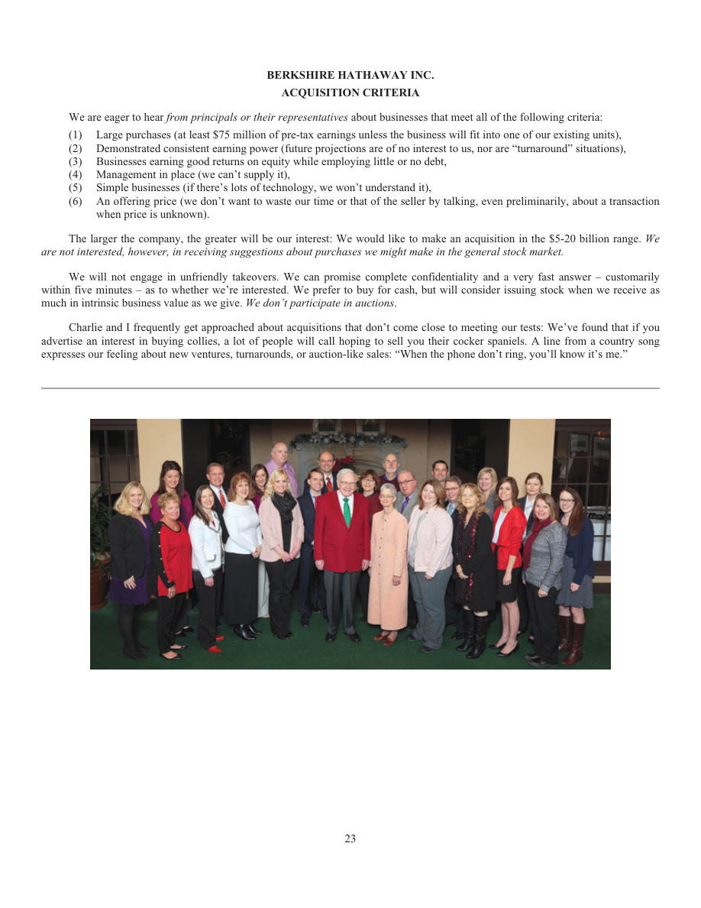
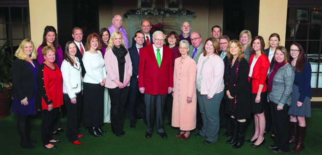

# 巴菲特2014年度致股东信 中英对照


## 原文第1页

### English

## Berkshire’s Performance vs. the S&P 500

## Annual Percentage Change

```text
                                                                                     in Per-Share            in Per-Share              in S&P 500
                                                            Book Value of       Market Value of         with Dividends
Year                                                                          Berkshire              Berkshire               Included
1965 .................... . . . . . . . . . . . . . . . . . . . . . . . . . . . . . . . . . . . . . . . . . . . . . . . . . .            23.8               49.5                      10.0
1966 .................... . . . . . . . . . . . . . . . . . . . . . . . . . . . . . . . . . . . . . . . . . . . . . . . . . .            20.3                  (3.4)                       (11.7)
1967 .................... . . . . . . . . . . . . . . . . . . . . . . . . . . . . . . . . . . . . . . . . . . . . . . . . . .            11.0               13.3                      30.9
1968 .................... . . . . . . . . . . . . . . . . . . . . . . . . . . . . . . . . . . . . . . . . . . . . . . . . . .            19.0               77.8                      11.0
1969 .................... . . . . . . . . . . . . . . . . . . . . . . . . . . . . . . . . . . . . . . . . . . . . . . . . . .            16.2               19.4                          (8.4)
1970 .................... . . . . . . . . . . . . . . . . . . . . . . . . . . . . . . . . . . . . . . . . . . . . . . . . . .            12.0                  (4.6)                        3.9
1971 .................... . . . . . . . . . . . . . . . . . . . . . . . . . . . . . . . . . . . . . . . . . . . . . . . . . .            16.4               80.5                      14.6
1972 .................... . . . . . . . . . . . . . . . . . . . . . . . . . . . . . . . . . . . . . . . . . . . . . . . . . .            21.7                 8.1                      18.9
1973 .................... . . . . . . . . . . . . . . . . . . . . . . . . . . . . . . . . . . . . . . . . . . . . . . . . . .             4.7                  (2.5)                       (14.8)
1974 .................... . . . . . . . . . . . . . . . . . . . . . . . . . . . . . . . . . . . . . . . . . . . . . . . . . .             5.5                (48.7)                       (26.4)
1975 .................... . . . . . . . . . . . . . . . . . . . . . . . . . . . . . . . . . . . . . . . . . . . . . . . . . .            21.9                 2.5                      37.2
1976 .................... . . . . . . . . . . . . . . . . . . . . . . . . . . . . . . . . . . . . . . . . . . . . . . . . . .            59.3              129.3                      23.6
1977 .................... . . . . . . . . . . . . . . . . . . . . . . . . . . . . . . . . . . . . . . . . . . . . . . . . . .            31.9               46.8                          (7.4)
1978 .................... . . . . . . . . . . . . . . . . . . . . . . . . . . . . . . . . . . . . . . . . . . . . . . . . . .            24.0               14.5                         6.4
1979 .................... . . . . . . . . . . . . . . . . . . . . . . . . . . . . . . . . . . . . . . . . . . . . . . . . . .            35.7              102.5                      18.2
1980 .................... . . . . . . . . . . . . . . . . . . . . . . . . . . . . . . . . . . . . . . . . . . . . . . . . . .            19.3               32.8                      32.3
1981 .................... . . . . . . . . . . . . . . . . . . . . . . . . . . . . . . . . . . . . . . . . . . . . . . . . . .            31.4               31.8                          (5.0)
1982 .................... . . . . . . . . . . . . . . . . . . . . . . . . . . . . . . . . . . . . . . . . . . . . . . . . . .            40.0               38.4                      21.4
1983 .................... . . . . . . . . . . . . . . . . . . . . . . . . . . . . . . . . . . . . . . . . . . . . . . . . . .            32.3               69.0                      22.4
1984 .................... . . . . . . . . . . . . . . . . . . . . . . . . . . . . . . . . . . . . . . . . . . . . . . . . . .            13.6                  (2.7)                        6.1
1985 .................... . . . . . . . . . . . . . . . . . . . . . . . . . . . . . . . . . . . . . . . . . . . . . . . . . .            48.2               93.7                      31.6
1986 .................... . . . . . . . . . . . . . . . . . . . . . . . . . . . . . . . . . . . . . . . . . . . . . . . . . .            26.1               14.2                      18.6
1987 .................... . . . . . . . . . . . . . . . . . . . . . . . . . . . . . . . . . . . . . . . . . . . . . . . . . .            19.5                 4.6                         5.1
1988 .................... . . . . . . . . . . . . . . . . . . . . . . . . . . . . . . . . . . . . . . . . . . . . . . . . . .            20.1               59.3                      16.6
1989 .................... . . . . . . . . . . . . . . . . . . . . . . . . . . . . . . . . . . . . . . . . . . . . . . . . . .            44.4               84.6                      31.7
1990 .................... . . . . . . . . . . . . . . . . . . . . . . . . . . . . . . . . . . . . . . . . . . . . . . . . . .             7.4                (23.1)                         (3.1)
1991 .................... . . . . . . . . . . . . . . . . . . . . . . . . . . . . . . . . . . . . . . . . . . . . . . . . . .            39.6               35.6                      30.5
1992 .................... . . . . . . . . . . . . . . . . . . . . . . . . . . . . . . . . . . . . . . . . . . . . . . . . . .            20.3               29.8                         7.6
1993 .................... . . . . . . . . . . . . . . . . . . . . . . . . . . . . . . . . . . . . . . . . . . . . . . . . . .            14.3               38.9                      10.1
1994 .................... . . . . . . . . . . . . . . . . . . . . . . . . . . . . . . . . . . . . . . . . . . . . . . . . . .            13.9               25.0                         1.3
1995 .................... . . . . . . . . . . . . . . . . . . . . . . . . . . . . . . . . . . . . . . . . . . . . . . . . . .            43.1               57.4                      37.6
1996 .................... . . . . . . . . . . . . . . . . . . . . . . . . . . . . . . . . . . . . . . . . . . . . . . . . . .            31.8                 6.2                      23.0
1997 .................... . . . . . . . . . . . . . . . . . . . . . . . . . . . . . . . . . . . . . . . . . . . . . . . . . .            34.1               34.9                      33.4
1998 .................... . . . . . . . . . . . . . . . . . . . . . . . . . . . . . . . . . . . . . . . . . . . . . . . . . .            48.3               52.2                      28.6
1999 .................... . . . . . . . . . . . . . . . . . . . . . . . . . . . . . . . . . . . . . . . . . . . . . . . . . .             0.5                (19.9)                      21.0
2000 .................... . . . . . . . . . . . . . . . . . . . . . . . . . . . . . . . . . . . . . . . . . . . . . . . . . .             6.5               26.6                          (9.1)
2001 .................... . . . . . . . . . . . . . . . . . . . . . . . . . . . . . . . . . . . . . . . . . . . . . . . . . .              (6.2)                6.5                        (11.9)
2002 .................... . . . . . . . . . . . . . . . . . . . . . . . . . . . . . . . . . . . . . . . . . . . . . . . . . .            10.0                  (3.8)                       (22.1)
2003 .................... . . . . . . . . . . . . . . . . . . . . . . . . . . . . . . . . . . . . . . . . . . . . . . . . . .            21.0               15.8                      28.7
2004 .................... . . . . . . . . . . . . . . . . . . . . . . . . . . . . . . . . . . . . . . . . . . . . . . . . . .            10.5                 4.3                      10.9
2005 .................... . . . . . . . . . . . . . . . . . . . . . . . . . . . . . . . . . . . . . . . . . . . . . . . . . .             6.4                 0.8                         4.9
2006 .................... . . . . . . . . . . . . . . . . . . . . . . . . . . . . . . . . . . . . . . . . . . . . . . . . . .            18.4               24.1                      15.8
2007 .................... . . . . . . . . . . . . . . . . . . . . . . . . . . . . . . . . . . . . . . . . . . . . . . . . . .            11.0               28.7                         5.5
2008 .................... . . . . . . . . . . . . . . . . . . . . . . . . . . . . . . . . . . . . . . . . . . . . . . . . . .              (9.6)               (31.8)                       (37.0)
2009 .................... . . . . . . . . . . . . . . . . . . . . . . . . . . . . . . . . . . . . . . . . . . . . . . . . . .            19.8                 2.7                      26.5
2010 .................... . . . . . . . . . . . . . . . . . . . . . . . . . . . . . . . . . . . . . . . . . . . . . . . . . .            13.0               21.4                      15.1
2011 .................... . . . . . . . . . . . . . . . . . . . . . . . . . . . . . . . . . . . . . . . . . . . . . . . . . .             4.6                  (4.7)                        2.1
2012 .................... . . . . . . . . . . . . . . . . . . . . . . . . . . . . . . . . . . . . . . . . . . . . . . . . . .            14.4               16.8                      16.0
2013 .................... . . . . . . . . . . . . . . . . . . . . . . . . . . . . . . . . . . . . . . . . . . . . . . . . . .            18.2               32.7                      32.4
2014 .................... . . . . . . . . . . . . . . . . . . . . . . . . . . . . . . . . . . . . . . . . . . . . . . . . . .             8.3               27.0                      13.7
```

```text
Compounded Annual Gain – 1965-2014  . . . . . . . . . . . . . . . . . . . . . . . . . . . . . . . . . . .          19.4%           21.6%                  9.9%
Overall Gain – 1964-2014  . . . . . . . . . . . . . . . . . . . . . . . . . . . . . . . . . . . . . . . . . . . . . . . . .       751,113%       1,826,163%                11,196%
Notes: Data are for calendar years with these exceptions: 1965 and 1966, year ended 9/30; 1967, 15 months ended 12/31. Starting in 1979,
accounting rules required insurance companies to value the equity securities they hold at market rather than at the lower of cost or market, which was
previously the requirement. In this table, Berkshire’s results through 1978 have been restated to conform to the changed rules. In all other respects,
the results are calculated using the numbers originally reported. The S&P 500 numbers are pre-tax whereas the Berkshire numbers are after-tax. If a
corporation such as Berkshire were simply to have owned the S&P 500 and accrued the appropriate taxes, its results would have lagged the S&P 500
in years when that index showed a positive return, but would have exceeded the S&P 500 in years when the index showed a negative return. Over the
years, the tax costs would have caused the aggregate lag to be substantial.
```

### 中文

## 伯克希尔公司表现与标普500比较

| 年度 | 伯克希尔每股账面价值年度变动 | 伯克希尔每股市值年度变动 | 标普500含股息年度变动 |
| --- | --- | --- | --- |
| 1965 | 23.8% | 49.5% | 10.0% |
| 1966 | 20.3% | (3.4%) | (11.7%) |
| 1967 | 11.0% | 13.3% | 30.9% |
| 1968 | 19.0% | 77.8% | 11.0% |
| 1969 | 16.2% | 19.4% | (8.4%) |
| 1970 | 12.0% | (4.6%) | 3.9% |
| 1971 | 16.4% | 80.5% | 14.6% |
| 1972 | 21.7% | 8.1% | 18.9% |
| 1973 | 4.7% | (2.5%) | (14.8%) |
| 1974 | 5.5% | (48.7%) | (26.4%) |
| 1975 | 21.9% | 2.5% | 37.2% |
| 1976 | 59.3% | 129.3% | 23.6% |
| 1977 | 31.9% | 46.8% | (7.4%) |
| 1978 | 24.0% | 14.5% | 6.4% |
| 1979 | 35.7% | 102.5% | 18.2% |
| 1980 | 19.3% | 32.8% | 32.3% |
| 1981 | 31.4% | 31.8% | (5.0%) |
| 1982 | 40.0% | 38.4% | 21.4% |
| 1983 | 32.3% | 69.0% | 22.4% |
| 1984 | 13.6% | (2.7%) | 6.1% |
| 1985 | 48.2% | 93.7% | 31.6% |
| 1986 | 26.1% | 14.2% | 18.6% |
| 1987 | 19.5% | 4.6% | 5.1% |
| 1988 | 20.1% | 59.3% | 16.6% |
| 1989 | 44.4% | 84.6% | 31.7% |
| 1990 | 7.4% | (23.1%) | (3.1%) |
| 1991 | 39.6% | 35.6% | 30.5% |
| 1992 | 20.3% | 29.8% | 7.6% |
| 1993 | 14.3% | 38.9% | 10.1% |
| 1994 | 13.9% | 25.0% | 1.3% |
| 1995 | 43.1% | 57.4% | 37.6% |
| 1996 | 31.8% | 6.2% | 23.0% |
| 1997 | 34.1% | 34.9% | 33.4% |
| 1998 | 48.3% | 52.2% | 28.6% |
| 1999 | 0.5% | (19.9%) | 21.0% |
| 2000 | 6.5% | 26.6% | (9.1%) |
| 2001 | (6.2%) | 6.5% | (11.9%) |
| 2002 | 10.0% | (3.8%) | (22.1%) |
| 2003 | 21.0% | 15.8% | 28.7% |
| 2004 | 10.5% | 4.3% | 10.9% |
| 2005 | 6.4% | 0.8% | 4.9% |
| 2006 | 18.4% | 24.1% | 15.8% |
| 2007 | 11.0% | 28.7% | 5.5% |
| 2008 | (9.6%) | (31.8%) | (37.0%) |
| 2009 | 19.8% | 2.7% | 26.5% |
| 2010 | 13.0% | 21.4% | 15.1% |
| 2011 | 4.6% | (4.7%) | 2.1% |
| 2012 | 14.4% | 16.8% | 16.0% |
| 2013 | 18.2% | 32.7% | 32.4% |
| 2014 | 8.3% | 27.0% | 13.7% |
| 1965—2014年年复合增长 | 19.4% | 21.6% | 9.9% |
| 1964—2014年累计增长 | 751,113% | 1,826,163% | 11,196% |

注：除以下情况，数据均按日历年：1965与1966年为截至9月30日的一年；1967年为截至12月31日的十五个月。

自1979年起，会计规则要求，保险公司持有的股票按市价计量，而非此前的成本与市价孰低。本表伯克希尔截至1978年的结果，已按新规则重列；其余方面，都使用原来报告的数字。

标普500为税前数字，伯克希尔为税后。若像伯克希尔这样的公司，只持有标普500并计提相应税款，指数正回报年份，会落后；指数负回报年份，则会领先。长久而言，税收成本会使累计落后相当显著。


## 原文第2页

### English

A note to readers: Fifty years ago, today’s management took charge at Berkshire. For this Golden Anniversary, Warren Buffett and Charlie Munger each wrote his views of what has happened at Berkshire during the past 50 years and what each expects during the next 50. Neither changed a word of his commentary after reading what the other had written. Warren’s thoughts begin on page 24 and Charlie’s on page 39. Shareholders, particularly new ones, may find it useful to read those letters before reading the report on 2014, which begins below.

BERKSHIRE HATHAWAY INC.

To the Shareholders of Berkshire Hathaway Inc.:

Berkshire’s gain in net worth during 2014 was $18.3 billion, which increased the per-share book value of both our Class A and Class B stock by 8.3%. Over the last 50 years (that is, since present management took over), per-share book value has grown from $19 to $146,186, a rate of 19.4% compounded annually.*

During our tenure, we have consistently compared the yearly performance of the S&P 500 to the change in Berkshire’s per-share book value. We’ve done that because book value has been a crude, but useful, tracking device for the number that really counts: intrinsic business value.

In our early decades, the relationship between book value and intrinsic value was much closer than it is now. That was true because Berkshire’s assets were then largely securities whose values were continuously restated to reflect their current market prices. In Wall Street parlance, most of the assets involved in the calculation of book value were “marked to market.”

Today, our emphasis has shifted in a major way to owning and operating large businesses. Many of these are worth far more than their cost-based carrying value. But that amount is never revalued upward no matter how much the value of these companies has increased. Consequently, the gap between Berkshire’s intrinsic value and its book value has materially widened.

With that in mind, we have added a new set of data – the historical record of Berkshire’s stock price – to the performance table on the facing page. Market prices, let me stress, have their limitations in the short term. Monthly or yearly movements of stocks are often erratic and not indicative of changes in intrinsic value. Over time, however, stock prices and intrinsic value almost invariably converge. Charlie Munger, Berkshire Vice Chairman and my partner, and I believe that has been true at Berkshire: In our view, the increase in Berkshire’s per-share intrinsic value over the past 50 years is roughly equal to the 1,826,163% gain in market price of the company’s shares.

* All per-share figures used in this report apply to Berkshire’s A shares. Figures for the B shares are 1/1500th of those shown for A.

### 中文

致读者：50 年前，现任管理层接掌了伯克希尔。值此金禧，沃伦·巴菲特与查理·芒格各自写下了对伯克希尔过去 50 年历程的看法，以及各自对未来 50 年的期待。两人读过对方的文章后，都没有改动自己的任何一个字。沃伦的文章从年报第 24 页开始，查理的从第 39 页开始。股东们，尤其是新股东，也许会觉得，先读这两篇文章，再读下面开始的 2014 年报告，会有所帮助。

## 伯克希尔·哈撒韦公司

致伯克希尔·哈撒韦公司的股东：

2014 年，伯克希尔的净资产增加了 183 亿美元，A 类股和 B 类股的每股账面价值均增长 8.3%。过去 50 年，也就是现任管理层接手以来，每股账面价值从 19 美元增至 146,186 美元，年复合增长率为 19.4%。*

在我们任职期间，我们始终把标普 500 指数的年度表现，与伯克希尔每股账面价值的变动相比较。之所以这样做，是因为账面价值虽然粗略，却是追踪那个真正重要的数字——企业内在价值——的一项有用工具。

在最初几十年，账面价值与内在价值的关系，比今天紧密得多。原因在于，当时伯克希尔的资产主要是证券，而这些证券的账面价值会不断调整，以反映当时的市场价格。用华尔街的话来说，计算账面价值时涉及的大多数资产，都“按市价计量”。

如今，我们的重心已经大幅转向拥有和经营大型企业。其中许多企业的价值，远远超过按成本列示的账面金额。不过，无论这些公司的价值增加多少，账面金额都不会向上重估。因此，伯克希尔内在价值与账面价值之间的差距，已经显著扩大。

考虑到这一点，我们在对页的业绩表中增加了一组新数据：伯克希尔股价的历史表现。我要强调，市场价格在短期内有其局限。股票每月或每年的走势，往往反复无常，不能说明内在价值发生了怎样的变化。不过，随着时间推移，股价和内在价值几乎总会趋于一致。伯克希尔副董事长、我的合伙人查理·芒格和我认为，伯克希尔的情况就是如此：在我们看来，过去 50 年伯克希尔每股内在价值的增幅，大致相当于公司股价 1,826,163% 的涨幅。

*本报告所有每股数字均适用于伯克希尔 A 类股。B 类股的相应数字，为所列 A 类股数字的 1/1500。


## 原文第3页

### English

## The Year at Berkshire

It was a good year for Berkshire on all major fronts, except one. Here are the important developments:

‹   Our “Powerhouse Five” – a collection of Berkshire’s largest non-insurance businesses – had a record $12.4 billion of pre-tax earnings in 2014, up $1.6 billion from 2013.* The companies in this sainted group are Berkshire Hathaway Energy (formerly MidAmerican Energy), BNSF, IMC (I’ve called it Iscar in the past), Lubrizol and Marmon.

Of the five, only Berkshire Hathaway Energy, then earning $393 million, was owned by us a decade ago. Subsequently we purchased another three of the five on an all-cash basis. In acquiring the fifth, BNSF, we paid about 70% of the cost in cash and, for the remainder, issued Berkshire shares that increased the number outstanding by 6.1%. In other words, the $12 billion gain in annual earnings delivered Berkshire by the five companies over the ten-year span has been accompanied by only minor dilution. That satisfies our goal of not simply increasing earnings, but making sure we also increase per-share results.

If the U.S. economy continues to improve in 2015, we expect earnings of our Powerhouse Five to improve as well. The gain could reach $1 billion, in part because of bolt-on acquisitions by the group that have already closed or are under contract.

‹   Our bad news from 2014 comes from our group of five as well and is unrelated to earnings. During the year, BNSF disappointed many of its customers. These shippers depend on us, and service failures can badly hurt their businesses.

BNSF is, by far, Berkshire’s most important non-insurance subsidiary and, to improve its performance, we will spend $6 billion on plant and equipment in 2015. That sum is nearly 50% more than any other railroad has spent in a single year and is a truly extraordinary amount, whether compared to revenues, earnings or depreciation charges.

Though weather, which was particularly severe last year, will always cause railroads a variety of operating problems, our responsibility is to do whatever it takes to restore our service to industry-leading levels. That can’t be done overnight: The extensive work required to increase system capacity sometimes disrupts operations while  it is underway. Recently, however, our outsized expenditures are beginning to show results. During the last three months, BNSF’s performance metrics have materially improved from last year’s figures.

‹   Our many dozens of smaller non-insurance businesses earned $5.1 billion last year, up from $4.7 billion in 2013. Here, as with our Powerhouse Five, we expect further gains in 2015. Within this group, we have two companies that last year earned between $400 million and $600 million, six that earned between $250 million and $400 million, and seven that earned between $100 million and $250 million. This collection of businesses will increase in both number and earnings. Our ambitions have no finish line.

‹   Berkshire’s huge and growing insurance operation again operated at an underwriting profit in 2014 – that makes 12 years in a row – and increased its float. During that 12-year stretch, our float – money that doesn’t belong to us but that we can invest for Berkshire’s benefit – has grown from $41 billion to $84 billion. Though neither that gain nor the size of our float  is reflected in Berkshire’s earnings, float generates significant investment income because of the assets it allows us to hold.

* Throughout this letter, as well as in the “Golden Anniversary” letters included later in this report, all earnings are stated on a pre-tax basis unless otherwise designated.

### 中文

## 伯克希尔这一年

除了一项之外，伯克希尔在所有主要方面都度过了一个好年。以下是重要进展：

- 我们的“五台强力发动机”——伯克希尔规模最大的几家非保险企业——在 2014 年创造了创纪录的 124 亿美元税前利润，比 2013 年增加 16 亿美元。* 跻身这个神圣小组的五家公司是：伯克希尔·哈撒韦能源（原中美能源）、BNSF、IMC（过去我一直称它为伊斯卡）、路博润和马蒙。

  十年前，这五家企业中，我们只拥有伯克希尔·哈撒韦能源，它当时的利润为 3.93 亿美元。此后，我们又用全现金的方式买下其中三家。收购第五家 BNSF 时，我们支付的价款约有 70% 是现金，其余部分则发行伯克希尔股票，使流通股数增加了 6.1%。换句话说，十年间，这五家公司为伯克希尔带来的年度利润增加了 120 亿美元，而伴随的股权稀释却很小。这符合我们的目标：不只是增加利润，还要确保每股业绩也随之增加。

  如果美国经济在 2015 年继续改善，我们预计这五台强力发动机的利润也会增长。增幅可能达到 10 亿美元，部分原因是它们已经完成或已经签约的补强式收购。

- 我们在 2014 年的坏消息，也来自这五家企业，但与利润无关。这一年，BNSF 让许多客户失望了。这些货主依赖我们的服务，而服务不到位，可能严重损害他们的生意。

  BNSF 是伯克希尔最重要的非保险子公司，其地位远超其他公司。为了改善它的表现，我们将在 2015 年投入 60 亿美元用于厂房和设备。这笔金额，比任何其他铁路公司单年投入过的最高金额还高近 50%；无论拿它与营业收入、利润，还是折旧费用相比，都是真正非同寻常的数目。

  天气，尤其是去年那样格外恶劣的天气，总会给铁路带来各种经营问题。不过，我们的责任是竭尽所能，把服务恢复到行业领先水平。这件事无法一夜完成：为扩大整个系统运力而开展的大量工程，有时在施工期间反而会干扰运营。不过，最近，我们超大规模的支出已经开始见效。过去三个月，BNSF 的运营表现指标与去年相比，已有明显改善。

- 我们的数十家规模较小的非保险企业，去年赚取了 51 亿美元，高于 2013 年的 47 亿美元。与那五台强力发动机一样，我们预计这些企业在 2015 年也会继续增长。在这一组企业中，去年有两家的利润在 4 亿至 6 亿美元之间，六家在 2.5 亿至 4 亿美元之间，七家在 1 亿至 2.5 亿美元之间。这些企业的数量和利润都会增加。我们的雄心没有终点线。

- 伯克希尔庞大且不断增长的保险业务，2014 年再次实现承保盈利——已经连续 12 年如此——浮存金也有所增加。这 12 年间，我们的浮存金，也就是那些不属于我们、却可以由我们投资并为伯克希尔谋利的资金，从 410 亿美元增至 840 亿美元。浮存金的增幅及其规模本身，都不体现在伯克希尔的利润中；但它使我们得以持有资产，从而产生可观的投资收益。

*本信以及后附的“金禧”文章中，除另有说明外，利润均为税前。


## 原文第4页

### English

Meanwhile, our underwriting profit totaled $24 billion during the twelve-year period, including $2.7 billion earned in 2014. And all of this began with our 1967 purchase of National Indemnity for $8.6 million.

‹   While Charlie and I search for new businesses to buy, our many subsidiaries are regularly making bolt-on acquisitions. Last year was particularly fruitful: We contracted for 31 bolt-ons, scheduled to cost $7.8 billion in aggregate. The size of these transactions ranged from $400,000 to $2.9 billion. However, the largest acquisition, Duracell, will not close until the second half of this year. It will then be placed under Marmon’s jurisdiction.

Charlie and I encourage bolt-ons, if they are sensibly-priced. (Most deals offered us aren’t.) They deploy capital in activities that fit with our existing businesses and that will be managed by our corps of expert managers. This means no more work for us, yet more earnings, a combination we find particularly appealing. We will make many more of these bolt-on deals in future years.

‹  Two years ago my friend, Jorge Paulo Lemann, asked Berkshire to join his 3G Capital group in the acquisition of Heinz. My affirmative response was a no-brainer: I knew immediately that this partnership would work well from both a personal and financial standpoint. And it most definitely has.

I’m not embarrassed to admit that Heinz is run far better under Alex Behring, Chairman, and Bernardo Hees, CEO, than would be the case if I were in charge. They hold themselves to extraordinarily high performance standards and are never satisfied, even when their results far exceed those of competitors.

We expect to partner with 3G in more activities. Sometimes our participation will only involve a financing role, as was the case in the recent acquisition of Tim Hortons by Burger King. Our favored arrangement, however, will usually be to link up as a permanent equity partner (who, in some cases, contributes to the financing of the deal as well). Whatever the structure, we feel good when working with Jorge Paulo.

Berkshire also has fine partnerships with Mars and Leucadia, and we may form new ones with them or with other partners. Our participation in any joint activities, whether as a financing or equity partner, will be limited to friendly transactions.

‹   In October, we contracted to buy Van Tuyl Automotive, a group of 78 automobile dealerships that is exceptionally well-run. Larry Van Tuyl, the company’s owner, and I met some years ago. He then decided that  if he were ever to sell his company,  its home should be Berkshire. Our purchase was recently completed, and we are now “car guys.”

Larry and his dad, Cecil, spent 62 years building the group, following a strategy that made owner-partners of all local managers. Creating this mutuality of interests proved over and over to be a winner. Van Tuyl is now  the  fifth-largest automotive group  in  the  country, with  per-dealership  sales  figures  that  are outstanding.

In recent years, Jeff Rachor has worked alongside Larry, a successful arrangement that will continue. There are about 17,000 dealerships in the country, and ownership transfers always require approval by the relevant auto manufacturer. Berkshire’s job is to perform in a manner that will cause manufacturers to welcome further purchases by us. If we do this – and if we can buy dealerships at sensible prices – we will build a business that before long will be multiples the size of Van Tuyl’s $9 billion of sales.

With the acquisition of Van Tuyl, Berkshire now owns 91⁄2 companies that would be listed on the Fortune 500 were they independent (Heinz is the 1⁄2). That leaves 4901⁄2 fish in the sea. Our lines are out.

### 中文

与此同时，这 12 年的承保利润累计达到 240 亿美元，其中包括 2014 年赚取的 27 亿美元。而这一切的起点，是我们在 1967 年以 860 万美元收购国民赔偿公司。

- 查理和我寻找新的收购企业时，我们的众多子公司也在经常进行补强式收购。去年尤其丰硕：我们签约了 31 项补强式收购，预计总成本为 78 亿美元，单笔交易规模从 40 万美元到 29 亿美元不等。不过，最大的一笔收购——金霸王——要到今年下半年才会完成交割，届时将归入马蒙旗下。

  只要价格合理，查理和我就鼓励这类收购。（送到我们面前的大多数交易，价格都不合理。）它们把资本投入与现有企业相契合的业务，并由我们那些经验丰富的经理人负责经营。这意味着我们不用多干活，却能多赚利润；这样的组合，我们尤其喜欢。今后几年，我们还会做许多这类补强式收购。

- 两年前，我的朋友若热·保罗·雷曼邀请伯克希尔，与他的 3G Capital 集团共同收购亨氏。我毫不犹豫就答应了：我立即知道，无论从个人合作还是财务角度，这个伙伴关系都会很好。事实也确实如此。

  我并不觉得承认这一点有什么丢脸：在董事长亚历克斯·贝林和首席执行官贝尔纳多·希斯的领导下，亨氏经营得比由我来负责要好得多。他们对自己的业绩标准要求极高，即使成绩已经远远超过竞争对手，也从不满足。

  我们预计，还会与 3G 开展更多合作。有时，我们只提供融资，最近汉堡王收购 Tim Hortons，就是这种情况。不过，我们通常最喜欢的安排，还是成为长期的股权合伙人（在有些情况下，也会同时为交易提供融资）。无论采用哪种结构，与若热·保罗合作，我们都觉得很安心。

  伯克希尔与玛氏及 Leucadia 也有很好的伙伴关系，将来可能与它们或其他伙伴开展新的合作。无论以融资伙伴还是股权伙伴的身份参与，任何联合行动，我们都只做友好交易。

- 10 月，我们签约收购 Van Tuyl 汽车集团。这家经营得极其出色的集团拥有 78 家汽车经销店。几年前，我认识了公司的所有者拉里·范泰尔。那时他就决定，如果有朝一日出售公司，它的归宿应当是伯克希尔。最近，收购已经完成，如今我们也成了“汽车圈的人”。

  拉里与父亲塞西尔花了 62 年建立这家集团。他们采取的策略，是让所有地方经理都成为持有权益的合伙人。事实一再证明，把彼此的利益这样结合起来，是制胜之道。如今，Van Tuyl 已是美国第五大汽车集团，平均每家经销店的销售额都十分出色。

  近年来，杰夫·雷科与拉里并肩工作，这个成功的安排将继续保留。全国约有 17,000 家汽车经销店，每次所有权转让，都必须得到相关汽车制造商的批准。伯克希尔的任务，就是拿出让制造商欢迎我们进一步收购的表现。如果我们办得到，而且能够以合理价格买到经销店，那么，不用太久，我们就能把这项业务的规模，扩大到 Van Tuyl 目前 90 亿美元销售额的好几倍。

  收购 Van Tuyl 后，伯克希尔如今拥有九家半这样的企业：如果它们独立经营，就能进入《财富》500 强（亨氏算半家）。海里还剩下 490条半鱼。我们的钓线已经放下去了。


## 原文第5页

### English

‹   Our subsidiaries spent a record $15 billion on plant and equipment during 2014, well over twice their depreciation charges. About 90% of that money was spent in the United States. Though we will always invest abroad as well, the mother lode of opportunities runs through America. The treasures that have been uncovered up to now are dwarfed by those still untapped. Through dumb luck, Charlie and I were born in the United States, and we are forever grateful for the staggering advantages this accident of birth has given us.

‹   Berkshire’s yearend employees – including those at Heinz – totaled a record 340,499, up 9,754 from last year. The increase, I am proud to say, included no gain at headquarters (where 25 people work). No sense going crazy.

‹   Berkshire increased its ownership interest last year in each of its “Big Four” investments – American Express, Coca-Cola, IBM and Wells Fargo. We purchased additional shares of IBM (increasing our ownership to 7.8% versus 6.3% at yearend 2013). Meanwhile, stock repurchases at Coca-Cola, American Express and Wells Fargo raised our percentage ownership of each. Our equity in Coca-Cola grew from 9.1% to 9.2%, our interest in American Express increased from 14.2% to 14.8% and our ownership of Wells Fargo grew from 9.2% to 9.4%. And, if you think tenths of a percent aren’t important, ponder this math: For the four companies in aggregate, each increase of one-tenth of a percent in our ownership raises Berkshire’s portion of their annual earnings by $50 million.

These four investees possess excellent businesses and are run by managers who are both talented and shareholder-oriented. At Berkshire, we much prefer owning a non-controlling but substantial portion of a wonderful company to owning 100% of a so-so business. It’s better to have a partial interest in the Hope Diamond than to own all of a rhinestone.

If Berkshire’s yearend holdings are used as the marker, our portion of the “Big Four’s” 2014 earnings before discontinued operations amounted to $4.7 billion (compared to $3.3 billion only three years ago). In the earnings we report to you, however, we include only the dividends we receive – about $1.6 billion last year. (Again, three years ago the dividends were $862 million.) But make no mistake: The $3.1 billion of these companies’ earnings we don’t report are every bit as valuable to us as the portion Berkshire records.

The earnings these investees retain are often used for repurchases of their own stock – a move that enhances Berkshire’s share of future earnings without requiring us to lay out a dime. Their retained earnings also fund business opportunities that usually turn out to be advantageous. All that leads us to expect that the per-share earnings of these four investees, in aggregate, will grow substantially over time (though 2015 will be a tough year for the group, in part because of the strong dollar). If the expected gains materialize, dividends to Berkshire will increase and, even more important, so will our unrealized capital gains. (For the package of four, our unrealized gains already totaled $42 billion at yearend.)

Our flexibility in capital allocation – our willingness to invest large sums passively in non-controlled businesses – gives us a significant advantage over companies that limit themselves to acquisitions they can operate. Our appetite for either operating businesses or passive investments doubles our chances of finding sensible uses for Berkshire’s endless gusher of cash.

‹   I’ve mentioned in the past that my experience in business helps me as an investor and that my investment experience has made me a better businessman. Each pursuit teaches lessons that are applicable to the other. And some truths can only be fully learned through experience. (In Fred Schwed’s wonderful book, Where Are the Customers’ Yachts?, a Peter Arno cartoon depicts a puzzled Adam looking at an eager Eve, while a caption says, “There are certain things that cannot be adequately explained to a virgin either by words or pictures.” If you haven’t read Schwed’s book, buy a copy at our annual meeting. Its wisdom and humor are truly priceless.)

### 中文

- 2014 年，我们的子公司用于厂房和设备的支出达到创纪录的 150 亿美元，远远超过折旧费用的两倍。其中约 90% 花在美国。虽然我们也始终会在海外投资，但机会的主矿脉仍贯穿美国。迄今已经发现的宝藏，与尚未开掘的相比，依然小得多。纯凭傻运气，查理和我生在了美国；这一出生的偶然，给了我们惊人的优势，我们对此永远心怀感激。

- 年底，伯克希尔包括亨氏在内的员工总数，达到创纪录的 340,499 人，比上年增加 9,754 人。我很自豪地说，这番增长没有给总部增加一个人（总部现有 25 人）。没必要发疯嘛。

- 去年，伯克希尔在“四大”投资——美国运通、可口可乐、IBM 和富国银行——中的持股比例，全部提高了。我们增持了 IBM，使持股比例从 2013 年底的 6.3% 升至 7.8%。与此同时，可口可乐、美国运通和富国银行回购自家股票，也提高了我们在各家的持股比例：可口可乐从 9.1% 升至 9.2%，美国运通从 14.2% 升至 14.8%，富国银行则从 9.2% 升至 9.4%。如果你觉得零点几个百分点无关紧要，请琢磨一下这道算术：对这四家公司合计而言，我们持股比例每增加 0.1 个百分点，伯克希尔应占的年度利润，就增加 5,000 万美元。

  这四家被投资企业的业务都很优秀，管理者既有才干，又把股东放在心上。在伯克希尔，我们更愿意不掌握控制权、却持有一家优秀公司的相当大部分，而不是百分之百拥有一家平平的企业。拥有希望钻石的一部分，总比拥有整颗水钻好。

  以伯克希尔年底的持股为基准，我们应占“四大”2014 年未计终止经营业务的利润，达到 47 亿美元，而仅仅三年前还是 33 亿美元。不过，在向你们报告的利润中，我们只计入实际收到的股息，去年约为 16 亿美元。（同样拿三年前作比较，当时股息为 8.62 亿美元。）但千万别误会：这些公司中我们没有报告的那 31 亿美元利润，对我们的价值，与伯克希尔已经入账的那部分丝毫不差。

  这些被投资企业留存的利润，常被用于回购自家股票；这样一来，我们不必掏出一分钱，就能提高在未来利润中所占的份额。留存利润也为新的经营机会提供资金，而这些机会通常会带来好结果。因此，我们预计，从整体看，这四家被投资企业的每股利润，将随时间推移而显著增长（不过，2015 年对它们会是艰难的一年，部分原因是美元强势）。如果预期的增长实现，伯克希尔收到的股息就会增加；而更重要的是，我们的未实现资本利得也会增加。（截至年底，这四项投资的未实现利得已经合计达到 420 亿美元。）

  我们在资本配置上的灵活性——愿意把大笔资金被动地投到不受我们控制的企业——使我们相对于那些把选择局限于收购自己能够经营的企业的公司，拥有显著优势。经营企业和被动投资，我们都乐于接受；这使我们为伯克希尔源源不绝涌出的现金寻找合理用途时，机会增加了一倍。

- 过去我提过，经营企业的经验帮助我做好投资，而投资经验又让我成为更好的经营者。两种活动各自教给我的东西，都适用于另一种活动。而有些道理，只有亲身经历，才能完全领会。（在弗雷德·施韦德那本精彩的《客户的游艇在哪里？》里，有一幅彼得·阿诺的漫画：困惑的亚当望着热切的夏娃，图注写道：“有些事，无论用语言还是图画，都无法充分向处子解释。”如果你还没读过施韦德的书，请在我们的年会上买一本。书中的智慧和幽默，真是无价之宝。）


## 原文第6页

### English

Among Arno’s “certain things,” I would include two separate skills, the evaluation of investments and the management of businesses. I therefore think it’s worthwhile for Todd Combs and Ted Weschler, our two investment managers, to each have oversight of at least one of our businesses. A sensible opportunity for them to do so opened up a few months ago when we agreed to purchase two companies that, though smaller than we would normally acquire, have excellent economic characteristics. Combined, the two earn $100 million annually on about $125 million of net tangible assets.

I’ve asked Todd and Ted to each take on one as Chairman, in which role they will function in the very limited way that I do with our larger subsidiaries. This arrangement will save me a minor amount of work and, more important, make the two of them even better investors than they already are (which is to say among the best).

---

Late in 2009, amidst the gloom of the Great Recession, we agreed to buy BNSF, the largest purchase in Berkshire’s history. At the time, I called the transaction an “all-in wager on the economic future of the United States.”

That kind of commitment was nothing new for us. We’ve been making similar wagers ever since Buffett Partnership Ltd. acquired control of Berkshire in 1965. For good reason, too: Charlie and I have always considered a “bet” on ever-rising U.S. prosperity to be very close to a sure thing.

Indeed, who has ever benefited during the past 238 years by betting against America? If you compare our country’s present condition to that existing in 1776, you have to rub your eyes in wonder. In my lifetime alone, real per-capita U.S. output has sextupled. My parents could not have dreamed in 1930 of the world their son would see. Though the preachers of pessimism prattle endlessly about America’s problems, I’ve never seen one who wishes to emigrate (though I can think of a few for whom I would happily buy a one-way ticket).

The dynamism embedded in our market economy will continue to work its magic. Gains won’t come in a smooth or uninterrupted manner; they never have. And we will regularly grumble about our government. But, most assuredly, America’s best days lie ahead.

With this tailwind working for us, Charlie and I hope to build Berkshire’s per-share intrinsic value by (1) constantly improving the basic earning power of our many subsidiaries; (2) further increasing their earnings through bolt-on acquisitions; (3) benefiting from the growth of our investees; (4) repurchasing Berkshire shares when they are available at a meaningful discount from intrinsic value; and (5) making an occasional large acquisition. We will also try to maximize results for you by rarely, if ever, issuing Berkshire shares.

Those building blocks rest on a rock-solid foundation. A century hence, BNSF and Berkshire Hathaway Energy will still be playing vital roles in our economy. Homes and autos will remain central to the lives of most families. Insurance will continue to be essential for both businesses and individuals. Looking ahead, Charlie and I see a world made to order for Berkshire. We feel fortunate to be entrusted with its management.

## Intrinsic Business Value

As much as Charlie and I talk about intrinsic business value, we cannot tell you precisely what that number is for Berkshire shares (nor, in fact, for any other stock). In our 2010 annual report, however, we laid out the three elements – one of them qualitative – that we believe are the keys to a sensible estimate of Berkshire’s intrinsic value. That discussion is reproduced in full on pages 123-124.

Here is an update of the two quantitative factors: In 2014 our per-share investments increased 8.4% to $140,123, and our earnings from businesses other than insurance and investments increased 19% to $10,847 per share.

### 中文

阿诺所说的“有些事”中，我会列入两项不同本领：评估投资，以及经营企业。所以，我认为，值得让两位投资经理托德·康布斯与特德·韦施勒，各监督至少一家企业。几个月前，机会来了，我们同意购买两家公司。虽然小于通常的收购规模，经济特性却极佳：合计使用约1.25亿美元有形净资产，每年赚1亿美元。

我请两人各任一家董事长，只像我对大型子公司那样，发挥很有限的作用。这能替我省一点工作，更重要的是，让他们在已有的一流投资本领之上，再进一步。

* * *

2009年底，大衰退阴霾中，我们同意购买BNSF，伯克希尔史上最大的一笔。我当时称为“对美国经济未来的全押”。

这种承诺并非新事。1965年巴菲特合伙企业取得控制权起，我们一直作类似下注，理由充分：查理和我始终认为，押美国繁荣持续增长，几乎稳操胜券。

过去238年，谁曾靠看空美国获益？比较今天与1776年，简直要揉眼惊叹。单我一生，美国实际人均产出就增至六倍。父母1930年不可能梦想，儿子将见到什么世界。悲观传道者没完没了谈美国问题，我却没见谁想移民，虽然有几个人，我很乐意替他们买单程票。

市场经济内在活力，会继续施展魔法。增长不会平滑、不间断，从来没有过；我们也会经常抱怨政府。但毫无疑问，最好的日子仍在前头。

顺风相助，查理和我希望通过五项增加每股内在价值：（1）不断改善子公司基本盈利能力；（2）补充收购，进一步增加利润；（3）受益于持股企业增长；（4）股价显著低于内在价值时回购；（5）偶尔作大型收购。也会尽可能少发行伯克希尔股票，最好不发行，来最大化你们的结果。

这些积木立在坚如磐石的基础上。一个世纪后，BNSF与伯克希尔能源仍是经济要角；住宅、汽车仍在多数家庭生活中央；企业和个人仍离不开保险。展望未来，世界仿佛为伯克希尔量身定做。受托管理，我们很幸运。

## 企业内在价值

虽然查理和我经常谈企业内在价值，却无法精确告诉你们，伯克希尔，或者任何其他股票，这个数字究竟多少。2010年年报，我们提出三项合理估值关键，其中一项定性，全文转载在第123—124页。

更新两项数量因素：2014年，每股投资额增8.4%，至140,123美元；保险与投资以外业务，每股利润增19%，至10,847美元。


## 原文第7页

### English

Since 1970, our per-share investments have increased at a rate of 19% compounded annually, and our earnings figure has grown at a 20.6% clip. It is no coincidence that the price of Berkshire stock over the ensuing 44 years has increased at a rate very similar to that of our two measures of value. Charlie and I like to see gains in both sectors, but our main focus is to build operating earnings. That’s why we were pleased to exchange our Phillips 66 and Graham Holdings stock for operating businesses last year and to contract with Procter and Gamble to acquire Duracell by means of a similar exchange set to close in 2015.

---

Now, let’s examine the four major sectors of our operations. Each has vastly different balance sheet and income characteristics from the others. So we’ll present them as four separate businesses, which is how Charlie and I view them (though there are important and enduring advantages to having them all under one roof). Our goal is to provide you with the information we would wish to have  if our positions were reversed, with you being the reporting manager and we the absentee shareholders. (But don’t get any ideas!)

Insurance

Let’s look first at insurance, Berkshire’s core operation. That industry has been the engine that has propelled our expansion since 1967, when we acquired National Indemnity and its sister company, National Fire & Marine, for $8.6 million. Though that purchase had monumental consequences for Berkshire, its execution was simplicity itself.

Jack Ringwalt, a friend of mine who was the controlling shareholder of the two companies, came to my office saying he would like to sell. Fifteen minutes later, we had a deal. Neither of Jack’s companies had ever had an audit by a public accounting firm, and I didn’t ask for one. My reasoning: (1) Jack was honest and (2) He was also a bit quirky and likely to walk away if the deal became at all complicated.

On pages 128-129, we reproduce the 11⁄2-page purchase agreement we used to finalize the transaction. That contract was homemade: Neither side used a lawyer. Per page, this has to be Berkshire’s best deal: National Indemnity today has GAAP (generally accepted accounting principles) net worth of $111 billion, which exceeds that of any other insurer in the world.

One reason we were attracted to the property-casualty business was its financial characteristics: P/C insurers receive premiums upfront and pay claims later. In extreme cases, such as those arising from certain workers’ compensation accidents, payments can stretch over many decades. This collect-now, pay-later model leaves P/C companies holding large sums – money we call “float” – that will eventually go to others. Meanwhile, insurers get to invest this float for their benefit. Though individual policies and claims come and go, the amount of float an insurer holds usually remains fairly stable in relation to premium volume. Consequently, as our business grows, so does our float. And how we have grown, as the following table shows:

```text
  Year                         Float (in $ millions)
1970                          $    39
1980                              237
1990                               1,632
2000                              27,871
2010                              65,832
2014                              83,921
```

Further gains in float will be tough to achieve. On the plus side, GEICO and our new commercial insurance operation are almost certain to grow at a good clip. National Indemnity’s reinsurance division, however, is party to a number of run-off contracts whose float drifts downward. If we do in time experience a decline in float, it will be very gradual – at the outside no more than 3% in any year. The nature of our insurance contracts is such that we can never be subject to immediate demands for sums that are large compared to our cash resources. This strength is a key pillar in Berkshire’s economic fortress.

### 中文

1970年以来，每股投资额年复合增长19%，利润增长20.6%。随后44年，股价增长率与两项价值尺度很近，并非巧合。查理和我喜欢两端都进步，但主要着力于增加经营利润。所以，很高兴去年以Phillips 66和格雷厄姆控股股票，交换经营企业；也与宝洁签约，以类似方式取得金霸王，预计2015年完成。

* * *

现在，看看四个主要板块。资产负债表与利润特点彼此不同，因此当四门独立生意介绍，查理和我也是这样看的，虽然同屋檐下有重要、持久的优势。目标是提供我们换位后想知道的信息：假如你们报告经营，我们是不管事的股东。不过，别动什么念头！

## 保险

先看核心业务。1967年以860万美元买下国民赔偿及其姐妹公司National Fire & Marine以来，保险一直推动扩张。购买影响巨大，执行却简单极了。

朋友杰克·林沃尔特，控制两家公司，来到办公室，说想出售。15分钟后，我们成交。两家公司都从未接受公共会计师事务所审计，我也没要求。理由有二：杰克诚实；他又有点古怪，交易稍复杂，就可能走开。

第128—129页，转载了敲定交易的一页半协议，自己动手写，双方都没律师。按每页价值计算，恐怕是伯克希尔最好的一笔：今天国民赔偿的GAAP净资产为1,110亿美元，超过全球任何其他保险商。

吸引我们进入财险的原因之一，是其财务特性：先收保费，后付赔款。某些工伤等极端情形，付款会延续几十年。财险公司因此握着大量最终给别人的资金，称“浮存金”，期间可以投资获益。虽然单张保单和索赔来来去去，浮存金相对保费规模，却通常相当稳定。因此，业务增长，浮存金也增长。看看我们增长了多少：

| 年度 | 浮存金，百万美元 |
| :--- | ---: |
| 1970 | 39 |
| 1980 | 237 |
| 1990 | 1,632 |
| 2000 | 27,871 |
| 2010 | 65,832 |
| 2014 | 83,921 |

进一步增长不容易。好的一面，GEICO与新的商业保险业务，几乎肯定较快增长；但国民赔偿再保险部门，有些逐步退出的合约，浮存金会缓缓减少。如果总额未来下降，也会非常渐进，一年最多不超过3%。合约性质决定，绝不可能被立即要求支付相对于现金资源很大的金额。这项实力，是经济堡垒的关键支柱。


## 原文第8页

### English

If our premiums exceed the total of our expenses and eventual losses, we register an underwriting profit that adds to the investment income our float produces. When such a profit is earned, we enjoy the use of free money – and, better yet, get paid for holding it.

Unfortunately, the wish of  all insurers to achieve this happy result creates intense competition, so vigorous indeed that it frequently causes the P/C industry as a whole to operate at a significant underwriting loss. This loss, in effect, is what the industry pays to hold its float. Competitive dynamics almost guarantee that the insurance industry, despite the float income all its companies enjoy, will continue its dismal record of earning subnormal returns on tangible net worth as compared to other American businesses. The prolonged period of low interest rates our country is now dealing with causes earnings on float to decrease, thereby exacerbating the profit problems of the industry.

As noted in the first section of this report, Berkshire has now operated at an underwriting profit for twelve consecutive years, our pre-tax gain for the period having totaled $24 billion. Looking ahead, I believe we will continue to underwrite profitably in most years. Doing so is the daily focus of all of our insurance managers, who know that while float is valuable, its benefits can be drowned by poor underwriting results. That message is given at least lip service by all insurers; at Berkshire it is a religion.

So how does our float affect intrinsic value? When Berkshire’s book value is calculated, the full amount of our float is deducted as a liability, just as if we had to pay it out tomorrow and could not replenish it. But to think of float as strictly a liability is incorrect; it should instead be viewed as a revolving fund. Daily, we pay old claims and related expenses – a huge $22.7 billion to more than six million claimants in 2014 – and that reduces float. Just as surely, we each day write new business and thereby generate new claims that add to float.

If our revolving float is both costless and long-enduring, which I believe it will be, the true value of this liability is dramatically less than the accounting liability. Owing $1 that in effect will never leave the premises – because new business is almost certain to deliver a substitute – is worlds different from owing $1 that will go out the door tomorrow and not be replaced. The two types of liabilities are treated as equals, however, under GAAP.

A partial offset to this overstated liability is a $15.5 billion “goodwill” asset that we incurred in buying our insurance companies and that increases book value. In very large part, this goodwill represents the price we paid for the float-generating capabilities of our insurance operations. The cost of the goodwill, however, has no bearing on its true value. For example, if an insurance company sustains large and prolonged underwriting losses, any goodwill asset carried on the books should be deemed valueless, whatever its original cost.

Fortunately, that does not describe Berkshire. Charlie and I believe the true economic value of our insurance goodwill – what we would happily pay for float of similar quality were we to purchase an insurance operation possessing it – to be far in excess of its historic carrying value. Under present accounting rules (with which we agree) this excess value will never be entered on our books. But I can assure you that it’s real. That’s one reason – a huge reason – why we believe Berkshire’s intrinsic business value substantially exceeds its book value.

---

Berkshire’s attractive insurance economics exist only because we have some terrific managers running disciplined operations that possess hard-to-replicate business models. Let me tell you about the major units.

First by float size is the Berkshire Hathaway Reinsurance Group, managed by Ajit Jain. Ajit insures risks that no one else has the desire or the capital to take on. His operation combines capacity, speed, decisiveness and, most important, brains in a manner unique in the insurance business. Yet he never exposes Berkshire to risks that are inappropriate in relation to our resources.

### 中文

如果保费超过全部费用与最终赔款，就取得承保利润，再加上浮存金投资收益。这样，不仅免费用钱，更好的是，人家还付钱请我们保管。

不幸的是，所有保险商都希望如此，竞争激烈，经常使整个财险行业出现重大承保亏损。这实际上，就是行业持有浮存金的成本。竞争态势几乎保证，即使享有浮存金收益，行业有形净资产回报，相对其他美国企业，仍会延续低于正常水平的惨淡纪录。长期低息又压低浮存金收益，进一步加剧利润问题。

前面说过，伯克希尔已连续12年承保盈利，税前合计240亿美元。我相信，未来多数年份会继续。保险经理每天专注于此，知道浮存金虽有价值，糟糕承保却能淹掉好处。所有保险商至少嘴上这么说，在伯克希尔，它是信仰。

浮存金怎样影响内在价值？计算账面时，全额作为负债扣除，仿佛明天就得付出，而且无法补充。但完全只当负债，不对，应视为循环资金。每天赔旧索赔及相关费用，2014年向逾600万人支付227亿美元，使浮存金减少；每天承接新业务，又产生新的赔偿责任，增加浮存金。

如果循环资金无成本、又长期存在，我相信会如此，其真实负债价值就远低于会计金额。欠一美元，实际永不离场，因为新业务几乎肯定补上，与欠一美元明天出门、再无补充，天差地别，GAAP却把两者同等处理。

部分抵消这项高估负债的，是购买保险企业形成、增加账面价值的155亿美元商誉。很大程度上，代表我们为产生浮存金的能力支付的价格。但成本与真实价值无关。例如，长期大额承保亏损的公司，商誉不论原价多少，都应视为零。

幸好，伯克希尔不是如此。查理和我相信，真实经济商誉，也就是愿为同质量浮存金支付的价格，远高于历史账面。按当前会计规则，我们赞成这些规则，这部分额外价值永远不上账。但我保证，它真实存在。这是内在价值显著超过账面价值的一个巨大原因。

* * *

好经济特性，只因为有出色经理，经营有纪律、商业模式难以复制的企业。下面介绍主要单位。

按浮存金规模居首，是阿吉特·贾恩管理的伯克希尔再保险集团。他承保别人不愿、或没有资本承接的风险，把承保能力、速度、决断，尤其头脑，独一无二地结合起来，但绝不让伯克希尔承担相对于资源不适当的风险。


## 原文第9页

### English

Indeed, we are far more conservative in avoiding risk than most large insurers. For example, if the insurance industry should experience a $250 billion loss from some mega-catastrophe – a loss about triple anything it has ever experienced – Berkshire as a whole would likely record a significant profit for the year because of its many streams of earnings. We would also remain awash in cash and be looking for large opportunities in a market that might well have gone into shock. Meanwhile, other major insurers and reinsurers would be far in the red, if not facing insolvency.

Ajit’s underwriting skills are unmatched. His mind, moreover, is an idea factory that is always looking for more lines of business he can add to his current assortment. Last year I told you about his formation of Berkshire Hathaway Specialty Insurance (“BHSI”). This initiative took us into commercial insurance, where we were instantly welcomed by both major insurance brokers and corporate risk managers throughout America. Previously, we had written only a few specialized lines of commercial insurance.

BHSI is led by Peter Eastwood, an experienced underwriter who is widely respected in the insurance world. During 2014, Peter expanded his talented group, moving into both international business and new lines of insurance. We repeat last year’s prediction that BHSI will be a major asset for Berkshire, one that will generate volume in the billions within a few years.

---

We have another reinsurance powerhouse in General Re, managed by Tad Montross.

At bottom, a sound insurance operation needs to adhere to four disciplines. It must (1) understand all exposures that might cause a policy to incur losses; (2) conservatively assess the likelihood of any exposure actually causing a loss and the probable cost if it does; (3) set a premium that, on average, will deliver a profit after both prospective loss costs and operating expenses are covered; and (4) be willing to walk away if the appropriate premium can’t be obtained.

Many insurers pass the first three tests and flunk the fourth. They simply can’t turn their back on business that is being eagerly written by their competitors. That old line, “The other guy is doing it, so we must as well,” spells trouble in any business, but in none more so than insurance.

Tad has observed all four of the insurance commandments, and it shows in his results. General Re’s huge float has been considerably better than cost-free under his leadership, and we expect that, on average, to continue. We are particularly enthusiastic about General Re’s international  life reinsurance business, which has grown consistently and profitably since we acquired the company in 1998.

It can be remembered that soon after we purchased General Re, it was beset by problems that caused commentators – and me as well, briefly – to believe I had made a huge mistake. That day is long gone. General Re is now a gem.

---

Finally, there is GEICO, the insurer on which I cut my teeth 64 years ago. GEICO is managed by Tony Nicely, who joined the company at 18 and completed 53 years of service in 2014. Tony became CEO in 1993, and since then the company has been flying. There is no better manager than Tony.

When I was first introduced to GEICO in January 1951, I was blown away by the huge cost advantage the company enjoyed compared to the expenses borne by the giants of the industry. It was clear to me that GEICO would succeed because it deserved to succeed. No one likes to buy auto insurance. Almost everyone, though, likes to drive. The insurance consequently needed is a major expenditure for most families. Savings matter to them – and only a low-cost operation can deliver these. Indeed, at least 40% of the people reading this letter can save money by insuring with GEICO. So stop reading and go to geico.com or call 800-368-2734.

### 中文

事实上，回避风险这方面，我们比多数大保险商保守得多。假如某次超级巨灾使行业损失2,500亿美元，约为以往任何一次三倍，凭众多利润来源，伯克希尔整体很可能当年仍显著盈利，现金也充盈，在可能受震惊的市场里寻找大机会。其他主要保险商与再保险商，则会严重亏损，甚至无力偿付。

阿吉特承保本领无可匹敌，脑子更是点子工厂，总在寻找可加入现有组合的新业务。去年介绍了他成立伯克希尔特种保险BHSI，让我们进入商业保险，立即得到全美主要保险经纪与企业风险经理欢迎。此前，只承接少数专门商业险种。

BHSI由彼得·伊斯特伍德领导。他承保经验丰富，广受尊敬。2014年扩大能干的团队，进入国际业务和新险种。重申去年预测：几年内业务量达数十亿美元，成为伯克希尔重要资产。

* * *

另一家再保险劲旅，是塔德·蒙特罗斯管理的通用再保险。

健全经营，需要四项纪律：（1）理解所有可能使保单发生损失的风险暴露；（2）保守评估每项风险造成损失的概率及可能成本；（3）确定的保费，覆盖预期赔款与经营费用后，平均而言仍有利润；（4）得不到适当保费时，愿意转身离开。

许多保险商前三项过关，第四项却不及格，就是不能拒绝竞争者抢着承接的业务。“别人这么干，所以我们也必须干”，在任何行业都意味着麻烦，保险业尤其如此。

塔德遵守全部四条戒律，结果说明一切。他领导下，巨额浮存金远不止免费，还带来承保利润，预期平均而言会继续。特别让我们兴奋的是国际寿险再保险，自1998年收购以来，持续有利润地成长。

还记得刚买下不久，问题接踵而来，评论家，甚至我也短暂觉得，犯了巨大错误。那时早已过去，如今通用再保险是一块宝石。

* * *

最后是GEICO，64年前，我从它入门。托尼·奈斯利管理，18岁加入，2014年服务满53年。1993年出任首席执行官，此后公司一路高飞，没有比托尼更好的经理。

1951年1月初识GEICO，成本相对行业巨头竟低那么多，让我震撼。我很清楚，它会成功，因为值得成功。没人喜欢买车险，几乎人人却喜欢开车，因此所需保险，是多数家庭重大支出。省钱对他们很重要，而只有低成本经营才能提供。事实上，读信的人至少40%，向GEICO投保能省钱。所以，先别读了，去geico.com，或拨800-368-2734。


## 原文第10页

### English

GEICO’s cost advantage is the factor that has enabled the company to gobble up market share year after year. (We ended 2014 at 10.8% compared to 2.5% in 1995, when Berkshire acquired control of GEICO.) The company’s low costs create a moat – an enduring one – that competitors are unable to cross. Our gecko never tires of telling Americans how GEICO can save them important money. The gecko, I should add, has one particularly endearing quality – he works without pay. Unlike a human spokesperson, he never gets a swelled head from his fame nor does he have an agent to constantly remind us how valuable he is. I love the little guy.

---

In addition to our three major insurance operations, we own a group of smaller companies, most of them plying their trade in odd corners of the insurance world. In aggregate, these companies are a growing operation that consistently delivers an underwriting profit. Indeed, over the past decade, they have earned $2.95 billion from underwriting while growing their float from $1.7 billion to $8.6 billion. Charlie and I treasure these companies and their managers.

```text
                                                   Underwriting Profit          Yearend Float
                                                                                   (in millions)
 Insurance Operations                             2014       2013        2014        2013
BH Reinsurance . . . . . . . . . . . . . . . . . . . . . . . . . . . . . . . . . . . .  $  606      $1,294      $42,454      $37,231
 General Re . . . . . . . . . . . . . . . . . . . . . . . . . . . . . . . . . . . . . . . . .     277        283        19,280       20,013
GEICO  . . . . . . . . . . . . . . . . . . . . . . . . . . . . . . . . . . . . . . . . . . . .    1,159       1,127        13,569       12,566
 Other Primary . . . . . . . . . . . . . . . . . . . . . . . . . . . . . . . . . . . . . .     626        385         8,618        7,430
                                                  $2,668      $3,089      $83,921      $77,240
```

---

Simply put, insurance is the sale of promises. The “customer” pays money now; the insurer promises to pay money in the future should certain unwanted events occur.

Sometimes, the promise will not be tested for decades. (Think of life insurance bought by people in their 20s.) Therefore, both the ability and willingness of the insurer to pay, even if economic chaos prevails when payment time arrives, is all-important.

Berkshire’s promises have no equal, a fact affirmed in recent years by certain of the world’s largest and most sophisticated P/C insurers, who wished to shed themselves of huge and exceptionally long-lived liabilities. That is, these insurers wished to “cede” these liabilities – most of them potential losses from asbestos claims – to a reinsurer. They needed the right one, though: If a reinsurer fails to pay a loss, the original insurer is still on the hook for it. Choosing a reinsurer, therefore, that down the road proves to be financially strapped or a bad actor threatens the original insurer with getting huge liabilities right back in its lap.

Last year, our premier position in reinsurance was reaffirmed by our writing a policy carrying a $3 billion single premium. I believe that the policy’s size has only been exceeded by our 2007 transaction with Lloyd’s, in which the premium was $7.1 billion.

In fact, I know of only eight P/C policies in history that had a single premium exceeding $1 billion. And, yes, all eight were written by Berkshire. Certain of these contracts will require us to make substantial payments 50 years or more from now. When major insurers have needed an unquestionable promise that payments of this type will be made, Berkshire has been the party – the only party – to call.

---

Berkshire’s great managers, premier financial strength and a variety of business models protected by wide moats amount to something unique in the insurance world. This assemblage of strengths is a huge asset for Berkshire shareholders that will only get more valuable with time.

### 中文

GEICO 的成本优势，使它能够年复一年地大口吞下市场份额。（2014 年底，我们的市场份额为 10.8%；1995 年伯克希尔取得 GEICO 控制权时，这个数字是 2.5%。）公司的低成本筑起了一条持久的护城河，竞争对手无法跨越。我们的小壁虎总是不厌其烦地告诉美国人，GEICO 能替他们省下不少钱。还得补充一句，小壁虎有一个特别招人喜欢的优点：它干活不要薪水。它不像真人代言人，不会因为出名就飘飘然，也没有经纪人不断提醒我们，它到底有多值钱。我爱这个小家伙。

* * *

除了三大保险业务，我们还拥有一批较小的保险公司，其中大多数在保险世界一些不常有人涉足的角落经营。作为整体，这些公司不断成长，并持续创造承保利润。事实上，过去十年，它们从承保业务中赚取了 29.5 亿美元，同时使浮存金从 17 亿美元增至 86 亿美元。查理和我都很珍视这些公司及其经理人。

| 保险业务 | 2014年承保利润 | 2013年承保利润 | 2014年底浮存金 | 2013年底浮存金 |
| :--- | ---: | ---: | ---: | ---: |
| 伯克希尔再保险 | 606 | 1,294 | 42,454 | 37,231 |
| 通用再保险 | 277 | 283 | 19,280 | 20,013 |
| GEICO | 1,159 | 1,127 | 13,569 | 12,566 |
| 其他直接保险 | 626 | 385 | 8,618 | 7,430 |
| 合计 | 2,668 | 3,089 | 83,921 | 77,240 |

单位：百万美元。

* * *

简单说，保险卖的就是承诺。“客户”现在付钱；保险公司承诺，假如某些不幸的事情发生，将来就支付赔款。

有时，这份承诺要过几十年才会受到考验。（想想二十多岁的人购买的寿险。）因此，即使付款时经济已经陷入混乱，保险公司是否有能力、也愿意履行支付义务，仍是头等重要的事。

伯克希尔的承诺无与伦比。近年来，全球某些规模最大、最精明的财产与意外险公司，以实际行动肯定了这一点：它们希望卸下巨额、而且存续时间极长的负债。也就是说，它们希望把这些负债——主要是石棉索赔的潜在损失——“分出”给一家再保险公司。不过，它们必须找对人：再保险公司如果不赔，原保险公司仍然负有责任。因此，假如选中的再保险公司日后财务拮据，或是不守信用，原保险公司就面临着巨额负债重新落回自己怀里的风险。

去年，我们承保了一份单次保费达 30 亿美元的保单，再次确认了我们在再保险领域的领先地位。我相信，规模超过它的，只有我们在 2007 年与劳合社达成、保费为 71 亿美元的那项交易。

事实上，据我所知，历史上单次保费超过 10 亿美元的财产与意外险保单，只有八份。没错，八份全部由伯克希尔承保。其中某些合同，将要求我们在 50 年甚至更久之后，仍支付大笔赔款。当大型保险公司需要一份无可置疑的承诺，确保这类付款一定兑现时，它们应该打电话找的对象是伯克希尔——而且只有伯克希尔。

* * *

伯克希尔出色的经理人、顶尖的财务实力，以及受宽阔护城河保护的多种商业模式，汇成了保险世界独一无二的优势。这些实力的组合，是伯克希尔股东的一项巨大资产，而且只会随着时间推移变得更加宝贵。


## 原文第11页

### English

## Regulated, Capital-Intensive Businesses

We have two major operations, BNSF and Berkshire Hathaway Energy (“BHE”), that share important characteristics distinguishing them from our other businesses. Consequently, we assign them their own section in this letter and split out their combined financial statistics in our GAAP balance sheet and income statement.

A key characteristic of both companies is their huge investment in very long-lived, regulated assets, with these partially funded by large amounts of long-term debt that is not guaranteed by Berkshire. Our credit is in fact not needed because each company has earning power that even under terrible economic conditions will far exceed its interest requirements. Last year, for example, BNSF’s interest coverage was more than 8:1. (Our definition of coverage is pre-tax earnings/interest, not EBITDA/interest, a commonly used measure we view as seriously flawed.)

At BHE, meanwhile, two factors ensure the company’s ability to service its debt under all circumstances. The first is common to all utilities: recession-resistant earnings, which result from these companies offering an essential service on an exclusive basis. The second is enjoyed by few other utilities: a great diversity of earnings streams, which shield us from being seriously harmed by any single regulatory body. Recently, we have further broadened that base through our $3 billion (Canadian) acquisition of AltaLink, an electric transmission system serving 85% of Alberta’s population. This multitude of profit streams, supplemented by the inherent advantage of being owned by a strong parent, has enabled BHE and its utility subsidiaries to significantly lower their cost of debt. This economic fact benefits both us and our customers.

Every day, our two subsidiaries power the American economy in major ways:

•  BNSF carries about 15% (measured by ton-miles) of all inter-city freight, whether it is transported by truck, rail, water, air, or pipeline. Indeed, we move more ton-miles of goods than anyone else, a fact establishing BNSF as the most important artery in our economy’s circulatory system.

BNSF, like all railroads, also moves its cargo in an extraordinarily fuel-efficient and environmentally friendly way, carrying a ton of freight about 500 miles on a single gallon of diesel fuel. Trucks taking on the same job guzzle about four times as much fuel.

•   BHE’s utilities serve regulated retail customers in eleven states. No utility company stretches further. In addition, we are a leader in renewables: From a standing start ten years ago, BHE now accounts for 6% of the country’s wind generation capacity and 7% of its solar generation capacity. Beyond these businesses, BHE owns two large pipelines that deliver 8% of our country’s natural gas consumption; the recently- purchased electric transmission operation in Canada; and major electric businesses in the U.K. and Philippines. And the beat goes on: We will continue to buy and build utility operations throughout the world for decades to come.

BHE can make these investments because it retains all of its earnings. In fact, last year the company retained more dollars of earnings – by far – than any other American electric utility. We and our regulators see this 100% retention policy as an important advantage – one almost certain to distinguish BHE from other utilities for many years to come.

When BHE completes certain renewables projects that are underway, the company’s renewables portfolio will have cost $15 billion. In addition, we have conventional projects in the works that will also cost many billions. We relish making such commitments as long as they promise reasonable returns – and, on that front, we put a large amount of trust in future regulation.

Our confidence is justified both by our past experience and by the knowledge that society will forever need massive investments in both transportation and energy. It is in the self-interest of governments to treat capital providers in a manner that will ensure the continued flow of funds to essential projects. It is concomitantly in our self-interest to conduct our operations in a way that earns the approval of our regulators and the people they represent.

### 中文

## 受监管、资本密集型企业

我们有两项主要业务——BNSF 和伯克希尔·哈撒韦能源（简称 BHE）——具有一些共同的重要特征，使它们区别于其他业务。因此，我们在信中为它们单设一节，并在按 GAAP 编制的资产负债表和利润表中，单独列出两者合计的财务数据。

这两家公司的一个关键特征，是在寿命极长的受监管资产上投入巨额资金，其中部分由大笔长期债务提供融资，而这些债务不由伯克希尔担保。事实上，它们并不需要我们的信用支持，因为即使经济状况非常糟糕，两家公司的盈利能力也会远远超过利息支付需求。例如，去年 BNSF 的利息保障倍数超过 8∶1。（我们对保障倍数的定义，是税前利润除以利息，而不是一种常见、但在我们看来有严重缺陷的指标：EBITDA 除以利息。）

与此同时，BHE 有两个因素，确保它在任何情况下都能偿付债务。第一个是所有公用事业共有的特点：由于以独家方式提供必需服务，它们的盈利能够抵御经济衰退。第二个则是其他公用事业公司很少拥有的特点：利润来源高度多样化，使我们不至于因任何一个监管机构而受到严重损害。最近，我们以 30亿加元收购了 AltaLink，进一步拓宽了这个基础。这个输电系统服务着阿尔伯塔省 85% 的人口。多样的利润来源，再加上拥有强大母公司的固有优势，使 BHE 及其公用事业子公司能够显著降低债务成本。这一经济事实，让我们与客户都受益。

每天，我们这两家子公司都在以重要的方式推动美国经济：

- 按吨英里衡量，BNSF 承运了全部城际货运量的约 15%，这里的全部包括卡车、铁路、水路、航空和管线运输。事实上，我们承运的货物吨英里数超过任何其他人；这一事实使 BNSF 成为美国经济循环系统中最重要的动脉。

  与所有铁路一样，BNSF 的运输方式也格外节能、环保。一加仑柴油，就能把一吨货物运送约 500 英里。卡车完成同样的任务，要吞下大约四倍的燃料。

- BHE 的公用事业公司在 11 个州服务于受监管的零售客户，没有其他公用事业公司覆盖得更广。此外，我们在可再生能源领域也处于领先地位：十年前还从零起步的 BHE，如今占美国风力发电装机容量的 6%，太阳能发电装机容量的 7%。除此之外，BHE 还拥有两条大型管线，输送量相当于美国天然气消费量的 8%；在加拿大新收购的输电业务；以及在英国和菲律宾的大型电力业务。而这节奏还会继续：今后几十年，我们仍会在世界各地购买和建设公用事业业务。

  BHE 能够进行这些投资，是因为它把全部利润都留在公司。事实上，去年这家公司留存的利润金额，远远超过美国其他任何一家电力公司。我们和监管机构，都把这种 100% 留存利润的政策视为一项重要优势；未来许多年，它几乎肯定仍会使 BHE 与其他公用事业公司有所区别。

等目前在建的某些可再生能源项目完成时，BHE 可再生能源组合的总成本将达到 150 亿美元。此外，我们也有传统能源项目正在推进，同样需要数十亿美元。只要预期能带来合理回报，我们就乐于作出这样的投入承诺；而在这方面，我们对未来的监管政策抱有很大信任。

我们的信心既有过往经验作依据，也来自这样一种认识：社会永远需要对交通运输和能源进行巨额投资。以能够确保资金持续流入必要项目的方式，对待资本提供者，符合政府自身的利益。同样，以能够赢得监管机构及其所代表公众认可的方式经营，也符合我们自身的利益。


## 原文第12页

### English

Last year we fully met this objective at BHE, just as we have in every year of our ownership. Our rates remain low, our customer satisfaction is high and our record for employee safety is among the best in the industry.

The story at BNSF, however – as I noted earlier – was not good in 2014, a year in which the railroad disappointed many of its customers. This problem occurred despite the record capital expenditures that BNSF has made in recent years, with those having far exceeded the outlays made by Union Pacific, our principal competitor.

The two railroads are of roughly equal size measured by revenues, though we carry considerably more freight (measured either by carloads or ton-miles). But our service problems exceeded Union Pacific’s last year, and we lost market share as a result. Moreover, U.P.’s earnings beat ours by a record amount. Clearly, we have a lot of work to do.

We are wasting no time: As I also mentioned earlier, we will spend $6 billion in 2015 on improving our railroad’s operation. That will amount to about 26% of estimated revenues (a calculation that serves as the industry’s yardstick). Outlays of this magnitude are largely unheard of among railroads. For us, this percentage compares to our average of 18% in 2009-2013 and to U.P.’s projection for the near future of 16-17%. Our huge investments will soon lead to a system with greater capacity and much better service. Improved profits should follow.

Here are the key figures for Berkshire Hathaway Energy and BNSF:

```text
Berkshire Hathaway Energy (89.9% owned)                                    Earnings (in millions)
                                                                  2014      2013      2012
```

```text
U.K. utilities . . . . . . . . . . . . . . . . . . . . . . . . . . . . . . . . . . . . . . . . . . . . . . . . . . . . . . . . . . . . . . . .  $  527    $  362    $  429
Iowa utility  . . . . . . . . . . . . . . . . . . . . . . . . . . . . . . . . . . . . . . . . . . . . . . . . . . . . . . . . . . . . . . . . .      298       230       236
Nevada utilities  . . . . . . . . . . . . . . . . . . . . . . . . . . . . . . . . . . . . . . . . . . . . . . . . . . . . . . . . . . . . .      549    —    —
PacifiCorp (primarily Oregon and Utah) . . . . . . . . . . . . . . . . . . . . . . . . . . . . . . . . . . . . .     1,010       982       737
Gas Pipelines (Northern Natural and Kern River) . . . . . . . . . . . . . . . . . . . . . . . . . . . .      379       385       383
HomeServices  . . . . . . . . . . . . . . . . . . . . . . . . . . . . . . . . . . . . . . . . . . . . . . . . . . . . . . . . . . . . . .      139       139        82
Other (net) . . . . . . . . . . . . . . . . . . . . . . . . . . . . . . . . . . . . . . . . . . . . . . . . . . . . . . . . . . . . . . . . . .      236         4        91
```

```text
Operating earnings before corporate interest and taxes . . . . . . . . . . . . . . . . . . . . . . .     3,138       2,102      1,958
Interest  . . . . . . . . . . . . . . . . . . . . . . . . . . . . . . . . . . . . . . . . . . . . . . . . . . . . . . . . . . . . . . . . . . . . .      427       296       314
Income taxes . . . . . . . . . . . . . . . . . . . . . . . . . . . . . . . . . . . . . . . . . . . . . . . . . . . . . . . . . . . . . . . .      616       170       172
```

Net earnings  . . . . . . . . . . . . . . . . . . . . . . . . . . . . . . . . . . . . . . . . . . . . . . . . . . . . . . . . . . . . . . . .  $ 2,095    $ 1,636    $ 1,472

Earnings applicable to Berkshire  . . . . . . . . . . . . . . . . . . . . . . . . . . . . . . . . . . . . . . . . . . . .  $ 1,882    $ 1,470    $ 1,323

BNSF                                                                      Earnings (in millions)

2014      2013      2012

```text
Revenues  . . . . . . . . . . . . . . . . . . . . . . . . . . . . . . . . . . . . . . . . . . . . . . . . . . . . . . . . . . . . . . . . . . .  $23,239    $22,014    $20,835
Operating expenses  . . . . . . . . . . . . . . . . . . . . . . . . . . . . . . . . . . . . . . . . . . . . . . . . . . . . . . . . .   16,237     15,357     14,835
```

```text
Operating earnings before interest and taxes . . . . . . . . . . . . . . . . . . . . . . . . . . . . . . . . .     7,002       6,657      6,000
Interest (net) . . . . . . . . . . . . . . . . . . . . . . . . . . . . . . . . . . . . . . . . . . . . . . . . . . . . . . . . . . . . . . . .      833       729       623
Income taxes . . . . . . . . . . . . . . . . . . . . . . . . . . . . . . . . . . . . . . . . . . . . . . . . . . . . . . . . . . . . . . . .     2,300       2,135      2,005
```

Net earnings  . . . . . . . . . . . . . . . . . . . . . . . . . . . . . . . . . . . . . . . . . . . . . . . . . . . . . . . . . . . . . . . .  $ 3,869    $ 3,793    $ 3,372

### 中文

去年，BHE 完全实现了这个目标，正如自我们拥有它以来的每一年一样。我们的费率保持低廉，客户满意度很高，员工安全纪录也位居行业最佳之列。

然而，正如前面提到的，BNSF 在 2014 年的情况并不好，让许多客户失望了。虽然近年来 BNSF 的资本支出屡创新高，远远超过我们的主要竞争对手联合太平洋铁路，问题依然发生了。

按营业收入衡量，两家铁路公司的规模大致相当，不过，无论按车皮数还是吨英里衡量，我们承运的货物都多得多。但去年，我们的服务问题比联合太平洋更多，因此丢失了市场份额。此外，联合太平洋的利润超过我们的金额，也创下纪录。显然，我们还有很多工作要做。

我们没有浪费时间：正如前面也提到的，2015 年，我们将投入 60 亿美元，改善铁路运营。这相当于预计营业收入的约 26%（这项比例是行业衡量投入的尺度）。如此规模的支出，在铁路业基本闻所未闻。相比之下，我们在 2009—2013 年的平均比例是 18%，联合太平洋对近期的预计则是 16% 至 17%。我们的巨额投资，很快就会带来运力更大、服务好得多的铁路系统，利润改善也应随之而来。

以下是伯克希尔·哈撒韦能源和 BNSF 的主要数字：

### 伯克希尔·哈撒韦能源（持股89.9%）

| 项目 | 2014年 | 2013年 | 2012年 |
| :--- | ---: | ---: | ---: |
| 英国公用事业利润 | 527 | 362 | 429 |
| 爱荷华州公用事业利润 | 298 | 230 | 236 |
| 内华达州公用事业利润 | 549 | — | — |
| PacifiCorp（主要俄勒冈与犹他州） | 1,010 | 982 | 737 |
| 天然气管线（北方天然气、克恩河） | 379 | 385 | 383 |
| HomeServices利润 | 139 | 139 | 82 |
| 其他净额 | 236 | 4 | 91 |
| 公司层面利息及税前营业利润 | 3,138 | 2,102 | 1,958 |
| 利息 | 427 | 296 | 314 |
| 所得税 | 616 | 170 | 172 |
| 净利润 | 2,095 | 1,636 | 1,472 |
| 伯克希尔应占收益 | 1,882 | 1,470 | 1,323 |

单位：百万美元。“—”为原表横线。利息及税按原表列为正数费用。

### BNSF

| 项目 | 2014年 | 2013年 | 2012年 |
| :--- | ---: | ---: | ---: |
| 收入 | 23,239 | 22,014 | 20,835 |
| 营业费用 | 16,237 | 15,357 | 14,835 |
| 利息及税前营业利润 | 7,002 | 6,657 | 6,000 |
| 净利息 | 833 | 729 | 623 |
| 所得税 | 2,300 | 2,135 | 2,005 |
| 净利润 | 3,869 | 3,793 | 3,372 |

单位：百万美元。


## 原文第13页

### English

## Manufacturing, Service and Retailing Operations

Our activities in this part of Berkshire cover the waterfront. Let’s look, though, at a summary balance sheet and earnings statement for the entire group.

Balance Sheet 12/31/14 (in millions)

## Assets                                                           Liabilities and Equity

Cash and equivalents  . . . . . . . . . . . . . . . . . . . . . .     $ 5,765   Notes payable . . . . . . . . . . . . . . . . . . . . . . . . . . .     $  965 Accounts and notes receivable . . . . . . . . . . . . .       8,264   Other current liabilities  . . . . . . . . . . . . . . . . .       9,734

Inventory . . . . . . . . . . . . . . . . . . . . . . . . . . . . . . . . . .      10,236   Total current liabilities . . . . . . . . . . . . . . . . . .      10,699 Other current assets  . . . . . . . . . . . . . . . . . . . . . . .       1,117

Total current assets . . . . . . . . . . . . . . . . . . . . . . . .      25,382 Deferred taxes  . . . . . . . . . . . . . . . . . . . . . . . . . .       3,801 Goodwill and other intangibles  . . . . . . . . . . . .      28,107  Term debt and other liabilities . . . . . . . . . . .       4,269 Fixed assets  . . . . . . . . . . . . . . . . . . . . . . . . . . . . . . .      13,806   Non-controlling interests . . . . . . . . . . . . . . . .        492 Other assets  . . . . . . . . . . . . . . . . . . . . . . . . . . . . . . .       3,793   Berkshire equity  . . . . . . . . . . . . . . . . . . . . . . . .      51,827

$71,088                                           $71,088

```text
Earnings Statement (in millions)
                                                                  2014      2013*      2012*
```

```text
Revenues  . . . . . . . . . . . . . . . . . . . . . . . . . . . . . . . . . . . . . . . . . . . . . . . . . . . . . . . . . . . . . . . . . .   $97,689     $93,472     $81,432
Operating expenses  . . . . . . . . . . . . . . . . . . . . . . . . . . . . . . . . . . . . . . . . . . . . . . . . . . . . . . . .    90,788      87,208      75,734
Interest expense . . . . . . . . . . . . . . . . . . . . . . . . . . . . . . . . . . . . . . . . . . . . . . . . . . . . . . . . . . . .      109        104        112
```

```text
Pre-tax earnings . . . . . . . . . . . . . . . . . . . . . . . . . . . . . . . . . . . . . . . . . . . . . . . . . . . . . . . . . . . .     6,792       6,160       5,586
Income taxes and non-controlling interests  . . . . . . . . . . . . . . . . . . . . . . . . . . . . . . . . .     2,324       2,283       2,229
```

Net earnings  . . . . . . . . . . . . . . . . . . . . . . . . . . . . . . . . . . . . . . . . . . . . . . . . . . . . . . . . . . . . . . .  $ 4,468    $ 3,877    $ 3,357

*Earnings for 2012 and 2013 have been restated to exclude Marmon’s leasing operations, which are now included in the Finance and Financial Products section.

Our income and expense data conforming to GAAP is on page 49. In contrast, the operating expense figures above are non-GAAP and exclude some purchase-accounting items (primarily the amortization of certain intangible assets). We present the data in this manner because Charlie and I believe the adjusted numbers more accurately reflect the true economic expenses and profits of the businesses aggregated in the table than do GAAP figures.

I won’t explain all of the adjustments – some are tiny and arcane – but serious investors should understand the disparate nature of intangible assets. Some truly deplete over time, while others in no way lose value. For software, as a big example, amortization charges are very real expenses. The concept of making charges against other intangibles, such as the amortization of customer relationships, however, arises through purchase-accounting rules and clearly does not reflect reality. GAAP accounting draws no distinction between the two types of charges. Both, that is, are recorded as expenses when earnings are calculated – even though from an investor’s viewpoint they could not be more different.

### 中文

## 制造、服务与零售业务

伯克希尔这一部分的业务，真是五花八门、无所不包。不过，还是先看看整个组别的简要合并资产负债表和利润表。

### 2014年12月31日资产负债表

| 资产 | 金额 | 负债与权益 | 金额 |
| :--- | ---: | :--- | ---: |
| 现金及现金等价物 | 5,765 | 应付票据 | 965 |
| 应收账款及票据 | 8,264 | 其他流动负债 | 9,734 |
| 存货 | 10,236 | 流动负债合计 | 10,699 |
| 其他流动资产 | 1,117 | 递延税款 | 3,801 |
| 流动资产合计 | 25,382 | — | — |
| 商誉及其他无形资产 | 28,107 | 长期债务及其他负债 | 4,269 |
| 固定资产 | 13,806 | 非控制性权益 | 492 |
| 其他资产 | 3,793 | 伯克希尔权益 | 51,827 |
| 资产合计 | 71,088 | 负债与权益合计 | 71,088 |

单位：百万美元。左右分别排列，“—”为空白占位，不代表零。

### 利润表

| 项目 | 2014年 | 2013年* | 2012年* |
| :--- | ---: | ---: | ---: |
| 收入 | 97,689 | 93,472 | 81,432 |
| 营业费用 | 90,788 | 87,208 | 75,734 |
| 利息费用 | 109 | 104 | 112 |
| 税前利润 | 6,792 | 6,160 | 5,586 |
| 所得税及非控制性权益 | 2,324 | 2,283 | 2,229 |
| 净利润 | 4,468 | 3,877 | 3,357 |

单位：百万美元。

*2012 年和 2013 年的利润已经重列，剔除了马蒙的租赁业务；这些业务如今列入“金融与金融产品”一节。

符合 GAAP 的收入和费用数据，见年报第 49 页。相比之下，上面的营业费用数字采用非 GAAP 口径，剔除了某些购买会计项目，主要是某些无形资产的摊销。我们这样列示数据，是因为查理和我认为，与 GAAP 数字相比，调整后的数字能够更准确地反映表中这些企业真实的经济费用和利润。

我不会逐一解释所有调整，有些项目既微小又晦涩。不过，认真的投资者应当理解，无形资产的性质各不相同。有些确实会随着时间推移而消耗殆尽，另一些却丝毫不减价值。软件就是一个重要例子：软件摊销是真实的费用。然而，对其他无形资产计提费用的做法，例如摊销客户关系，源自购买会计规则，显然并不反映现实。GAAP 会计并不区分这两类费用。也就是说，计算利润时，两者都记作费用，尽管从投资者的角度来看，它们实在是天差地别。


## 原文第14页

### English

In the GAAP-compliant figures we show on page 49, amortization charges of $1.15 billion have been deducted as expenses. We would call about 20% of these “real,” the rest not. The “non-real” charges, once non- existent  at Berkshire, have become  significant because of the many acquisitions we have made. Non-real amortization charges will almost certainly rise further as we acquire more companies.

The GAAP-compliant table on page 67 gives you the current status of our intangible assets. We now have $7.4 billion left to amortize, of which $4.1 billion will be charged over the next five years. Eventually, of course, every dollar of non-real costs becomes entirely charged off. When that happens, reported earnings increase even if true earnings are flat.

Depreciation charges, we want to emphasize, are different: Every dime of depreciation expense we report is a real cost. That’s true, moreover, at most other companies. When CEOs tout EBITDA as a valuation guide, wire them up for a polygraph test.

Our public reports of earnings will, of course, continue to conform to GAAP. To embrace reality, however, you should remember to add back most of the amortization charges we report.

---

To get back to our many manufacturing, service and retailing operations, they sell products ranging from lollipops to jet airplanes. Some of this sector’s businesses, measured by earnings on unleveraged net tangible assets, enjoy terrific economics, producing profits that run from 25% after-tax to far more than 100%. Others generate good returns in the area of 12% to 20%. A few, however, have very poor returns, the result of some serious mistakes I made in my job of capital allocation. I was not misled: I simply was wrong in my evaluation of the economic dynamics of the company or the industry in which it operates.

Fortunately, my blunders normally involved relatively small acquisitions. Our large buys have generally worked out well and, in a few cases, more than well. I have not, nonetheless, made my last mistake in purchasing either businesses or stocks. Not everything works out as planned.

Viewed as a single entity, the companies in this group are an excellent business. They employed an average of $24 billion of net tangible assets during 2014 and, despite their holding large quantities of excess cash and using little leverage, earned 18.7% after-tax on that capital.

Of course, a business with terrific economics can be a bad investment if it is bought for too high a price. We have paid substantial premiums to net tangible assets for most of our businesses, a cost that is reflected in the large figure we show for goodwill. Overall, however, we are getting a decent return on the capital we have deployed in this sector. Furthermore, the intrinsic value of these businesses, in aggregate, exceeds their carrying value by a good margin, and that premium is likely to widen. Even so, the difference between intrinsic value and carrying value in both the insurance and regulated-industry segments is far greater. It is there that the truly big winners reside.

---

We have far too many companies in this group to comment on them individually. Moreover, their competitors – both current and potential – read this report. In a few of our businesses we might be disadvantaged if others knew our numbers. In some of our operations that are not of a size material to an evaluation of Berkshire, therefore, we only disclose what is required. You can find a good bit of detail about many of our operations, however, on pages 97-100.

### 中文

在年报第 49 页符合 GAAP 的数字中，已作为费用扣除了 11.5亿美元的摊销。我们认为，其中约 20% 是“真实”的，其余则不是。这些“不真实”的费用，原来在伯克希尔并不存在；随着我们进行了大量收购，它们的金额已经变得相当可观。今后继续收购公司时，这类不真实的摊销费用几乎肯定还会增加。

年报第 67 页符合 GAAP 的表格，列出了我们无形资产的当前情况。目前还有 74 亿美元尚待摊销，其中 41 亿美元将在未来五年计入费用。当然，最终每一美元不真实的成本都会全部摊销完毕。到那时，即使真实利润毫无增长，报告出来的利润也会上升。

我们要强调，折旧费用与此不同：我们报告的每一分钱折旧，都是真实成本。而且，大多数其他公司也是如此。要是哪位首席执行官把 EBITDA 吹捧为估值指南，就给他接上测谎仪吧。

当然，我们公开报告的利润，仍会继续符合 GAAP。不过，要把握实际情况，你们应当记得，把我们报告的大部分摊销费用加回去。

* * *

再回到我们众多的制造、服务和零售企业，它们销售的产品，从棒棒糖到喷气式飞机，无所不包。按不使用杠杆的有形净资产回报来衡量，这个板块的某些企业具有极佳的经济特性，税后回报率从 25% 到远超 100% 不等。另一些则创造了 12% 至 20% 左右的良好回报。不过，也有少数企业的回报很差，这是我在资本配置工作中犯下某些严重错误的结果。我并不是受人误导；只是我自己对公司、或它所在行业的经济运行情况，评估错了。

幸运的是，我的失误通常发生在规模相对较小的收购中。我们的大型收购总体上都很成功，其中几项甚至好得多。尽管如此，无论购买企业还是股票，我都还没有犯完最后一个错误。事情并不总能按计划发展。

把这个组别的企业看成一个整体，它们是一门优秀的生意。2014 年，它们平均使用 240 亿美元的有形净资产；虽然持有大量多余现金，而且很少使用杠杆，仍在这笔资本上取得了 18.7% 的税后回报。

当然，一家经济特性极佳的企业，如果买价太高，也可能成为一项糟糕的投资。我们购买的大多数企业，支付的价格都显著高于其有形净资产；这一成本体现在我们列示的巨额商誉中。不过，总体而言，我们投到这个板块的资本，取得了不错的回报。此外，这些企业合计的内在价值，已经显著高于账面价值，而且这个差额很可能继续扩大。即便如此，保险和受监管行业板块中，内在价值超过账面价值的差额还要大得多。真正的大赢家，就在那里。

* * *

这个组别里的公司实在太多，我们无法逐一评论。而且，它们现有和潜在的竞争者，也会阅读这份报告。对于其中少数业务，别人如果知道我们的数字，可能会使我们处于不利地位。因此，对某些规模尚不足以对评估伯克希尔构成重大影响的业务，我们只披露规定要求的信息。不过，在年报第 97—100 页，你们仍能找到许多业务相当详细的资料。


## 原文第15页

### English

## Finance and Financial Products

This year we include in this section Marmon’s very sizable leasing operations, whose wares are railcars, containers and cranes. We have also restated the previous two years to reflect that change. Why have we made it? At one time there was a large minority ownership at Marmon, and I felt it was more understandable to include all of the company’s operations in one place. Today we own virtually 100% of Marmon, which makes me think you will gain more insight into our various businesses if we include Marmon’s leasing operations under this heading. (The figures for the many dozens of Marmon’s other businesses remain in the previous section.)

Our other leasing and rental operations are conducted by CORT (furniture) and XTRA (semi-trailers). These companies are industry leaders and have substantially increased their earnings as the American economy has gained strength. Both companies have invested more money in new equipment than have many of their competitors, and that’s paying off.

Kevin Clayton has again delivered an industry-leading performance at Clayton Homes, the largest home builder in America. Last year, Clayton sold 30,871 homes, about 45% of the manufactured homes bought by Americans. When we purchased Clayton in 2003 for $1.7 billion, its share was 14%.

Key to Clayton’s earnings is the company’s $13 billion mortgage portfolio. During the financial panic of 2008 and 2009, when funding for the industry dried up, Clayton was able to keep lending because of Berkshire’s backing. In fact, we continued during that period to finance our competitors’ retail sales as well as our own.

Many of Clayton’s borrowers have low incomes and mediocre FICO scores. But thanks to the company’s sensible lending practices, its portfolio performed well during the recession, meaning a very high percentage of our borrowers kept their homes. Our blue-collar borrowers, in many cases, proved much better credit risks than their higher-income brethren.

At Marmon’s railroad-car operation, lease rates have improved substantially over the past few years. The nature of this business, however, is that only 20% or so of our leases expire annually. Consequently, improved pricing only gradually works its way into our revenue stream. The trend, though, is strong. Our 105,000-car fleet consists largely of tank cars, but only 8% of those transport crude oil.

One further fact about our rail operation is important for you to know: Unlike many other lessors, we manufacture our own tank cars, about 6,000 of them in a good year. We do not book any profit when we transfer cars from our manufacturing division to our leasing division. Our fleet is consequently placed on our books at a “bargain” price. The difference between that figure and a “retail” price is only slowly reflected in our earnings through smaller annual depreciation charges that we enjoy over the 30-year life of the car. Because of that fact as well as others, Marmon’s rail fleet is worth considerably more than the $5 billion figure at which it is carried on our books.

Here’s the earnings recap for this sector:

2014            2013           2012

(in millions)

```text
   Berkadia (our 50% share)  . . . . . . . . . . . . .    $    122        $      80       $    35
   Clayton  . . . . . . . . . . . . . . . . . . . . . . . . . . . . . . .          558             416           255
CORT  . . . . . . . . . . . . . . . . . . . . . . . . . . . . . . . .           36              40            42
 Marmon – Containers and Cranes  . . . . .          238             226           246
 Marmon – Railcars . . . . . . . . . . . . . . . . . . . .          442             353           299
XTRA  . . . . . . . . . . . . . . . . . . . . . . . . . . . . . . . .          147             125           106
  Net financial income* . . . . . . . . . . . . . . . . .          296             324           410
```

$   1,839        $   1,564       $ 1,393

## * Excludes capital gains or losses

### 中文

## 金融与金融产品

今年，我们把马蒙规模很大的租赁业务纳入本节，涉及的设备是铁路货车、集装箱和起重机。我们也已重列前两年的数字，以反映这项变化。为什么要改呢？以前，马蒙有相当大一部分权益由少数股东持有，我觉得把该公司的全部业务放在一处，更容易理解。如今，我们几乎拥有马蒙 100% 的权益；因此，我认为，把它的租赁业务列入这一标题下，更能帮助你们了解我们的各项业务。（马蒙其余数十项业务的数字，仍留在上一节。）

我们的其他出租和租赁业务，由 CORT（家具）和 XTRA（半挂车）经营。这两家公司都是行业领先者，随着美国经济增强，它们的利润也显著增长。两家公司投入新设备的资金，都超过许多竞争对手，如今正获得回报。

凯文·克莱顿再次带领美国最大的住宅建筑商克莱顿住宅，交出了行业领先的成绩。去年，克莱顿售出 30,871 套住宅，约占美国人购买的工厂预制住宅的 45%。2003 年我们以 17 亿美元收购克莱顿时，它的市场份额是 14%。

克莱顿盈利的关键，是公司 130 亿美元的住房抵押贷款组合。2008 年和 2009 年金融恐慌期间，行业资金来源枯竭；凭借伯克希尔的支持，克莱顿仍能继续放贷。事实上，在那段时期，我们不仅为自己的零售销售提供融资，也继续为竞争对手的零售销售提供融资。

克莱顿的许多借款人收入不高，FICO 信用评分也只是一般。不过，由于公司采用合理的放贷做法，贷款组合在衰退中表现良好；这也意味着，我们的借款人中有极高的比例保住了自己的家。在许多情况下，事实证明，我们这些蓝领借款人的信用风险，比那些收入更高的同胞还小得多。

马蒙的铁路货车业务，过去几年租金水平显著改善。不过，这门生意的特点是，每年只有约 20% 的租约到期。因此，价格改善只能逐步反映到收入中。不过，这个趋势很强劲。我们拥有 105,000 辆铁路货车，主要由罐车组成，而这些罐车中只有 8% 运输原油。

关于铁路货车业务，还有一点很重要，你们应当知道：与许多其他出租商不同，我们自己制造罐车，年景好的时候，一年约造 6,000 辆。把车辆从制造部门转到租赁部门时，我们不确认任何利润。因此，车队是以一个“便宜价”入账的。这个数字与“零售价”之间的差额，只能在车辆 30 年的使用寿命中，通过每年较少的折旧费用，缓慢地反映到利润里。正因如此，再加上其他原因，马蒙铁路车队的价值，显著高于我们账上列示的 50 亿美元。

以下是这个板块的利润汇总：

| 项目 | 2014年 | 2013年 | 2012年 |
| :--- | ---: | ---: | ---: |
| Berkadia（我们应占50%） | 122 | 80 | 35 |
| 克莱顿 | 558 | 416 | 255 |
| CORT | 36 | 40 | 42 |
| 马蒙——集装箱与起重机 | 238 | 226 | 246 |
| 马蒙——铁路货车 | 442 | 353 | 299 |
| XTRA | 147 | 125 | 106 |
| 金融净收益* | 296 | 324 | 410 |
| 合计 | 1,839 | 1,564 | 1,393 |

单位：百万美元。

*不包括资本利得或损失。


## 原文第16页

### English

Investments

Below we list our fifteen common stock investments that at yearend had the largest market value.

12/31/14 Percentage of Shares**                   Company                Company         Cost*       Market Owned (in millions)

```text
151,610,700    American Express Company . . . . . . . . . . . . . . . . .      14.8         $  1,287    $   14,106
400,000,000    The Coca-Cola Company . . . . . . . . . . . . . . . . . . . .       9.2             1,299        16,888
 18,513,482    DaVita HealthCare Partners Inc. . . . . . . . . . . . . .       8.6             843          1,402
 15,430,586    Deere & Company  . . . . . . . . . . . . . . . . . . . . . . . . . .       4.5             1,253          1,365
 24,617,939   DIRECTV  . . . . . . . . . . . . . . . . . . . . . . . . . . . . . . . . . .       4.9             1,454          2,134
 13,062,594    The Goldman Sachs Group, Inc. . . . . . . . . . . . . .       3.0             750          2,532
 76,971,817     International Business Machines Corp.  . . . . . .       7.8            13,157        12,349
 24,669,778    Moody’s Corporation . . . . . . . . . . . . . . . . . . . . . . . .      12.1             248          2,364
 20,060,390    Munich Re  . . . . . . . . . . . . . . . . . . . . . . . . . . . . . . . . . .      11.8             2,990          4,023
 52,477,678    The Procter & Gamble Company . . . . . . . . . . . .       1.9             336          4,683 ***
 22,169,930     Sanofi . . . . . . . . . . . . . . . . . . . . . . . . . . . . . . . . . . . . . . .       1.7             1,721          2,032
 96,890,665    U.S. Bancorp . . . . . . . . . . . . . . . . . . . . . . . . . . . . . . . .       5.4             3,033          4,355
 43,387,980   USG Corporation . . . . . . . . . . . . . . . . . . . . . . . . . . . .      30.0             836          1,214
 67,707,544    Wal-Mart Stores, Inc.  . . . . . . . . . . . . . . . . . . . . . . .       2.1             3,798          5,815
483,470,853    Wells Fargo & Company . . . . . . . . . . . . . . . . . . . .       9.4            11,871        26,504
                Others . . . . . . . . . . . . . . . . . . . . . . . . . . . . . . . . . . . . . . .                     10,180        15,704
```

Total Common Stocks Carried at Market  . . . .                    $55,056     $ 117,470

*This is our actual purchase price and also our tax basis; GAAP “cost” differs in a few cases because of write-ups or write-downs that have been required under GAAP rules.

**Excludes shares held by pension funds of Berkshire subsidiaries.

***Held under contract of sale for this amount.

Berkshire has one major equity position that is not included in the table: We can buy 700 million shares of Bank of America at any time prior to September 2021 for $5 billion. At yearend these shares were worth $12.5 billion. We are likely to purchase the shares just before expiration of our option. In the meantime, it is important for you to realize that Bank of America is, in effect, our fourth largest equity investment – and one we value highly.

---

Attentive readers will notice that Tesco, which last year appeared in the list of our largest common stock investments, is now absent. An attentive investor, I’m embarrassed to report, would have sold Tesco shares earlier. I made a big mistake with this investment by dawdling.

At the end of 2012 we owned 415 million shares of Tesco, then and now the leading food retailer in the U.K. and an important grocer in other countries as well. Our cost for this investment was $2.3 billion, and the market value was a similar amount.

### 中文

## 投资

下表列出了截至年底，按市值排名最大的十五项普通股投资：

| 股数** | 公司 | 持有公司比例（%） | 成本* | 2014年12月31日市值 |
| ---: | :--- | ---: | ---: | ---: |
| 151,610,700 | 美国运通 | 14.8 | 1,287 | 14,106 |
| 400,000,000 | 可口可乐 | 9.2 | 1,299 | 16,888 |
| 18,513,482 | DaVita HealthCare Partners | 8.6 | 843 | 1,402 |
| 15,430,586 | 迪尔公司 | 4.5 | 1,253 | 1,365 |
| 24,617,939 | DIRECTV | 4.9 | 1,454 | 2,134 |
| 13,062,594 | 高盛集团 | 3.0 | 750 | 2,532 |
| 76,971,817 | 国际商业机器公司（IBM） | 7.8 | 13,157 | 12,349 |
| 24,669,778 | 穆迪 | 12.1 | 248 | 2,364 |
| 20,060,390 | 慕尼黑再保险 | 11.8 | 2,990 | 4,023 |
| 52,477,678 | 宝洁 | 1.9 | 336 | 4,683*** |
| 22,169,930 | 赛诺菲 | 1.7 | 1,721 | 2,032 |
| 96,890,665 | 合众银行（U.S. Bancorp） | 5.4 | 3,033 | 4,355 |
| 43,387,980 | USG | 30.0 | 836 | 1,214 |
| 67,707,544 | 沃尔玛 | 2.1 | 3,798 | 5,815 |
| 483,470,853 | 富国银行 | 9.4 | 11,871 | 26,504 |
| — | 其他 | — | 10,180 | 15,704 |
| — | 按市值列示的普通股合计 | — | 55,056 | 117,470 |

成本与市值单位：百万美元。“—”为空白占位。

*这里列的是我们的实际买入价格，也是计税基础；在少数情况下，由于 GAAP 规则要求向上或向下调整，GAAP“成本”与此不同。

**不包括伯克希尔子公司养老基金持有的股份。

***已按此金额订立出售合同。

伯克希尔还有一项重要的股权头寸，未列入上表：在 2021 年 9 月之前，我们随时可以用 50 亿美元购买美国银行的 7 亿股股票。截至年底，这些股票价值 125 亿美元。我们很可能会在期权即将到期前才购买。不过，在此期间，你们应当认识到，美国银行实际上是我们的第四大股权投资，而且是一项我们十分看重的投资。

* * *

细心的读者会发现，去年还在我们最大普通股投资名单上的乐购，如今已经不见了。惭愧地说，一位细心的投资者，本该更早卖出乐购股票。我在这项投资上犯了一个大错：拖拖拉拉，迟迟没有行动。

2012 年底，我们持有乐购 4.15 亿股。无论当时还是现在，它都是英国领先的食品零售商，在其他国家也是重要的食品杂货商。这项投资的成本为 23 亿美元，当时市值也与此相近。


## 原文第17页

### English

In 2013, I soured somewhat on the company’s then-management and sold 114 million shares, realizing a profit of $43 million. My leisurely pace in making sales would prove expensive. Charlie calls this sort of behavior “thumb-sucking.” (Considering what my delay cost us, he is being kind.)

During 2014, Tesco’s problems worsened by the month. The company’s market share fell, its margins contracted and accounting problems surfaced. In the world of business, bad news often surfaces serially: You see a cockroach in your kitchen; as the days go by, you meet his relatives.

We sold Tesco shares throughout the year and are now out of the position. (The company, we should mention, has hired new management, and we wish them well.) Our after-tax loss from this investment was $444 million, about 1/5 of 1% of Berkshire’s net worth. In the past 50 years, we have only once realized an investment loss that at the time of sale cost us 2% of our net worth. Twice, we experienced 1% losses. All three of these losses occurred in the 1974-1975 period, when we sold stocks that were very cheap in order to buy others we believed to be even cheaper.

---

Our investment results have been helped by a terrific tailwind. During the 1964-2014 period, the S&P 500 rose from 84 to 2,059, which, with reinvested dividends, generated the overall return of 11,196% shown on page 2. Concurrently, the purchasing power of the dollar declined a staggering 87%. That decrease means that it now takes $1 to buy what could be bought for 13¢ in 1965 (as measured by the Consumer Price Index).

There is an important message for investors in that disparate performance between stocks and dollars. Think back to our 2011 annual report, in which we defined investing as “the transfer to others of purchasing power now with the reasoned expectation of receiving more purchasing power – after taxes have been paid on nominal gains – in the future.”

The unconventional, but inescapable, conclusion to be drawn from the past fifty years is that it has been far safer to invest in a diversified collection of American businesses than to invest in securities – Treasuries, for example – whose values have been tied to American currency. That was also true in the preceding half-century, a period including the Great Depression and two world wars. Investors should heed this history. To one degree or another it is almost certain to be repeated during the next century.

Stock prices will always be far more volatile than cash-equivalent holdings. Over the long term, however, currency-denominated instruments are riskier investments – far riskier investments – than widely-diversified stock portfolios that are bought over time and that are owned in a manner invoking only token fees and commissions. That lesson has not customarily been taught in business schools, where volatility is almost universally used as a proxy for risk. Though  this pedagogic assumption makes for easy teaching,  it  is dead wrong: Volatility  is far from synonymous with risk. Popular formulas that equate the two terms lead students, investors and CEOs astray.

It is true, of course, that owning equities for a day or a week or a year is far riskier (in both nominal and purchasing-power terms) than leaving funds in cash-equivalents. That  is relevant to certain investors – say, investment banks – whose viability can be threatened by declines in asset prices and which might be forced to sell securities during depressed markets. Additionally, any party that might have meaningful near-term needs for funds should keep appropriate sums in Treasuries or insured bank deposits.

For the great majority of investors, however, who can – and should – invest with a multi-decade horizon, quotational declines are unimportant. Their focus should remain fixed on attaining significant gains in purchasing power over their investing lifetime. For them, a diversified equity portfolio, bought over time, will prove far less risky than dollar-based securities.

### 中文

2013 年，我对当时的管理层有些失望，卖出了 1.14 亿股，实现利润 4,300 万美元。事实证明，我不紧不慢的卖出节奏，代价很高。查理把这种行为叫作“吮手指”。（想想我的拖延让我们损失了多少钱，他这么说已经很客气了。）

2014 年，乐购的问题逐月恶化：市场份额下降、利润率收缩，会计问题也浮出了水面。在商界，坏消息往往是接二连三出现的：你在厨房里看见一只蟑螂；日子一天天过去，它的亲戚们也就陆续与你见面了。

我们在全年陆续卖出乐购股票，现在已经全部清仓。（还应提一句，公司已经聘请了新的管理层，我们祝他们顺利。）这项投资造成的税后损失为 4.44 亿美元，约占伯克希尔净资产的 0.2%。过去 50 年，我们只有一次实现的投资损失，在卖出当时达到净资产的 2%；另有两次，损失达到 1%。这三次都发生在 1974—1975 年期间，当时我们卖出了已经非常便宜的股票，去购买我们认为更加便宜的其他股票。

* * *

我们的投资成绩，受惠于一股强劲的顺风。在 1964—2014 年期间，标普 500 指数从 84 点升至 2,059 点，计入股息再投资，产生了年报第 2 页所列 11,196% 的总回报。与此同时，美元的购买力却惊人地下跌了 87%。这意味着，按消费者价格指数衡量，1965 年花 13 美分能买到的东西，如今需要花 1 美元。

股票与美元如此悬殊的表现，给投资者传递了重要信息。回想我们在 2011 年年报中对投资的定义：“现在把购买力转交给别人，并基于合理判断，期待将来在就名义收益缴税之后，收回更多的购买力。”

过去 50 年的历史，带来了一个不合常规、却无法回避的结论：投资于一组充分分散的美国企业，比投资于价值与美元挂钩的证券——例如美国国债——安全得多。此前半个世纪也同样如此，而那段时期还包括大萧条和两次世界大战。投资者应当重视这段历史。在下一个世纪，它几乎肯定会以某种程度重演。

股价的波动，始终会远大于现金等价物。不过，从长期看，以货币计价的工具，比那些逐步买入、广泛分散、持有时只产生极少管理费和佣金的股票组合，风险更高——高得多。这一课，商学院通常并不教授；在那里，波动率几乎普遍被用作风险的替代指标。虽然这种教学假设便于讲授，但它完全错误：波动率远远不等于风险。那些把两者画上等号的流行公式，误导了学生、投资者和首席执行官。

当然，持有股票一天、一周或一年，无论按名义金额还是按购买力衡量，确实都比把资金放在现金等价物里风险大得多。这对某些投资者很重要，例如投资银行：资产价格下跌可能威胁它们的生存，并迫使它们在低迷的市场中出售证券。此外，任何近期可能有重大资金需求的人，都应当把适当金额放在美国国债或有保险保障的银行存款中。

不过，绝大多数投资者能够——也应该——以几十年为投资期限。对他们来说，报价下跌并不重要。他们应当始终专注于，在整个投资生涯中取得购买力的显著增长。对这些人而言，随时间逐步买入的分散股票组合，将证明远比以美元计价的证券风险低。


## 原文第18页

### English

If the investor, instead, fears price volatility, erroneously viewing  it as a measure of risk, he may, ironically, end up doing some very risky things. Recall, if you will, the pundits who six years ago bemoaned falling stock prices and advised investing in “safe” Treasury bills or bank certificates of deposit. People who heeded this sermon are now earning a pittance on sums they had previously expected would finance a pleasant retirement. (The S&P 500 was then below 700; now it is about 2,100.) If not for their fear of meaningless price volatility, these investors could have assured themselves of a good income for life by simply buying a very low-cost index fund whose dividends would trend upward over the years and whose principal would grow as well (with many ups and downs, to be sure).

Investors, of course, can, by their own behavior, make stock ownership highly risky. And many do. Active trading, attempts to “time” market movements, inadequate diversification, the payment of high and unnecessary fees to managers and advisors, and the use of borrowed money can destroy the decent returns that a life-long owner of equities would otherwise enjoy. Indeed, borrowed money has no place in the investor’s tool kit: Anything can happen anytime in markets. And no advisor, economist, or TV commentator – and definitely not Charlie nor I – can tell you when chaos will occur. Market forecasters will fill your ear but will never fill your wallet.

The commission of the investment sins listed above is not limited to “the little guy.” Huge institutional investors, viewed as a group, have long underperformed the unsophisticated index-fund investor who simply sits tight for decades. A major reason has been fees: Many institutions pay substantial sums to consultants who, in turn, recommend high-fee managers. And that is a fool’s game.

There are a few investment managers, of course, who are very good – though in the short run, it’s difficult to determine whether a great record is due to luck or talent. Most advisors, however, are far better at generating high fees than they are at generating high returns. In truth, their core competence is salesmanship. Rather than listen to their siren songs, investors – large and small – should instead read Jack Bogle’s The Little Book of Common Sense Investing.

Decades ago, Ben Graham pinpointed the blame for investment failure, using a quote from Shakespeare: “The fault, dear Brutus, is not in our stars, but in ourselves.”

## The Annual Meeting

The annual meeting will be held on Saturday, May 2nd at the CenturyLink Center. Last year’s attendance of 39,000 set a record, and we expect a further increase this year as we celebrate our Golden Anniversary. Be there when the doors open at 7 a.m.

Berkshire’s talented Carrie Sova will again be in charge. Carrie joined us six years ago at the age of 24 as a secretary. Then, four years ago, I asked her to take charge of the meeting – a huge undertaking, requiring a multitude of skills – and she jumped at the chance. Carrie is unflappable, ingenious and expert at bringing out the best in the hundreds who work with her. She is aided by our entire home office crew who enjoy pitching in to make the weekend fun and informative for our owners.

And, yes, we also try to sell our visiting shareholders our products while they’re here. In fact, this year we will substantially increase the hours available for purchases, opening for business at the CenturyLink on Friday, May 1st, from noon to 5 p.m. as well as the usual 7 a.m. to 4 p.m. on meeting day. So bring a smile to Charlie’s face and do some serious shopping.

Get up early on Saturday morning. At 6:20 a.m., Norman and Jake, two Texas longhorns each weighing about a ton, will proceed down 10th Street to the CenturyLink. Aboard them will be a couple of our Justin Boot executives, who do double duty as cowboys. Following the steers will be four horses pulling a Wells Fargo stagecoach. Berkshire already markets planes, trains and automobiles. Adding steers and stagecoaches to our portfolio should seal our reputation as America’s all-purpose transportation company.

### 中文

反过来，如果投资者害怕价格波动，错误地把它当作风险的尺度，讽刺的是，他最终可能做出一些风险很大的事。请回想六年前那些评论家：他们哀叹股价下跌，建议人们投资“安全”的短期国库券或银行存款凭证。听从这番说教的人，原本指望靠那笔钱安享退休生活，如今却只能拿到一点微薄的收入。（当时标普 500 指数不到 700 点，如今约为 2,100 点。）假如他们不曾惧怕那种没有实际意义的价格波动，只需购买一只费用极低的指数基金，就能为自己确保终身不错的收入；基金的股息会逐年趋于增长，本金也会增长——当然，中间会有许多起起落落。

当然，投资者能够通过自己的行为，把持股变成一件风险极高的事。许多人确实如此。频繁交易、试图判断市场涨跌时机、分散不足、向经理人和顾问支付高昂而不必要的费用，以及借钱投资，都会毁掉一个终身持有股票的人原本可以享有的良好回报。事实上，投资者的工具箱里，就不该有借来的钱：市场随时都可能发生任何事情。没有哪位顾问、经济学家或电视评论员——当然更不包括查理和我——能够告诉你，混乱何时会来。市场预测者能塞满你的耳朵，却永远塞不满你的钱包。

犯下上述投资错误的，并不只是“小散户”。从整体来看，大型机构投资者长期以来的表现，还不如那些并不精通投资、只是几十年坐着不动的指数基金投资者。费用是一个主要原因：许多机构花大钱请顾问，顾问又向它们推荐高收费的经理人。这是一场傻瓜的游戏。

当然，也确实有少数投资经理非常优秀，不过，在短期内，很难判断出色的纪录究竟来自运气还是才干。然而，大多数顾问创造高收费的本领，远远超过创造高回报的本领。说实话，他们的核心能力是推销。大小投资者与其听他们诱人的歌声，不如去读杰克·博格的《常识投资小册》。

几十年前，本·格雷厄姆借用莎士比亚的一句话，指出了投资失败的责任所在：“亲爱的布鲁图斯，错不在我们的星辰，而在我们自己。”

## 股东大会

年度股东大会将于 5 月 2 日星期六，在 CenturyLink 中心举行。去年到会 39,000 人，创下纪录；今年庆祝金禧，我们预计人数还会增加。早上 7 点开门时，就请到场吧。

伯克希尔才干出众的凯莉·索瓦将再次负责组织。六年前，24 岁的凯莉加入我们，担任秘书。四年前，我请她接手股东大会——这是一项需要多种本领的大工程——她欣然抓住了这个机会。凯莉处变不惊、足智多谋，而且善于激发与她共事的数百人的最佳表现。总部全体同事都会协助她，大家乐于出一份力，让我们的股东度过一个有趣、又有收获的周末。

没错，股东们来访时，我们也会努力向他们推销自家产品。事实上，今年我们会大幅延长购物时间：除了大会当天通常的早上 7 点到下午 4 点，5 月 1 日星期五中午到下午 5 点，CenturyLink 也会营业。所以，请认真采购一番，让查理脸上露出笑容。

星期六早上要早点起床。早上 6 点 20 分，两头名叫诺曼和杰克、各重约一吨的得克萨斯长角牛，将沿第十街前往 CenturyLink 中心。骑在它们背上的，是我们 Justin 靴业的两位高管，他们还兼任牛仔。牛后面，则是四匹马拉着一辆富国银行驿站马车。伯克希尔已经销售飞机、火车和汽车；再把牛和驿站马车加入产品组合，我们作为美国全能交通运输公司的名声，应该就坐实了。


## 原文第19页

### English

At about 7:30 a.m. on Saturday, we will have our fourth International Newspaper Tossing Challenge. Our target again will be a Clayton Home porch, located precisely 35 feet from the throwing line. When I was a teenager – in my one brief flirtation with honest labor – I tossed about 500,000 papers. So I think I’m pretty good. Challenge me! Humiliate me! Knock me down a peg! I’ll buy a Dilly Bar for anyone who lands his or her throw closer to the doorstep than I do. The papers will run 36 to 42 pages, and you must fold them yourself (no rubber bands allowed). I’ll present a special prize to the 12-or-under contestant who makes the best toss. Deb Bosanek will be the judge.

At 8:30 a.m., a new Berkshire movie will be shown. An hour later, we will start the question-and-answer period, which (with a break for lunch at CenturyLink’s stands) will last until 3:30 p.m. After a short recess, Charlie and I will convene the annual meeting at 3:45 p.m. This business session typically lasts only a half hour or so.

Your venue for shopping will be the 194,300-square-foot hall that adjoins the meeting and in which products from dozens of Berkshire subsidiaries will be for sale. If you don’t get your shopping done on Friday, slip out while Charlie’s talking on Saturday and binge on our bargains. Check the terrific BNSF railroad layout also. Even though I’m 84, it still excites me.

Last year you did your part as a shopper, and most of our businesses racked up record sales. In a nine-hour period on Saturday, we sold 1,385 pairs of Justin boots (that’s a pair every 23 seconds), 13,440 pounds of See’s candy, 7,276 pairs of Wells Lamont work gloves and 10,000 bottles of Heinz ketchup. Heinz has a new mustard product, so both mustard and ketchup will be available this year. (Buy both!) Now that we are open for business on Friday as well, we expect new records in every precinct.

Brooks, our running-shoe company, will again have a special commemorative shoe to offer at the meeting. After you purchase a pair, wear them the next day at our third annual “Berkshire 5K,” an 8 a.m. race starting at the CenturyLink. Full details for participating will be included in the Visitor’s Guide that will be sent to you with your credentials for the meeting. Entrants in the race will find themselves running alongside many of Berkshire’s managers, directors and associates. (Charlie and I, however, will sleep in.)

A GEICO booth in the shopping area will be staffed by a number of the company’s top counselors from around the country. Stop by for a quote. In most cases, GEICO will be able to give you a shareholder discount (usually 8%). This special offer is permitted by 44 of the 51 jurisdictions in which we operate. (One supplemental point: The discount is not additive if you qualify for another discount, such as that available to certain groups.) Bring the details of your existing insurance and check out our price. We can save many of you real money.

Be sure to visit the Bookworm. It will carry about 35 books and DVDs, among them a couple of new titles. Last year, many shareholders purchased Max Olson’s compilation of Berkshire letters going back to 1965, and he has produced an updated edition for the meeting. We also expect to be selling an inexpensive book commemorating our fifty years. It’s currently a work in process, but I expect it to contain a wide variety of historical material, including documents from the 19th Century.

An attachment to the proxy material that is enclosed with this report explains how you can obtain the credential you will need for admission to both the meeting and other events. Airlines have sometimes jacked up prices for the Berkshire weekend. If you are coming from far away, compare the cost of flying to Kansas City vs. Omaha. The drive between the two cities is about 21⁄2 hours, and  it may be that Kansas City can save you significant money, particularly if you had planned to rent a car in Omaha. The savings for a couple could run to $1,000 or more. Spend that money with us.

At Nebraska Furniture Mart, located on a 77-acre site on 72nd Street between Dodge and Pacific, we will again be having “Berkshire Weekend” discount pricing. Last year in the week surrounding the meeting, the store did a record $40,481,817 of business. (An average week for NFM’s Omaha store is about $9 million.)

### 中文

星期六早上约 7 点 30 分，我们将举行第四届国际掷报挑战赛。靶子仍是一栋克莱顿住宅的门廊，与投掷线的距离精确为 35 英尺。我十几岁时——那是我这辈子短暂尝试诚实劳动的一段时光——大约投过 50 万份报纸。因此，我觉得自己水平相当不错。来挑战我吧！让我出丑吧！杀杀我的威风吧！谁掷出的报纸比我的更靠近门阶，我就请谁吃一根 Dilly Bar 冰淇淋。报纸有 36 至 42 页，必须自己折叠，不准用橡皮筋。我还会颁给 12 岁及以下选手中投得最好的一位特别奖。黛布·博萨内克将担任裁判。

早上 8 点 30 分，会放映一部新的伯克希尔电影。一小时后开始问答，中间留出时间供大家到 CenturyLink 的摊位买午餐，持续到下午 3 点 30 分。短暂休息后，查理和我将在 3 点 45 分召开正式股东大会。这一处理公司事务的环节，通常只需半小时左右。

你们购物的地方，是紧邻会场、面积为 194,300 平方英尺的展厅，数十家伯克希尔子公司的产品将在那里出售。如果星期五还没买够，星期六就趁查理说话时溜出去，尽情采购我们的便宜货吧。也别忘了看看 BNSF 那套精妙的铁路模型。虽然我已经 84 岁，看见它还是会兴奋。

去年，你们充分履行了购物者的职责，我们的大多数业务都创下了销售纪录。星期六的九个小时里，我们卖出了 1,385 双 Justin 靴子——每 23 秒一双——还有 13,440 磅喜诗糖果、7,276 双 Wells Lamont 工作手套，以及 10,000 瓶亨氏番茄酱。亨氏新推出了一款芥末酱，所以今年番茄酱和芥末酱都会有售。（两种都买！）如今星期五也营业，我们预计各处都会再创新纪录。

我们的跑鞋公司 Brooks 将再次在会上推出特别纪念鞋。买上一双，第二天就穿着它参加第三届“伯克希尔 5 公里跑”吧。比赛早上 8 点从 CenturyLink 中心出发。参加活动的全部细节，将收录在与你们的大会入场凭证一同寄出的《访客指南》中。参赛者会发现，伯克希尔的许多经理人、董事和同事就在身边一起跑。（不过，查理和我会睡懒觉。）

购物区的 GEICO 展位，将有来自全国各地的多位顶尖顾问值守。过去问个报价吧。在多数情况下，GEICO 能给你股东折扣，通常为 8%。我们开展业务的 51 个司法辖区中，有 44 个允许这项特别优惠。（补充一点：如果你已经享有其他折扣，例如某些群体可以获得的优惠，这项折扣不能叠加。）带上你现有保险的详细资料，来比较我们的价格。我们能替许多人省下实实在在的钱。

一定要到 Bookworm 书店看看。那里将销售约 35 种图书和 DVD，包括几种新作品。去年，许多股东购买了马克斯·奥尔森汇编的伯克希尔股东信，最早追溯到 1965 年；他已经为这次大会准备了更新版。我们也预计会销售一本价格不高、纪念这 50 年的书。它目前还在编制中，不过，我预计其中会收入丰富多样的历史材料，包括 19 世纪的文件。

随这份年报附上的委托投票材料中，有一份附件，说明怎样取得参加大会及其他活动所需的入场凭证。航空公司有时会在伯克希尔周末抬高票价。如果你从远方而来，请比较一下飞往堪萨斯城与飞往奥马哈的费用。两座城市之间开车约需两个半小时；飞堪萨斯城可能替你省下不少钱，尤其是你本来就打算在奥马哈租车的话。两个人省下的金额，可能达到 1,000 美元甚至更多。把省下的钱花在我们这里吧。

内布拉斯加家具卖场位于第七十二街、道奇街与太平洋街之间，占地 77 英亩，今年仍会提供“伯克希尔周末”优惠价。去年大会前后的一周，该店创下了 40,481,817 美元的销售纪录。（奥马哈店平常一周的销售额约为 900 万美元。）


## 原文第20页

### English

To obtain the Berkshire discount at NFM, you must make your purchases between Tuesday, April 28th and Monday, May 4th inclusive, and also present your meeting credential. The period’s special pricing will even apply to the products of several prestigious manufacturers that normally have ironclad rules against discounting but which, in the spirit of our shareholder weekend, have made an exception for you. We appreciate their cooperation. NFM is open from 10 a.m. to 9 p.m. Monday through Friday, 10 a.m. to 9:30 p.m. on Saturday and 10 a.m. to 8 p.m. on Sunday. From 5:30 p.m. to 8 p.m. on Saturday, NFM is having a picnic to which you are all invited.

At Borsheims, we will again have two shareholder-only events. The first will be a cocktail reception from 6 p.m. to 9 p.m. on Friday, May 1st. The second, the main gala, will be held on Sunday, May 3rd, from 9 a.m. to 4 p.m. On Saturday, we will remain open until 6 p.m. In recent years, our three-day volume has far exceeded our sales in all of December, normally a jeweler’s best month.

We will have huge crowds at Borsheims throughout the weekend. For your convenience, therefore, shareholder prices will be available from Monday, April 27th through Saturday, May 9th. During that period, please identify yourself as a shareholder by presenting your meeting credentials or a brokerage statement that shows you are a Berkshire holder.

On Sunday, in the mall outside of Borsheims, Norman Beck, a remarkable magician from Dallas, will bewilder onlookers. Additionally, we will have Bob Hamman and Sharon Osberg, two of the world’s top bridge experts, available to play bridge with our shareholders on Sunday afternoon. Don’t play them for money.

My friend, Ariel Hsing, will be in the mall as well on Sunday, taking on challengers at table tennis. I met Ariel when she was nine and even then I was unable to score a point against her. Now, she’s a sophomore at Princeton, having already represented the United States in the 2012 Olympics. If you don’t mind embarrassing yourself, test your skills against her, beginning at 1 p.m. Bill Gates and I will lead off and try to soften her up.

Gorat’s and Piccolo’s will again be open exclusively for Berkshire shareholders on Sunday, May 3rd. Both will be serving until 10 p.m., with Gorat’s opening at 1 p.m. and Piccolo’s opening at 4 p.m. These restaurants are my favorites, and I will eat at both of them on Sunday evening. Remember: To make a reservation at Gorat’s, call 402-551-3733 on April 1st (but not before); for Piccolo’s, call 402-346-2865. At Piccolo’s, order a giant root beer float for dessert. Only sissies get the small one.

We will again have the same three financial journalists lead the question-and-answer period at the meeting, asking Charlie and me questions that shareholders have submitted to them by e-mail. The journalists and their e-mail addresses are: Carol Loomis, who retired last year after sixty years at Fortune, but remains the expert on business and financial matters, and who may be e-mailed at loomisbrk@gmail.com; Becky Quick, of CNBC, at BerkshireQuestions@cnbc.com; and Andrew Ross Sorkin, of The New York Times, at arsorkin@nytimes.com.

From the questions submitted, each journalist will choose the six he or she decides are the most interesting and important. The journalists have told me your question has the best chance of being selected if you keep it concise, avoid sending it in at the last moment, make it Berkshire-related and include no more than two questions in any e-mail you send them. (In your e-mail, let the journalist know if you would like your name mentioned if your question is asked.)

We will also have a panel of three analysts who follow Berkshire. This year the insurance specialist will be Gary Ransom of Dowling & Partners. Questions that deal with our non-insurance operations will come from Jonathan Brandt of Ruane, Cunniff & Goldfarb and Gregg Warren of Morningstar. Our hope is that the analysts and journalists will ask questions that add to our owners’ understanding and knowledge of their investment.

### 中文

要享受内布拉斯加家具卖场的伯克希尔折扣，请在 4 月 28 日星期二至 5 月 4 日星期一之间购物，首尾两天均包括在内，并出示大会入场凭证。这段时间的特别价格，甚至适用于几家知名制造商的产品；它们通常有绝不打折的铁规矩，但为了我们的股东周末，特地为你们破了例。我们感谢它们的合作。卖场星期一至星期五营业时间为上午 10 点到晚上 9 点，星期六为上午 10 点到晚上 9 点 30 分，星期日为上午 10 点到晚上 8 点。星期六下午 5 点 30 分到晚上 8 点，卖场会举行野餐，欢迎大家参加。

波仙珠宝也将再次举行两场股东专属活动。第一场是 5 月 1 日星期五晚上 6 点至 9 点的鸡尾酒招待会；第二场，也就是主要庆祝活动，将在 5 月 3 日星期日上午 9 点至下午 4 点举行。星期六，我们会营业到下午 6 点。近年来，我们这三天的销售额，远远超过整个 12 月的销售额，而 12 月通常是珠宝商最旺的月份。

整个周末，波仙珠宝都会人潮汹涌。因此，为了方便大家，从 4 月 27 日星期一到 5 月 9 日星期六，都可以享受股东价。在此期间，请出示大会入场凭证，或者能够证明你持有伯克希尔股票的券商对账单，以表明股东身份。

星期日，来自达拉斯的出色魔术师诺曼·贝克，会在波仙珠宝外的购物中心，把围观者看得目瞪口呆。此外，世界顶尖桥牌专家中的两位——鲍勃·哈曼和莎伦·奥斯伯格——星期日下午也会到场，与我们的股东打桥牌。千万别跟他们赌钱。

星期日，我的朋友邢延华也会在购物中心，接受乒乓球挑战。我认识她时，她才九岁；即便那时，我也没法从她手里赢下一分。如今，她是普林斯顿大学二年级学生，而且已经代表美国参加过 2012 年奥运会。如果你不介意出丑，下午 1 点起就来试试身手吧。比尔·盖茨和我会先上场，争取先把她磨弱一点。

5 月 3 日星期日，Gorat’s 和 Piccolo’s 将再次只接待伯克希尔股东。两家都会供应餐饮到晚上 10 点，Gorat’s 下午 1 点开门，Piccolo’s 下午 4 点开门。这是我最喜欢的两家餐厅，星期日晚上，我两家都会去吃。请记住：预订 Gorat’s，请在 4 月 1 日拨打 402-551-3733，不要提前；预订 Piccolo’s，请拨打 402-346-2865。在 Piccolo’s，甜点要点一大杯加冰淇淋的根汁汽水。胆小鬼才点小杯。

大会的问答环节，仍将由同样三位财经记者参与主持，把股东通过电子邮件提交的问题，问给查理和我。他们及其邮箱是：卡萝尔·卢米斯，去年从《财富》退休，在那里工作了 60 年，但仍是商业和金融事务的行家，邮箱为 loomisbrk@gmail.com；CNBC 的贝姬·奎克，邮箱为 BerkshireQuestions@cnbc.com；以及《纽约时报》的安德鲁·罗斯·索尔金，邮箱为 arsorkin@nytimes.com。

每位记者会从收到的问题中，选出自己认为最有趣、最重要的六个。他们告诉我，如果问题简洁、不要拖到最后一刻才发、内容与伯克希尔有关，而且每封邮件不超过两个问题，被选中的机会就最大。（请在邮件中告诉记者，如果问题被提出，你是否希望提到自己的姓名。）

我们还会邀请三位跟踪伯克希尔的分析师组成小组。今年的保险业专家，是 Dowling & Partners 的加里·兰塞姆。非保险业务的问题，将由 Ruane, Cunniff & Goldfarb 的乔纳森·布兰特，以及晨星的格雷格·沃伦提出。我们希望，分析师和记者的问题，能增进股东对自己投资的了解和认识。


## 原文第21页

### English

Neither Charlie nor I will get so much as a clue about the questions headed our way. Some will be tough, for sure, and that’s the way we like it. All told we expect at least 54 questions, which will allow for six from each analyst and journalist and for 18 from the audience. (Last year we had 62 in total.) The questioners from the audience will be chosen by means of 11 drawings that will take place at 8:15 a.m. on the morning of the annual meeting. Each of the 11 microphones installed in the arena and main overflow room will host, so to speak, a drawing.

While I’m on the subject of our owners’ gaining knowledge, let me remind you that Charlie and I believe all shareholders should simultaneously have access to new information that Berkshire releases and should also have adequate time to analyze it. That’s why we try to issue financial data late on Fridays or early on Saturdays and why our annual meeting is always held on a Saturday. We do not talk one-on-one to large institutional investors or analysts, treating them instead as we do all other shareholders.

---

We get terrific help at meeting time from literally thousands of Omaha residents and businesses who want you to enjoy yourselves. This year, because we expect record attendance, we have worried about a shortage of hotel rooms. To deal with that possible problem, Airbnb is making a special effort to obtain listings for the period around meeting time and is likely to have a wide array of accommodations to offer. Airbnb’s services may be especially helpful to shareholders who expect to spend only a single night in Omaha and are aware that last year a few hotels required guests to pay for a minimum of three nights. That gets expensive. Those people on a tight budget should check the Airbnb website.

---

For good reason, I regularly extol the accomplishments of our operating managers. They are truly All- Stars who run their businesses as if they were the only asset owned by their families. I believe the mindset of our managers also to be as shareholder-oriented as can be found in the universe of large publicly-owned companies. Most of our managers have no financial need to work. The joy of hitting business “home runs” means as much to them as their paycheck.

Equally important, however, are the 24 men and women who work with me at our corporate office. This group efficiently deals with a multitude of SEC and other regulatory requirements, files a 24,100-page Federal income tax return and oversees the filing of 3,400 state tax returns, responds to countless shareholder and media inquiries, gets out the annual report, prepares for the country’s largest annual meeting, coordinates the Board’s activities – and the list goes on and on.

They handle all of these business tasks cheerfully and with unbelievable efficiency, making my life easy and pleasant. Their efforts go beyond activities strictly related to Berkshire: Last year they dealt with the 40 universities (selected from 200 applicants) who sent students to Omaha for a Q&A day with me. They also handle all kinds of requests that I receive, arrange my travel, and even get me hamburgers and french fries (smothered in Heinz ketchup, of course) for lunch. No CEO has it better; I truly do feel like tap dancing to work every day.

Last year, for the annual report, we dropped our 48-year-old “no pictures” policy – who says I’m not flexible? – and ran a photo of our remarkable home-office crew that was taken at our Christmas lunch. I didn’t warn the gang of the public exposure they were to receive, so they didn’t have on their Sunday best. This year was a different story: On the facing page you will see what our group looks like when they think someone will be noticing. However they dress, their performance is mind-boggling.

Come meet them on May 2nd and enjoy our Woodstock for Capitalists.

February 27, 2015 Warren E. Buffett Chairman of the Board

### 中文

查理和我事先不会得到任何线索，不知道会有什么问题等着我们。有些问题肯定很难，这正是我们喜欢的。总计，我们预计至少回答 54 个问题：每位分析师和记者各六个，现场观众 18 个。（去年总共回答了 62 个。）现场提问者将通过 11 场抽签选出，抽签在大会当天早上 8 点 15 分举行。会场及主要溢出会场中设置的 11 支麦克风，可以说各自主持一场抽签。

既然谈到让股东增进了解，我要提醒你们：查理和我认为，所有股东都应同时获得伯克希尔发布的新信息，也应有足够时间分析。这就是为什么我们尽量在星期五晚些时候或星期六一大早发布财务数据，也解释了为什么股东大会总在星期六举行。我们不与大型机构投资者或分析师一对一交流，而是像对待所有其他股东一样对待他们。

* * *

大会期间，成千上万的奥马哈居民和企业，给了我们极大的帮助，他们希望你们玩得开心。今年，我们预计到会人数创纪录，因此担心酒店房间可能不足。为应对这个潜在问题，Airbnb 正在特别努力征集大会前后的房源，届时很可能提供多种住宿选择。对于只打算在奥马哈住一晚、又知道去年有些酒店要求至少支付三晚房费的股东，Airbnb 的服务可能尤其有用。三晚的最低要求可不便宜。预算紧张的朋友，应该去 Airbnb 网站看看。

* * *

我经常赞扬经营经理人的成绩，这是有充分理由的。他们是真正的全明星，把自己的企业当作全家唯一拥有的资产来经营。我相信，放眼大型上市公司，我们经理人的思维方式，也已是最为股东着想的那一类。我们的大多数经理人，在财务上已经没有工作的必要。打出经营“全垒打”的快乐，对他们而言，与工资支票同样重要。

不过，在总部与我共事的 24 位男女同事，也同样重要。他们高效处理证券交易委员会及其他监管机构的大量要求，提交长达 24,100 页的联邦所得税申报表，并监督提交 3,400 份州税申报表；回复数不清的股东和媒体问询，编制年报，为全国规模最大的年度股东大会作准备，协调董事会活动——这样的清单还可以一直列下去。

他们愉快地处理所有这些事务，效率高得不可思议，让我的生活轻松而愉快。他们的工作还不只限于严格意义上的伯克希尔事务：去年，他们接洽了派学生到奥马哈、与我共度问答日的 40 所大学，这些学校是从 200 所申请者中选出来的。他们还处理我收到的各种请求，安排我的出行，甚至替我买午餐的汉堡和薯条——当然，薯条上要浇满亨氏番茄酱。没有哪位首席执行官比我过得更好；我真的觉得，每天都可以跳着踢踏舞去上班。

去年编年报时，我们放弃了实行 48 年的“不登照片”政策——谁说我不灵活？——刊登了一张在圣诞午餐时拍摄的出色总部团队合照。我没有事先告诉大家，他们会这样公开亮相，所以他们没有穿上最体面的衣服。今年可不一样了：在对页，你们会看到，这群人觉得有人会留意自己时，会打扮成什么模样。不过，无论穿成怎样，他们的工作表现都令人惊叹。

5 月 2 日来认识他们吧，一起享受我们的“资本家伍德斯托克”。

2015年2月27日

沃伦·E·巴菲特
董事长


## 原文第22页

### English

BERKSHIRE HATHAWAY INC.

## ACQUISITION CRITERIA

We are eager to hear from principals or their representatives about businesses that meet all of the following criteria:

(1)   Large purchases (at least $75 million of pre-tax earnings unless the business will fit into one of our existing units), (2)   Demonstrated consistent earning power (future projections are of no interest to us, nor are “turnaround” situations), (3)   Businesses earning good returns on equity while employing little or no debt, (4)  Management in place (we can’t supply it), (5)   Simple businesses (if there’s lots of technology, we won’t understand it), (6)  An offering price (we don’t want to waste our time or that of the seller by talking, even preliminarily, about a transaction when price is unknown).

The larger the company, the greater will be our interest: We would like to make an acquisition in the $5-20 billion range. We are not interested, however, in receiving suggestions about purchases we might make in the general stock market.

We will not engage in unfriendly takeovers. We can promise complete confidentiality and a very fast answer – customarily within five minutes – as to whether we’re interested. We prefer to buy for cash, but will consider issuing stock when we receive as much in intrinsic business value as we give. We don’t participate in auctions.

Charlie and I frequently get approached about acquisitions that don’t come close to meeting our tests: We’ve found that if you advertise an interest in buying collies, a lot of people will call hoping to sell you their cocker spaniels. A line from a country song expresses our feeling about new ventures, turnarounds, or auction-like sales: “When the phone don’t ring, you’ll know it’s me.”



### 中文

## 伯克希尔·哈撒韦公司——收购标准

如果一家企业符合以下全部标准，我们热切欢迎其所有者或代表与我们联系：

1. 规模较大的收购：税前利润至少 7,500 万美元；如果能够并入我们现有某项业务，则不受此限。
2. 已经证明具备持续盈利能力：我们对未来预测没有兴趣，对“扭亏为盈”的情形也没有兴趣。
3. 很少负债或不负债，同时能够取得良好净资产收益率的企业。
4. 已有管理团队：我们无法提供管理层。
5. 业务简单：如果涉及大量技术，我们就弄不明白。
6. 明确的出售报价：不知道价格就讨论交易，即使只是初步讨论，我们也不想浪费自己或卖方的时间。

公司越大，我们的兴趣越浓：我们希望进行一笔 50亿至200亿美元的收购。不过，对于建议我们在普通股票市场购买哪些股票，我们没有兴趣接收。

我们不会进行敌意收购。我们可以保证完全保密，并且非常迅速地答复是否感兴趣——通常只需五分钟。我们偏好现金收购，但如果得到的企业内在价值不少于付出的内在价值，也会考虑发行股票。我们不参加竞价拍卖。

查理和我经常收到远远不符合我们标准的收购提议。我们发现，如果你登广告说想买柯利牧羊犬，就会有很多人打电话，希望把自己的可卡犬卖给你。关于新创企业、扭亏项目或类似拍卖的出售方式，一句乡村歌曲的歌词，正好表达了我们的感受：“电话没响的时候，你就知道，那是我。”




## 原文第23页

### English

## Berkshire – Past, Present and Future

## In the Beginning

On May 6, 1964, Berkshire Hathaway, then run by a man named Seabury Stanton, sent a letter to its shareholders offering to buy 225,000 shares of its stock for $11.375 per share. I had expected the letter; I was surprised by the price.

Berkshire then had 1,583,680 shares outstanding. About 7% of these were owned by Buffett Partnership Ltd. (“BPL”), an investing entity that I managed and in which I had virtually all of my net worth. Shortly before the tender offer was mailed, Stanton had asked me at what price BPL would sell its holdings. I answered $11.50, and he said, “Fine, we have a deal.” Then came Berkshire’s letter, offering an eighth of a point less. I bristled at Stanton’s behavior and didn’t tender.

That was a monumentally stupid decision.

Berkshire was then a northern textile manufacturer mired in a terrible business. The industry in which it operated was heading south, both metaphorically and physically. And Berkshire, for a variety of reasons, was unable to change course.

That was true even though the industry’s problems had long been widely understood. Berkshire’s own Board minutes of July 29, 1954, laid out the grim facts: “The textile industry in New England started going out of business forty years ago. During the war years this trend was stopped. The trend must continue until supply and demand have been balanced.”

About a year after that board meeting, Berkshire Fine Spinning Associates and Hathaway Manufacturing – both with roots in the 19th Century – joined forces, taking the name we bear today. With its fourteen plants and 10,000 employees, the merged company became the giant of New England textiles. What the two managements viewed as a merger agreement, however, soon morphed into a suicide pact. During the seven years following the consolidation, Berkshire operated at an overall loss, and its net worth shrunk by 37%.

Meanwhile, the company closed nine plants, sometimes using the liquidation proceeds to repurchase shares. And that pattern caught my attention.

I purchased BPL’s first shares of Berkshire in December 1962, anticipating more closings and more repurchases. The stock was then selling for $7.50, a wide discount from per-share working capital of $10.25 and book value of $20.20. Buying the stock at that price was like picking up a discarded cigar butt that had one puff remaining in it. Though the stub might be ugly and soggy, the puff would be free. Once that momentary pleasure was enjoyed, however, no more could be expected.

Berkshire thereafter stuck to the script: It soon closed another two plants, and in that May 1964 move, set out to repurchase shares with the shutdown proceeds. The price that Stanton offered was 50% above the cost of our original purchases. There it was – my free puff, just waiting for me, after which I could look elsewhere for other discarded butts.

Instead, irritated by Stanton’s chiseling, I ignored his offer and began to aggressively buy more Berkshire shares.

### 中文

## 伯克希尔——过去、现在与未来

### 最初的日子

1964 年 5 月 6 日，当时由西伯里·斯坦顿掌管的伯克希尔·哈撒韦，向股东寄出一封信，提出以每股 11.375 美元回购 225,000 股公司股票。我早就料到会有这封信，没料到的却是价格。

当时，伯克希尔共有 1,583,680 股流通股，其中约 7% 由巴菲特合伙有限公司（简称 BPL）持有。这是一家由我管理的投资实体，我几乎全部的个人净资产都放在里面。在要约收购信寄出前不久，斯坦顿曾问我，BPL 愿意以什么价格卖掉持股。我回答 11.50 美元，他说：“好，就这么定了。”随后，伯克希尔的信来了，报价却少了八分之一美元。我对斯坦顿的做法大为恼火，没有接受要约。

那是一个愚蠢透顶的决定。

当时，伯克希尔是一家北方纺织制造商，深陷一门糟糕透顶的生意。它所在的行业，正在“往南走”：既是比喻意义上的走下坡路，也是在地理上向南方迁移。而伯克希尔由于种种原因，无法改变方向。

即使行业的问题早已为人广泛了解，情况仍是如此。伯克希尔自己在 1954 年 7 月 29 日的董事会会议记录中，就列出了严峻的事实：“新英格兰的纺织业，四十年前就开始逐步退出经营。战争期间，这一趋势曾经停止。这个趋势必须继续，直到供需恢复平衡。”

那次董事会会议约一年后，伯克希尔精纺联合公司与哈撒韦制造公司联手，采用了我们沿用至今的名称。这两家企业的根，都可追溯到 19 世纪。合并后的公司拥有 14 家工厂、10,000 名员工，成为新英格兰的纺织巨头。然而，两方管理层眼里的合并协议，很快变成了一份自杀契约。合并之后的七年，伯克希尔整体经营亏损，净资产缩水了 37%。

与此同时，公司关闭了九家工厂，有时把清算所得用来回购股票。这种做法引起了我的注意。

1962 年 12 月，我替 BPL 买入了第一批伯克希尔股票，预期今后还会有更多关厂和更多回购。当时股价为 7.50 美元，远低于每股 10.25 美元的营运资本，以及 20.20 美元的账面价值。以这个价格买入，就像捡到一截别人丢弃、却还剩一口可抽的雪茄烟蒂。烟蒂也许又难看又湿漉漉，但那一口是免费的。不过，享受完这片刻快意，也就不能再指望别的了。

后来，伯克希尔果然照着剧本演：它很快又关了两家工厂，并在 1964 年 5 月的那次行动中，准备用关厂所得回购股份。斯坦顿的报价，比我们最初的买入成本高 50%。我那免费的一口，就摆在那里等着我；抽完之后，我便可以到别处寻找其他丢弃的烟蒂。

可是，我被斯坦顿斤斤计较的小动作惹恼了，既不理会他的报价，反而开始大举增购伯克希尔股票。


## 原文第24页

### English

By April 1965, BPL owned 392,633 shares (out of 1,017,547 then outstanding) and at an early-May board meeting we formally took control of the company. Through Seabury’s and my childish behavior – after all, what was an eighth of a point to either of us? – he lost his job, and I found myself with more than 25% of BPL’s capital invested in a terrible business about which I knew very little. I became the dog who caught the car.

Because of Berkshire’s operating losses and share repurchases, its net worth at the end of fiscal 1964 had fallen to $22 million from $55 million at the time of the 1955 merger. The full $22 million was required by the textile operation: The company had no excess cash and owed its bank $2.5 million. (Berkshire’s 1964 annual report is reproduced on pages 130-142.)

For a time I got lucky: Berkshire immediately enjoyed two years of good operating conditions. Better yet, its earnings in those years were free of income tax because it possessed a large loss carry-forward that had arisen from the disastrous results in earlier years.

Then the honeymoon ended. During the 18 years following 1966, we struggled unremittingly with the textile business, all to no avail. But stubbornness – stupidity? – has its limits. In 1985, I finally threw in the towel and closed the operation.

---

Undeterred by my first mistake of committing much of BPL’s resources to a dying business, I quickly compounded the error. Indeed, my second blunder was far more serious than the first, eventually becoming the most costly in my career.

Early in 1967, I had Berkshire pay $8.6 million to buy National Indemnity Company (“NICO”), a small but promising Omaha-based insurer. (A tiny sister company was also included in the deal.) Insurance was in my sweet spot: I understood and liked the industry.

Jack Ringwalt, the owner of NICO, was a long-time friend who wanted to sell to me – me, personally. In no way was his offer intended for Berkshire. So why did I purchase NICO for Berkshire rather than for BPL? I’ve had 48 years to think about that question, and I’ve yet to come up with a good answer. I simply made a colossal mistake.

If BPL had been the purchaser, my partners and I would have owned 100% of a fine business, destined to form the base for building the company Berkshire has become. Moreover, our growth would not have been impeded for nearly two decades by the unproductive funds imprisoned in the textile operation. Finally, our subsequent acquisitions would have been owned in their entirety by my partners and me rather than being 39%-owned by the legacy shareholders of Berkshire, to whom we had no obligation. Despite these facts staring me in the face, I opted to marry 100% of an excellent business (NICO) to a 61%-owned terrible business (Berkshire Hathaway), a decision that eventually diverted $100 billion or so from BPL partners to a collection of strangers.

---

One more confession and then I’ll go on to more pleasant topics: Can you believe that in 1975 I bought Waumbec Mills, another New England textile company? Of course, the purchase price was a “bargain” based on the assets we received and the projected synergies with Berkshire’s existing textile business. Nevertheless – surprise, surprise – Waumbec was a disaster, with the mill having to be closed down not many years later.

And now some good news: The northern textile industry is finally extinct. You need no longer panic if you hear that I’ve been spotted wandering around New England.

### 中文

到 1965 年 4 月，BPL 已持有 392,633 股，当时流通股总数为 1,017,547 股；5 月初的董事会会议上，我们正式取得了公司控制权。由于西伯里和我幼稚的行为——说到底，八分之一美元对我们任何一个人，又算得了什么呢？——他丢掉了工作，而我则发现，BPL 超过 25% 的资本，已经投进了一门我几乎一无所知、而且糟糕透顶的生意。我成了那只真的追上汽车的狗。

由于经营亏损和股票回购，伯克希尔的净资产，已从 1955 年合并时的 5,500 万美元，降到 1964 财年年底的 2,200 万美元。这 2,200 万美元，全部都为纺织业务所必需：公司没有多余现金，还欠银行 250 万美元。（伯克希尔 1964 年年报，转载于本年报第 130—142 页。）

有一阵子，我的运气不错：伯克希尔随即享受了两年的良好经营环境。更好的是，由于早年惨淡经营留下了大量可结转亏损，那两年的利润不用缴所得税。

然后，蜜月结束了。1966 年之后的 18 年，我们不懈地与纺织业务搏斗，却全无成效。不过，顽固——还是愚蠢？——也有个限度。1985 年，我终于认输，关闭了这项业务。

* * *

把 BPL 的大量资源投入一门垂死生意，是我的第一个错误；但我没有就此收手，很快又把错上加错。事实上，第二次失误比第一次严重得多，最终成为我职业生涯中代价最高的错误。

1967 年初，我让伯克希尔支付 860 万美元，买下国民赔偿公司（简称 NICO），一家总部位于奥马哈、规模虽小却前景不错的保险公司。（交易中还包括一家很小的姊妹公司。）保险正是我擅长的领域：我了解，也喜欢这个行业。

NICO 的所有者杰克·林沃尔特，是我的多年老友；他希望卖给我——我本人。他的出售提议，根本不是向伯克希尔发出的。那么，为什么我替伯克希尔、而不是替 BPL 买下 NICO 呢？这个问题，我已经想了 48 年，至今还没想出一个好答案。我就是犯了一个巨大的错误。

如果买家是 BPL，我的合伙人和我，就会百分之百拥有一家优秀企业；而这家企业，注定会成为后来发展成今天伯克希尔的根基。此外，我们的成长，也不必被那些困在纺织业务里、毫无生产力的资金，妨碍将近二十年。最后，我们后来收购的企业，也会全部由合伙人和我拥有，而不是让我们并无义务照顾的伯克希尔原有股东占有 39%。尽管这些事实明明白白摆在眼前，我仍选择把一家百分之百拥有的优秀企业（NICO），嫁给一家只持有 61% 的糟糕企业（伯克希尔·哈撒韦）。这个决定，最终把约 1,000 亿美元，从 BPL 合伙人手中，转给了一群陌生人。

* * *

再坦白一件事，然后我们就谈点愉快的话题：你能相信吗？1975 年，我竟然又买了一家新英格兰纺织企业，沃姆贝克纺织厂。当然，根据我们得到的资产，以及它与伯克希尔现有纺织业务之间预计能实现的协同效应，收购价算得上“便宜”。然而——惊不惊喜，意不意外——沃姆贝克成了一场灾难，没过多少年，工厂就不得不关闭。

现在说个好消息：北方的纺织业，终于彻底消失了。以后，就算听说有人看见我在新英格兰闲逛，你们也不必再惊慌了。


## 原文第25页

### English

## Charlie Straightens Me Out

My cigar-butt strategy worked very well while I was managing small sums. Indeed, the many dozens of free puffs I obtained in the 1950s made that decade by far the best of my life for both relative and absolute investment performance.

Even then, however, I made a few exceptions to cigar butts, the most important being GEICO. Thanks to a 1951 conversation I had with Lorimer Davidson, a wonderful man who later became CEO of the company, I learned that GEICO was a terrific business and promptly put 65% of my $9,800 net worth into its shares. Most of my gains in those early years, though, came from investments in mediocre companies that traded at bargain prices. Ben Graham had taught me that technique, and it worked.

But a major weakness in this approach gradually became apparent: Cigar-butt investing was scalable only to a point. With large sums, it would never work well.

In addition, though marginal businesses purchased  at cheap prices may be  attractive as short-term investments, they are the wrong foundation on which to build a large and enduring enterprise. Selecting a marriage partner clearly requires more demanding criteria than does dating. (Berkshire, it should be noted, would have been a highly satisfactory “date”: If we had taken Seabury Stanton’s $11.375 offer for our shares, BPL’s weighted annual return on its Berkshire investment would have been about 40%.)

---

It took Charlie Munger to break my cigar-butt habits and set the course for building a business that could combine huge size with satisfactory profits. Charlie had grown up a few hundred feet from where I now live and as a youth had worked, as did I, in my grandfather’s grocery store. Nevertheless, it was 1959 before I met Charlie, long after he had left Omaha to make Los Angeles his home. I was then 28 and he was 35. The Omaha doctor who introduced us predicted that we would hit it off – and we did.

If you’ve attended our annual meetings, you know Charlie has a wide-ranging brilliance, a prodigious memory, and some firm opinions. I’m not exactly wishy-washy myself, and we sometimes don’t agree. In 56 years, however, we’ve never had an argument. When we differ, Charlie usually ends the conversation by saying: “Warren, think it over and you’ll agree with me because you’re smart and I’m right.”

What most of you do not know about Charlie is that architecture is among his passions. Though he began his career as a practicing lawyer (with his time billed at $15 per hour), Charlie made his first real money in his 30s by designing and building five apartment projects near Los Angeles. Concurrently, he designed the house that he lives in today – some 55 years later. (Like me, Charlie can’t be budged if he is happy in his surroundings.) In recent years, Charlie has designed large dorm complexes at Stanford and the University of Michigan and today, at age 91, is working on another major project.

From my perspective, though, Charlie’s most important architectural feat was the design of today’s Berkshire. The blueprint he gave me was simple: Forget what you know about buying fair businesses at wonderful prices; instead, buy wonderful businesses at fair prices.

### 中文

## 查理把我拉回正路

管理小额资金时，我的雪茄烟蒂策略效果极好。事实上，50年代捡到的几十口免费烟，让那个十年无论相对还是绝对投资表现，都远远成为我一生最好的时期。

即便那时，我也偶有不捡烟蒂的例外，最重要的是GEICO。1951年，与后来出任公司首席执行官的好人洛里默·戴维森交谈后，我了解到，GEICO是一门极佳生意，立即把9,800美元净资产的65%投进它的股票。不过，早年的多数收益，仍来自那些交易价格便宜、经营却平庸的公司。本·格雷厄姆教我的技巧，确实有效。

但这个方法的重大弱点，逐渐显现：烟蒂投资只能扩大到某个程度。面对巨额资金，它永远不会很好用。

另外，廉价买来的边缘企业，虽可能是有吸引力的短期投资，却不适合作为庞大、持久企业的基础。选择结婚对象，标准显然该比约会高得多。顺便说，伯克希尔会是一场非常满意的“约会”：如果接受斯坦顿每股11.375美元的要约，BPL这笔投资的加权年回报率，约为40%。

* * *

是查理·芒格，打破了我的烟蒂习惯，指明一条既能拥有巨大规模、又能取得满意利润的道路。他长大的地方，离我现在的家只有几百英尺，年轻时也和我一样，在祖父的杂货店工作过。然而，直到1959年，我才见到他，那时他已离开奥马哈很久，在洛杉矶安家。我28岁，他35岁，介绍我们认识的奥马哈医生，预言会投缘，事实果然如此。

来过年会，就知道查理才智广博、记忆惊人，也有一些十分坚定的观点。我自己也不是摇摆不定的人，有时意见不同。不过，56年来，从未争吵。分歧时，查理通常这样结束：“沃伦，再想想，你会同意我的，因为你聪明，而我正确。”

多数人不知道，建筑也是他的热情所在。他最初执业律师，每小时收费15美元；30多岁时，靠设计、建设洛杉矶附近五个公寓项目，赚到第一笔真正的钱。同时，他设计了今天仍住着的房子，已约55年。和我一样，只要周围环境满意，谁也挪不动他。近年，他为斯坦福和密歇根大学设计大型宿舍，如今91岁，还在做另一个大项目。

不过，在我眼中，最重要的建筑杰作，是今天的伯克希尔。他给我的蓝图很简单：忘掉以优秀价格购买平平企业那套，改为以公平价格购买优秀企业。


## 原文第26页

### English

Altering my behavior is not an easy task (ask my family). I had enjoyed reasonable success without Charlie’s input, so why should I listen to a lawyer who had never spent a day in business school (when – ahem – I had attended three). But Charlie never tired of repeating his maxims about business and investing to me, and his logic was irrefutable. Consequently, Berkshire has been built to Charlie’s blueprint. My role has been that of general contractor, with the CEOs of Berkshire’s subsidiaries doing the real work as sub-contractors.

The year 1972 was a turning point for Berkshire (though not without occasional backsliding on my part – remember my 1975 purchase of Waumbec). We had the opportunity then to buy See’s Candy for Blue Chip Stamps, a company in which Charlie, I and Berkshire had major stakes, and which was later merged into Berkshire.

See’s was a legendary West Coast manufacturer and retailer of boxed chocolates, then annually earning about $4 million pre-tax while utilizing only $8 million of net tangible assets. Moreover, the company had a huge asset that did not appear on its balance sheet: a broad and durable competitive advantage that gave it significant pricing power. That strength was virtually certain to give See’s major gains in earnings over time. Better yet, these would materialize with only minor amounts of incremental investment. In other words, See’s could be expected to gush cash for decades to come.

The family controlling See’s wanted $30 million for the business, and Charlie rightly said it was worth that much. But I didn’t want to pay more than $25 million and wasn’t all that enthusiastic even at that figure. (A price that was three times net tangible assets made me gulp.) My misguided caution could have scuttled a terrific purchase. But, luckily, the sellers decided to take our $25 million bid.

To date, See’s has earned $1.9 billion pre-tax, with its growth having required added investment of only $40 million. See’s has thus been able to distribute huge sums that have helped Berkshire buy other businesses that, in turn, have themselves produced large distributable profits. (Envision rabbits breeding.) Additionally, through watching See’s in action, I gained a business education about the value of powerful brands that opened my eyes to many other profitable investments.

---

Even with Charlie’s blueprint, I have made plenty of mistakes since Waumbec. The most gruesome was Dexter Shoe. When we purchased the company in 1993, it had a terrific record and in no way looked to me like a cigar butt. Its competitive strengths, however, were soon to evaporate because of foreign competition. And I simply didn’t see that coming.

Consequently, Berkshire paid $433 million for Dexter and, rather promptly, its value went to zero. GAAP accounting, however, doesn’t come close to recording the magnitude of my error. The fact is that I gave Berkshire stock to the sellers of Dexter rather than cash, and the shares I used for the purchase are now worth about $5.7 billion. As a financial disaster, this one deserves a spot in the Guinness Book of World Records.

Several of my subsequent errors also involved the use of Berkshire shares to purchase businesses whose earnings were destined to simply limp along. Mistakes of that kind are deadly. Trading shares of a wonderful business – which Berkshire most certainly is – for ownership of a so-so business irreparably destroys value.

We’ve also suffered financially when this mistake has been committed by companies whose shares Berkshire has owned (with the errors sometimes occurring while I was serving as a director). Too often CEOs seem blind to an elementary reality: The intrinsic value of the shares you give in an acquisition must not be greater than the intrinsic value of the business you receive.

### 中文

改变我的行为，并非易事，问问家人就知道。没有查理的意见，我也已有不错的成功，为什么要听一个一天商学院都没读过的律师，而我，咳，读过三所？但他不厌其烦地重复经营和投资格言，逻辑无可反驳。因此，伯克希尔按查理的蓝图建成。我担任总承包商，子公司首席执行官们当分包商，真正的工作由他们完成。

1972年是个转折，虽然我偶尔还会倒退，记得1975年买Waumbec吧。那年，我们有机会，由蓝筹印花购买喜诗糖果。查理、我和伯克希尔都持有蓝筹大量权益，后来它也并入伯克希尔。

喜诗是西海岸传奇的盒装巧克力制造及零售商，使用800万美元有形净资产，每年税前约赚400万美元。此外，还有一项账上没有的巨大资产：宽广而持久的竞争优势，带来很强的定价权。这几乎肯定能让利润长期大幅增加。更妙的是，实现增长只需很少新增投资。换句话说，未来几十年，喜诗可不断喷出现金。

控制公司的家族要价3,000万美元，查理正确地说，它值那么多。但我不愿超过2,500万美元，即使在这个价，也不十分热心。三倍有形净资产的价格，让我直咽口水。这份错误的谨慎，差点毁掉一笔极好的购买。幸好，卖家接受了2,500万美元。

迄今，喜诗税前赚取19亿美元，增长却只需追加4,000万美元投资。因此，它能够分出大量资金，帮助伯克希尔购买其他企业，那些企业又产生大笔可分利润，想象兔子繁殖吧。另外，观察喜诗的经营，让我学懂强大品牌的价值，也打开了通向许多其他有利投资的眼睛。

* * *

即便有查理的蓝图，Waumbec以后，我仍犯了许多错，最惨的是德克斯特鞋业。1993年买入时，它的纪录极佳，在我看来根本不像烟蒂。然而，外国竞争很快让优势蒸发，而我完全没料到。

伯克希尔付了4.33亿美元，价值很快归零。但GAAP远远没记录我错误的真正规模。因为交给卖家的不是现金，而是伯克希尔股票，如今约值57亿美元。作为金融灾难，这一笔够在吉尼斯世界纪录占个位子。

后来几次错误，也涉及用伯克希尔股票，购买利润注定只能勉强前进的企业。这类错误是致命的。用优秀企业股票，伯克希尔绝对算优秀，交换平平企业的所有权，会不可挽回地毁损价值。

我们持股的企业犯同样错误时，也使我们蒙受财务损失，有些还发生在我任董事期间。首席执行官们太常看不见一个基本事实：收购中交出的股票内在价值，不能超过收到企业的内在价值。


## 原文第27页

### English

I’ve yet to see an investment banker quantify this all-important math when he is presenting a stock-for- stock deal to the board of a potential acquirer. Instead, the banker’s focus will be on describing “customary” premiums-to-market-price that are currently being paid for acquisitions – an absolutely asinine way to evaluate the attractiveness of an acquisition – or whether the deal will increase the acquirer’s earnings-per-share (which in itself should be far from determinative). In striving to achieve the desired per-share number, a panting CEO and his “helpers” will often conjure up fanciful “synergies.” (As a director of 19 companies over the years, I’ve never heard “dis-synergies” mentioned, though I’ve witnessed plenty of these once deals have closed.) Post mortems of acquisitions, in which reality is honestly compared to the original projections, are rare in American boardrooms. They should instead be standard practice.

I can promise you that long after I’m gone, Berkshire’s CEO and Board will carefully make intrinsic value calculations before issuing shares in any acquisitions. You can’t get rich trading a hundred-dollar bill for eight tens (even if your advisor has handed you an expensive “fairness” opinion endorsing that swap).

---

Overall, Berkshire’s acquisitions have worked out well – and very well in the case of a few large ones. So, too, have our investments in marketable securities. The latter are always valued on our balance sheet at their market prices so any gains – including those unrealized – are immediately reflected in our net worth. But the businesses we buy outright are never revalued upward on our balance sheet, even when we could sell them for many billions of dollars more than their carrying value. The unrecorded gains in the value of Berkshire’s subsidiaries have become huge, with these growing at a particularly fast pace in the last decade.

Listening to Charlie has paid off.

### 中文

投行向潜在买方董事会介绍换股交易时，我从未见他们把这项最重要的数学算清楚。相反，他们着力描述，当前并购相对于市价支付的“惯例”溢价，以此评估吸引力，绝对荒唐；或者讨论能否提高买方每股利润，单凭这一点也远不足以决定。为了凑出想要的每股数字，一位急切的首席执行官和他的“帮手”，常会编出幻想般的“协同效应”。多年担任19家公司董事，我从没听人提“反协同”，虽然交易完成后，亲眼见过许多。收购后的检讨，诚实地把实际与原始预测比较，在美国董事会议室里十分罕见，本来却应该是惯例。

我可以保证，在我离开很久以后，伯克希尔的首席执行官与董事会，任何发股收购前，都仍会仔细计算内在价值。拿一张百元钞票换八张十元，不会致富，即便顾问交来一份价格昂贵的“公平”意见，为交换背书。

* * *

总体而言，伯克希尔的收购成功，几项大型购买尤其成功。可交易证券投资，也同样如此。后者始终按市价列入资产负债表，因此，包括未实现部分在内的任何收益，都立即反映在净资产中。但整家买下的企业，即使能比账面多卖数十亿美元，也从不向上重估。子公司未入账的增值已经巨大，过去十年增长尤其快。

听查理的话，有回报。


## 原文第28页

### English

## Berkshire Today

Berkshire is now a sprawling conglomerate, constantly trying to sprawl further.

Conglomerates,  it should be acknowledged, have a terrible reputation with investors. And they richly deserve  it. Let me  first explain why they are in the doghouse, and then  I will go on to describe why the conglomerate form brings huge and enduring advantages to Berkshire.

Since I entered the business world, conglomerates have enjoyed several periods of extreme popularity, the silliest of which occurred in the late 1960s. The drill for conglomerate CEOs then was simple: By personality, promotion or dubious accounting – and often by all three – these managers drove a fledgling conglomerate’s stock to, say, 20 times earnings and then issued shares as fast as possible to acquire another business selling at ten-or-so times earnings. They immediately applied “pooling” accounting to the acquisition, which – with not a dime’s worth of change in the underlying businesses – automatically increased per-share earnings, and used the rise as proof of managerial genius. They next explained to investors that this sort of talent justified the maintenance, or even the enhancement, of the acquirer’s p/e multiple. And, finally, they promised to endlessly repeat this procedure and thereby create ever-increasing per-share earnings.

Wall Street’s love affair with this hocus-pocus intensified as the 1960s rolled by. The Street’s denizens are always ready to suspend disbelief when dubious maneuvers are used to manufacture rising per-share earnings, particularly if these acrobatics produce mergers that generate huge fees for investment bankers. Auditors willingly sprinkled their holy water on the conglomerates’ accounting and sometimes even made suggestions as to how to further juice the numbers. For many, gushers of easy money washed away ethical sensitivities.

Since the per-share earnings gains of an expanding conglomerate came from exploiting p/e differences, its CEO had to search for businesses selling at low multiples of earnings. These, of course, were characteristically mediocre businesses with poor long-term prospects. This incentive to bottom-fish usually led to a conglomerate’s collection of underlying businesses becoming more and more junky. That mattered little to investors: It was deal velocity and pooling accounting they looked to for increased earnings.

The resulting firestorm of merger activity was fanned by an adoring press. Companies such as ITT, Litton Industries, Gulf & Western, and LTV were lionized, and their CEOs became celebrities. (These once-famous conglomerates are now long gone. As Yogi Berra said, “Every Napoleon meets his Watergate.”)

Back then, accounting shenanigans of all sorts – many of them ridiculously transparent – were excused or overlooked. Indeed, having an accounting wizard at the helm of an expanding conglomerate was viewed as a huge plus: Shareholders in those instances could be sure that reported earnings would never disappoint, no matter how bad the operating realities of the business might become.

In the late 1960s, I attended a meeting at which an acquisitive CEO bragged of his “bold, imaginative accounting.” Most of the analysts listening responded with approving nods, seeing themselves as having found a manager whose forecasts were certain to be met, whatever the business results might be.

### 中文

## 今日的伯克希尔

如今，伯克希尔是个摊子很广的综合企业，而且不断试图铺得更广。

必须承认，综合企业在投资者中名声糟透，而且完全活该。先解释为什么不招待见，再说明，这种形式为什么给伯克希尔带来巨大而持久的优势。

我进入商界以后，综合企业有过几次极受追捧的时期，最荒唐是60年代末。当时首席执行官的套路很简单：靠个人魅力、宣传，或可疑会计，而且常常三样一起，把新生综合企业的股价推到比如20倍利润，然后尽快发股，收购售价约10倍利润的企业。立即采用“权益结合法”会计，即使底层业务没有一分钱变化，每股利润也自动上升。他们把上涨当作管理天才的证明，再解释，这种才能值得维持，甚至提高买方市盈率。最后，许诺不断重复，创造永远增长的每股利润。

随着60年代过去，华尔街越来越爱这种魔术。可疑操作造出每股利润增长时，街上的人总愿暂时放下怀疑，尤其这些杂技带来并购，让投行赚巨额费用。审计师也乐意向会计撒圣水，有时还提议，怎样进一步榨数字。对许多人，轻易喷涌的钱，冲走了道德敏感。

扩大中的综合企业，靠利用市盈率差增加每股利润，首席执行官就必须寻找低倍数企业。它们通常平庸，长期前景差。这种抄底激励，使底层业务组合越来越垃圾。但投资者不在乎，指望交易速度与权益结合法，让利润增长。

热烈赞美的媒体，又为并购烈火扇风。ITT、Litton Industries、Gulf & Western及LTV受到追捧，首席执行官成为名人。这些昔日著名集团，如今早已消失。正如约吉·贝拉所说：“每个拿破仑，都会遇上自己的水门事件。”

当时，各式会计把戏，许多明显得可笑，都会被原谅或忽略。让会计魔术师掌舵一家扩张中的集团，反而是巨大利好：无论真实经营多糟，股东都能确信，报告利润绝不会让人失望。

60年代末，我参加一次会议，一位热衷收购的首席执行官，吹嘘“大胆、有想象力的会计”。多数分析师点头赞同，以为找到一位无论经营实际如何，都肯定能兑现预测的经理。


## 原文第29页

### English

Eventually, however, the clock struck twelve, and everything turned to pumpkins and mice. Once again, it became evident that business models based on the serial issuances of overpriced shares – just like chain-letter models – most assuredly redistribute wealth, but in no way create it. Both phenomena, nevertheless, periodically blossom in our country – they are every promoter’s dream – though often they appear in a carefully-crafted disguise. The ending is always the same: Money flows from the gullible to the fraudster. And with stocks, unlike chain letters, the sums hijacked can be staggering.

At both BPL and Berkshire, we have never invested in companies that are hell-bent on issuing shares. That behavior is one of the surest indicators of a promotion-minded management, weak accounting, a stock that is overpriced and – all too often – outright dishonesty.

---

So what do Charlie and I find so attractive about Berkshire’s conglomerate structure? To put the case simply: If the conglomerate form is used judiciously,  it is an ideal structure for maximizing long-term capital growth.

One of the heralded virtues of capitalism is that it efficiently allocates funds. The argument is that markets will direct investment to promising businesses and deny it to those destined to wither. That is true: With all its excesses, market-driven allocation of capital is usually far superior to any alternative.

Nevertheless, there are often obstacles to the rational movement of capital. As those 1954 Berkshire minutes made clear, capital withdrawals within the textile industry that should have been obvious were delayed for decades because of the vain hopes and self-interest of managements. Indeed, I myself delayed abandoning our obsolete textile mills for far too long.

A CEO with capital employed in a declining operation seldom elects to massively redeploy that capital into unrelated activities. A move of that kind would usually require that long-time associates be fired and mistakes be admitted. Moreover, it’s unlikely that CEO would be the manager you would wish to handle the redeployment job even if he or she was inclined to undertake it.

At the shareholder level, taxes and frictional costs weigh heavily on individual investors when they attempt to reallocate capital among businesses and industries. Even tax-free institutional investors face major costs as they move capital because they usually need intermediaries to do this job. A lot of mouths with expensive tastes then clamor to be fed – among them investment bankers, accountants, consultants, lawyers and such capital-reallocators as leveraged buyout operators. Money-shufflers don’t come cheap.

In contrast, a conglomerate such as Berkshire is perfectly positioned to allocate capital rationally and at minimal cost. Of course, form itself is no guarantee of success: We have made plenty of mistakes, and we will make more. Our structural advantages, however, are formidable.

At Berkshire, we can – without incurring taxes or much in the way of other costs – move huge sums from businesses that have limited opportunities for incremental investment to other sectors with greater promise. Moreover, we are free of historical biases created by lifelong association with a given industry and are not subject to pressures from colleagues having a vested interest in maintaining the status quo. That’s important: If horses had controlled investment decisions, there would have been no auto industry.

### 中文

不过，午夜十二点的钟声终究还是敲响了，一切又变回了南瓜和老鼠。事实再一次表明：靠不断发行价格虚高的股票维持的商业模式，就像连环信骗局一样，确实能重新分配财富，却根本不能创造财富。然而，这两种东西总会隔一阵子就在美国遍地开花——它们都是推销炒作者的美梦——只不过，登场时往往披着精心剪裁的外衣。结局永远相同：钱从轻信者口袋流进骗子口袋。而股票与连环信还有一点区别：前者劫走的钱，数目可能大得惊人。

不论在巴菲特合伙企业，还是在伯克希尔，我们从未投资过一门心思想发行股票的公司。这种行为，是识别管理层热衷炒作、会计质量低劣、股价高估，以及——太多时候——公然欺诈的最可靠信号之一。

* * *

那么，伯克希尔的综合企业结构，究竟有什么地方让查理和我如此着迷呢？道理说来简单：只要运用得当，综合企业就是一种使资本实现长期最大增长的理想结构。

资本主义备受赞誉的一项优点，是它能有效配置资金。这个说法的理由是，市场会把投资引向前景光明的企业，而不再给注定衰落的企业输血。这话没错：尽管市场也会做出种种过火的事，由市场引导的资本配置，通常仍远胜于其他任何选择。

然而，资本要合理流动，往往也会碰上障碍。伯克希尔那份 1954 年的会议记录已清楚说明，纺织业本来显而易见应该撤出的资本，却因为管理层不切实际的希望和自身利益，拖了几十年才撤出。说实话，就连我自己，也把关闭那些落后纺织厂的决定拖延了太久。

一位把资本投入衰退业务的首席执行官，很少会选择把这笔资本大规模转投到毫不相干的行业。这么做，通常意味着必须辞退多年共事的伙伴，还得承认自己犯了错。此外，即使这位首席执行官愿意着手转移资本，他或她也未必是你希望负责这项工作的人选。

到了股东这一层，个人投资者试图在不同企业和行业之间重新配置资本时，税款和各种交易摩擦成本又会构成沉重负担。就连免税的机构投资者，转移资本时也要付出不小的代价，因为它们通常得找中间人来办事。于是，一大群胃口昂贵的嘴巴都嚷着要开饭——其中有投资银行家、会计师、顾问、律师，还有杠杆收购商之类专门替人重新调配资本的角色。倒腾钱的人，收费可不便宜。

相比之下，像伯克希尔这样的综合企业，在以极低成本合理配置资本方面，正好占据了理想位置。当然，结构本身并不能保证成功：我们已经犯过不少错误，以后还会再犯。不过，我们的结构优势确实十分强大。

在伯克希尔，我们可以把巨额资金，从追加投资机会有限的企业，转移到前景更好的其他领域，而不产生税款，也几乎不发生其他费用。此外，我们既没有因一辈子只与某个行业打交道而形成的历史偏见，也不会受到那些既得利益系于维持现状的同事们施加的压力。这一点很重要：要是投资决策由马来做，世界上就不会有汽车工业了。


## 原文第30页

### English

Another major advantage we possess is the ability to buy pieces of wonderful businesses – a.k.a. common stocks. That’s not a course of action open to most managements. Over our history, this strategic alternative has proved to be very helpful; a broad range of options always sharpens decision-making. The businesses we are offered by the stock market every day – in small pieces, to be sure – are often far more attractive than the businesses we are concurrently being offered in their entirety. Additionally, the gains we’ve realized from marketable securities have helped us make certain large acquisitions that would otherwise have been beyond our financial capabilities.

In effect, the world is Berkshire’s oyster – a world offering us a range of opportunities far beyond those realistically open to most companies. We are limited, of course, to businesses whose economic prospects we can evaluate. And that’s a serious limitation: Charlie and I have no idea what a great many companies will look like ten years from now. But that limitation is much smaller than that borne by an executive whose experience has been confined to a single industry. On top of that, we can profitably scale to a far larger size than the many businesses that are constrained by the limited potential of the single industry in which they operate.

I mentioned  earlier  that See’s Candy had produced huge earnings compared to  its modest  capital requirements. We would have loved, of course, to intelligently use those funds to expand our candy operation. But our many attempts to do so were largely futile. So, without incurring tax inefficiencies or frictional costs, we have used the excess funds generated by See’s to help purchase other businesses. If See’s had remained a stand-alone company, its earnings would have had to be distributed to investors to redeploy, sometimes after being heavily depleted by large taxes and, almost always, by significant frictional and agency costs.

---

Berkshire has one further advantage that has become increasingly important over the years: We are now the home of choice for the owners and managers of many outstanding businesses.

Families that own successful businesses have multiple options when they contemplate sale. Frequently, the best decision is to do nothing. There are worse things in life than having a prosperous business that one understands well. But sitting tight is seldom recommended by Wall Street. (Don’t ask the barber whether you need a haircut.)

When one part of a family wishes to sell while others wish to continue, a public offering often makes sense. But, when owners wish to cash out entirely, they usually consider one of two paths.

The first is sale to a competitor who is salivating at the possibility of wringing “synergies” from the combining of the two companies. This buyer invariably contemplates getting rid of large numbers of the seller’s associates, the very people who have helped the owner build his business. A caring owner, however – and there are plenty of them – usually does not want to leave his long-time associates sadly singing the old country song: “She got the goldmine, I got the shaft.”

The second choice for sellers is the Wall Street buyer. For some years, these purchasers accurately called themselves “leveraged buyout firms.” When that term got a bad name in the early 1990s – remember RJR and Barbarians at the Gate? – these buyers hastily relabeled themselves “private-equity.”

The name may have changed but that was all: Equity is dramatically reduced and debt is piled on in virtually all private-equity purchases. Indeed, the amount that a private-equity purchaser offers to the seller is in part determined by the buyer assessing the maximum amount of debt that can be placed on the acquired company.

### 中文

我们还有一项重大优势：可以购买优秀企业的一小部分——也就是普通股。大多数管理层没有这条路可走。在我们的发展过程中，这个战略选择已经证明非常有用；可供选择的道路越广，做决策时的眼光总会越敏锐。股票市场每天摆到我们面前的企业——当然，只是一小块一小块地卖——往往比同一时期有人愿意整家出售给我们的企业，更有吸引力。此外，我们从有价证券中取得的收益，也帮助我们完成了若干大型收购；没有这些收益，那些收购原本会超出我们的财力。

实际上，整个世界都成了伯克希尔可以大显身手的天地；我们面前的机会范围，远远超出了大多数公司实际能够把握的范围。当然，我们只能涉足那些我们能够评估其经济前景的企业。这是个实实在在的限制：对于许许多多公司，查理和我根本不知道它们十年后会是什么模样。不过，与一位经验局限于单一行业的高管所受的限制相比，我们的限制小得多。除此之外，许多企业的发展受制于所在单一行业的有限潜力，而我们可以在远大于它们的规模上，继续实现有利可图的增长。

前面我提过，喜诗糖果只需要不多的资本，就创造了巨额利润。我们当然非常希望能把这些钱明智地用于扩张糖果业务。然而，我们为此做过许多尝试，大多徒劳无功。所以，我们把喜诗产生的多余资金，用来帮助购买其他企业，既没有税务上的损耗，也没有交易摩擦成本。假如喜诗一直是一家独立公司，它就得先把利润分给投资者，再由投资者另作配置；在这之前，这些钱有时会被大笔税款削去一块，而几乎总会被可观的交易摩擦成本和代理成本再削去一块。

* * *

伯克希尔还有一个优势，而且这些年来变得越来越重要：对于许多优秀企业的所有者和经理人来说，我们如今已成为他们首选的归宿。

拥有成功企业的家族，考虑出售时，有好几种选择。很多时候，最好的决定是什么也不做。拥有一家生意兴隆、自己又十分了解的企业，这样的日子，怎么也算不上人生的苦事。不过，华尔街很少建议人们按兵不动。（别问理发师，你是不是该理发了。）

如果家族中一部分人想卖，另一部分人想继续持有，那么公开上市往往是合理的办法。但如果所有者想把全部权益都变成现金，通常会考虑以下两条路中的一条。

第一条，是卖给一个竞争对手。这个买家一想到合并两家公司后能够榨出“协同效应”，就馋得直流口水。他盘算的，必定包括裁掉卖方的大批同事——恰恰就是这些人，曾帮助老板把企业建了起来。不过，一位关心员工的老板——这样的人可不少——通常不愿让多年共事的伙伴，最后只能伤心地唱那首老乡村歌曲：“她拿走了金矿，我只落得一场空。”〔原歌词的 shaft 同时带有“矿井”和“受人坑害”的双关。〕

卖方的第二个选择，是华尔街买家。有好几年，这些收购者曾准确地称自己为“杠杆收购公司”。到了 20 世纪 90 年代初，这个词名声不佳——还记得 RJR 和《门口的野蛮人》吗？——他们就赶紧给自己换了块招牌，叫作“私募股权”。

变的只有名字：几乎所有私募股权收购，都会大幅削减权益资本，同时堆上大笔债务。事实上，私募股权买家愿意付给卖方多少钱，部分就取决于他们估计能给被收购企业压上多大的债务。


## 原文第31页

### English

Later, if things go well and equity begins to build, leveraged buy-out shops will often seek to re-leverage with new borrowings. They then typically use part of the proceeds to pay a huge dividend that drives equity sharply downward, sometimes even to a negative figure.

In truth, “equity” is a dirty word for many private-equity buyers; what they love is debt. And, because debt is currently so inexpensive, these buyers can frequently pay top dollar. Later, the business will be resold, often to another leveraged buyer. In effect, the business becomes a piece of merchandise.

Berkshire offers a third choice to the business owner who wishes to sell: a permanent home, in which the company’s people and culture will be retained (though, occasionally, management changes will be needed). Beyond that, any business we acquire dramatically increases its financial strength and ability to grow. Its days of dealing with banks and Wall Street analysts are also forever ended.

Some sellers don’t care about these matters. But, when sellers do, Berkshire does not have a lot of competition.

---

Sometimes pundits propose that Berkshire spin-off certain of its businesses. These suggestions make no sense. Our companies are worth more as part of Berkshire than as separate entities. One reason is our ability to move funds between businesses or into new ventures instantly and without tax. In addition, certain costs duplicate themselves, in full or part, if operations are separated. Here’s the most obvious example: Berkshire incurs nominal costs for its single board of directors; were our dozens of subsidiaries to be split off, the overall cost for directors would soar. So, too, would regulatory and administration expenditures.

Finally, there are sometimes important tax efficiencies for Subsidiary A because we own Subsidiary B. For example, certain tax credits that are available to our utilities are currently realizable only because we generate huge amounts of taxable income at other Berkshire operations. That gives Berkshire Hathaway Energy a major advantage over most public-utility companies in developing wind and solar projects.

Investment bankers, being paid as they are for action, constantly urge acquirers to pay 20% to 50% premiums over market price for publicly-held businesses. The bankers tell the buyer that the premium is justified for “control value” and for the wonderful things that are going to happen once the acquirer’s CEO takes charge. (What acquisition-hungry manager will challenge that assertion?)

A few years later, bankers – bearing straight faces – again appear and just as earnestly urge spinning off the earlier acquisition in order to “unlock shareholder value.” Spin-offs, of course, strip the owning company of its purported “control value” without any compensating payment. The bankers explain that the spun-off company will flourish because its management will be more entrepreneurial, having been freed from the smothering bureaucracy of the parent company. (So much for that talented CEO we met earlier.)

If the divesting company later wishes to reacquire the spun-off operation, it presumably would again be urged by its bankers to pay a hefty “control” premium for the privilege. (Mental “flexibility” of this sort by the banking fraternity has prompted the saying that fees too often lead to transactions rather than transactions leading to fees.)

It’s possible, of course, that someday a spin-off or sale at Berkshire would be required by regulators. Berkshire carried out such a spin-off in 1979, when new regulations for bank holding companies forced us to divest a bank we owned in Rockford, Illinois.

### 中文

往后，如果一切顺利，权益资本开始积累，杠杆收购公司往往又会借入新债，重新加上一层杠杆。接着，它们通常会拿出部分借款发放巨额股息，把权益资本再次大幅压低，有时甚至降为负数。

说穿了，对许多私募股权买家来说，“股权”两个字简直令人嫌弃；它们真正爱的，是债务。而由于眼下借钱如此便宜，这些买家往往能够开出很高的价钱。再往后，企业又会被卖掉，买主往往还是另一家杠杆收购公司。实际上，这家企业成了一件倒来倒去的商品。

对于想出售企业的老板，伯克希尔提供第三种选择：一个永久的家。在这里，公司的员工和文化会得到保留（不过，偶尔也有必要更换管理层）。不仅如此，我们收购的任何一家企业，财务实力和成长能力都会显著增强。它与银行和华尔街分析师周旋的日子，也从此永久结束。

有些卖家不在乎这些事情。但当卖家在乎时，伯克希尔就没有多少竞争对手了。

* * *

有时，评论家会提议伯克希尔分拆某些业务。这些建议毫无道理。我们的企业作为伯克希尔的一部分，比各自独立时更值钱。一个原因是，我们能够即时、免税地把资金在企业之间调动，或投向新的业务。此外，一旦各项业务分开，某些成本就会全部或部分重复发生。最明显的例子是：伯克希尔只有一个董事会，相关成本微不足道；倘若把几十家子公司都分拆出去，董事费用的总额就会猛增。监管和行政开支也会如此。

最后，有时正因为我们拥有子公司乙，子公司甲才能获得重要的税务效益。例如，我们公用事业业务能够获得的某些税收抵免，目前之所以能兑现，完全是因为伯克希尔的其他业务产生了巨额应税收入。这使伯克希尔·哈撒韦能源在开发风电和太阳能项目时，比大多数公用事业公司具有重大优势。

投资银行家靠促成交易赚钱，因此总是怂恿收购方，以高于市价 20% 至 50% 的溢价收购上市公司。他们告诉买家，付出这笔溢价很合理，因为有“控制权价值”，而且只要收购方的首席执行官一接手，各种美事就会接踵而至。（哪个热衷收购的经理人，会去质疑这种说法呢？）

几年之后，银行家们又会一本正经地现身，以同样诚恳的口吻，敦促客户把早先收购的公司分拆出去，以便“释放股东价值”。当然，分拆会让母公司失去所谓的“控制权价值”，却得不到任何补偿。银行家解释说，分拆后的公司摆脱了母公司令人窒息的官僚体系，其管理层会更有企业家精神，因此将蓬勃发展。（前面那位才华横溢的首席执行官，就这么回事了。）

如果卖方公司往后又想把分拆出去的业务买回来，可以想见，银行家又会劝它为取得这份特权，付出一大笔“控制权”溢价。（银行业这种头脑的“灵活性”，催生了一句评语：太多时候，是佣金催生交易，而非交易带来佣金。）

当然，也有可能将来某一天，监管机构要求伯克希尔分拆或出售某项业务。1979 年，新出台的银行控股公司法规迫使我们剥离伊利诺伊州罗克福德的一家银行时，伯克希尔就进行过这样的分拆。


## 原文第32页

### English

Voluntary spin-offs, though, make no sense for us: We would lose control value, capital-allocation flexibility and, in some cases, important tax advantages. The CEOs who brilliantly run our subsidiaries now would have difficulty in being as effective if running a spun-off operation, given the operating and financial advantages derived from Berkshire’s ownership. Moreover, the parent and the spun-off operations, once separated, would likely incur moderately greater costs than existed when they were combined.

---

Before I depart the subject of spin-offs, let’s look at a lesson to be learned from a conglomerate mentioned earlier: LTV. I’ll summarize here, but those who enjoy a good financial story should read the piece about Jimmy Ling that ran in the October 1982 issue of D Magazine. Look it up on the Internet.

Through a lot of corporate razzle-dazzle, Ling had taken LTV from sales of only $36 million in 1965 to number 14 on the Fortune 500 list just two years later. Ling, it should be noted, had never displayed any managerial skills. But Charlie told me long ago to never underestimate the man who overestimates himself. And Ling had no peer in that respect.

Ling’s strategy, which he labeled “project redeployment,” was to buy a large company and then partially spin off its various divisions. In LTV’s 1966 annual report, he explained the magic that would follow: “Most importantly, acquisitions must meet the test of the 2 plus 2 equals 5 (or 6) formula.” The press, the public and Wall Street loved this sort of talk.

In 1967 Ling bought Wilson & Co., a huge meatpacker that also had interests in golf equipment and pharmaceuticals. Soon after, he split the parent into three businesses, Wilson & Co. (meatpacking), Wilson Sporting Goods and Wilson Pharmaceuticals, each of which was to be partially spun off. These companies quickly became known on Wall Street as Meatball, Golf Ball and Goof Ball.

Soon thereafter, it became clear that, like Icarus, Ling had flown too close to the sun. By the early 1970s, Ling’s empire was melting, and he himself had been spun off from LTV . . . that is, fired.

Periodically, financial markets will become divorced from reality – you can count on that. More Jimmy Lings will appear. They will look and sound authoritative. The press will hang on their every word. Bankers will fight for their business. What they are saying will recently have “worked.” Their early followers will be feeling very clever. Our suggestion: Whatever their line, never forget that 2+2 will always equal 4. And when someone tells you how old-fashioned that math is --- zip up your wallet, take a vacation and come back in a few years to buy stocks at cheap prices.

---

Today Berkshire possesses (1) an unmatched collection of businesses, most of them now enjoying favorable economic prospects; (2) a cadre of outstanding managers who, with few exceptions, are unusually devoted to both the subsidiary they operate and to Berkshire; (3) an extraordinary diversity of earnings, premier financial strength and oceans of liquidity that we will maintain under all circumstances; (4) a first-choice ranking among many owners and managers who are contemplating sale of their businesses and (5) in a point related to the preceding item, a culture, distinctive in many ways from that of most large companies, that we have worked 50 years to develop and that is now rock-solid.

These strengths provide us a wonderful foundation on which to build.

### 中文

不过，主动分拆对我们没有道理：我们会损失控制权价值、资本配置的灵活性，以及在某些情况下十分重要的税务优势。如今把子公司经营得十分出色的那些首席执行官，如果改为经营分拆后的独立企业，也很难取得同样的成效，因为他们将失去伯克希尔所有权带来的经营和财务优势。此外，母公司和分拆出去的业务一旦分开，各自发生的成本加起来，很可能会比原先合在一起时略高。

* * *

在结束分拆这个话题之前，让我们看看前面提过的一家综合企业——LTV——能给我们什么教训。我在这里只作个概述；喜欢精彩金融故事的读者，应该读一读《D Magazine》1982 年 10 月号上那篇讲吉米·林的文章。可以上网找来看看。

靠着一连串令人眼花缭乱的公司运作，林把 1965 年销售额仅为 3,600 万美元的 LTV，在短短两年后推上了《财富》500 强第 14 位。需要指出的是，林从未表现出什么管理才能。不过，查理很早以前就告诉我：永远不要低估一个高估自己的人。论这一点，林还真是无人能及。

林把自己的战略称为“重新部署计划”：先买下一家大公司，再把它的各个部门分别作部分分拆。在 LTV 的 1966 年年报里，他解释了接下来会出现的魔法：“最重要的是，收购必须经得起 2 加 2 等于 5（或 6）这一公式的检验。”媒体、公众和华尔街都爱听这套话。

1967 年，林收购了威尔逊公司，这是一家大型肉类加工企业，同时也经营高尔夫器材和制药业务。不久，他就把母公司拆成三家企业：威尔逊公司（肉类加工）、威尔逊体育用品公司和威尔逊制药公司，并打算分别将它们部分分拆上市。这三家公司很快就在华尔街得了外号：肉丸、高尔夫球和糊涂蛋。〔原文依次为 Meatball、Golf Ball、Goof Ball，借 ball 一词串起三个绰号。〕

很快，人们发现林和伊卡洛斯一样，飞得离太阳太近了。到了 20 世纪 70 年代初，他的帝国开始融化，而他本人也被 LTV“分拆”了出去……也就是遭到解雇。

金融市场每隔一段时间就会脱离现实——这一点，你尽可以放心。还会有更多的吉米·林出现。他们看上去、听起来都很权威。媒体会把他们的每句话都奉为圭臬。银行家会争抢他们的生意。他们那套说辞，最近刚刚“灵验”过。最早追随他们的人，正觉得自己聪明极了。我们的建议是：无论他们说得多么天花乱坠，永远别忘了，2 加 2 始终等于 4。如果有人告诉你，这套算术已经过时了——那就拉好钱包的拉链，去度个假，过几年再回来，以便宜的价格买股票。

* * *

今天，伯克希尔拥有：（1）一组无与伦比的企业，其中大多数目前都有良好的经济前景；（2）一批出色的经理人，除极少数例外，他们对自己经营的子公司和伯克希尔，都格外忠诚投入；（3）极为多样的收益来源、顶尖的财务实力，以及无论在什么情况下我们都会保持的充沛流动性；（4）在许多考虑出售企业的所有者和经理人心中，作为买家的首选地位；（5）与上一点相联系的、一种在许多方面区别于大多数大公司的文化——我们用 50 年来培育它，如今它已经牢不可破。

这些优势，为我们继续建设伯克希尔打下了极佳的基础。


## 原文第33页

### English

## The Next 50 Years at Berkshire

Now let’s take a look at the road ahead. Bear in mind that if I had attempted 50 years ago to gauge what was coming, certain of my predictions would have been far off the mark. With that warning, I will tell you what I would say to my family today if they asked me about Berkshire’s future.

‹    First and definitely foremost, I believe that the chance of permanent capital loss for patient Berkshire shareholders is as low as can be found among single-company investments. That’s because our per-share intrinsic business value is almost certain to advance over time.

This cheery prediction comes, however, with an important caution:  If an investor’s entry point into Berkshire stock is unusually high – at a price, say, approaching double book value, which Berkshire shares have occasionally reached – it may well be many years before the investor can realize a profit. In other words, a sound investment can morph into a rash speculation if it is bought at an elevated price. Berkshire is not exempt from this truth.

Purchases of Berkshire that investors make at a price modestly above the level at which the company would repurchase its shares, however, should produce gains within a reasonable period of time. Berkshire’s directors will only authorize repurchases at a price they believe to be well below intrinsic value. (In our view, that is an essential criterion for repurchases that is often ignored by other managements.)

For those investors who plan to sell within a year or two after their purchase, I can offer no assurances, whatever the entry price. Movements of the general stock market during such abbreviated periods will likely be far more important in determining your results than the concomitant change in the intrinsic value of your Berkshire shares. As Ben Graham said many decades ago: “In the short-term the market is a voting machine; in the long-run it acts as a weighing machine.” Occasionally, the voting decisions of investors – amateurs and professionals alike – border on lunacy.

Since I know of no way to reliably predict market movements, I recommend that you purchase Berkshire shares only if you expect to hold them for at least five years. Those who seek short-term profits should look elsewhere.

Another warning: Berkshire shares should not be purchased with borrowed money. There have been three times since 1965 when our stock has fallen about 50% from its high point. Someday, something close to this kind of drop will happen again, and no one knows when. Berkshire will almost certainly be a satisfactory holding for investors. But  it could well be a disastrous choice for speculators employing leverage.

‹    I believe the chance of any event causing Berkshire to experience financial problems is essentially zero. We will always be prepared for the thousand-year flood; in fact, if it occurs we will be selling life jackets to the unprepared. Berkshire played an important role as a  “first responder” during the 2008-2009 meltdown, and we have since more than doubled the strength of our balance sheet and our earnings potential. Your company is the Gibraltar of American business and will remain so.

Financial staying power requires a company to maintain three strengths under all circumstances: (1) a large and  reliable stream  of  earnings;  (2) massive  liquid  assets and  (3) no  significant  near-term cash requirements. Ignoring that last necessity  is what usually leads companies to experience unexpected problems: Too often, CEOs of profitable companies feel they will always be able to refund maturing obligations, however large these are. In 2008-2009, many managements learned how perilous that mindset can be.

Here’s how we will always stand on the three essentials. First, our earnings stream is huge and comes from a vast array of businesses. Our shareholders now own many large companies that have durable competitive advantages, and we will acquire more of those in the future. Our diversification assures Berkshire’s continued profitability, even  if a catastrophe causes insurance losses that far exceed any previously experienced.

### 中文

### 伯克希尔未来的 50 年

现在，让我们看看前面的路。请记住：假如我在 50 年前曾试图预测后来会发生什么，有些预测肯定会错得很远。先把这句提醒放在这里；接下来我要告诉你们，假如家人今天问起伯克希尔的未来，我会怎么回答。

- 首先，也是最重要的一点：我认为，对于有耐心的伯克希尔股东来说，在单一公司的投资中，他们遭受永久性资本损失的概率，已经低到了难以找到更低者的程度。原因在于，我们每股的企业内在价值，几乎肯定会随时间推移而增长。

  不过，这个乐观判断也带着一项重要提醒：如果投资者买入伯克希尔股票的价格异常高昂——比如接近账面价值的两倍，伯克希尔股价偶尔也曾到达这个水平——那么，他很可能要等很多年才能获利。换句话说，一项稳健的投资，如果买价过高，也会变成鲁莽的投机。伯克希尔也不能例外。

  然而，如果投资者的买价，只比公司愿意回购自身股票的价位略高一些，那么，在合理的时间内，这笔投资应当能够带来收益。伯克希尔董事只会在他们认为股价远低于内在价值时，才批准回购。（在我们看来，这是回购的一项必要条件，却经常被其他公司的管理层忽视。）

  对于那些打算买入后一两年内就卖出的投资者，无论买入价格是多少，我都无法作出任何保证。在这么短的时间里，决定你投资结果的，整体股市的波动很可能比伯克希尔股票内在价值同期的变化重要得多。正如本·格雷厄姆几十年前所说：“短期看，市场是一台投票机；长期看，它是一台称重机。”投资者的投票决定——无论业余还是专业——偶尔都近乎疯狂。

  由于我不知道有什么可靠的方法能够预测市场走势，我建议你，只有打算持有至少五年时，才购买伯克希尔股票。想赚短线利润的人，应该另寻去处。

  还要提醒一句：不要借钱买伯克希尔股票。自 1965 年以来，我们的股价有过三次从高点下跌约 50% 的经历。总有一天，类似幅度的下跌还会再来，谁也不知道会在什么时候。对投资者而言，伯克希尔几乎肯定会是一项令人满意的持仓；但对于运用杠杆的投机者，它完全可能是一场灾难。

- 我认为，无论发生什么事件，导致伯克希尔陷入财务困难的概率，基本为零。我们始终会为千年一遇的洪水做好准备；事实上，洪水若真来了，我们还会向那些没有准备的人出售救生衣。在 2008—2009 年金融崩溃期间，伯克希尔曾作为“第一时间赶到的救援者”发挥重要作用。此后，我们的资产负债表实力和盈利潜力，都已增强了一倍以上。你们的公司是美国企业界的直布罗陀磐石，而且会一直如此。

  要有财务上的持久力，一家公司必须在任何情况下都保持三种实力：（1）庞大而可靠的收益来源；（2）巨额流动资产；（3）近期没有重大的现金支付需求。忽略最后这一条，通常正是企业遭遇意外麻烦的原因：太多盈利企业的首席执行官觉得，不管到期债务有多大，自己总能借新还旧。在 2008—2009 年，许多管理层领教了这种想法有多危险。

  对这三个基本条件，我们始终会这样做。首先，我们的收益来源庞大，而且来自极为广泛的各类业务。我们的股东如今拥有许多具备持久竞争优势的大公司，将来我们还会收购更多。这样的多元化，确保伯克希尔能够持续盈利，即使某场巨灾造成的保险损失，远远超过过去的任何纪录，也不例外。


## 原文第34页

### English

Next up is cash. At a healthy business, cash is sometimes thought of as something to be minimized – as an unproductive asset that acts as a drag on such markers as return on equity. Cash, though, is to a business as oxygen is to an individual: never thought about when it is present, the only thing in mind when it is absent.

American business provided a case study of that in 2008. In September of that year, many long-prosperous companies suddenly wondered whether their checks would bounce in the days ahead. Overnight, their financial oxygen disappeared.

At Berkshire, our “breathing” went uninterrupted. Indeed, in a three-week period spanning late September and early October, we supplied $15.6 billion of fresh money to American businesses.

We could do that because we always maintain at least $20 billion – and usually far more – in cash equivalents. And by that we mean U.S. Treasury bills, not other substitutes for cash that are claimed to deliver liquidity and actually do so, except when it is truly needed. When bills come due, only cash is legal tender. Don’t leave home without it.

Finally – getting to our third point – we will never engage in operating or investment practices that can result in sudden demands for large sums. That means we will not expose Berkshire to short-term debt maturities of size nor enter into derivative contracts or other business arrangements that could require large collateral calls.

Some years ago, we became a party to certain derivative contracts that we believed were significantly mispriced and that had only minor collateral requirements. These have proved to be quite profitable. Recently, however, newly-written derivative contracts have required full collateralization. And that ended our interest in derivatives, regardless of what profit potential they might offer. We have not, for some years, written these contracts, except for a few needed for operational purposes at our utility businesses.

Moreover, we will not write insurance contracts that give policyholders the right to cash out at their option. Many life insurance products contain redemption features that make them susceptible to a “run” in times of extreme panic. Contracts of that sort, however, do not exist in the property-casualty world that we inhabit. If our premium volume should shrink, our float would decline – but only at a very slow pace.

The reason for our conservatism, which may impress some people as extreme,  is that  it  is entirely predictable that people will occasionally panic, but not at all predictable when this will happen. Though practically all days are relatively uneventful, tomorrow is always uncertain. (I felt no special apprehension on December 6, 1941 or September 10, 2001.) And if you can’t predict what tomorrow will bring, you must be prepared for whatever it does.

A CEO who is 64 and plans to retire at 65 may have his own special calculus in evaluating risks that have only a tiny chance of happening in a given year. He may, in fact, be “right” 99% of the time. Those odds, however, hold no appeal for us. We will never play financial Russian roulette with the funds you’ve entrusted to us, even if the metaphorical gun has 100 chambers and only one bullet. In our view, it is madness to risk losing what you need in pursuing what you simply desire.

‹   Despite our conservatism, I think we will be able every year to build the underlying per-share earning power of Berkshire. That does not mean operating earnings will increase each year – far from it. The U.S. economy will ebb and flow – though mostly flow – and, when it weakens, so will our current earnings. But we will continue to achieve organic gains, make bolt-on acquisitions and enter new fields. I believe, therefore, that Berkshire will annually add to its underlying earning power.

In some years the gains will be substantial, and at other times they will be minor. Markets, competition, and chance will determine when opportunities come our way. Through it all, Berkshire will keep moving forward, powered by the array of solid businesses we now possess and the new companies we will purchase. In most years, moreover, our country’s economy will provide a strong tailwind for business. We are blessed to have the United States as our home field.

### 中文

接下来是现金。在一家健康的企业里，人们有时认为现金应该尽量少留，因为它是不产生收益的资产，会拖累净资产收益率之类的指标。然而，现金之于企业，就如同氧气之于个人：有的时候，谁也不去想它；没有的时候，脑子里就只剩下它。

美国企业界在 2008 年给我们上了生动的一课。那年 9 月，许多长期生意兴隆的公司，突然开始担心，未来几天自己开出的支票会不会遭到退票。一夜之间，它们财务上的氧气消失了。

伯克希尔的“呼吸”始终没有中断。事实上，在 9 月下旬到 10 月上旬的三个星期里，我们向美国企业注入了 156 亿美元的新资金。

我们之所以办得到，是因为我们始终持有至少 200 亿美元——通常还远远超过这个数——的现金等价物。我们所说的现金等价物，是美国短期国库券，而不是其他那些号称具有流动性的现金替代品；后者平时倒确实有流动性，只是到了真正需要时就没有了。账单到期时，只有现金才是法定支付手段。出门可别忘了带上它。

最后，谈到第三点，我们绝不从事那些可能突然要求支付巨额资金的经营或投资活动。这意味着，我们不会让伯克希尔背上大笔即将到期的短期债务，也不会订立可能引发巨额追加担保品要求的衍生品合约或其他商业安排。

几年前，我们曾签下一些衍生品合约，因为我们认为其定价存在明显偏差，而且所需担保品很少。这些合约最终带来了相当丰厚的利润。不过，近来新订立的衍生品合约要求提供足额担保品。于是，无论它们可能提供多么可观的利润，我们对衍生品的兴趣也就到此为止。除了公用事业业务出于经营需要而订立的少数合约，我们已经有好几年没有再签这类合约。

此外，我们不会承保那些允许投保人自行选择兑现退出的保险合同。许多人寿保险产品带有赎回条款，因此在极度恐慌时，可能遭遇“挤兑”。不过，在我们所在的财产与意外险领域，并不存在这种合同。即使我们的保费规模缩小，浮存金也只会以非常缓慢的速度下降。

我们的保守，在有些人看来也许到了极端的地步；原因却很简单：人们偶尔会陷入恐慌，这是完全可以预料的；但恐慌何时发生，却根本无法预料。虽然几乎每一天都比较平静，明天总是充满不确定性。（1941 年 12 月 6 日和 2001 年 9 月 10 日，我都没有感到什么特别的不安。）既然无法预测明天会带来什么，就必须做好准备，迎接它可能带来的一切。

一个已经 64 岁、计划 65 岁退休的首席执行官，在评估那些任何一年发生概率都极低的风险时，可能会有自己的一套特别算法。事实上，他可能有 99% 的时候都算“对”了。不过，这样的胜算对我们没有吸引力。我们绝不会拿你们托付给我们的资金，去玩财务上的俄罗斯轮盘赌；即使那把比喻中的枪有 100 个弹膛，只有一颗子弹，也不玩。在我们看来，为了追求你只是想要的东西，却冒险失去你必需的东西，是发疯。

- 尽管我们如此保守，我仍认为，我们每年都能增强伯克希尔每股的基础盈利能力。这不意味着经营利润每年都会增长——远非如此。美国经济会有起伏——虽然主要还是向上——而经济转弱时，我们当期的利润也会转弱。不过，我们会继续实现内生增长、进行补强式收购，并进入新的领域。因此，我相信，伯克希尔每年都能增强其基础盈利能力。

  有些年份，增幅会很可观；另一些年份，则会比较小。市场、竞争和机缘，将决定机会何时来到我们面前。在这一过程中，凭借我们现有的一系列扎实企业，以及将来买入的新公司，伯克希尔会继续向前。而且在大多数年份，美国经济还会给企业带来强劲的顺风。能够以美国为主场，是我们的福气。


## 原文第35页

### English

‹   The bad news is that Berkshire’s long-term gains – measured by percentages, not by dollars – cannot be dramatic and will not come close to those achieved in the past 50 years. The numbers have become too big. I think Berkshire will outperform the average American company, but our advantage, if any, won’t be great.

Eventually – probably between ten and twenty years from now – Berkshire’s earnings and capital resources will reach a level that will not allow management to intelligently reinvest all of the company’s earnings. At that time our directors will need to determine whether the best method to distribute the excess earnings is through dividends, share repurchases or both. If Berkshire shares are selling below intrinsic business value, massive repurchases will almost certainly be the best choice. You can be comfortable that your directors will make the right decision.

‹  No company will be more shareholder-minded than Berkshire. For more than 30 years, we have annually reaffirmed our Shareholder Principles (see page 117), always leading off with: “Although our form is corporate, our attitude is partnership.” This covenant with you is etched in stone.

We have an extraordinarily knowledgeable and business-oriented board of directors ready to carry out that promise of partnership. None took the job for the money: In an arrangement almost non-existent elsewhere, our directors are paid only token fees. They receive their rewards instead through ownership of Berkshire shares and the satisfaction that comes from being good stewards of an important enterprise.

The shares that they and their families own – which, in many cases, are worth very substantial sums – were purchased in the market (rather than their materializing through options or grants). In addition, unlike almost  all other sizable public companies, we carry no directors and officers  liability insurance. At Berkshire, directors walk in your shoes.

To further ensure continuation of our culture, I have suggested that my son, Howard, succeed me as a non- executive Chairman. My only reason for this wish is to make change easier if the wrong CEO should ever be employed and there occurs a need for the Chairman to move forcefully. I can assure you that this problem has a very low probability of arising at Berkshire – likely as low as at any public company. In my service on the boards of nineteen public companies, however, I’ve seen how hard it is to replace a mediocre CEO if that person is also Chairman. (The deed usually gets done, but almost always very late.)

If elected, Howard will receive no pay and will spend no time at the job other than that required of all directors. He will simply be a safety valve to whom any director can go if he or she has concerns about the CEO and wishes to learn if other directors are expressing doubts as well. Should multiple directors be apprehensive, Howard’s chairmanship will allow the matter to be promptly and properly addressed.

‹   Choosing the right CEO is all-important and is a subject that commands much time at Berkshire board meetings. Managing Berkshire is primarily a job of capital allocation, coupled with the selection and retention of outstanding managers to captain our operating subsidiaries. Obviously, the job also requires the replacement of a subsidiary’s CEO when that is called for. These duties require Berkshire’s CEO to be a rational, calm and decisive individual who has a broad understanding of business and good insights into human behavior. It’s important as well that he knows his limits. (As Tom Watson, Sr. of IBM said, “I’m no genius, but I’m smart in spots and I stay around those spots.”)

Character is crucial: A Berkshire CEO must be “all in” for the company, not for himself. (I’m using male pronouns to avoid awkward wording, but gender should never decide who becomes CEO.) He can’t help but earn money far in excess of any possible need for it. But it’s important that neither ego nor avarice motivate him to reach for pay matching his most lavishly-compensated peers, even if his achievements far exceed theirs. A CEO’s behavior has a huge impact on managers down the line: If it’s clear to them that shareholders’ interests are paramount to him, they will, with few exceptions, also embrace that way of thinking.

### 中文

- 坏消息是，伯克希尔长期的增长——以百分比而非美元金额衡量——不可能十分惊人，更不可能接近过去 50 年的成绩。数字已经变得太大了。我认为伯克希尔会胜过美国企业的平均水平，但即使有优势，也不会很大。

  最终——大概是从现在起十年到二十年之间——伯克希尔的利润和资本资源将达到某种规模，管理层再也无法把公司的全部利润都明智地再投资出去。届时，董事们需要决定，分配多余利润的最佳方式，是派发股息、回购股份，还是两者并用。如果伯克希尔股价低于企业内在价值，大规模回购几乎肯定是最好的选择。你们可以放心，董事们会作出正确的决定。

- 不会有哪家公司，比伯克希尔更把股东放在心上。30 多年来，我们每年都重申《股东原则》（见年报第 117 页），开篇始终是这句话：“虽然我们在形式上是一家公司，在态度上却是合伙企业。”我们与你们的这个约定，已经刻在石头上。

  我们的董事会见识非凡，注重企业经营，随时准备践行这份合伙人的承诺。没有哪位董事是为了钱才接受这个职位的：我们只付给董事象征性的报酬，这种安排在别处几乎找不到。他们得到的回报，来自持有的伯克希尔股票，以及妥善守护一家重要企业所带来的满足感。

  他们本人及家人持有的股票——在许多情况下，价值相当可观——都是在市场上买来的，而非通过期权或赠股凭空得到的。此外，与几乎所有其他大型上市公司不同，我们没有购买董事及高管责任保险。在伯克希尔，董事与你们处在同样的位置。

  为了进一步确保我们的文化得以延续，我已提议由儿子霍华德接替我，担任非执行董事长。我有这个愿望，只有一个原因：万一公司聘错了首席执行官，需要董事长果断采取行动时，能够更容易作出调整。我可以向你们保证，这个问题在伯克希尔发生的概率很低——很可能与任何上市公司相比，都属于最低的水平。不过，我在 19 家上市公司的董事会任职时，已经见识过：如果一位平庸的首席执行官还兼任董事长，要更换他是多么困难。（事情通常最终还是办成了，但几乎总是拖得太久。）

  如果当选，霍华德不会领取报酬，除所有董事都必须投入的时间之外，他也不需要为这个职位额外花时间。他只是一个安全阀：任何董事如果对首席执行官有所担忧，想知道其他董事是否也有疑虑，都可以去找他。如果不止一位董事感到不安，霍华德的董事长身份，就能让事情得到及时、妥善的处理。

- 选对首席执行官至关重要，也是伯克希尔董事会花大量时间讨论的议题。管理伯克希尔，首要工作是配置资本，同时挑选并留住优秀经理人，让他们掌舵我们的经营子公司。显然，必要时更换子公司的首席执行官，也是这份工作的职责。这些任务要求伯克希尔的首席执行官理性、冷静、果断，广泛了解企业经营，并且深谙人性。同样重要的是，他要知道自己的能力边界。（正如 IBM 的老托马斯·沃森所说：“我不是天才，但我在某些地方很聪明，所以我就待在那些地方。”）

  品格至关重要：伯克希尔的首席执行官必须全心全意为了公司，而非为了自己。（我使用男性代词，只是为了避免行文累赘；性别绝不应该决定由谁担任首席执行官。）他的收入必然会远远超过任何可能的个人需要。不过，重要的是，他不能因为虚荣或贪婪，就要求拿到与那些薪酬最奢侈的同行一样多的钱，即使他的成就远远超过对方。首席执行官的行为，对下属经理人影响极大：如果他们清楚地看到，他始终把股东利益放在首位，那么，除了极少数例外，他们也会接受同样的想法。


## 原文第36页

### English

My successor will need one other particular strength: the ability to fight off the ABCs of business decay, which are arrogance, bureaucracy and complacency. When these corporate cancers metastasize, even the strongest of companies can falter. The examples available to prove the point are legion, but to maintain friendships I will exhume only cases from the distant past.

In their glory days, General Motors, IBM, Sears Roebuck and U.S. Steel sat atop huge industries. Their strengths seemed unassailable. But the destructive behavior I deplored above eventually led each of them to fall to depths that their CEOs and directors had not long before thought impossible. Their one-time financial strength and their historical earning power proved no defense.

Only a vigilant and determined CEO can ward off such debilitating forces as Berkshire grows ever larger. He must never forget Charlie’s plea: “Tell me where I’m going to die, so I’ll never go there.” If our non- economic values were to be lost, much of Berkshire’s economic value would collapse as well. “Tone at the top” will be key to maintaining Berkshire’s special culture.

Fortunately, the structure our future CEOs will need to be successful is firmly in place. The extraordinary delegation of authority now existing at Berkshire is the ideal antidote to bureaucracy. In an operating sense, Berkshire is not a giant company but rather a collection of large companies. At headquarters, we have never had a committee nor have we ever required our subsidiaries to submit budgets (though many use them as an important internal tool). We don’t have a legal office nor departments that other companies take for granted: human relations, public relations, investor relations, strategy, acquisitions, you name it.

We do, of course, have an active audit function; no sense being a damned fool. To an unusual degree, however, we trust our managers to run their operations with a keen sense of stewardship. After all, they were doing exactly that before we acquired their businesses. With only occasional exceptions, furthermore, our trust produces better results than would be achieved by streams of directives, endless reviews and layers of bureaucracy. Charlie and I try to interact with our managers in a manner consistent with what we would wish for, if the positions were reversed.

‹   Our directors believe that our future CEOs should come from internal candidates whom the Berkshire board has grown to know well. Our directors also believe that an incoming CEO should be relatively young, so that he or she can have a long run in the job. Berkshire will operate best if its CEOs average well over ten years at the helm. (It’s hard to teach a new dog old tricks.) And they are not likely to retire at 65 either (or have you noticed?).

In both Berkshire’s business acquisitions and large, tailored investment moves, it is important that our counterparties be both familiar with and feel comfortable with Berkshire’s CEO. Developing confidence of that sort and cementing relationships takes time. The payoff, though, can be huge.

Both the board and I believe we now have the right person to succeed me as CEO – a successor ready to assume the job the day after I die or step down. In certain important respects, this person will do a better job than I am doing.

‹   Investments will always be of great importance to Berkshire and will be handled by several specialists. They will report to the CEO because their investment decisions, in a broad way, will need to be coordinated with  Berkshire’s  operating and  acquisition programs.  Overall, though, our investment managers will enjoy great autonomy. In this area, too, we are in fine shape for decades to come. Todd Combs and Ted Weschler, each of whom has spent several years on Berkshire’s investment team, are first- rate in all respects and can be of particular help to the CEO in evaluating acquisitions.

All told, Berkshire is ideally positioned for life after Charlie and I leave the scene. We have the right people in place – the right directors, managers and prospective successors to those managers. Our culture, furthermore, is embedded throughout their ranks. Our system is also regenerative. To a large degree, both good and bad cultures self-select to perpetuate themselves. For very good reasons, business owners and operating managers with values similar to ours will continue to be attracted to Berkshire as a one-of-a-kind and permanent home.

### 中文

我的继任者还需要一项特别的本领：抵御企业衰败的 ABC——傲慢（Arrogance）、官僚主义（Bureaucracy）和自满（Complacency）。这些企业癌症一旦扩散，就连最强大的公司也会步履蹒跚。能够证明这一点的例子多得很，不过，为了不伤朋友的感情，我只挖几桩年代久远的旧案。

在全盛时期，通用汽车、IBM、西尔斯·罗巴克和美国钢铁公司，分别雄踞庞大的行业之巅。它们的实力似乎牢不可破。然而，我在上面痛斥的那些破坏性行为，最终使每家公司都跌入了不久之前其首席执行官和董事还认为绝不可能到达的低谷。事实证明，它们曾经的财务实力，以及历史上的盈利能力，都没能保护它们。

随着伯克希尔日益壮大，只有一位警觉而坚定的首席执行官，才能挡住这些侵蚀力量。他绝不能忘记查理的那句请求：“告诉我会死在哪里，我就永远不去那里。”如果我们那些金钱之外的价值观丧失了，伯克希尔很大一部分经济价值也会随之崩塌。高层树立什么样的风气，将是维系伯克希尔独特文化的关键。

幸运的是，未来的首席执行官要取得成功所需要的结构，已经牢牢建立起来。伯克希尔如今异乎寻常的放权程度，正是对付官僚主义的理想解药。从经营角度看，伯克希尔不是一家巨型公司，而是一群大公司的集合。总部从未设过委员会，也从未要求子公司提交预算（虽然许多子公司把预算用作重要的内部管理工具）。我们没有法务办公室，也没有其他公司视为理所当然的那些部门：人力资源、公共关系、投资者关系、战略、收购，诸如此类，随你去列。

当然，我们确实有积极开展工作的审计职能；没必要当个十足的傻瓜。不过，我们对经理人的信任程度异乎寻常，相信他们会怀着强烈的守护责任感经营企业。毕竟，在我们收购他们的企业之前，他们本来就是这么做的。而且，除了偶尔的例外，这种信任带来的结果，比没完没了的指令、无穷无尽的审查，以及层层官僚机构所能取得的结果更好。查理和我努力这样与经理人相处：假如双方位置对调，我们希望别人怎样对待我们，就怎样对待他们。

- 我们的董事认为，未来的首席执行官应从伯克希尔董事会已经深入了解的内部候选人中产生。董事们也认为，新任首席执行官应当比较年轻，以便能够长期任职。如果伯克希尔首席执行官的平均掌舵时间远远超过十年，公司就能运转得最好。（要教新狗学会老把戏，可不容易。）而且，他们大概也不会在 65 岁退休。（难道你们还没注意到吗？）

  不论是收购企业，还是进行大笔量身定制的投资，对方熟悉伯克希尔的首席执行官、并且与他相处放心，都很重要。建立这样的信任、巩固这样的关系，需要时间。不过，回报可能极为丰厚。

  董事会和我都相信，我们现在已经有了接替我担任首席执行官的合适人选；在我去世或卸任的次日，这位继任者就能接手。在某些重要方面，这个人会比我现在做得更好。

- 投资对伯克希尔永远十分重要，将由几位专业人士负责。他们向首席执行官汇报，因为从整体来看，他们的投资决策需要与伯克希尔的经营和收购计划相协调。不过，总体而言，我们的投资经理将享有很大的自主权。在这一领域，我们也已为未来几十年做好了充分准备。托德·库姆斯和特德·韦施勒都已在伯克希尔投资团队工作数年，各方面都属一流，在评估收购项目时，他们尤其能够给首席执行官提供帮助。

总而言之，伯克希尔已经处于十分理想的位置，能够迎接查理和我离场之后的生活。合适的人已经各就各位：合适的董事、经理人，以及这些经理人的潜在继任者。而且，我们的文化已经深入他们整个群体。我们的体系还具有自我再生的能力。在很大程度上，不论好文化还是坏文化，都会通过自我筛选而延续下去。基于非常充分的理由，价值观与我们相近的企业所有者和经营经理人，还会继续被伯克希尔吸引，把这里当作独一无二的永久家园。


## 原文第37页

### English

‹    I would be remiss if I didn’t salute another key constituency that makes Berkshire special: our shareholders. Berkshire truly has an owner base unlike that of any other giant corporation. That fact was demonstrated in spades at last year’s annual meeting, where the shareholders were offered a proxy resolution:

RESOLVED: Whereas the corporation has more money than it needs and since the owners unlike Warren are not multi billionaires, the board shall consider paying a meaningful annual dividend on the shares.

The sponsoring shareholder of that resolution never showed up at the meeting, so his motion was not officially proposed. Nevertheless, the proxy votes had been tallied, and they were enlightening.

Not surprisingly, the A shares – owned by relatively few shareholders, each with a large economic interest – voted “no” on the dividend question by a margin of 89 to 1.

The remarkable vote was that of our B shareholders. They number in the hundreds of thousands – perhaps even totaling one million – and they voted 660,759,855 “no” and 13,927,026 “yes,” a ratio of about 47 to 1.

Our  directors recommended a “no” vote but the company did not otherwise attempt  to influence shareholders. Nevertheless, 98% of the shares voting said, in effect, “Don’t send us a dividend but instead reinvest all of the earnings.” To have our fellow owners – large and small – be so in sync with our managerial philosophy is both remarkable and rewarding.

I am a lucky fellow to have you as partners.

## Warren E. Buffett

### 中文

- 如果不向另一个使伯克希尔与众不同的重要群体致意，我就失职了：这个群体就是我们的股东。伯克希尔的所有者群体，确实有别于其他任何巨型公司。去年的股东大会把这一点表现得淋漓尽致；当时，股东们收到一项委托投票议案：

  > 兹决议：鉴于公司的资金已超过所需，而且各位股东并不像沃伦那样都是身家数十亿美元的富翁，董事会应考虑每年就股份支付一笔有实际意义的股息。

  提交这项议案的股东没有来参加大会，因此，他的动议并未被正式提出。不过，委托投票已经统计完毕，结果很能说明问题。

  不出所料，A 类股就分红问题投出的反对票与赞成票之比为 89∶1。A 类股由人数相对较少、但每位持有的经济权益较大的股东持有。

  真正引人注目的是 B 类股股东的投票。他们人数以数十万计——可能总共多达一百万人——投出了 660,759,855 票反对、13,927,026 票赞成，比例约为 47∶1。

  我们的董事建议投反对票，不过，除此之外，公司没有试图影响股东。即便如此，参与投票的股份仍有 98% 实际上表达了这样的意思：“不要给我们分红，请把全部利润继续投入。”我们的共同所有者——无论大小——竟然与我们的管理理念如此合拍，既非同寻常，也令人欣慰。

能有你们作合伙人，我是个幸运的人。

沃伦·E·巴菲特


## 原文第38页

### English

## Vice Chairman’s Thoughts – Past and Future

To the shareholders of Berkshire Hathaway Inc.:

I closely watched the 50-year history of Berkshire’s uncommon success under Warren Buffett. And it now seems appropriate that I independently supplement whatever celebratory comment comes from him. I will try to do five things.

(1)  Describe the management system and policies that caused a small and unfixably-doomed commodity textile business to morph into the mighty Berkshire that now exists,

(2)  Explain how the management system and policies came into being,

(3)  Explain, to some extent, why Berkshire did so well,

(4)  Predict whether abnormally good results would continue if Buffett were soon to depart, and

(5)  Consider whether Berkshire’s great results over the last 50 years have implications that may prove useful elsewhere.

The management system and policies of Berkshire under Buffett (herein together called “the Berkshire system”) were fixed early and are described below:

(1)  Berkshire would be a diffuse conglomerate, averse only to activities about which it could not make useful predictions. (2)   Its top company would do almost all business through separately incorporated subsidiaries whose CEOs would operate with very extreme autonomy. (3)  There would be almost nothing at conglomerate headquarters except a tiny office suite containing a Chairman, a CFO, and a few assistants who mostly helped the CFO with auditing, internal control, etc. (4)  Berkshire subsidiaries would always prominently include casualty insurers. Those insurers as a group would be expected to produce, in due course, dependable underwriting gains while also producing substantial “float” (from unpaid insurance liabilities) for investment. (5)  There would be no significant system-wide personnel system, stock option system, other incentive system, retirement system, or the like, because the subsidiaries would have their own systems, often different. (6)  Berkshire’s Chairman would reserve only a few activities for himself.

(i)   He would manage almost all security investments, with these normally residing in Berkshire’s casualty insurers.

(ii)   He would choose all CEOs of important subsidiaries, and he would fix their compensation and obtain from each a private recommendation for a successor in case one was suddenly needed.

(iii)   He would deploy most cash not needed in subsidiaries after they had increased their competitive advantage, with the ideal deployment being the use of that cash to acquire new subsidiaries.

(iv)   He would make himself promptly available for almost any contact wanted by any subsidiary’s CEO, and he would require almost no additional contact.

(v)   He would write a long, logical, and useful letter for inclusion in his annual report, designed as he would wish it to be if he were only a passive shareholder, and he would be available for hours of answering questions at annual shareholders’ meetings.

(vi)   He would try to be an exemplar in a culture that would work well for customers, shareholders, and other incumbents for a long time, both before and after his departure.

(vii)    His first priority would be reservation of much time for quiet reading and thinking, particularly that which might advance his determined learning, no matter how old he became; and

### 中文

## 副董事长的思考——过去与未来

致伯克希尔·哈撒韦公司股东：

在沃伦·巴菲特领导下，伯克希尔取得了非同寻常的成功；这 50 年的历史，我一直密切关注。如今，无论他会写些什么庆祝的话，由我独立作一番补充，似乎正合时宜。我打算做五件事。

1. 说明是什么样的管理制度和政策，使一家规模很小、经营同质化产品、注定衰亡且无可挽救的纺织企业，变成了今天强大的伯克希尔。
2. 解释这套管理制度和政策是怎样形成的。
3. 在一定程度上，解释伯克希尔为什么能做得这么好。
4. 预测如果巴菲特不久后离开，这种超乎寻常的好成绩是否还会继续。
5. 考察伯克希尔过去 50 年的出色成绩，是否蕴含着一些在别处也可能有用的启示。

巴菲特领导下伯克希尔的管理制度和政策（以下统称“伯克希尔体系”），很早就确立下来了，具体如下：

1. 伯克希尔将成为一家业务广泛分散的综合企业，只回避那些自己无法作出有用预测的活动。
2. 集团母公司几乎所有的业务，都通过具有独立法人地位的子公司开展；子公司的首席执行官享有极大程度的自主权。
3. 综合企业总部几乎什么都没有，只有一小套办公室，里面是一位董事长、一位首席财务官和几位助理；助理们主要协助首席财务官处理审计、内部控制等事务。
4. 财产与意外险公司将始终在伯克希尔子公司中占据重要位置。预期这些保险公司作为一个整体，经过一段时间后，既能产生可靠的承保利润，又能提供大量可供投资的“浮存金”（来自尚未支付的保险负债）。
5. 集团不会有重要的统一人事制度、股票期权制度、其他激励制度、退休制度或类似安排，因为各子公司会有自己的制度，而且往往各不相同。
6. 伯克希尔董事长只会为自己保留少数几项事务：

   （i）管理几乎全部证券投资，而这些投资通常放在伯克希尔的财产与意外险公司中。

   （ii）挑选所有重要子公司的首席执行官，决定他们的报酬，并请每个人私下推荐一位继任者，以备突然需要时使用。

   （iii）在子公司已投入资金增强竞争优势之后，调配它们不再需要的大部分现金；理想的用途，是拿这些钱收购新的子公司。

   （iv）任何子公司的首席执行官，只要想与他联系，几乎无论为了什么事，他都会及时回应；除此之外，他几乎不要求额外的联系。

   （v）为年报撰写一封篇幅较长、逻辑清楚、对读者有用的信；写作时，要把自己放在仅仅作为被动股东的位置，想一想自己希望读到什么。此外，在年度股东大会上，他会拿出几个小时回答问题。

   （vi）努力以身作则，建立一种文化，让客户、股东和其他身处其中的人，都能长期受益；无论在他离开之前还是之后，都如此。

   （vii）他的首要任务，是留出大量时间安静地阅读与思考，尤其是那些有助于推进他坚定不移的学习的阅读与思考，不论他年纪多大；以及


## 原文第39页

### English

(viii)   He would also spend much time in enthusiastically admiring what others were accomplishing.

(7) New subsidiaries would usually be bought with cash, not newly issued stock.

(8)  Berkshire would not pay dividends so long as more than one dollar of market value for shareholders was being created by each dollar of retained earnings.

(9)  In buying a new subsidiary, Berkshire would seek to pay a fair price for a good business that the Chairman could pretty well understand. Berkshire would also want a good CEO in place, one expected to remain for a long time and to manage well without need for help from headquarters.

(10) In choosing CEOs of subsidiaries, Berkshire would try to secure trustworthiness, skill, energy, and love for the business and circumstances the CEO was in.

(11) As an important matter of preferred conduct, Berkshire would almost never sell a subsidiary.

(12) Berkshire would almost never transfer a subsidiary’s CEO to another unrelated subsidiary.

(13) Berkshire would never force the CEO of a subsidiary to retire on account of mere age.

(14) Berkshire would have little debt outstanding as it tried to maintain (i) virtually perfect creditworthiness under all conditions and (ii) easy availability of cash and credit for deployment in times presenting unusual opportunities.

(15) Berkshire would always be user-friendly to a prospective seller of a large business. An offer of such a business would get prompt attention. No one but the Chairman and one or two others at Berkshire would ever know about the offer if it did not lead to a transaction. And they would never tell outsiders about it.

Both the elements of the Berkshire system and their collected size are quite unusual. No other large corporation I know of has half of such elements in place.

How did Berkshire happen to get a corporate personality so different from the norm?

Well, Buffett, even when only 34 years old, controlled about 45% of Berkshire’s shares and was completely trusted by all the other big shareholders. He could install whatever system he wanted. And he did so, creating the Berkshire system.

Almost every element was chosen because Buffett believed that, under him, it would help maximize Berkshire’s achievement. He was not trying to create a one-type-fits-all system for other corporations. Indeed, Berkshire’s subsidiaries were not required to use the Berkshire system in their own operations. And some flourished while using different systems.

What was Buffett aiming at as he designed the Berkshire system?

Well, over the years I diagnosed several important themes:

(1)  He particularly wanted continuous maximization of the rationality,  skills, and devotion of the most important people in the system, starting with himself. (2)  He wanted win/win results everywhere--in gaining loyalty by giving it, for instance. (3)  He wanted decisions that maximized long-term results, seeking these from decision makers who usually stayed long enough in place to bear the consequences of decisions. (4)  He wanted to minimize the bad effects that would almost inevitably come from a large bureaucracy at headquarters. (5)  He wanted to personally contribute, like Professor Ben Graham, to the spread of wisdom attained.

When Buffett developed the Berkshire system, did he foresee all the benefits that followed? No. Buffett stumbled into some benefits through practice evolution. But, when he saw useful consequences, he strengthened their causes.

### 中文

（viii）他也会花很多时间，满怀热情地欣赏他人所取得的成就。

7. 收购新的子公司，通常支付现金，而非新发行的股票。
8. 只要每留存一美元利润，能够为股东创造超过一美元的市场价值，伯克希尔就不派发股息。
9. 收购新的子公司时，伯克希尔会寻求以公道的价格，买入董事长能够相当充分理解的好企业。伯克希尔还希望，这家企业已经有一位优秀的首席执行官，预计他会长期留任，而且不需要总部帮助，就能把企业经营好。
10. 挑选子公司首席执行官时，伯克希尔力求找到值得信赖、有本领、有干劲，而且热爱所处业务及环境的人。
11. 作为一项重要的行为偏好，伯克希尔几乎永远不出售子公司。
12. 伯克希尔几乎永远不会把一家子公司的首席执行官，调到另一家业务不相关的子公司。
13. 伯克希尔绝不会仅仅因为年龄，就强迫子公司的首席执行官退休。
14. 伯克希尔会保持很低的负债，以求做到：（i）在任何情况下都保持几乎无可挑剔的信用；（ii）出现不同寻常的机会时，能够轻松取得现金和信贷，供调配使用。
15. 对于可能出售大型企业的卖方，伯克希尔始终会友好、便利地相待。此类出售提议会立即得到关注。如果未能成交，除董事长和伯克希尔的一两个人外，不会有任何人知道这项提议。而这些知情者，也绝不会向外界透露。

伯克希尔体系的各个组成部分，以及这些部分汇集在一起的整体规模，都相当不寻常。据我所知，没有哪家其他大型公司，具备其中一半的要素。

**伯克希尔怎么会形成一种与通常情形如此不同的企业个性？**

是这样的，巴菲特年仅 34 岁时，就控制了伯克希尔约 45% 的股份，并得到所有其他大股东的完全信任。他想建立什么制度，就能建立什么制度。他也确实这样做了，由此创造出伯克希尔体系。

他选择几乎每一项要素，都是因为相信在他的领导下，它能帮助伯克希尔取得最大的成就。他并非试图为其他公司创造一种放之四海而皆准的体系。事实上，伯克希尔并不要求子公司在自身经营中使用伯克希尔体系。有些子公司采用不同的体系，也一样欣欣向荣。

**巴菲特设计伯克希尔体系时，想要达到什么目的？**

这些年来，我看出了几条重要的主线：

1. 他尤其希望，体系中最重要的那些人，从他自己开始，理性程度、能力和投入程度，都能不断提升到最高。
2. 他希望处处实现双赢——例如，以忠诚待人，从而换得忠诚。
3. 他希望决策能够使长期结果达到最优，并希望作出这些决策的人，通常会留任足够长的时间，亲自承担决策的后果。
4. 他希望尽量减少总部庞大的官僚机构几乎不可避免会带来的不良影响。
5. 他希望像本·格雷厄姆教授一样，亲自为传播自己获得的智慧作出贡献。

**巴菲特建立伯克希尔体系时，是否预见到了后来出现的所有好处？**没有。有些好处，是他在实践演进中偶然碰上的。不过，一旦发现了有益的结果，他就会强化产生这些结果的原因。


## 原文第40页

### English

Why did Berkshire under Buffett do so well?

Only four large factors occur to me:

(1)  The constructive peculiarities of Buffett, (2)  The constructive peculiarities of the Berkshire system, (3)  Good luck, and (4)  The weirdly intense, contagious devotion of some shareholders and other admirers, including some in the press.

I believe  all four factors were present and helpful. But the heavy freight was carried by the constructive peculiarities, the weird devotion, and their interactions.

In particular, Buffett’s decision to limit his activities to a few kinds and to maximize his attention to them, and to keep doing so for 50 years, was a lollapalooza. Buffett succeeded for the same reason Roger Federer became good at tennis.

Buffett was, in effect, using the winning method of the famous basketball coach, John Wooden, who won most regularly after he had learned to assign virtually all playing time to his seven best players. That way, opponents always faced his best players, instead of his second best. And, with the extra playing time, the best players improved more than was normal.

And Buffett much out-Woodened Wooden, because in his case the exercise of skill was concentrated in one person, not seven, and his skill improved and improved as he got older and older during 50 years, instead of deteriorating like the skill of a basketball player does.

Moreover, by concentrating so much power and authority in the often-long-serving CEOs of important subsidiaries, Buffett was also creating strong Wooden-type effects there. And such effects enhanced the skills of the CEOs and the achievements of the subsidiaries.

Then, as the Berkshire system bestowed much-desired autonomy on many subsidiaries and their CEOs, and Berkshire became successful and well known, these outcomes attracted both more and better subsidiaries into Berkshire, and better CEOs as well.

And the better subsidiaries and CEOs then required less attention from headquarters, creating what is often called a “virtuous circle.”

How well did it work out for Berkshire to always include casualty insurers as important subsidiaries?

Marvelously well. Berkshire’s ambitions were unreasonably extreme and, even so, it got what it wanted.

Casualty insurers often invest in common stocks with a value amounting roughly to their shareholders’ equity, as did Berkshire’s insurance subsidiaries. And the S&P 500 Index produced about 10% per annum, pre-tax, during the last 50 years, creating a significant tailwind.

And, in the early decades of the Buffett era, common stocks within Berkshire’s insurance subsidiaries greatly outperformed  the index, exactly as Buffett expected. And,  later, when both the  large  size of Berkshire’s stockholdings and income tax considerations caused the index-beating part of returns to fade to insignificance (perhaps not forever), other and better advantage came. Ajit Jain created out of nothing an immense reinsurance business that produced both a huge “float” and a large underwriting gain. And all of GEICO came into Berkshire, followed by a quadrupling of GEICO’s market share. And the rest of Berkshire’s insurance operations hugely improved, largely by dint of reputational advantage, underwriting discipline, finding and staying within good niches, and recruiting and holding outstanding people.

### 中文

**为什么巴菲特领导下的伯克希尔，能做得这么好？**

我只想到四个主要因素：

1. 巴菲特那些具有建设性的独特之处。
2. 伯克希尔体系那些具有建设性的独特之处。
3. 好运气。
4. 某些股东及其他仰慕者——包括一些媒体人士——那种强烈得异乎寻常、而且富有感染力的热爱与投入。

我相信，四个因素都存在，也都发挥了帮助作用。不过，承担主要分量的，是那些具有建设性的独特之处、那种非同寻常的热爱，以及两者之间的相互作用。

尤其是，巴菲特决定只做少数几类事情，把注意力尽可能集中在这些事情上，并且坚持这样做了 50 年，这一招产生了极其惊人的效果。巴菲特成功的原因，与罗杰·费德勒成为网球高手的原因相同。

实际上，巴菲特采用了著名篮球教练约翰·伍登的制胜方法。伍登学会把几乎全部上场时间，都分配给自己最好的七名球员之后，就开始一再获胜。这样，对手面对的始终是他的最佳球员，而非次一等的球员。而且，由于获得额外的上场时间，最好的球员进步也比通常更快。

而巴菲特把伍登这一套，发挥得比伍登本人还要彻底得多。因为在他这里，技能的运用集中在一个人身上，而不是七个人；而且在 50 年里，随着年龄不断增长，他的本领也不断提高，而不像篮球运动员那样，技能会随年岁衰退。

此外，巴菲特把如此多的权力和决定权，集中在重要子公司那些往往长期任职的首席执行官手中，也在这些地方创造了强大的伍登式效应。这种效应提高了首席执行官的本领，也提升了子公司的成就。

随后，随着伯克希尔体系给予许多子公司及其首席执行官梦寐以求的自主权，而伯克希尔自身又取得成功、声名日隆，这些结果吸引了数量更多、质量更好的子公司加入伯克希尔，也吸引了更优秀的首席执行官。

而更优秀的子公司和首席执行官，又更少需要总部操心，由此形成了人们常说的“良性循环”。

**伯克希尔始终把财产与意外险公司列为重要子公司，这样做的结果如何？**

好得出奇。伯克希尔的雄心，原本高得近乎不合理；即便如此，它还是得到了自己想要的结果。

财产与意外险公司，往往会持有价值大致相当于股东权益的普通股投资；伯克希尔的保险子公司也是如此。而过去 50 年，标普 500 指数每年的税前回报约为 10%，提供了显著的顺风。

而且，在巴菲特时代的最初几十年，伯克希尔保险子公司持有的普通股，大幅跑赢了指数，完全如巴菲特所料。后来，由于伯克希尔持股规模庞大，加上所得税方面的考虑，超越指数的那部分回报，已经缩小到无足轻重的程度（也许并非永远如此）；但其他更好的优势又出现了。阿吉特·贾因从无到有，创建了一项庞大的再保险业务，既产生了巨额“浮存金”，也创造了大量承保利润。随后，GEICO 全部加入伯克希尔，接着其市场份额又增至原来的四倍。伯克希尔其余保险业务也有了巨大改善，主要依靠的是声誉优势、承保纪律、找到并坚守合适的细分领域，以及招揽并留住杰出人才。


## 原文第41页

### English

Then, later, as Berkshire’s nearly unique and quite dependable corporate personality and large size became well known, its insurance subsidiaries got and seized many attractive opportunities, not available to others, to buy privately issued securities. Most of these securities had fixed maturities and produced outstanding results.

Berkshire’s marvelous outcome in insurance was not a natural result. Ordinarily, a casualty insurance business is a producer of mediocre results, even when very well managed. And such results are of little use. Berkshire’s better outcome was so astoundingly large that I believe that Buffett would now fail to recreate it if he returned to a small base while retaining his smarts and regaining his youth.

Did Berkshire suffer from being a diffuse conglomerate? No, its opportunities were usefully enlarged by a widened area for operation. And bad effects, common elsewhere, were prevented by Buffett’s skills.

Why did Berkshire prefer to buy companies with cash, instead of its own stock? Well, it was hard to get anything in exchange for Berkshire stock that was as valuable as what was given up.

Why did Berkshire’s acquisition of companies outside the insurance business work out so well for Berkshire shareholders when the normal result in such acquisitions is bad for shareholders of the acquirer?

Well, Berkshire, by design, had methodological advantages to supplement its better opportunities. It never had the equivalent of a “department of acquisitions” under pressure to buy. And it never relied on advice from “helpers” sure to be prejudiced in favor of transactions. And Buffett held self-delusion at bay as he underclaimed expertise while he knew better than most corporate executives what worked and what didn’t in business, aided by his long experience as a passive investor. And, finally, even when Berkshire was getting much better opportunities than most others, Buffett often displayed almost inhuman patience and seldom bought. For instance, during his first ten years in control of Berkshire, Buffett saw one business (textiles) move close to death and two new businesses come in, for a net gain of one.

What were the big mistakes made by Berkshire under Buffett? Well, while mistakes of commission were common, almost all huge errors were in not making a purchase, including not purchasing Walmart stock when that was sure to work out enormously well. The errors of omission were of much importance. Berkshire’s net worth would now be at least $50 billion higher if it had seized several opportunities it was not quite smart enough to recognize as virtually sure things.

The next to last task on my list was: Predict whether abnormally good results would continue at Berkshire if Buffett were soon to depart.

The answer is yes. Berkshire has in place in its subsidiaries much business momentum grounded in much durable competitive advantage.

Moreover, its railroad and utility subsidiaries now provide much desirable opportunity to invest large sums in new fixed assets. And many subsidiaries are now engaged in making wise “bolt-on” acquisitions.

Provided that most of the Berkshire system remains in place, the combined momentum and opportunity now present is so great that Berkshire would almost surely remain a better-than-normal company for a very long time even if (1) Buffett left tomorrow, (2) his successors were persons of only moderate ability, and (3) Berkshire never again purchased a large business.

But, under this Buffett-soon-leaves assumption, his successors would not be “of only moderate ability.” For instance, Ajit Jain and Greg Abel are proven performers who would probably be under-described as “world-class.” “World-leading” would be the description I would choose. In some important ways, each is a better business executive than Buffett.

And I believe neither Jain nor Abel would (1) leave Berkshire, no matter what someone else offered or (2) desire much change in the Berkshire system.

### 中文

再往后，随着伯克希尔几乎独一无二、而且十分可靠的企业个性，以及庞大的规模广为人知，它的保险子公司又获得并抓住了许多其他人得不到的诱人机会，买入非公开发行的证券。这些证券大多有固定到期日，并带来了出色的结果。

伯克希尔在保险业取得的非凡成绩，绝非自然而然的结果。通常，财产与意外险业务即使管理得很好，产生的回报也只是平平。而这样的回报，用处不大。伯克希尔超出常态的成绩，幅度大得令人惊叹；因此，我相信，即使巴菲特保留全部聪明才智，重新恢复年轻，再从很小的起点出发，如今也无法复制这样的成绩。

**作为一家业务广泛分散的综合企业，伯克希尔是否因此吃过亏？**没有。经营范围扩大，使它获得了更多有益的机会。而巴菲特的本领，又避免了别处常见的不良影响。

**为什么伯克希尔更愿意用现金，而不是自家股票收购公司？**因为拿伯克希尔股票去交换，很难换回来价值与所放弃的东西一样高的资产。

**收购保险业以外的企业，通常对收购方股东的结果并不好，为什么伯克希尔这么做，却给其股东带来了如此好的结果？**

这是因为，除了机会更好，伯克希尔从设计之初就有方法上的优势。它从未设置类似“收购部”那样承受着必须买点什么的压力的机构，也从不依赖那些必然偏向促成交易的“帮手”的意见。而巴菲特始终防范自我欺骗，对自己专业能力的表述留有余地；与此同时，凭借长期作为被动投资者的经验，他比大多数企业高管更清楚，在经营中什么行得通、什么行不通。最后，即使伯克希尔得到的机会远好于其他大多数人，巴菲特也常常表现出近乎超乎常人的耐心，很少出手购买。例如，在他控制伯克希尔的头十年里，他眼看着一项业务（纺织）走向死亡边缘，同时迎来了两项新业务，净增加只有一项。

**巴菲特领导下的伯克希尔，犯过哪些重大错误？**采取行动而犯的错误固然常见，但几乎所有巨大的错误，都是没有买入；其中包括没有购买沃尔玛股票，而那笔投资本来肯定会取得极其出色的结果。这些不作为的错误，影响十分重大。如果伯克希尔抓住了那几个机会——只怪我们还不够聪明，没能认出它们几乎是稳操胜券的——那么如今它的净资产至少还会多出 500 亿美元。

我的清单上，倒数第二项任务是：预测如果巴菲特不久后离开，伯克希尔超乎寻常的好成绩是否还会继续。

答案是会。伯克希尔的子公司已经拥有强大的经营势头，其根基是众多持久的竞争优势。

此外，铁路和公用事业子公司，如今提供了许多可取的机会，让伯克希尔能够把大笔资金投入新的固定资产。而且，许多子公司也正在进行明智的“补强式”收购。

只要伯克希尔体系的大部分仍然保留，目前已有的势头和机会加在一起，力量之大，足以使伯克希尔在很长时期内几乎肯定仍是一家优于一般水平的公司；即使（1）巴菲特明天就离开，（2）继任者只是能力中等的人，而且（3）伯克希尔从此再也不收购一家大型企业，也一样。

不过，即使假设巴菲特很快就离开，他的继任者也绝不会“只是能力中等”。例如，阿吉特·贾因和格雷格·阿贝尔都是已经证明自身实力的人，用“世界一流”形容他们，恐怕还说轻了。我会选用的词，是“世界领先”。在某些重要方面，他们每个人都是比巴菲特更优秀的企业经营者。

而且，我相信，贾因和阿贝尔都不会：（1）不管别人开出什么条件，就离开伯克希尔；或者（2）希望对伯克希尔体系作出很大的改变。


## 原文第42页

### English

Nor do I think that desirable purchases of new businesses would end with Buffett’s departure. With Berkshire now so large and the age of activism upon us, I think some desirable acquisition opportunities will come and that Berkshire’s $60 billion in cash will constructively decrease.

My final task was to consider whether Berkshire’s great results over the last 50 years have implications that may prove useful elsewhere.

The answer is plainly yes. In its early Buffett years, Berkshire had a big task ahead: turning a tiny stash into a large and useful company. And it solved that problem by avoiding bureaucracy and relying much on one thoughtful leader for a long, long time as he kept improving and brought in more people like himself.

Compare this to a typical big-corporation system with much bureaucracy at headquarters and a long succession of CEOs who come in at about age 59, pause little thereafter for quiet thought, and are soon forced out by a fixed retirement age.

I believe that versions of the Berkshire system should be tried more often elsewhere and that the worst attributes of bureaucracy should much more often be treated like the cancers they so much resemble. A good example of bureaucracy fixing was created by George Marshall when he helped win World War II by getting from Congress the right to ignore seniority in choosing generals.

Sincerely,

## Charles T. Munger

### 中文

我也不认为，巴菲特离开之后，合意的新企业收购就会终止。如今伯克希尔规模如此庞大，而股东行动主义的时代又已经来临，我认为，一些值得把握的收购机会还会出现，伯克希尔的 600 亿美元现金也会因得到有益的运用而减少。

我的最后一项任务，是考察伯克希尔过去 50 年的出色成绩，是否蕴含着一些在别处也可能有用的启示。

答案显然是肯定的。在巴菲特执掌的早期，伯克希尔面前有一项艰巨任务：把很小的一笔家底，变成一家规模可观、能够发挥作用的公司。它解决这个问题的办法，是避免官僚主义，长期、长期地在很大程度上依靠一位深思熟虑的领导者；而这位领导者不断进步，又吸纳了更多与自己相似的人。

不妨把这与典型的大公司制度比较一下：总部官僚机构庞大，一任又一任首席执行官，大约 59 岁才上任，此后几乎不曾停下来安静地思考，很快又因固定退休年龄而被迫离职。

我相信，其他地方应该更经常地尝试伯克希尔体系的各种版本，也应该更经常地把官僚主义最恶劣的那些特征，当作它们酷似的癌症来对待。乔治·马歇尔就提供了一个整治官僚主义的好例子：他从国会取得了在挑选将领时不必论资排辈的权力，从而帮助赢得了第二次世界大战。

诚挚的，

查尔斯·T·芒格
